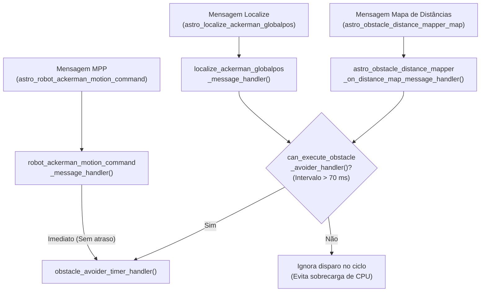
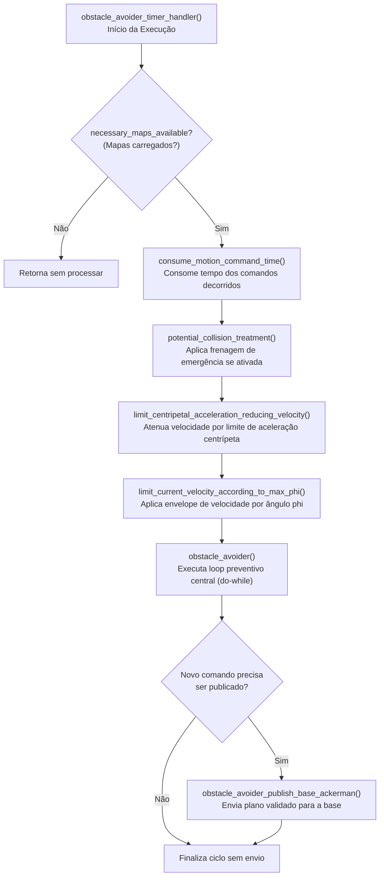

# Arquitetura e Fluxo Geral do Obstacle Avoider

Este documento detalha a arquitetura de software, o ciclo de vida e o modelo de execução orientado a eventos do módulo [`obstacle_avoider`](file:///home/lume/astro/src/obstacle_avoider/).

---

## 1. Modelo de Execução: Orientado a Eventos vs. Loop Periódico

Historicamente, o `obstacle_avoider` operava através de um timer periódico do IPC (`astro_ipc_addPeriodicTimer`) executando em frequência fixa (ex.: 20 Hz). No entanto, esse formato causava latência desnecessária entre a emissão de um novo plano pelo planejador e sua validação pelo freio de segurança.

Na arquitetura atual, o módulo adota um **modelo estritamente orientado a eventos** (definido no bloco `#else` da função [`main()`](file:///home/lume/astro/src/obstacle_avoider/obstacle_avoider_main.cpp#L2133-L2151)):

```c
// Em obstacle_avoider_main.cpp (L2144-L2147):
// astro_ipc_addPeriodicTimer(1.0 / freq, obstacle_avoider_timer_handler, NULL); // Comentado
astro_ipc_loop(shutdown_obstacle_avoider);
```

> [!NOTE]
> O timer periódico do IPC fica desativado por padrão. A função central [`obstacle_avoider_timer_handler()`](file:///home/lume/astro/src/obstacle_avoider/obstacle_avoider_main.cpp#L1211) é chamada diretamente pelos handlers de eventos sempre que novas informações críticas chegam ao módulo.

---

## 2. Os Três Gatilhos de Entrada (Handlers)

A validação de colisão e a emissão de comandos para a base são disparadas por **3 eventos principais**:



### Detalhamento dos Handlers:

| Handler | Mensagem de Entrada | Papel no Módulo | Política de Disparo |
| :--- | :--- | :--- | :--- |
| [`robot_ackerman_motion_command_message_handler`](file:///home/lume/astro/src/obstacle_avoider/obstacle_avoider_main.cpp#L1330) | `astro_robot_ackerman_motion_command_message` | Recebe o vetor de comandos $(v, \phi, \Delta t)$ gerado pelo MPP / Frenet. Armazena no buffer circular de trajetórias. | **Imediato:** O plano precisa ser validado no menor tempo possível para não atrasar a resposta da base. |
| [`localize_ackerman_globalpos_message_handler`](file:///home/lume/astro/src/obstacle_avoider/obstacle_avoider_main.cpp#L1396) | `astro_localize_ackerman_globalpos_message` | Atualiza a posição atual do caminhão e dos semirreboques. Executa o *Potential Collision* de emergência. | **Condicional:** Controlado por limitador de taxa (~14 Hz). |
| [`astro_obstacle_distance_mapper_on_distance_map_message_handler`](file:///home/lume/astro/src/obstacle_avoider/obstacle_avoider_main.cpp#L1588) | `astro_obstacle_distance_mapper_map_message` | Atualiza a matriz de distâncias aos obstáculos via memória compartilhada (*shared memory*). | **Condicional:** Controlado por limitador de taxa (~14 Hz). |

---

## 3. Mecanismo de Controle de Taxa (*Rate Limiter*)

Como o `localize` (GPS + Odometria) e o mapa de distâncias publicam mensagens em frequências elevadas (frequentemente 50 Hz ou mais), reavaliar o plano em cada mensagem recebida sobrecarregaria o processador sem ganho perceptível se o plano de trajetória não mudou.

Para solucionar isso, a função [`can_execute_obstacle_avoider_handler()`](file:///home/lume/astro/src/obstacle_avoider/obstacle_avoider_main.cpp#L1004-L1027) atua como um estrangulador de taxa:

```c
int can_execute_obstacle_avoider_handler()
{
    if (param_only_mpp == 1)
        return (0);

    double current_time = astro_get_time();

    // Permite que múltiplos handlers chamem o core, mas limita a taxa
    if ((current_time - executed_obstacle_avoider_handler_last_timestamp) > 0.07)
    {
        executed_obstacle_avoider_handler_last_timestamp = current_time;
        return (1);
    }
    return (0);
}
```

* **Janela temporal:** 70 milissegundos (~14,3 Hz).
* **Comportamento inteligente:** Quando o MPP envia um novo plano, ele **não consulta** essa função e dispara o `obstacle_avoider_timer_handler()` na hora. A janela de 70 ms serve apenas para controlar rechecagens baseadas em odometria e mapas.
* **Flag `-only_mpp on`:** Se ativada, bloqueia todas as chamadas vindas do GPS e do mapa, limitando o OA a agir apenas mediante novos planos.

---

## 4. Pipeline do `obstacle_avoider_timer_handler()`

Apesar do nome histórico (*timer handler*), esta função atua como o **orquestrador sequencial** de todas as regras de segurança do OA:



### Etapas Executadas em Ordem:

1. **`consume_motion_command_time()`**: Subtrai o tempo já transcorrido desde o início da execução do comando atual, mantendo a sincronia temporal da trajetória.
2. **`potential_collision_treatment()`**: Verifica se a simulação de emergência (calculada no handler do GPS) detectou colisão iminente com volante travado.
3. **`limit_centripetal_acceleration_reducing_velocity()`**: Modula a velocidade em trechos de curva acentuada para garantir que a aceleração centrípeta não exceda $1{,}05 \cdot a_{c,\max}$.
4. **`limit_current_velocity_according_to_max_phi()`**: Verifica a tabela spline de calibração para restringir a velocidade se o esterçamento $\phi$ for incompatível.
5. **`obstacle_avoider()`**: Executa a simulação física futura e atenua velocidades caso haja obstáculos no caminho do plano planejado.
6. **Publicação para `base_ackerman`**: Publica o plano apenas se houve intervenção (`needs_to_be_published == 1`) ou se o timestamp do plano do MPP mudou, evitando inundar o barramento com mensagens repetidas.

---

## 5. Watchdog de Ausência de Mensagens (*Fail-Safe*)

Para garantir que o veículo não continue se movendo caso algum nó do pipeline trave ou perca comunicação, existe a função [`check_message_absence_timeout_timer_handler()`](file:///home/lume/astro/src/obstacle_avoider/obstacle_avoider_main.cpp#L1307-L1326):

```c
void check_message_absence_timeout_timer_handler(void)
{
    if (log_mode) return;

    // 1. Timeout de Odometria / Sensores
    if ((astro_robot_ackerman_sensor_time_of_last_update >= 0.0) &&
        ((astro_get_time() - astro_robot_ackerman_sensor_time_of_last_update) > robot_sensor_timeout))
    {
        publish_base_ackerman_motion_command_message_to_stop_robot();
    }

    // 2. Timeout de Comandos do MPP
    if ((astro_robot_ackerman_motion_command_time_of_last_update >= 0.0) &&
        (((astro_get_time() - astro_robot_ackerman_motion_command_time_of_last_update) - last_motion_command_total_time) > command_timeout))
    {
        publish_base_ackerman_motion_command_message_to_stop_robot();
    }
}
```

* **Perda de Odometria (`robot_sensor_timeout`):** Se a pose global parar de atualizar, o veículo não sabe onde está e é freado imediatamente.
* **Perda do Planejador (`command_timeout`):** Se o MPP parar de enviar planos por mais tempo do que a duração do último plano somada à tolerância de timeout, o OA assume falha e envia comando de parada total.

---

## 6. Compensação de Latência de Atuadores

Na saída para o `base_ackerman`, a função [`obstacle_avoider_publish_base_ackerman_motion_command()`](file:///home/lume/astro/src/obstacle_avoider/obstacle_avoider_main.cpp#L860-L900) oferece suporte à compensação de latência (`new_latency_control`).

Como atuadores hidráulicos de direção e sistemas de freio possuem tempos de resposta física não desprezíveis:
* A função [`apply_robot_delays()`](file:///home/lume/astro/src/obstacle_avoider/obstacle_avoider_main.cpp#L876) desloca temporalmente os pontos do perfil de velocidade e esterçamento;
* Garante que o comando enviado para a base antecipe o atraso intrínseco do caminhão físico, sincronizando a trajetória real com o tempo simulado pelo OA.

