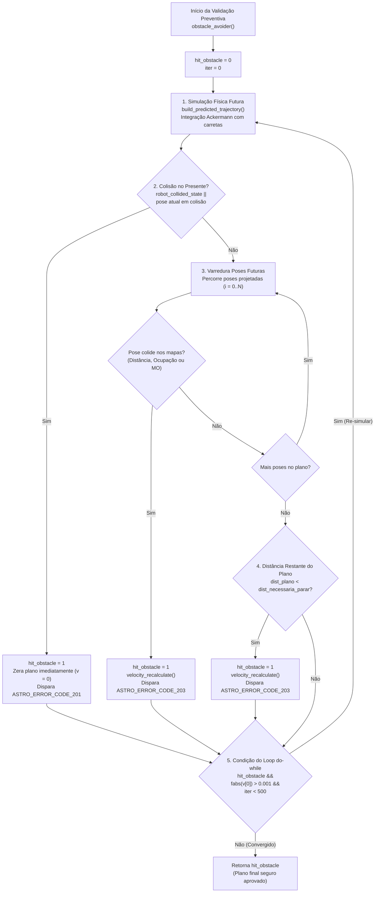

# Planejamento Preventivo e Loop Central de Validação

Este documento detalha o funcionamento do **algoritmo de validação preventiva de colisão**, implementado principalmente na função [`obstacle_avoider()`](file:///home/lume/astro/src/obstacle_avoider/obstacle_avoider.cpp#L1296-L1416) em [`src/obstacle_avoider/obstacle_avoider.cpp`](file:///home/lume/astro/src/obstacle_avoider/obstacle_avoider.cpp).

---

## 1. Conceito e Objetivo do Planejamento Preventivo

O planejador de caminhos ([MPP / Frenet](file:///home/lume/astro/src/mpp/)) gera uma sequência de comandos de controle composta por $(v_i, \phi_i, \Delta t_i)$. No entanto, o `obstacle_avoider` não pode apenas confiar nas coordenadas teóricas do planejador, pois:
1. O caminhão real opera em conjunto com **semirreboques (carretas)**, cujo arraste angular (*off-tracking*) varia com a curvatura e a velocidade;
2. Novos obstáculos dinâmicos ou estáticos podem ter surgido nos mapas desde que o MPP iniciou sua computação;
3. O veículo pode estar se deslocando mais rápido do que a distância planejada permite para uma frenagem suave.

O **Planejamento Preventivo** consiste em pegar esses comandos do MPP, integrá-los no modelo físico do caminhão a partir da posição real atual e verificar se há qualquer obstáculo no envelope espacial que o caminhão ocupará. Caso haja, o OA atenua progressivamente a velocidade até garantir a parada segura antes do impacto.

---

## 2. Fluxograma do Loop de Convergência (`do-while`)

A validação preventiva ocorre dentro de um loop de simulação e recálculo iterativo:



---

## 3. Simulação Física Futura: `build_predicted_trajectory()`

Antes de qualquer teste geométrico nos mapas, a função [`build_predicted_trajectory()`](file:///home/lume/astro/src/obstacle_avoider/obstacle_avoider.cpp#L758-L798) projeta a trajetória física do veículo:

```c
// Em obstacle_avoider.cpp (L769-L788):
for (i = 0; i < *num_motion_commands; i++)
{
    double distance_traveled = 0.0;
    pose = astro_libcarmodel_recalc_pos_ackerman(&pose, motion_commands_vector[i].v, motion_commands_vector[i].phi,
            motion_commands_vector[i].time, &distance_traveled, motion_commands_vector[i].time,
            astro_robot_ackerman_config, astro_semi_trailer_config);

    motion_commands_vector[i].x = pose.x;
    motion_commands_vector[i].y = pose.y;
    motion_commands_vector[i].theta = pose.theta;
    motion_commands_vector[i].num_trailers = pose.num_trailers;

    for (size_t z = 0; z < MAX_NUM_TRAILERS; z++)
        motion_commands_vector[i].trailer_theta[z] = pose.trailer_theta[z];

    trajectory_vector_of_points[trajectory_vector_of_points_size] = pose;
    trajectory_vector_of_points_size++;
}
```

* **Origem da Simulação:** A pose inicial é a posição atual real medida pelo sistema de localização ([`pose_vector[pose_index]`](file:///home/lume/astro/src/obstacle_avoider/obstacle_avoider.cpp#L1310)).
* **Modelo Cinemático:** Utiliza `astro_libcarmodel_recalc_pos_ackerman()` para calcular não só o cavalo mecânico, mas propagar o ângulo de articulação de cada semirreboque (`trailer_theta[z]`).
* **Saída:** O vetor global `trajectory_vector_of_points` é preenchido com as coordenadas precisas de cada pose futura.

---

## 4. Checagem de Colisão no Presente / Passado

A primeira validação avalia se o caminhão **já está em colisão agora**:

```c
astro_collision_detection_collision_result collision_result = astro_collision_detection_compute_maps_collision(maps_obstacle_avoider, pose_vector[pose_index]);

if (robot_collided_with_obstacle_state || collision_result.has_collision)
{
    if ((check_collided_robot == 1) && (robot_collided_with_obstacle_state == 0) && (fabs(pose_vector[pose_index].v) > 0.001) && (manual_override == 0))
    {
        astro_global_publish_astro_error_message(ASTRO_ERROR_CODE_201);
        ASTRO_ERROR_METADATA("ASTRO_ERROR_CODE_201", "Foi identificada que uma colisão ocorreu durante movimento do veículo. Esse estado é considerado um erro do sistema.");
    }

    hit_obstacle = 1;

    for (int i = 0; i < *num_motion_commands; i++)
    {
        motion_commands_vector[i].time = 1.0;
        motion_commands_vector[i].v = 0.0;
    }
}
```

### Regras de Atuação:
1. **Flag Persistente (`robot_collided_with_obstacle_state`):** Se em um ciclo anterior foi atestado estado de colisão física, o módulo impede qualquer avanço futuro.
2. **Pose Atual em Colisão (`collision_result.has_collision`):** Se o envelope do veículo intersectar qualquer obstáculo no mapa na sua posição atual.
3. **Ação Imediata:** Todas as velocidades do vetor de comandos são zeradas (`v = 0.0; time = 1.0`). Não há recálculo progressivo aqui, pois a colisão é presente.
4. **Alarme Crítico (`ASTRO_ERROR_CODE_201`):** Se o veículo estava em movimento quando colidiu, publica o código de erro 201 indicando falha grave.

---

## 5. Checagem das Poses Futuras no Mapa

Se o veículo estiver livre no presente, o código entra no laço que inspeciona cada uma das poses projetadas $i \in [0, N-1]$ da trajetória futura:

```c
astro_collision_detection_collision_result result = astro_collision_detection_compute_maps_collision(maps_obstacle_avoider, trajectory_vector_of_points[i]);

if (result.has_collision)
{
    velocity_recalculate(motion_commands_vector, *num_motion_commands);
    hit_obstacle = 1;
    set_new_motion_command_needs_to_be_published(1);

    EXEC_COOLDOWN(astro_global_publish_astro_error_message_custom_string(ASTRO_ERROR_CODE_203, custom_string), 0.5);
    break;
}
```

Ao encontrar qualquer colisão futura:
1. Dispara o recálculo progressivo através de [`velocity_recalculate()`](file:///home/lume/astro/src/obstacle_avoider/obstacle_avoider.cpp#L1262);
2. Seta `hit_obstacle = 1` e marca a flag de publicação para a base;
3. Publica o erro **`ASTRO_ERROR_CODE_203`** via telemetria com *cooldown* de 0,5 s;
4. Interrompe a varredura das poses restantes (`break`) para iniciar imediatamente a próxima iteração do `do-while`.

---

## 6. Critério de Distância de Frenagem Segura

Mesmo que nenhuma pose futura toque em um obstáculo, o plano pode ser perigoso se for muito curto para a velocidade com que o caminhão está se deslocando.

Controlado pelo parâmetro `obstacle_avoider_recalculate_velocity_when_braking_distance_exceeds_plan`:

```c
double distance_necessary_to_stop = pow(current_odometry_velocity, 2) / (2.0 * astro_robot_ackerman_config->maximum_deceleration_forward);

if (distance_remaining_in_current_plan < distance_necessary_to_stop)
{
    velocity_recalculate(motion_commands_vector, *num_motion_commands);
    hit_obstacle = 1;
    set_new_motion_command_needs_to_be_published(1);

    sprintf(custom_string, "Stop dist %.2fm > plano %.2fm; vel %.2fm/s; dec: %.2fm/s^2",
            distance_necessary_to_stop, distance_remaining_in_current_plan,
            current_odometry_velocity, astro_robot_ackerman_config->maximum_deceleration_forward);
    EXEC_COOLDOWN(astro_global_publish_astro_error_message_custom_string(ASTRO_ERROR_CODE_203, custom_string), 0.5);
}
```

Pela cinemática:
$$d_{\text{stop}} = \frac{v_{\text{odometria}}^2}{2 \cdot a_{\max}}$$

Onde $a_{\max}$ é a desaceleração máxima configurada (`maximum_deceleration_forward`). Se o comprimento total do plano $\sum \Delta s_i$ for menor que $d_{\text{stop}}$, o veículo não conseguirá parar com a desaceleração máxima permitida caso o plano termine abruptamente. O OA então aciona `velocity_recalculate()` para desacelerar o caminhão preventivamente.

---

## 7. O Algoritmo de Atenuação: `velocity_recalculate()`

A função [`velocity_recalculate()`](file:///home/lume/astro/src/obstacle_avoider/obstacle_avoider.cpp#L1262-L1292) é o núcleo matemático de atenuação suave do plano:

```c
void velocity_recalculate(astro_robot_and_trailers_motion_command_t *motion_commands_vector, int num_motion_commands)
{
    int i;
    double reduction_factor = 0.95;

    for (i = 0; i < num_motion_commands; i++)
    {
        if (i != 0)
        {
            reduction_factor *= 0.95;
        }

        motion_commands_vector[i].v *= reduction_factor;
        motion_commands_vector[i].time *= 1.0 / reduction_factor;

        if (fabs(motion_commands_vector[i].v) < 0.05)
        {
            motion_commands_vector[i].time = 1.0;
            motion_commands_vector[i].v = 0.0;
            break;
        }
    }

    for (; i < num_motion_commands; i++)
    {
        motion_commands_vector[i].time = 1.0;
        motion_commands_vector[i].v = 0.0;
    }
}
```

### Características Matemáticas Importantes:
1. **Decaimento Exponencial:** A cada ponto subsequente do plano, a atenuação é multiplicada por $0{,}95$. O ponto $i = 0$ recebe $0{,}95$, o ponto $i = 1$ recebe $0{,}95^2 \approx 0{,}9025$, e assim por diante. Isso gera um perfil de desaceleração suave e natural.
2. **Compensação Temporal:** Ao mesmo tempo em que a velocidade é multiplicada por $\text{factor}$, o tempo $\Delta t$ é multiplicado por $\frac{1}{\text{factor}}$. Como $\Delta s \approx v \cdot \Delta t$, essa compensação assegura que o percurso geométrico percorrido se mantenha coerente enquanto a velocidade cai.
3. **Limiar de Corte ($0{,}05\,\text{m/s}$):** Assim que a velocidade de qualquer ponto cai abaixo de $0{,}05\,\text{m/s}$ ($\approx 0{,}18\,\text{km/h}$), o comando é truncado para zero (`v = 0.0; time = 1.0`) e todos os comandos posteriores são zerados.

---

## 8. Dinâmica de Convergência do Loop `do-while`

O loop continua executando sob a seguinte condição:
```c
do {
    // 1. build_predicted_trajectory()
    // 2. checa colisões e distâncias
    // 3. velocity_recalculate() se necessário
    iter++;
} while (hit_obstacle && (fabs(motion_commands_vector[0].v) > 0.001) && (iter < 500));
```

A cada iteração em que `velocity_recalculate()` é chamado, as velocidades do vetor diminuem. Com velocidades menores, a função [`build_predicted_trajectory()`](file:///home/lume/astro/src/obstacle_avoider/obstacle_avoider.cpp#L758) calcula deslocamentos menores para o mesmo horizonte temporal:

$$\Delta s_i = v_i \cdot \Delta t_i$$

Isso faz com que o caminho simulado **"encolha" espacialmente** a cada volta do loop. O encolhimento continua até que:
* **Caso Ideal:** A trajetória desacelerada para antes de alcançar o obstáculo (`hit_obstacle == 0`). O loop termina e o plano seguro com velocidade reduzida é publicado.
* **Caso Extremo (Obstáculo Muito Próximo):** A velocidade cai progressivamente até a primeira pose zerar ($v_0 \le 0{,}001\,\text{m/s}$), forçando a parada total do veículo no local.
* **Proteção contra loop infinito:** Teto máximo de 500 iterações.

