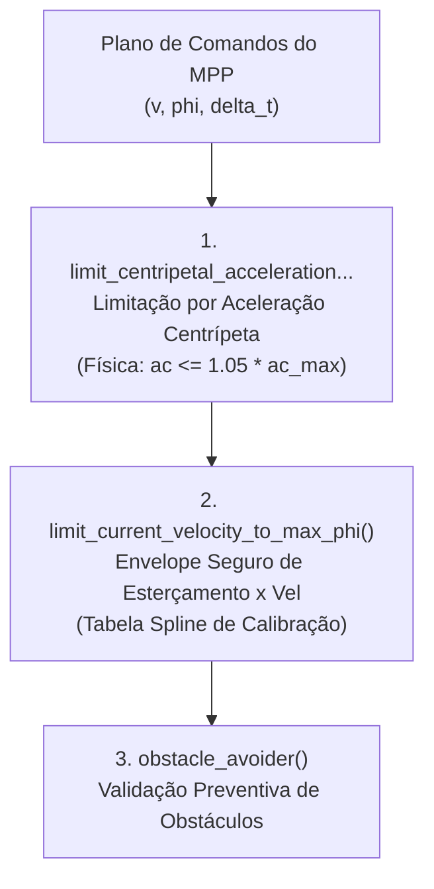
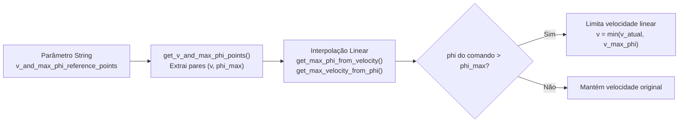

# Restrições de Dinâmica Veicular e Estabilidade Lateral

Este documento descreve os mecanismos implementados no [`obstacle_avoider`](file:///home/lume/astro/src/obstacle_avoider/) para garantir a **estabilidade dinâmica lateral** do caminhão e dos semirreboques.

---

## 1. Por que essas restrições estão no Obstacle Avoider?

Embora o planejador de trajetória ([MPP](file:///home/lume/astro/src/mpp/)) gere planos suaves, o `obstacle_avoider` atua como a **última barreira de segurança física** antes do envio dos comandos para a base.

Em veículos comerciais pesados (especialmente cavalos mecânicos atrelados a semirreboques):
* O centro de gravidade (CG) é elevado quando carregado;
* Curvas fechadas executadas em velocidades inadequadas geram risco iminente de **tombamento (*rollover*)** ou **efeito canivete (*jackknifing*)**;
* O esterçamento rápido em alta velocidade pode causar instabilidade no reboque por amplificação traseira (*rearward amplification*).

Por isso, dentro da função [`obstacle_avoider_timer_handler()`](file:///home/lume/astro/src/obstacle_avoider/obstacle_avoider_main.cpp#L1211), **antes** de testar qualquer obstáculo no mapa, o plano é submetido a dois filtros de dinâmica:



---

## 2. Limitação de Aceleração Centrípeta

A função [`limit_centripetal_acceleration_reducing_velocity()`](file:///home/lume/astro/src/obstacle_avoider/obstacle_avoider.cpp#L286-L314) calcula a aceleração lateral teórica gerada por cada comando de esterçamento do plano:

```c
// Em obstacle_avoider.cpp (L290-L311):
if (fabs(motion_commands_vector[i].phi) > 0.001)
{
    double radius_of_curvature = distance_between_front_and_rear_axles / fabs(tan(motion_commands_vector[i].phi));
    double centripetal_acceleration = (current_velocity * current_velocity) / radius_of_curvature;

    if (centripetal_acceleration > (1.05 * robot_max_centripetal_acceleration))
    {
        double v_for_centripetal = sqrt(robot_max_centripetal_acceleration * radius_of_curvature);

        if (motion_commands_vector[i].v < 0.0)
            v_for_centripetal = -v_for_centripetal;

        motion_commands_vector[i].time *= (1 - (v_for_centripetal / motion_commands_vector[i].v)) + 1;
        motion_commands_vector[i].v = v_for_centripetal;
        set_new_motion_command_needs_to_be_published(1);
    }
}
```

### 2.1. Formulação Matemática
1. **Raio de Curvatura ($R$):**
   Utilizando o modelo cinemático de bicicleta com distância entre eixos $L$ (`distance_between_front_and_rear_axles`):
   $$R = \frac{L}{|\tan(\phi_i)|}$$

2. **Aceleração Centrípeta Estimada ($a_c$):**
   $$a_c = \frac{v_{\text{atual}}^2}{R}$$

3. **Critério de Corte (Margem de 5%):**
   Se $a_c > 1{,}05 \cdot a_{c,\max}$ (onde $a_{c,\max}$ é o parâmetro do robô `robot_max_centripetal_acceleration`):
   * O módulo calcula a velocidade limite exata que satisfaz a aceleração máxima:
     $$v_{\text{lim}} = \sqrt{a_{c,\max} \cdot R}$$
   * Preserva o sinal de avanço ou marcha ré ($v < 0$);
   * Ajusta o tempo do comando proporcionalmente para manter a coerência espacial:
     $$\Delta t \leftarrow \Delta t \cdot \left(1 - \frac{v_{\text{lim}}}{v_{\text{orig}}} + 1\right)$$
   * Atribui $v_i \leftarrow v_{\text{lim}}$ e sinaliza para publicação imediata.

---

## 3. Envelope de Velocidade por Ângulo $\phi$ (*Spline de Calibração*)

Além da física teórica centrípeta, cada tipo de veículo (especialmente implementos de mineração ou caminhões articulados pesados) possui faixas práticas de esterçamento seguro determinadas por calibração de fábrica.

A função [`limit_current_velocity_according_to_max_phi()`](file:///home/lume/astro/src/obstacle_avoider/obstacle_avoider.cpp#L416-L483) impõe uma **tabela/spline de limites empíricos**:



### 3.1. Formato do Parâmetro de Calibração
Configurado via `.ini` através de `obstacle_avoider_v_and_max_phi_reference_points`:
```text
obstacle_avoider_v_and_max_phi_reference_points 3 1.5 100% 2.0 50% 3.5 0.2
```
A string segue a sintaxe:
$$\text{N} \quad v_1 \quad \phi_1 \quad v_2 \quad \phi_2 \quad \dots \quad v_N \quad \phi_N$$
* **$N$:** Quantidade de pontos de calibração;
* **$\phi$:** Pode ser expresso em radianos diretos (ex.: `0.2`) ou como porcentagem do ângulo máximo do caminhão (ex.: `100%`, `50%` de `robot_max_steering_angle`).

**Exemplo Prático de Interpretação:**
* Até $1{,}5\,\text{m/s}$ ($\approx 5{,}4\,\text{km/h}$): esterçamento total permitido ($100\%$ de $\phi_{\max}$);
* A $2{,}0\,\text{m/s}$ ($\approx 7{,}2\,\text{km/h}$): esterçamento limitado a $50\%$;
* A $3{,}5\,\text{m/s}$ ($\approx 12{,}6\,\text{km/h}$): esterçamento estritamente limitado a $0{,}2\,\text{rad}$ ($\approx 11{,}5^\circ$).

### 3.2. Interpolação e Modulação
Dada a velocidade linear de cada comando do plano, o algoritmo interpola linearmente entre os dois nós adjacentes da tabela:
* Se $|\phi_i| > \phi_{\max}(v_i)$, a velocidade permitida é reduzida para $v_{\text{novo}} = \min(v_i, v_{\max}(\phi_i))$;
* O tempo $\Delta t$ é ajustado proporcionalmente para conservar a distância percorrida;
* A primeira alteração é armazenada para fins de diagnóstico e telemetria.

---

## 4. Modos de Operação: Intervenção Ativa vs. Auditoria

O comportamento do sistema mediante violação do envelope de esterçamento é governado pelo parâmetro:

```text
obstacle_avoider_use_hold_velocity_to_reference_phi [on|off]
```

| Configuração | Ação no Plano de Movimento | Diagnóstico e Alarme |
| :---: | :--- | :--- |
| **`on` (Ativo)** | **Modifica o plano:** reduz efetivamente a velocidade enviada para a `base_ackerman`. | Publica **`ASTRO_ERROR_CODE_205`** no barramento com cooldown de 0,5 s: *"Ângulo de articulação (phi) excedeu o limite seguro para a velocidade atual..."* |
| **`off` (Passivo / Auditoria)** | **Não altera o plano:** o veículo prossegue na velocidade planejada pelo MPP. | Registra a ocorrência na telemetria de auditoria via [`send_hold_velocity_to_reference_phi_info_to_audit()`](file:///home/lume/astro/src/obstacle_avoider/obstacle_avoider.cpp#L406-L413). |

> [!TIP]
> O modo passivo (`off`) é frequentemente utilizado durante etapas de validação em campo para coletar métricas de manobra sem interferir na dirigibilidade do planejador.

