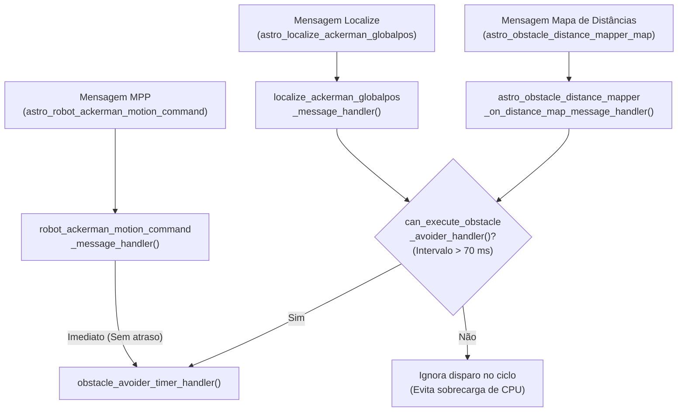
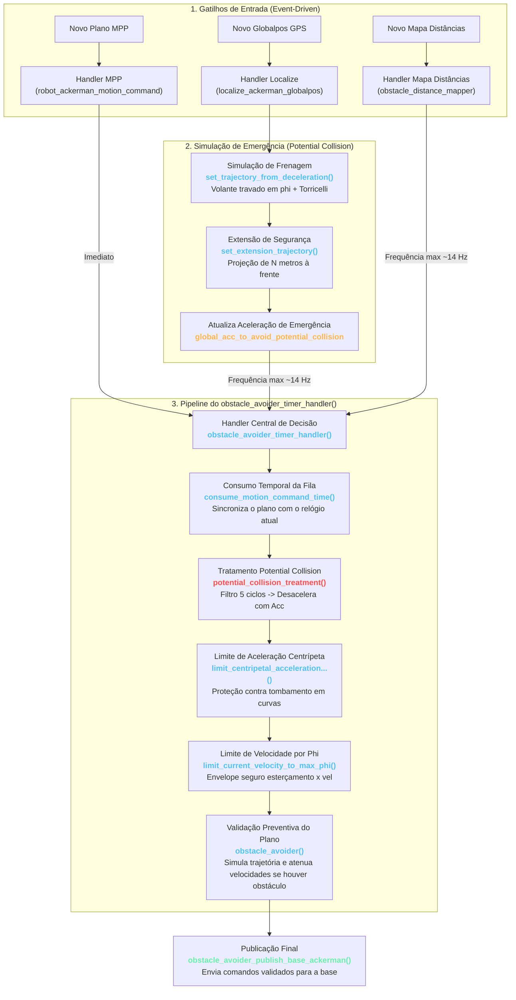

# Arquitetura e Fluxo Geral do Obstacle Avoider

No [`main()`](file:///home/lume/astro/src/obstacle_avoider/obstacle_avoider_main.cpp#L2285-L2322) do `obstacle_avoider`, existe a possibilidade de o módulo atuar em uma frequência fixa chamando periodicamente a função principal [`obstacle_avoider_timer_handler()`](file:///home/lume/astro/src/obstacle_avoider/obstacle_avoider_main.cpp#L1359) via timer do IPC. Porém, como essa funcionalidade está comentada no código, **o módulo funciona exclusivamente através dos seus handlers de mensagens**:

```c
// Em obstacle_avoider_main.cpp:
// astro_ipc_addPeriodicTimer(1.0 / astro_obstacle_avoider_collision_avoidance_frequency, (TIMER_HANDLER_TYPE) obstacle_avoider_timer_handler, NULL);
// astro_ipc_addPeriodicTimer(1.0 / astro_obstacle_avoider_collision_avoidance_frequency, (TIMER_HANDLER_TYPE) check_message_absence_timeout_timer_handler, NULL);

astro_ipc_loop(shutdown_obstacle_avoider);
```

---

## 1. Os Três Gatilhos de Entrada (Handlers)

A validação de colisão e a emissão de comandos para a base são disparadas por **3 eventos principais**:



### Detalhamento dos Handlers:

| Handler | Mensagem de Entrada | Papel no Módulo | Política de Disparo |
| :--- | :--- | :--- | :--- |
| [`robot_ackerman_motion_command_message_handler`](file:///home/lume/astro/src/obstacle_avoider/obstacle_avoider_main.cpp#L1330) | `astro_robot_ackerman_motion_command_message` | Recebe o vetor de comandos $(v, \phi, \Delta t)$ gerado pelo MPP / Frenet. Armazena no buffer circular de trajetórias. | **Imediato:** O plano precisa ser validado no menor tempo possível para não atrasar a resposta da base. |
| [`localize_ackerman_globalpos_message_handler`](file:///home/lume/astro/src/obstacle_avoider/obstacle_avoider_main.cpp#L1553) | `astro_localize_ackerman_globalpos_message` | Atualiza a posição atual do caminhão e dos semirreboques. Executa a desaceleração preventiva com $\phi$ fixo ([`06_desaceleracao_preventiva_phi_fixo.md`](06_desaceleracao_preventiva_phi_fixo.md)). | **Condicional:** Controlado por limitador de taxa (~14 Hz). |
| [`astro_obstacle_distance_mapper_on_distance_map_message_handler`](file:///home/lume/astro/src/obstacle_avoider/obstacle_avoider_main.cpp#L1588) | `astro_obstacle_distance_mapper_map_message` | Atualiza a matriz de distâncias aos obstáculos via memória compartilhada (*shared memory*). | **Condicional:** Controlado por limitador de taxa (~14 Hz). |

---

## 2. Mecanismo de Controle de Taxa (*Rate Limiter*)

Como o `localize` (GPS + Odometria) e o mapa de distâncias publicam mensagens em frequências elevadas (frequentemente 50 Hz ou mais), reavaliar o plano em cada mensagem recebida sobrecarregaria o processador sem ganho perceptível se o plano de trajetória não mudou.

Para solucionar isso, a função [`can_execute_obstacle_avoider_handler()`](file:///home/lume/astro/src/obstacle_avoider/obstacle_avoider_main.cpp#L1004-L1027) atua como um estrangulador de taxa:

```c
int can_execute_obstacle_avoider_handler()
{
    if (param_only_mpp == 1)
        return (0);

    double current_time = astro_get_time();

    // Permite que múltiplos handlers chamem o core, mas limita a taxa
    if ((current_time - executed_obstacle_avoider_handler_last_timestamp) > 0.07)
    {
        executed_obstacle_avoider_handler_last_timestamp = current_time;
        return (1);
    }
    return (0);
}
```

* **Janela temporal:** 70 milissegundos (~14,3 Hz).
* **Comportamento inteligente:** Quando o MPP envia um novo plano, ele **não consulta** essa função e dispara o `obstacle_avoider_timer_handler()` na hora. A janela de 70 ms serve apenas para controlar rechecagens baseadas em odometria e mapas.
* **Flag `-only_mpp on`:** Se ativada, bloqueia todas as chamadas vindas do GPS e do mapa, limitando o OA a agir apenas mediante novos planos.

---

## 3. Diagrama Macro Integrado de Fluxo

O sistema opera de forma orientada a eventos. O fluxo geral de avaliação e os blocos principais que alteram o plano seguem o pipeline abaixo:



### Etapas Principais Executadas no `obstacle_avoider_timer_handler()`:

1. **[`consume_motion_command_time()`](05_consumo_temporal_e_sincronizacao.md)**: Subtrai o tempo já transcorrido desde a última atualização, mantendo a sincronia temporal da trajetória e compensando a latência do MPP.
2. **[`potential_collision_treatment()`](08_atuacao_potential_collision_treatment.md)**: Verifica se a simulação de emergência (calculada no handler do `localize`) confirmou colisão iminente por 5 ciclos e desacelera o plano.
3. **[`limit_centripetal_acceleration_reducing_velocity()`](04_restricoes_dinamica_veiculo.md)**: Modula a velocidade em trechos de curva acentuada para garantir que a aceleração centrípeta não exceda $1{,}05 \cdot a_{c,\max}$.
4. **[`limit_current_velocity_according_to_max_phi()`](04_restricoes_dinamica_veiculo.md)**: Restringe a velocidade caso o ângulo de esterçamento $\phi$ exija velocidade menor.
5. **[`obstacle_avoider()`](02_planejamento_preventivo.md)**: Executa a simulação física futura do plano do MPP e atenua as velocidades caso haja obstáculos no caminho.
6. **Publicação para `base_ackerman`**: Envia o plano validado/modificado para o controle de baixo nível.

---

## 5. Códigos de Erro Emitidos

O módulo publica os seguintes erros no barramento do sistema (`ASTRO_ERROR_CODE`):

* **`ASTRO_ERROR_CODE_201`**: Colisão identificada na pose atual enquanto o veículo estava em movimento (estado crítico de colisão real).
* **`ASTRO_ERROR_CODE_203`**: Colisão futura identificada no plano do MPP ou espaço insuficiente para frenagem até o destino.
* **`ASTRO_ERROR_CODE_204`**: Colisão detectada na simulação de emergência (*potential collision* ou extensão).
* **`ASTRO_ERROR_CODE_205`**: Ângulo de esterçamento $\phi$ excedeu o envelope seguro para a velocidade atual.

---