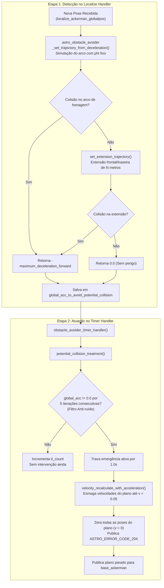
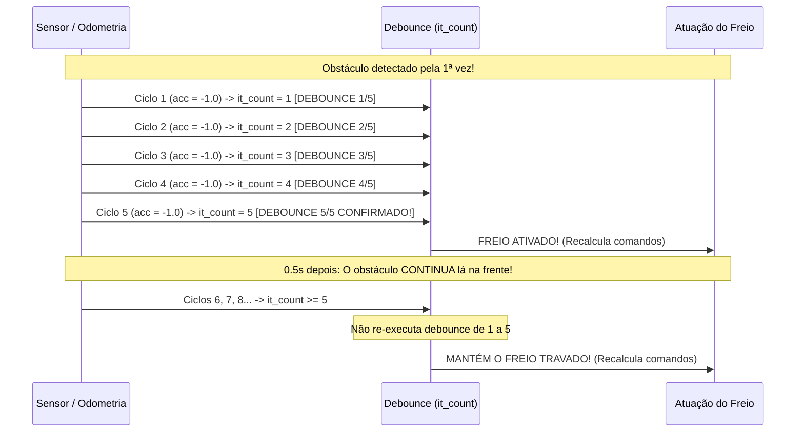

# Planejamento de Emergência: Potential Collision

Este documento detalha o mecanismo de **frenagem de emergência por colisão potencial** (*Potential Collision*), projetado para proteger o caminhão autônomo contra falhas repentinas de comunicação, perda de novos planejamentos ou situações em que o veículo não tem tempo de aguardar a reavaliação de longo prazo.

---

## 1. O Conceito Fundamental

Enquanto a validação preventiva ([`docs/02_planejamento_preventivo.md`](02_planejamento_preventivo.md)) avalia o plano futuro completo gerado pelo MPP (com curvaturas que variam ao longo do trajeto), o **Potential Collision** formula uma hipótese crítica e pessimista:

> *"Se o planejador parar de atualizar o plano ou se o sistema travar agora, mantendo o ângulo do volante atual ($\phi$) e a velocidade atual ($v$), o veículo conseguirá frear com a desaceleração máxima até parar completamente sem colidir com nenhum obstáculo?"*

Se a resposta a essa pergunta for **NÃO** (ou seja, a curva de parada cruza algum obstáculo no mapa), o veículo aciona o protocolo de emergência imediatamente: esmaga todas as velocidades do plano atual para zero e força a parada total do veículo.

---

## 2. Fluxo Geral de Emergência

O processo ocorre em duas etapas: cálculo no handler do GPS e atuação no handler central:



---

## 3. A Física da Simulação: `astro_obstacle_avoider_set_trajectory_from_deceleration()`

> [!TIP]
> **Estudo Aprofundado com Dados Reais de Telemetria:**  
> Para uma análise passo a passo da integração por Torricelli ($d \propto v^2$) e validação com os logs de pista de parada da cabine e carretas, consulte o documento dedicado [`06_desaceleracao_preventiva_phi_fixo.md`](06_desaceleracao_preventiva_phi_fixo.md).

Implementada em [`src/obstacle_avoider/obstacle_avoider.cpp`](file:///home/lume/astro/src/obstacle_avoider/obstacle_avoider.cpp#L1308-L1401):

```c
// Em obstacle_avoider.cpp (L1220-L1240):
while (fabs(current_velocity) > 0.0)
{
    iterative_pose = astro_libcarmodel_recalc_pos_ackerman(&iterative_pose, vel_sign * 0.5, odometry_phi,
            full_time_interval, &distance_traveled, delta_t, &astro_robot_ackerman_config, &astro_semi_trailer_config);

    current_velocity = vel_sign * compute_final_velocity_using_torricelli(current_velocity,
            -astro_robot_ackerman_config.maximum_deceleration_forward, DIST2D(iterative_pose, prev_pose));

    iterative_pose.phi = odometry_phi;
    iterative_pose.v = current_velocity;

    poses_vector.push_back(iterative_pose);
    total_distance_traveled += DIST2D(iterative_pose, prev_pose);

    returned_acc = check_collision_in_trajectory(iterative_pose, astro_robot_ackerman_config,
            occupancy_map, astro_robot_ackerman_config.obstacle_avoider_obstacles_safe_distance, vel_sign, total_distance_traveled, timestamp);

    if ((fabs(returned_acc) > EPSILON_OB) || (total_distance_traveled >= 50.0))
    {
        break;
    }

    distance_traveled = 0;
    prev_pose = iterative_pose;
}
```

### 3.1. O Método de Euler com Velocidade Alvo Virtual ($\pm 0{,}5\,\text{m/s}$)
* O código adota `full_time_interval = 0.1s` e `delta_t = 0.05s`. A cada iteração macro de $0{,}1\,\text{s}$, são executados $n = 2$ micro-passos do método de Euler em `astro_libcarmodel_recalc_pos_ackerman()`.
* No modelo cinemático, a aceleração de transição é calculada por:
  $$a = \frac{v_{\text{alvo}} - v_{\text{atual}}}{\Delta t}$$
* A velocidade alvo é fixada arbitrariamente em `vel_sign * 0.5`. O objetivo dessa velocidade virtual não é avaliar a aceleração em si, mas sim **gerar com precisão geométrica o arco de curvatura espacial** que o caminhão e suas carretas descreverão ao manter o volante fixo em `odometry_phi`.

### 3.2. Recálculo da Velocidade Real pela Equação de Torricelli
Assim que a nova pose espacial é encontrada, a velocidade real do caminhão é recalculada através da cinemática clássica pela função [`compute_final_velocity_using_torricelli()`](file:///home/lume/astro/src/obstacle_avoider/obstacle_avoider.cpp#L952-L963):

$$v^2 = v_0^2 + 2 \cdot a \cdot \Delta s \implies v = \sqrt{v_0^2 + 2 \cdot a \cdot \Delta s}$$

Onde:
* $v_0$ é a velocidade do passo anterior;
* $a = -a_{\max}$ (onde $a_{\max}$ é o parâmetro `maximum_deceleration_forward`, ou positivo se em marcha ré via `maximum_deceleration_reverse`);
* $\Delta s = \text{DIST2D}(p_{\text{atual}}, p_{\text{anterior}})$ é o deslocamento percorrido naquele micro-passo.

Se $v^2 \le 0$, a função retorna $0{,}0\,\text{m/s}$, indicando que o veículo atingiu a parada total.

### 3.3. Checagem Multi-Mapas e Interrupção Antecipada (`break`)
A cada passo projetado, a função [`check_collision_in_trajectory()`](file:///home/lume/astro/src/obstacle_avoider/obstacle_avoider.cpp#L995-L1040) valida a pose contra:
1. Mapa de distâncias e áreas com geometria personalizada (`maps_obstacle_avoider`);
2. Mapa de ocupação binário (`occupancy_map`);
3. Nuvens de pontos de objetos móveis (`moving_objects`).

Caso detecte colisão em qualquer uma dessas fontes:
* Retorna imediatamente `returned_acc = -maximum_deceleration_forward` (ou positiva em ré);
* Interrompe o loop de simulação na hora (`break;`), sem precisar computar o restante da curva até a parada;
* Limite de segurança: se a distância percorrida atingir $50{,}0\,\text{m}$ sem colisões, a simulação também encerra (`break;`).

---

## 4. A Fase de Extensão: `set_extension_trajectory_from_deceleration()`

Mesmo que a curva de frenagem até a parada completa não toque em nenhum obstáculo, parar a poucos centímetros de um obstáculo é inaceitável para a segurança operacional.

Por isso, se o veículo conseguiu parar com segurança, o OA aciona a **extensão do potential collision** ([`set_extension_trajectory_from_deceleration()`](file:///home/lume/astro/src/obstacle_avoider/obstacle_avoider.cpp#L1136-L1195)):

* **O que faz:** A partir da pose onde o veículo parou, estende mais $N$ metros à frente (parâmetro `obstacle_avoider_potential_collision_extension_length`, padrão **3,0 metros**) mantendo o mesmo $\phi$ travado e velocidade virtual de direção (`motion_desired * 0.5`).
* **Se colidir na extensão:** Retorna `-maximum_deceleration_forward`, forçando a frenagem do veículo com antecedência para preservar uma margem de amortecimento (*buffer*).

### 4.1. Ajuste Fino no Final Goal (Atracamento / Docas)
Em manobras de precisão onde o destino final (`final_goal`) fica propositalmente encostado em uma parede, doca ou balança, uma extensão rígida de 3 metros impediria o caminhão de completar a operação.

Controlado pelo parâmetro `obstacle_avoider_potential_collision_use_final_goal_implementation`:
```c
// Em obstacle_avoider_main.cpp (L1475-L1490):
desired_distance_to_obstacle = astro_fmax(0.6 * distance_between_final_goal_and_obstacle, distance_to_compare);
```
* A extensão é encurtada gradualmente conforme o veículo se aproxima do objetivo final.
* O limite inferior é fixado em **60% da distância livre** entre o *final goal* e o obstáculo frontal, permitindo o atracamento seguro sem travamentos indevidos.

---

## 5. O Filtro Anti-Ruído e Atuação: `potential_collision_treatment()`

Sensores LiDAR e câmeras podem gerar ruídos pontuais em um único frame. Para evitar "freadas fantasmas", a função [`potential_collision_treatment()`](file:///home/lume/astro/src/obstacle_avoider/obstacle_avoider_main.cpp#L1108-L1160) implementa um filtro temporal de confirmação:

```c
static const int it_count_to_activate = 5;

if (fabs(global_acc_to_avoid_potential_collision) > EPSILON)
{
    if (it_count >= it_count_to_activate)
    {
        last_ativation_timestamp = astro_get_time();
        last_global_acc_to_avoid_potential_collision = global_acc_to_avoid_potential_collision;
    }
    it_count++;
}
else
{
    it_count = 0; // Zera se o perigo sumir
}
```

1. **Debounce de 5 Ciclos:** O perigo deve persistir por **5 iterações consecutivas** (`it_count >= 5`).
2. **Trava de Ativação por 1,0 Segundo:** Uma vez confirmado o perigo, a desaceleração de emergência é mantida ativa por pelo menos 1,0 s (`(astro_get_time() - last_ativation_timestamp) < 1.0`), impedindo oscilações rápidas entre frear e acelerar.
3. **Persistência do Freio:** Enquanto o obstáculo continuar à frente, `it_count` permanece $\ge 5$, mantendo a trava acionada sem reiniciar a contagem de 1 a 5:



---

## 6. Esmagamento de Velocidade: `velocity_recalculate_with_acceleration()`

Quando a trava de emergência está ativa, a função [`velocity_recalculate_with_acceleration()`](file:///home/lume/astro/src/obstacle_avoider/obstacle_avoider.cpp#L1043-L1121) intervém nos comandos do plano atual do MPP:

```c
for (i = 0; i < num_motion_commands; i++)
{
    if (fabs(motion_commands_vector[i].v) < 0.05) continue;

    if (i > 0)
    {
        // Encadeamento contínuo: cada comando herda a velocidade final do ponto anterior
        motion_commands_vector[i].v = motion_commands_vector[i - 1].v;
    }

    // Aplicação cinemática: v = v0 + a * dt
    motion_commands_vector[i].v += acceleration * motion_commands_vector[i].time;

    // Compensação temporal: como o veículo anda mais devagar, leva mais tempo para percorrer o trecho espacial
    motion_commands_vector[i].time *= (1 - (motion_commands_vector[i].v / original_index_velocity)) + 1;

    // Se velocidade cair abaixo de 0.05 m/s ou inverter sinal
    if ((fabs(motion_commands_vector[i].v) < 0.05) || (first_sign != astro_sign(motion_commands_vector[i].v)))
    {
        motion_commands_vector[i].time = 1.0;
        motion_commands_vector[i].v = 0.0;
        break;
    }
}

// Zera todas as poses posteriores
for (; i < num_motion_commands; i++)
{
    motion_commands_vector[i].time = 1.0;
    motion_commands_vector[i].v = 0.0;
}
```

* **Encadeamento Contínuo:** Ao fazer $v[i] = v[i-1]$, a velocidade inicial de cada comando parte exatamente do valor desacelerado deixado pelo comando anterior, formando uma rampa contínua suave.
* **Dilatação do Tempo ($\Delta t$):** Como a velocidade diminui enquanto a distância geométrica entre os pontos do plano é fixa, a fórmula estica $\Delta t$ progressivamente em até $2\times$ conforme $v \to 0$.
* **Corte e Zeragem Total:** No momento em que qualquer comando cai abaixo de **$0{,}05\,\text{m/s}$** (ou inverte o sinal de avanço para ré), ele é truncado para $0{,}0\,\text{m/s}$ e **todos os comandos seguintes são zerados**.
* **Envio para a Base:** A flag `set_new_motion_command_needs_to_be_published(1)` é setada, publicando o comando de parada total para a `base_ackerman`.

---

## 7. Alarmes, Logs de Auditoria e Modo Manual

* **Código de Erro:** Dispara **`ASTRO_ERROR_CODE_204`**: *"Houve colisão na trajetória do potential collision"*.
* **Arquivo de Log Dedicado:** Registra a ocorrência com data, hora, timestamp e localização geográfica no arquivo:
  `./potential_collision_error_log.txt`
* **Módulo de Auditoria:** Publica pacote de auditoria via `send_potential_collision_info_to_audit()`.
* **Modo Manual:** Por padrão, o *potential collision* não atua quando o veículo está sob comando humano manual (`manual_override == 1`). Para forçar a proteção ativa mesmo em modo manual (ex.: assistência de condução), utiliza-se o parâmetro:
  `obstacle_avoider_manual_override_activate 1`

