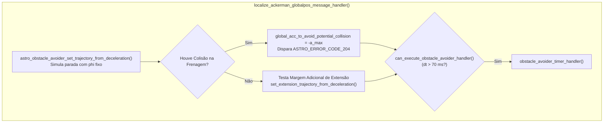
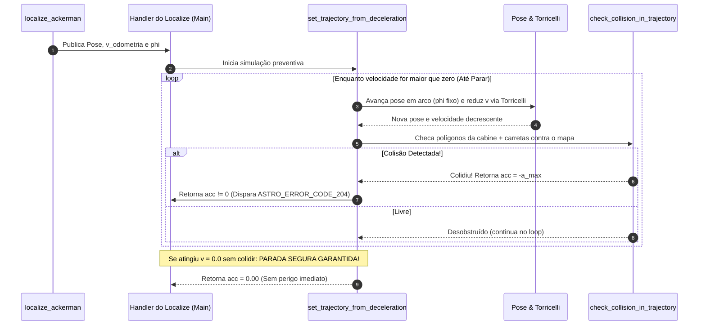

# Desaceleração Preventiva com Ângulo de Esterçamento Fixo (`phi` Fixo)

A função [`astro_obstacle_avoider_set_trajectory_from_deceleration()`](file:///home/lume/astro/src/obstacle_avoider/obstacle_avoider.cpp#L1308-L1401) é a **primeira etapa de verificação de colisão de emergência**, executada no [`localize_ackerman_globalpos_message_handler()`](file:///home/lume/astro/src/obstacle_avoider/obstacle_avoider_main.cpp#L1623) imediatamente após ser identificada a nova posição do veículo.

> [!IMPORTANT]
> **Resumo do Papel da Desaceleração com `phi` Fixo:**
> * **Condição de execução:** Roda a cada nova mensagem de localização (`localize_ackerman_globalpos`), desde que o veículo não esteja em controle manual (`manual_override == 0` ou forçado por `manual_override_activate`).
> * **O problema que ela resolve:** Verifica se, caso o sistema trave ou precise frear agora mantendo o volante no ângulo atual (`odometry_phi` fixo) e partindo da velocidade atual (`odometry_velocity`), o veículo tem espaço livre suficiente para desacelerar até parar ($v = 0$) sem atingir nenhum obstáculo.
> * **Como atua:** Projeta o veículo em pequenos passos de $0{,}1\text{ s}$ ao longo do ângulo de giro fixo e reduz a velocidade a cada passo pela **Equação de Torricelli** aplicando a frenagem máxima (`-maximum_deceleration_forward`), testando cada pose nos mapas.
> * **Resultado:**
>   * **Se colidir antes de parar:** Interrompe a simulação na hora (`break`), emite o **`ASTRO_ERROR_CODE_204`** e preenche a variável de controle `global_acc_to_avoid_potential_collision` com a desaceleração máxima de alarme (nem precisando executar a Etapa 2 de extensão).
>   * **Se parar sem colidir ($v = 0$):** Retorna `0.0` (parada física garantida) e libera o fluxo para a Etapa 2 ([`07_extensao_seguranca_potential_collision.md`](07_extensao_seguranca_potential_collision.md)), que verificará se a margem mínima adicional também está livre.

---

## 1. Posição no Fluxo de Execução

Ao contrário do consumo temporal da fila (que ocorre dentro do ciclo do timer de decisão), a desaceleração preventiva é disparada no handler de alta frequência da localização:



---

## 2. Fluxo de Funcionamento da `astro_obstacle_avoider_set_trajectory_from_deceleration()`

O objetivo central da [`astro_obstacle_avoider_set_trajectory_from_deceleration()`](file:///home/lume/astro/src/obstacle_avoider/obstacle_avoider.cpp#L1308-L1401) é **tentar parar o veículo mantendo seu ângulo de esterçamento ($\phi$) fixo** e verificar se essa trajetória até a parada completa é segura.

Para fazer isso, a função executa um loop iterativo (`while (fabs(current_velocity) > 0.0)`) que projeta o futuro passo a passo:

### Passo 1: Previsão da Pose Futura ("Passinho" de $0{,}1\text{ s}$)
A partir da pose atual vinda do `localize`, a função utiliza a [`astro_libcarmodel_recalc_pos_ackerman()`](file:///home/lume/astro/src/obstacle_avoider/obstacle_avoider.cpp#L1358) para calcular a coordenada espacial onde o veículo (cabine e carretas) estará daqui a **$0{,}1\text{ s}$** (`full_time_interval = 0.1`, integrado com `delta_t = 0.05` e velocidade de referência `0.5 m/s` apenas para gerar o deslocamento geométrico na curva com `odometry_phi` fixo):

```cpp
iterative_pose = astro_libcarmodel_recalc_pos_ackerman(
    &iterative_pose, vel_sign * 0.5, odometry_phi, 
    full_time_interval, &distance_traveled, delta_t, 
    &astro_robot_ackerman_config, &astro_semi_trailer_config
);
```
> *Nota:* O objetivo dessa chamada não é testar a dinâmica de aceleração, mas simplesmente descobrir **o caminho geométrico (próximo ponto no espaço)** que o caminhão percorre ao avançar um "passinho" mantendo o volante travado em `odometry_phi`.

---

### Passo 2: Redução da Velocidade via Equação de Torricelli
Encontrado esse novo ponto no espaço, mede-se a distância real percorrida nesse passinho ($\Delta s$, dada por `DIST2D(iterative_pose, prev_pose)`) e utiliza-se a **Equação de Torricelli** ([`compute_final_velocity_using_torricelli()`](file:///home/lume/astro/src/obstacle_avoider/obstacle_avoider.cpp#L969)) para identificar qual será a velocidade real do veículo após andar esse deslocamento aplicando a **frenagem máxima**:

$$v^2 = v_0^2 + 2 \cdot a \cdot \Delta s$$

Onde:
* **$\Delta s$:** Distância percorrida entre a pose anterior e a nova pose calculada.
* **$a$:** Valor negativo da desaceleração máxima (`-maximum_deceleration_forward`, vindo dos parâmetros).
* **$v_0$:** Velocidade real do veículo no início daquele passo.

```cpp
current_velocity = vel_sign * compute_final_velocity_using_torricelli(
    current_velocity, 
    -astro_robot_ackerman_config.maximum_deceleration_forward, 
    DIST2D(iterative_pose, prev_pose)
);
```

---

### Passo 3: Verificação de Colisão e Critério de Parada do Loop
Obtida a posição futura exata e sua respectiva velocidade reduzida, chama-se [`check_collision_in_trajectory()`](file:///home/lume/astro/src/obstacle_avoider/obstacle_avoider.cpp#L1012) para verificar se há colisão naquele ponto contra:
1. O **mapa de distâncias / mapas especiais** (`obstacle_distance_map` / `maps_obstacle_avoider`).
2. O **mapa de ocupação** (`occupancy_map`).
3. Algum **objeto móvel** (`moving_objects`).

```cpp
while (fabs(current_velocity) > 0.0)
{
    // 1. Projeta a pose 0.1s à frente mantendo phi fixo
    // 2. Reduz a velocidade pelo deslocamento usando Torricelli com frenagem máxima
    // 3. Verifica se a nova pose colide nos mapas:
    returned_acc = check_collision_in_trajectory(
        iterative_pose, astro_robot_ackerman_config, occupancy_map, 
        astro_robot_ackerman_config.obstacle_avoider_obstacles_safe_distance, 
        vel_sign, total_distance_traveled, timestamp
    );

    if ((returned_acc != 0.0) || (total_distance_traveled >= 50.0))
    {
        break;
    }
    ...
}
```

* **Se houver colisão:** A função `check_collision_in_trajectory()` devolve imediatamente a desaceleração máxima de frenagem (`-maximum_deceleration_forward` em marcha à frente, ou `maximum_deceleration_reverse` em ré). A previsão é **finalizada na hora (`break`)** — sem precisar continuar calculando até a velocidade zerar — e esse valor de frenagem máxima é retornado para a variável de controle `global_acc_to_avoid_potential_collision` no `localize_ackerman_globalpos_message_handler()`.
* **Se não houver colisão:** O fluxo continua repetindo o processo passo a passo enquanto a velocidade não chegar a zero (`fabs(current_velocity) > 0.0`) ou até atingir o limite de segurança de $50\text{ m}$ projetados (`total_distance_traveled >= 50.0`).

---

## 3. Diagrama de Sequência e Fluxo Interno



---

## 4. Continuação da Simulação de Emergência (*Potential Collision*)

Ao finalizar a execução de `astro_obstacle_avoider_set_trajectory_from_deceleration()`, o valor retornado em `global_acc_to_avoid_potential_collision` define qual será o próximo passo do módulo:

* **`acc == 0.0` (Parada livre de colisão na Etapa 1):**  
  O fluxo avança imediatamente (ainda dentro do handler do `localize`) para a **Etapa 2 — Extensão de Segurança**, que verifica se a margem mínima à frente do veículo (`extension_length`) também está desobstruída:  
**[`07_extensao_seguranca_potential_collision.md`](07_extensao_seguranca_potential_collision.md)**

* **`acc != 0.0` (Colisão detectada na Etapa 1):**  
  A Etapa 2 é ignorada (já que o perigo imediato foi confirmado) e o valor de frenagem armazenado em `global_acc_to_avoid_potential_collision` segue direto para a **Etapa 3 — atuação do potential_collision()** no `obstacle_avoider_timer_handler()`:  
  **[`08_atuacao_potential_collision_treatment.md`](08_atuacao_potential_collision_treatment.md)** 

