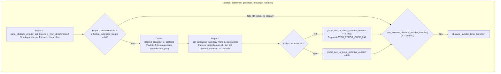
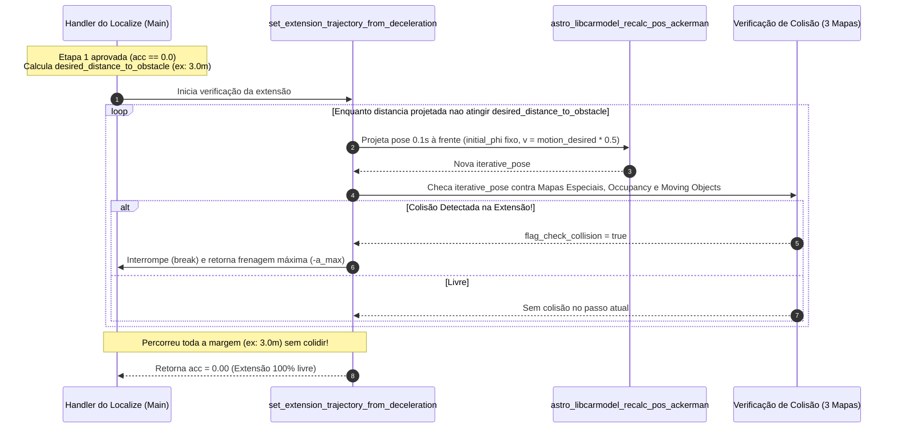
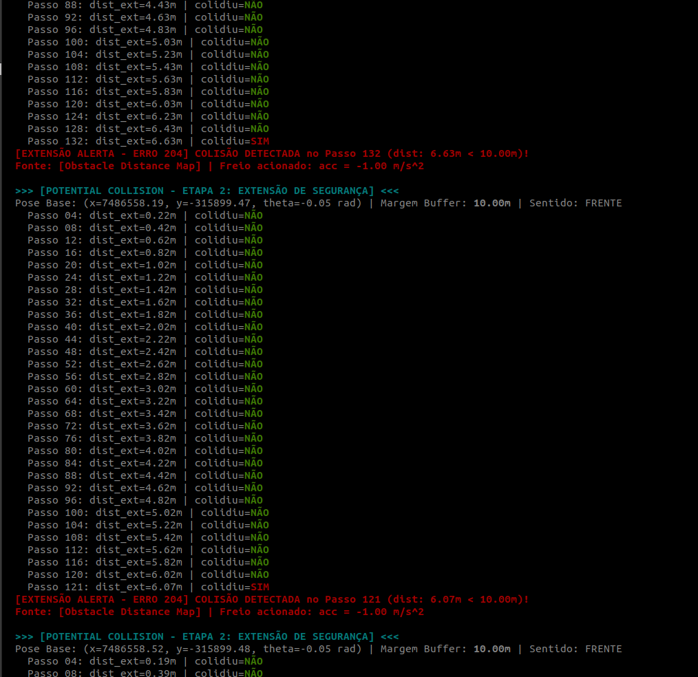

# Extensão de Segurança da Trajetória (`set_extension_trajectory_from_deceleration`)

A função [`set_extension_trajectory_from_deceleration()`](file:///home/lume/astro/src/obstacle_avoider/obstacle_avoider.cpp#L1181-L1305) é a **segunda etapa de verificação de colisão de emergência**, executada no [`localize_ackerman_globalpos_message_handler()`](file:///home/lume/astro/src/obstacle_avoider/obstacle_avoider_main.cpp#L1626-L1656) imediatamente após ser identificada a nova posição do veículo.

> [!IMPORTANT]
> **Resumo do Papel da `extension_length`:**
> * **Condição de execução:** Só ocorre se a **Etapa 1 ([`06_desaceleracao_preventiva_phi_fixo.md`](06_desaceleracao_preventiva_phi_fixo.md)) aprovar a parada** (`global_acc_to_avoid_potential_collision == 0.0`).
> * **O problema que ela resolve:** Na Etapa 1, o veículo pode conseguir parar fisicamente antes de bater (ex.: em baixa velocidade ele para em $0{,}5\text{ m}$), mas terminar **dentro do limite mínimo de segurança** exigido para o obstáculo.
> * **Como atua:** A verificação é refeita projetando o veículo desde a `pose` atual até o alcance definido por parâmetro (ou o padrão de **$3{,}0\text{ m}$**).
> * **Resultado em caso de violação:** Se houver colisão dentro desse limite mínimo, o erro **`ASTRO_ERROR_CODE_204`** é emitido **mesmo que o veículo conseguisse parar antes do impacto**, pois a regra da margem mínima foi violada. Em seguida, a variável de controle de frenagem (`global_acc_to_avoid_potential_collision`) é preenchida com o valor de desaceleração máxima de alarme.

---

## 1. Posição no Fluxo de Execução e Condição de Entrada

Dentro do escopo de [`localize_ackerman_globalpos_message_handler()`](file:///home/lume/astro/src/obstacle_avoider/obstacle_avoider_main.cpp#L1553), a Etapa 2 entra em ação imediatamente após a Etapa 1 emitir a franagem nula (acc == 0):



### Definição do Limite de Extensão (`effective_extension_length`)
O tamanho da margem que o veículo deve respeitar até qualquer obstáculo vem do parâmetro `obstacle_avoider_potential_collision_extension_length` (inicializado em $3{,}0\text{ m}$) ou é forçado diretamente para **$3{,}0\text{ m}$** caso a flag `force_potential_collision_usage` esteja ativa:

```cpp
double effective_extension_length = potential_collision_extension_length;

if (force_potential_collision_usage)
{
    effective_extension_length = 3.0;
}
```
Ou seja, mesmo que o veículo esteja em baixa velocidade e consiga parar em poucos centímetros na Etapa 1, ele ainda deve cumprir um **limite mínimo de distância para o obstáculo** (tipicamente $3{,}0\text{ m}$).

### Ajuste da Distância Próximo ao Destino Final (`final_goal`)
Antes de chamar a função de extensão, o código verifica se o veículo já está chegando ao ponto de destino final (`final_destination`) e se esse destino fica naturalmente próximo de obstáculos no mapa offline (como em docas de carregamento):

```cpp
if ((fabs(global_acc_to_avoid_potential_collision) < EPSILON) && (effective_extension_length > 0.0))
{
    double desired_distance_to_obstacle = effective_extension_length;
    double default_desired_distance_to_obstacle = effective_extension_length;

    if (use_potential_collision_final_goal_implementation == 1)
    {
        if ((distance_between_pose_and_final_goal < default_desired_distance_to_obstacle) && (distance_between_final_goal_and_obstacle > 0.0)
            && (distance_between_final_goal_and_obstacle < default_desired_distance_to_obstacle))
        {
            double distance_to_compare = default_desired_distance_to_obstacle;

            if (distance_between_pose_and_final_goal < default_desired_distance_to_obstacle)
            {
                distance_to_compare = distance_between_pose_and_final_goal;
            }

            desired_distance_to_obstacle = astro_fmax(0.6 * distance_between_final_goal_and_obstacle, distance_to_compare);
        }
    }

    global_acc_to_avoid_potential_collision = set_extension_trajectory_from_deceleration(pose, astro_robot_ackerman_config,
            astro_semi_trailer_config, &occupancy_map, current_phi, motion_desired, desired_distance_to_obstacle, msg->timestamp);
}
```
* **Em condução normal na via:** `desired_distance_to_obstacle` permanece igual a `effective_extension_length` ($3{,}0\text{ m}$).
* **Próximo ao `final_goal` com obstáculo:** Reduz proporcionalmente `desired_distance_to_obstacle` para evitar falsos positivos que travariam o caminhão antes de concluir o estacionamento/atracamento.

---

## 2. Fluxo de Funcionamento da `set_extension_trajectory_from_deceleration()`

O objetivo da [`set_extension_trajectory_from_deceleration()`](file:///home/lume/astro/src/obstacle_avoider/obstacle_avoider.cpp#L1181-L1305) é **projetar o veículo mantendo seu ângulo de esterçamento (`initial_phi`) fixo por toda a distância `desired_distance_to_obstacle`** e garantir que nenhum obstáculo invada essa extensão de segurança.

Para isso, a função executa um loop espacial (`while (DIST2D(initial_pose, iterative_pose) <= desired_distance_to_obstacle)`):

### Passo 1: Avanço Geométrico da Pose ("Passinho" de $0{,}1\text{ s}$)
Partindo da `pose` atual vinda do `localize`, a função utiliza a [`astro_libcarmodel_recalc_pos_ackerman()`](file:///home/lume/astro/src/obstacle_avoider/obstacle_avoider.cpp#L1226) para calcular a coordenada do veículo (cabine e carretas) passados **$0{,}1\text{ s}$** (`full_time_interval = 0.1`, `delta_t = 0.05`) com velocidade virtual fixa de `motion_desired * 0.5` mantendo o ângulo `initial_phi` travado:

```cpp
iterative_pose = astro_libcarmodel_recalc_pos_ackerman(
    &iterative_pose, motion_desired * 0.5, initial_phi, full_time_interval,
    &distance_traveled, delta_t, &astro_robot_ackerman_config, &astro_semi_trailer_config
);
```
> *Nota:* Diferente da Etapa 1 (que depende da velocidade real `odometry_velocity` e para quando $v = 0$), a Etapa 2 **independe da velocidade atual** e usa a intenção de movimento (`motion_desired`). Assim, mesmo que o caminhão esteja quase parado ou em baixa velocidade (onde a Etapa 1 aprova em poucos centímetros), a Etapa 2 varre obrigatoriamente de $0\text{ m}$ até `desired_distance_to_obstacle` (ex.: $3{,}0\text{ m}$) a partir da `pose` atual.

---

### Passo 2: Verificação de Colisão e Critério de Parada do Loop
A cada nova pose calculada na extensão, verifica-se imediatamente se há colisão da cabine ou das carretas contra:
1. O **mapa de distâncias / mapas especiais** (`obstacle_distance_map` / `maps_obstacle_avoider`).
2. O **mapa de ocupação** (`occupancy_map`).
3. Algum **objeto móvel** (`moving_objects`).

```cpp
while (DIST2D(initial_pose, iterative_pose) <= desired_distance_to_obstacle)
{
    // 1. Avança a pose 0.1s mantendo initial_phi fixo no sentido de motion_desired
    // 2. Verifica colisão nos 3 níveis de mapas (Mapas Especiais, Occupancy Map e Moving Objects)

    if (flag_check_collision)
    {
        set_astro_error_for_oa_mediation(ASTRO_ERROR_CODE_204, custom_string, timestamp);
        returned_acc = -astro_robot_ackerman_config.maximum_deceleration_forward;

        if (motion_desired < 0.0)
        {
            returned_acc = astro_robot_ackerman_config.maximum_deceleration_reverse;
        }
        break;
    }
}
```

* **Se houver colisão dentro da extensão:** A previsão é **interrompida imediatamente (`break`)**, registra-se o erro `ASTRO_ERROR_CODE_204` e retorna-se a desaceleração máxima de frenagem (`-maximum_deceleration_forward` ou `maximum_deceleration_reverse` em ré) para a variável `global_acc_to_avoid_potential_collision` no handler do `localize`.
* **Se não houver colisão:** O loop segue avançando até que a distância euclidiana entre a pose inicial e a pose projetada (`DIST2D(initial_pose, iterative_pose)`) ultrapasse `desired_distance_to_obstacle` (ex.: $3{,}0\text{ m}$), retornando `0.0` e confirmando que toda a margem de extensão à frente do veículo está livre.

---

## 3. Diagrama de Sequência e Fluxo Interno



---

## 4. Exemplo Prático: Comportamento Real na Detecção da Extensão

Em um teste prático acompanhado em tempo real, o parâmetro `obstacle_avoider_potential_collision_extension_length` foi configurado com uma margem de **$10{,}00\text{ m}$** (`Margem Buffer: 10.00m`).

### 4.1 Trajetória Livre e Varredura Completa da Margem
O veículo trafegava, a Etapa 1 (frenagem por Torricelli) aprovava a continuidade do plano atual e liberava a execução da Etapa 2. Enquanto Enquanto não encontrava obstáculo no diâmetro de 10m nada foi sinalizado, porém na imagem abaixo pode ser observado que próximo ao metro 6   foi encontrado um obstáculo:

<p align="center">
  
</p>

---

### 4.2 Análise Comparativa com a Lógica das Seções Anteriores

Esse registro comprova na prática cada regra descrita nas seções anteriores:

1. **A Etapa 1 (Torricelli) passou, mas a Etapa 2 (Extensão) barrou:**
   * A Etapa 2 só foi chamada porque na Etapa 1 (`astro_obstacle_avoider_set_trajectory_from_deceleration()`) o veículo conseguia parar por Torricelli antes dos $6\text{ m}$ onde estava o obstáculo.
   * Porém, como o limite parametrizado exigia **$10{,}00\text{ m}$ livres**, a Etapa 2 continuou projetando o veículo à frente e identificou que o obstáculo violava essa margem (`6.63m < 10.00m` e depois `6.07m < 10.00m`).

2. **Interrupção Imediata (`break`) e Retorno da Frenagem Máxima:**
   * O log da imagem imprime de 4 em 4 passos (`Passo 116`, `Passo 120`...).
   * Porém, assim que a pose projetada no **Passo 121** (`dist_ext = 6.07m`) tocou um obstáculo no **`[Obstacle Distance Map]`** (`collision_result.has_collision == true`), a condição `flag_check_collision` ativou o print imediato daquele passo , disparou o **`ASTRO_ERROR_CODE_204`** e **acionou o `break`** evitando o processo de calcular os passos restantes até $10{,}00\text{ m}$.
   * No mesmo momento foi retornado **`acc = -1.00 m/s^2`** (`-maximum_deceleration_forward`) para a variável `global_acc_to_avoid_potential_collision` no `localize_ackerman_globalpos_message_handler()`.

---

## 5. Continuação da Simulação de Emergência (*Potential Collision*)

Ao finalizar a execução de `set_extension_trajectory_from_deceleration()`, o valor retornado em `global_acc_to_avoid_potential_collision` encerra a verificação no handler do `localize` e será consumido na **Etapa 3 — Atuação e Recálculo do Plano** dentro do `obstacle_avoider_timer_handler()`:

* **`acc == 0.0` (Margem de extensão 100% livre):**  
  Nenhuma desaceleração de emergência é solicitada (caso o contador de debounce estivesse ativo, ele é zerado em `potential_collision_treatment()`).

* **`acc != 0.0` (Colisão detectada dentro da margem de extensão):**  
  O valor de frenagem armazenado em `global_acc_to_avoid_potential_collision` segue para validação de persistência (Debounce 5/5) e recálculo das velocidades da fila:  
  **[`08_atuacao_potential_collision_treatment.md`](08_atuacao_potential_collision_treatment.md)** (`potential_collision_treatment()`)

