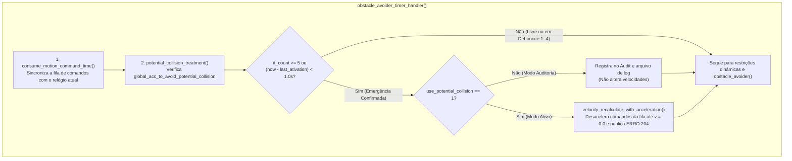
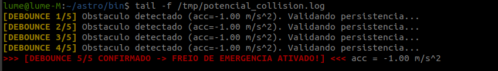
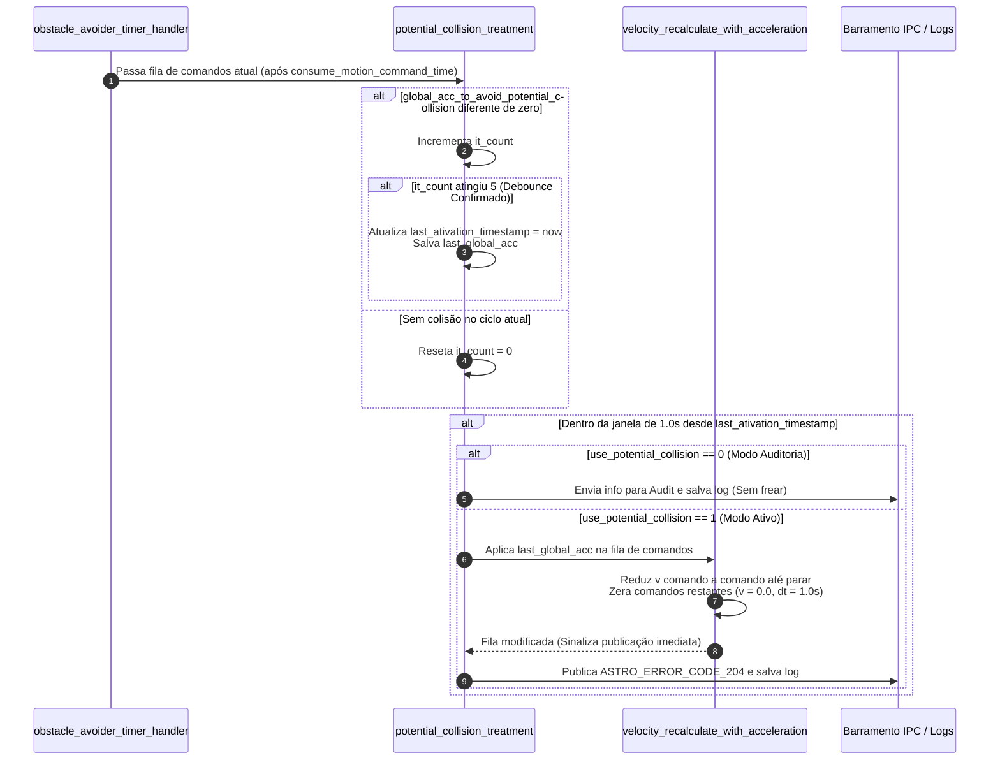
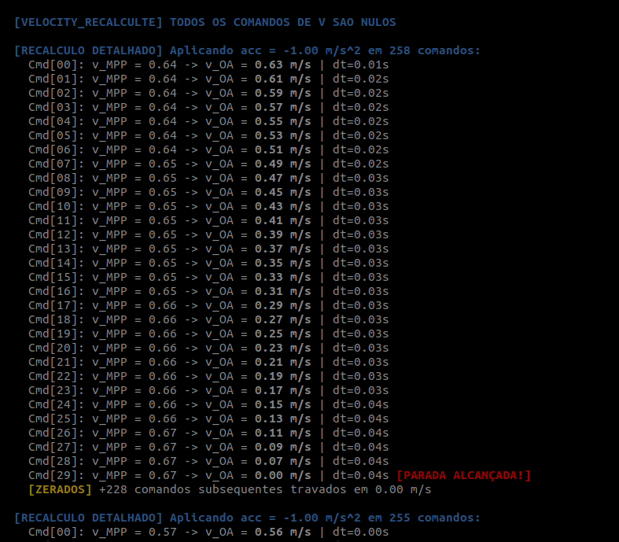

# Atuação de Emergência: `potential_collision_treatment()`

A função [`potential_collision_treatment()`](file:///home/lume/astro/src/obstacle_avoider/obstacle_avoider_main.cpp#L1205-L1312) é a **terceira e última etapa do ciclo de colisão de emergência (*Potential Collision*)**, executada dentro do [`obstacle_avoider_timer_handler()`](file:///home/lume/astro/src/obstacle_avoider/obstacle_avoider_main.cpp#L1389) logo após o consumo temporal da fila ([`05_consumo_temporal_e_sincronizacao.md`](05_consumo_temporal_e_sincronizacao.md)).

> [!IMPORTANT]
> **Resumo do Papel da `potential_collision_treatment()`:**
> * **Condição de entrada:** Lê a variável global de controle `global_acc_to_avoid_potential_collision`, que foi previamente preenchida no handler do `localize` pela **Etapa 1 ([`06_desaceleracao_preventiva_phi_fixo.md`](06_desaceleracao_preventiva_phi_fixo.md))** ou pela **Etapa 2 ([`07_extensao_seguranca_potential_collision.md`](07_extensao_seguranca_potential_collision.md))**.
> * **O problema que ela resolve:** Impede que um ruído isolado de sensor (um falso positivo de 1 único ciclo) cause uma freada brusca desnecessária, exigindo que o perigo se confirme por **5 iterações consecutivas (Debounce 5/5)** antes de intervir no plano.
> * **Como atua:** Uma vez atingido o Debounce 5/5, a função ativa o estado de emergência (que permanece atuando continuamente enquanto o perigo persistir e por mais `1.0 s` após a última detecção) e:
>   * Se `use_potential_collision == 0` (**Modo Auditoria**): Apenas grava o erro em log e envia para a auditoria, sem alterar as velocidades do plano.
>   * Se `use_potential_collision == 1` (**Modo Ativo**): Chama [`velocity_recalculate_with_acceleration()`](file:///home/lume/astro/src/obstacle_avoider/obstacle_avoider.cpp#L1060) para aplicar a desaceleração diretamente nos comandos do plano atual até zerar a velocidade do veículo, além de publicar o `ASTRO_ERROR_CODE_204`.

---

## 1. Posição no Fluxo de Execução

Dentro do escopo de [`obstacle_avoider_timer_handler()`](file:///home/lume/astro/src/obstacle_avoider/obstacle_avoider_main.cpp#L1359), a função atua imediatamente após a fila ter sido sincronizada no tempo por `consume_motion_command_time()`:



---

## 2. Fluxo de Funcionamento da `potential_collision_treatment()`

A lógica interna da função divide-se em três mecanismos sequenciais:

### Passo 1: Filtro de Persistência (Debounce de 5 Iterações)
Toda vez que `potential_collision_treatment()` é chamada, ela inspeciona se `global_acc_to_avoid_potential_collision` contém uma desaceleração de alarme (`fabs(global_acc_to_avoid_potential_collision) > EPSILON`):

```cpp
if (fabs(global_acc_to_avoid_potential_collision) != 0.0)
{
    it_count++;
    ...
    if (it_count >= it_count_to_activate) // it_count_to_activate = 5
    {
        last_ativation_timestamp = astro_get_time();
        last_global_acc_to_avoid_potential_collision = global_acc_to_avoid_potential_collision;
    }
}
else
{
    it_count = 0;
}
```
* **Nas iterações 1 a 4 (`it_count < 5`):** O código apenas incrementa `it_count`, sem frear o caminhão ainda. Se o obstáculo sumir antes da 5ª iteração, `it_count` volta a `0` (`[DEBOUNCE RESET]`).
* **A partir da 5ª iteração consecutiva (`it_count >= 5`):** Confirma-se que o obstáculo é real. Nesse instante, salva-se o horário atual em `last_ativation_timestamp` e congela-se a desaceleração em `last_global_acc_to_avoid_potential_collision`.

<p align="center">
  
</p>

---

### Passo 2: Manutenção do Freio (`< 1.0 s` após a última detecção) e Modo Auditoria
Enquanto o obstáculo continuar sendo detectado (`it_count >= 5`), `last_ativation_timestamp` é atualizado a cada ciclo com o tempo atual, mantendo a frenagem ativa continuamente. Além disso, a condição `if ((now - last_ativation_timestamp) < 1.0)` garante que, **mesmo após o obstáculo sumir (ou caso o sensor falhe por um instante), o freio continue atuando por mais 1 segundo após a última confirmação**:

```cpp
if ((now - last_ativation_timestamp) < 1.0)
{
    int current_error = get_astro_error_for_oa_mediation_error_code();
    char *oa_mediation_error_custom_string = get_astro_error_for_oa_mediation_error_custom_string();

    if ((use_potential_collision == 0))
    {
        // Apenas registra no audit e em potential_collision_error_log.txt, e retorna sem frear
        EXEC_COOLDOWN(send_potential_collision_info_to_audit(oa_mediation_error_custom_string), 1.0);
        save_potential_collision_error();
        return;
    }
    ...
```
* Se o parâmetro `obstacle_avoider_use_potential_collision` estiver desligado (`0`), a função opera em **Modo Auditoria**: grava a ocorrência no log e envia para o módulo de auditoria, mas executa `return` antes de tocar no vetor de comandos.

---

### Passo 3: Recálculo das Velocidades do Plano (`velocity_recalculate_with_acceleration`)
Com `use_potential_collision == 1`, a função chama [`velocity_recalculate_with_acceleration()`](file:///home/lume/astro/src/obstacle_avoider/obstacle_avoider.cpp#L1060-L1177) para modificar diretamente o vetor de comandos ativo (`current_motion_commands_vector`):

```cpp
	velocity_recalculate_with_acceleration(current_motion_commands_vector, num_motion_commands, last_global_acc_to_avoid_potential_collision);

```

Dentro de `velocity_recalculate_with_acceleration()`, cada comando $i$ da fila tem sua velocidade reduzida progressivamente usando a desaceleração de emergência (`acceleration`, ex.: $-1{,}00\text{ m/s}^2$) e seu tempo de passo reajustado proporcionalmente:

```cpp
for (i = 0; i < num_motion_commands; i++)
{
    if (i > 0)
        motion_commands_vector[i].v = motion_commands_vector[i - 1].v;

    motion_commands_vector[i].v += acceleration * motion_commands_vector[i].time;
    motion_commands_vector[i].time *= (1 - (motion_commands_vector[i].v / original_index_velocity)) + 1;

    if (get_new_motion_command_needs_to_be_published() == 0)
        set_new_motion_command_needs_to_be_published(1); // sinaliza que esse plano deve ser publicado

    if ((velocidade_atual < 0.05) ||
        (sinal_velocidade_atual != sinal_velocidade_inicial) || // a frenagem passou do zero e inverteu o sentido
        (velocidade_atual > velocidade_inicial))                // redundância para impedir aumento indevido de velocidade
    {
        motion_commands_vector[i].time = 1.0;
        motion_commands_vector[i].v = 0.0;
        i++;
        break;
    }
}

// Zera todos os comandos restantes da fila após atingir a parada
for (; i < num_motion_commands; i++)
{
    motion_commands_vector[i].time = 1.0;
    motion_commands_vector[i].v = 0.0;
}
```
* Assim que a velocidade calculada cai abaixo de $0{,}05\text{ m/s}$ (ou inverte de sinal), aquele comando e **todos os comandos subsequentes da fila são cravados em `v = 0.0 m/s` e `time = 1.0 s`**.
* A flag `set_new_motion_command_needs_to_be_published(1)` avisa o final do `obstacle_avoider_timer_handler()` que o plano foi modificado pelo OA e precisa ser republicado imediatamente.
* Por fim, publica-se o erro **`ASTRO_ERROR_CODE_204`** via IPC (com cooldown de $0{,}5\text{ s}$) 

---

## 3. Diagrama de Sequência e Fluxo Interno



---

## 4. Exemplo Prático: Simulação Completa da Atuação e Recálculo

O log simulado abaixo demonstra todas as etapas descritas nas seções anteriores atuando em conjunto durante a detecção de um obstáculo:

### 4.1 Fase 1: Validação de Persistência (Debounce 1/5 até 5/5) e Primeiro Recálculo
Quando a Etapa 1 ou a Etapa 2 começa a preencher `global_acc_to_avoid_potential_collision = -1.00 m/s^2`, as 4 primeiras chamadas apenas validam a persistência. Na 5ª chamada consecutiva, o freio de emergência é ativado e a função `velocity_recalculate_with_acceleration()` esmaga o plano de 218 comandos do MPP (que originalmente pedia `v_MPP = 1.38 m/s`):

```text
[DEBOUNCE 1/5] Obstaculo detectado (acc=-1.00 m/s^2). Validando persistencia...
[DEBOUNCE 2/5] Obstaculo detectado (acc=-1.00 m/s^2). Validando persistencia...
[DEBOUNCE 3/5] Obstaculo detectado (acc=-1.00 m/s^2). Validando persistencia...
[DEBOUNCE 4/5] Obstaculo detectado (acc=-1.00 m/s^2). Validando persistencia...
>>> [DEBOUNCE 5/5 CONFIRMADO -> FREIO DE EMERGENCIA ATIVADO!] <<< acc = -1.00 m/s^2

  [RECALCULO DETALHADO] Aplicando acc = -1.00 m/s^2 em 218 comandos:
    Cmd[00]: v_MPP = 1.38 -> v_OA = 1.37 m/s | dt=0.02s
    Cmd[01]: v_MPP = 1.38 -> v_OA = 1.35 m/s | dt=0.02s
    Cmd[02]: v_MPP = 1.38 -> v_OA = 1.33 m/s | dt=0.02s
    ...
    Cmd[22]: v_MPP = 1.38 -> v_OA = 0.93 m/s | dt=0.03s
    Cmd[23]: v_MPP = 1.38 -> v_OA = 0.87 m/s | dt=0.08s
    ...
    Cmd[36]: v_MPP = 1.38 -> v_OA = 0.09 m/s | dt=0.12s
    Cmd[37]: v_MPP = 1.38 -> v_OA = 0.00 m/s | dt=0.12s [PARADA ALCANÇADA!]
    [ZERADOS] +180 comandos subsequentes travados em 0.00 m/s
```
* **Redução progressiva e dilatação de `dt`:** A velocidade cai degrau a degrau de `1.38 m/s` até atingir a parada no `Cmd[37]`, enquanto o tempo de cada passo (`dt`) aumenta proporcionalmente (`0.02s` $\to$ `0.03s` $\to$ `0.12s`) pois o veículo passa mais devagar por cada segmento.
* **Travamento do restante da fila:** Do `Cmd[38]` ao `Cmd[217]` (**180 comandos**), todas as velocidades são zeradas (`0.00 m/s`).

---

### 4.2 Fase 2: Atuação Contínua Entre Planos do MPP até Esgotar Velocidades
Nos ciclos seguintes do timer (enquanto o MPP ainda não enviou um plano novo), observe como o número de comandos cai (`218` $\to$ `214` $\to$ `211`) e o campo `v_MPP` já reflete as velocidades que o próprio OA havia reduzido no ciclo anterior:

```text
  [RECALCULO DETALHADO] Aplicando acc = -1.00 m/s^2 em 214 comandos:
    Cmd[00]: v_MPP = 1.29 -> v_OA = 1.28 m/s | dt=0.01s
    Cmd[01]: v_MPP = 1.27 -> v_OA = 1.26 m/s | dt=0.02s
    ...
    Cmd[26]: v_MPP = 0.45 -> v_OA = 0.11 m/s | dt=0.18s
    Cmd[27]: v_MPP = 0.39 -> v_OA = 0.00 m/s | dt=0.20s [PARADA ALCANÇADA!]
    [ZERADOS] +186 comandos subsequentes travados em 0.00 m/s

  [RECALCULO DETALHADO] Aplicando acc = -1.00 m/s^2 em 211 comandos:
    Cmd[00]: v_MPP = 1.21 -> v_OA = 1.21 m/s | dt=0.00s
    ...
    Cmd[21]: v_MPP = 0.31 -> v_OA = 0.14 m/s | dt=0.21s
    Cmd[22]: v_MPP = 0.21 -> v_OA = 0.00 m/s | dt=0.32s [PARADA ALCANÇADA!]
    [ZERADOS] +188 comandos subsequentes travados em 0.00 m/s

  [VELOCITY_RECALCULTE] TODOS OS COMANDOS DE V SAO NULOS

  [VELOCITY_RECALCULTE] TODOS OS COMANDOS DE V SAO NULOS
```
* **Conexão com o `consume_motion_command_time()`:** A cada ciclo, o consumo temporal descarta os primeiros comandos executados (`218` $\to$ `214` $\to$ `211`) e o `potential_collision_treatment()` reaplica a frenagem sobre o plano que ele mesmo modificou, puxando a parada para cada vez mais perto (`Cmd[37]` $\to$ `Cmd[27]` $\to$ `Cmd[22]`), até que restem apenas comandos nulos na fila (`TODOS OS COMANDOS DE V SAO NULOS`).
* Assim que o MPP envia um **novo plano** (ex.: `230 comandos` tentando acelerar novamente para `v_MPP = 1.38 m/s`), como o alarme continua ativo, o OA imediatamente recalcula e zera o novo plano também.

---

### 4.3 Fase 3: A Janela de Retenção de $1{,}0\text{ s}$ Mesmo Após o `[DEBOUNCE RESET]`
Mais adiante no log, ocorre um momento em que a trajetória fica temporariamente livre na leitura atual (`global_acc_to_avoid_potential_collision == 0.0`), disparando o reset do contador:

```text
[DEBOUNCE RESET] Trajetoria desobstruida. Debounce zerado.


  [RECALCULO DETALHADO] Aplicando acc = -1.00 m/s^2 em 239 comandos:
    Cmd[00]: v_MPP = 0.47 -> v_OA = 0.45 m/s | dt=0.02s
    Cmd[01]: v_MPP = 0.44 -> v_OA = 0.42 m/s | dt=0.03s
    ...
    Cmd[11]: v_MPP = 0.15 -> v_OA = 0.06 m/s | dt=0.07s
    Cmd[12]: v_MPP = 0.12 -> v_OA = 0.00 m/s | dt=0.09s [PARADA ALCANÇADA!]
    [ZERADOS] +226 comandos subsequentes travados em 0.00 m/s
```
* **Por que o recálculo continuou atuando mesmo após o `[DEBOUNCE RESET]`?**  
  Exatamente por causa da trava temporal `if ((now - last_ativation_timestamp) < 1.0)` descrita no Passo 2! Mesmo que `it_count` tenha sido zerado naquele instante, o sistema **mantém a frenagem de emergência ativa por mais `1.0 s`** usando a desaceleração salva em `last_global_acc_to_avoid_potential_collision` (`-1.00 m/s^2`), evitando que uma falha momentânea de detecção solte o freio prematuramente diante do obstáculo.

---

### 4.4 Análise Detalhada: Novo Plano do MPP após Zeramento e Consumo de Comandos

A captura abaixo evidencia perfeitamente a interação entre o zeramento da fila, a chegada de um novo plano do MPP e o consumo temporal entre dois ciclos consecutivos do `obstacle_avoider_timer_handler()`:

<p align="center">
  
</p>

Observando a sequência da imagem de cima para baixo, extraímos três conclusões diretas:

1. **Plano Anterior Totalmente Zerado (`TODOS OS COMANDOS DE V SAO NULOS`):**
   * A primeira linha azul comprova que, naquela execução, `velocity_recalculate_with_acceleration()` percorreu o vetor e identificou que **todos os comandos restantes já estavam com velocidade zero** (`v = 0.00 m/s`), encerrando sem precisar recalcular nada.

2. **Chegada de um Novo Plano do MPP Durante o Estado de Emergência (`258 comandos`):**
   * Se o plano anterior já estava todo zerado, o único motivo para na linha seguinte surgirem **258 comandos** com velocidades positivas (`v_MPP = 0.64 m/s`) é que **o MPP acabou de enviar um plano novo** (disparando imediatamente o handler do MPP).
   * Como não houve `[DEBOUNCE RESET]`, temos certeza de que **a colisão continuava ativa (`it_count >= 5`)**, então o OA interceptou esse novo plano no mesmo momento e recalculou as velocidades do `Cmd[00]` até alcançar a parada no `Cmd[29]` (`v_OA = 0.00 m/s`), travando os `+228 comandos` seguintes em zero.


3. **Consumo de 3 Comandos e Reaproveitamento do Plano Modificado (`258` $\to$ `255 comandos`):**
   * No bloco seguinte (`[RECALCULO DETALHADO] Aplicando acc = -1.00 m/s^2 em 255 comandos`), a colisão continua ativa, então o recálculo é chamado novamente (desta vez disparado pelo handler do `localize` ou do mapa de distâncias, já que o MPP não mandou outro plano).
   * O tamanho da fila diminuiu de **258 para 255 comandos** porque a função `consume_motion_command_time()` descartou os **3 primeiros comandos** (`Cmd[00]`, `Cmd[01]` e `Cmd[02]`) que já foram executados pelo veículo nesse intervalo de tempo.
   * Com o descarte dos 3 primeiros (`00`, `01` e `02`), o antigo **`Cmd[03]`** (que o OA havia deixado com **`v_OA = 0.57 m/s`**) passou a ser o novo **`Cmd[00]`** da fila de 255 comandos:
     * `Cmd[00]: v_MPP = 0.57 -> v_OA = 0.56 m/s | dt=0.00s`
   * Isso comprova visualmente que, enquanto não chega um plano novo do MPP, **o OA opera diretamente sobre o plano que ele mesmo modificou no ciclo anterior**!

