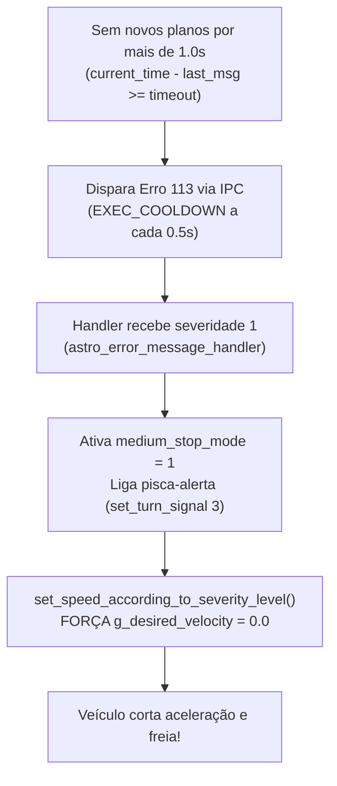

# Diagnóstico e Solução: Erro ASTRO 113 e o Parâmetro `motion_command_timeout`

Este documento explica em detalhes o que é o **Erro 113**, a cadeia de eventos de segurança que ele desencadeia no `vehicle_driver`, por que ele passou a ocorrer após a remoção da flag `-tune_pid_mode`, e como o ajuste de `motion_command_timeout = 20.0` contornou o problema.

---

## 1. O que é o Erro 113 no Sistema ASTRO?

No arquivo global de definições de erros da plataforma ASTRO ([`include/astro/astro_global_error_code_list.def`](file:///home/lume/astro/include/astro/astro_global_error_code_list.def#L96)), encontramos:

```c
ASTRO_ERROR_REG(113, 1, "One second has elapsed since the last plan reception.")
```

- **Código:** `113`
- **Severidade:** `1` (Alta Severidade — Parada Média / Controlada com pisca-alerta).
- **Descrição:** *"Passou-se um segundo desde a recepção do último plano."*

### O Papel Funcional do Erro 113
O Erro 113 atua como um **Watchdog (Dead Man's Switch / Dispositivo de Homem Morto)**:
Em veículos autônomos, trajetórias têm validade de curto prazo (frações de segundo). O planejador dinâmico de movimento (`motion_planner`, `rrt`) deve recalcular e republicar novas trajetórias a cada 50 ms ou 100 ms.

Se o veículo está autorizado a andar (`g_go_state == 1`), mas fica **mais de 1,0 segundo sem receber um novo comando de movimento**, o sistema deduz que o planejador travou, caiu ou perdeu a conexão com o IPC. Por segurança, o veículo corta a tração e freia imediatamente.

---

## 2. A Cadeia de Consequências no Código (Passo a Passo)

Quando o tempo limite de 1,0 s expira, uma sequência de proteções é disparada em cascata dentro de [`vehicle_driver_main.cpp`](file:///home/lume/astro/src/vehicle_driver/vehicle_driver_main.cpp):



### 1. Detecção do Timeout (Linha 1097):
```cpp
if ((last_motion_command_message_time > 0.0) &&
    ((current_time - last_motion_command_message_time) >= motion_command_timeout) &&
    (current_time > 0.0) && 
    (g_go_state == 1))
{
    char error_message[1024];
    snprintf(error_message, sizeof(error_message), "One second has elapsed since the last plan reception.\n");
    EXEC_COOLDOWN(astro_global_publish_astro_error_message_custom_string(ASTRO_ERROR_CODE_113, error_message), 0.5);
}
```

### 2. Recepção no Handler de Erros (Linha 2358):
O `vehicle_driver` assina mensagens globais de erro via IPC. Ao receber a mensagem com severidade `1`:
```cpp
if (message->error_data.error_severity == 1)
{
    medium_stop_mode = 1;

    // Aciona o pisca-alerta do carro
    set_g_turn_signal_command(3);
    dbc_state.g_turn_signal_command = 1;
}
```

### 3. Corte da Velocidade no Laço de Controle (Linha 2928):
Dentro da função `set_speed_according_to_severity_level()` (chamada antes de enviar a referência ao PID):
```cpp
if (medium_stop_mode || max_stop_mode)
{
    g_desired_velocity = 0.0; // Anula a velocidade desejada!
}
```

### 4. A Armadilha do Cooldown (Por que o carro não voltava a andar):
O código até prevê desligar o `medium_stop_mode` se passarem 0,9 segundos sem novos erros:
```cpp
if ((astro_get_time() - last_severe_astro_error_message_timestamp) > 0.9)
{
    medium_stop_mode = 0;
}
```
Porém, como a condição de falta de plano continuava verdadeira e o `EXEC_COOLDOWN` republicava o erro a cada **0,5 segundos**, o cronômetro era resetado antes de atingir os 0,9 s. O veículo ficava permanentemente congelado com velocidade `0.0`.

---

## 3. Por que o Erro 113 Ocorria com o `tune_pid`?

O binário de calibração [`ford_escape_hybrid_tune_pid`](file:///home/lume/astro/src/vehicle_driver/vehicle_driver_tune_pid.c) possui um paradigma de envio diferente dos planejadores contínuos:

1. **Envio da Trajetória em Bloco Único:**
   Ele gera um vetor completo de 400 pontos contendo a trajetória inteira de teste (ex: $1.0\text{s de espera} + 4.0\text{s de aceleração} + 4.0\text{s de patamar} + 4.0\text{s de frenagem} + 1.0\text{s final} = \mathbf{14.0\text{ segundos}}$).
2. **Intervalo entre Publicações de 14 Segundos:**
   No `main()` do `vehicle_driver_tune_pid.c`:
   ```c
   timer_period = t0 + t1 + t2 + t3 + t4; // = 14.0 segundos
   astro_ipc_addPeriodicTimer(timer_period, timer_handler, NULL);
   ```
   O `tune_pid` só publica uma nova mensagem a cada **14 segundos**!

### O Conflito Temporal:
- No segundo $t = 0$: O `tune_pid` publica a trajetória de 14 segundos.
- O `vehicle_driver` recebe e começa a executar o plano.
- No segundo $t = 1.0$: Passou 1,0 s desde o último recebimento. O `motion_command_timeout` padrão (1.0 s) estoura!
- O `vehicle_driver` dispara o **Erro 113**, entra em `medium_stop_mode` e **zera a velocidade no 1º segundo de teste**, abortando o ensaio antes que o carro pudesse atingir a velocidade máxima planejada!

---

## 4. Por que esse erro NÃO acontecia com a flag `-tune_pid_mode on`?

Observe novamente a 4ª condição da linha 1097:
```cpp
if ((last_motion_command_message_time > 0.0) &&
    (...) &&
    (g_go_state == 1)) // <--- A CHAVE DA QUESTÃO!
```

- No modo antigo (`-tune_pid_mode on`), o `ford_escape_hybrid_tune_pid` **nunca enviava o comando GO** (`astro_navigator_ackerman_go()`).
- Por isso, a variável `g_go_state` permanecia em `0`.
- Como `g_go_state == 0`, a condição `(g_go_state == 1)` era **falsa**, e o watchdog de 1 segundo ficava **dormente**!
- Além disso, com `tune_pid_mode == 1`, a linha 1260 atribuía `g_desired_velocity = v;` direto, sem checar travas.

Quando removemos a flag `-tune_pid_mode on` para rodar no fluxo normal, passamos a enviar o comando GO (`g_go_state = 1`). Com `g_go_state = 1`, o watchdog armou e o Erro 113 se manifestou imediatamente!

---

## 5. A Solução: Ajuste do `motion_command_timeout`

Para permitir que o `vehicle_driver` execute trajetórias de longa duração enviadas em bloco único pelo `tune_pid` sem disparar o watchdog, ajustamos a tolerância de timeout:

No [`src/vehicle_driver/vehicle_driver_main.cpp#L224`](file:///home/lume/astro/src/vehicle_driver/vehicle_driver_main.cpp#L224):

```cpp
// VALOR ORIGINAL DE FÁBRICA:
// double motion_command_timeout = 1.0;

// VALOR AJUSTADO PARA O ENSAIO:
double motion_command_timeout = 20.0;
```

### Por que 20.0 segundos?
Como a trajetória de ensaio configurada dura 14 segundos ($t_0 + t_1 + t_2 + t_3 + t_4 = 14\text{ s}$), um timeout de **20 segundos**:
1. Permite que os 14 segundos de ensaio sejam executados integralmente e suavemente ponto a ponto.
2. Mantém uma margem de segurança de 6 segundos até o próximo envio do `tune_pid`.
3. **Evita que o Erro 113 seja disparado** durante a execução do perfil de velocidade.

---

## 6. Como Aplicar Sem Modificar o Código-Fonte (Boas Práticas)

O parâmetro `motion_command_timeout` foi registrado no ASTRO como parâmetro de linha de comando/arquivo de configuração:
```cpp
{(char *) "vehicle_driver", (char *) "motion_command_timeout", ASTRO_PARAM_DOUBLE, &(motion_command_timeout), 1, NULL}
```

Isso significa que o `vehicle_driver_main.cpp` pode manter seu valor padrão original (`1.0`) e o valor estendido de 20 segundos pode ser passado dinamicamente:

### Via Linha de Comando:
```bash
./ford_escape_hybrid -can vcan0 -vehicle_driver:motion_command_timeout 20.0
```

### Via Arquivo de Processo (`process.ini`):
```ini
[vehicle_driver]
motion_command_timeout 20.0
```

Dessa forma, o `vehicle_driver` opera com a segurança de 1.0 s na operação autônoma real da rua, e utiliza 20.0 s de tolerância quando parametrizado para os ensaios de calibração de bancada.

