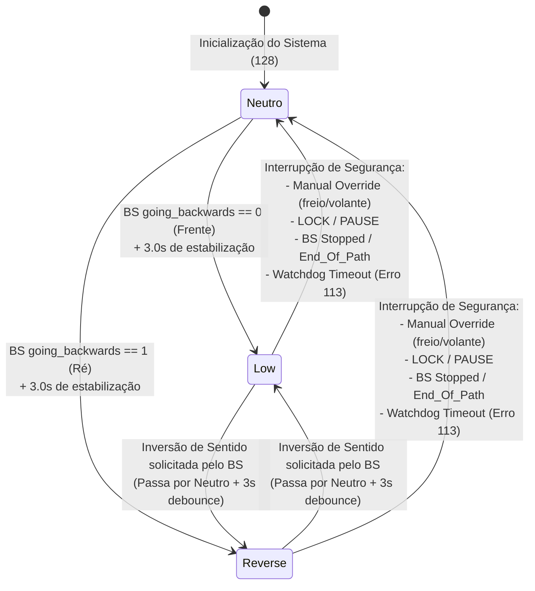

# Arquitetura de Seleção de Marcha e Velocidade no `vehicle_driver`

Este documento explica em detalhes a separação entre **Macro-Intenção Tática** e **Micro-Cinemática Instantânea** dentro do `vehicle_driver`, o papel das mensagens `path_goals_and_annotations` e `motion_command`, a máquina de estados da transmissão mecânica (Neutro, Low, Ré) e por que essa arquitetura garante a integridade mecânica do trem de força de veículos autônomos pesados (ex: caminhão Atego e Ford Escape).

---

## 1. O Dilema Fundamental: De onde vem a Velocidade e de onde vem a Marcha?

Ao executar o programa de calibração do PID com os argumentos:
```bash
./ford_escape_hybrid_tune_pid -max_v 2.0 -max_phi 5.0 -timer_period 1.0 -t1 4.0 -t2 4.0 -t3 4.0
```
Surge uma dúvida conceitual importante:
> *"Se eu estou publicando uma velocidade desejada de $2.0\text{ m/s}$ no `motion_command` através do binário de teste, por que a marcha do caminhão depende de anotações e metas do Behavior Selector (`path_goals_and_annotations`) e não simplesmente do sinal dessa velocidade?"*

### A Resposta Rápida:
1. **O Perfil Dinâmico de Velocidade ($0 \to 2.0 \to 0\text{ m/s}$)** vem **100% do `motion_command`**!
2. **A Marcha (Neutro, Frente ou Ré)** vem do **`behavior_selector`** através de `path_goals_and_annotations`.

A tabela abaixo resume a divisão de responsabilidades:

| Parâmetro | Mensagem IPC de Origem | Publicador | Frequência | Função no `vehicle_driver` |
| :--- | :--- | :--- | :--- | :--- |
| **Micro-Cinemática** ($v(t), \phi(t), dt$) | `base_ackerman_motion_command` | Planejador de Movimento (`mpp`, `motion_planner`) ou `tune_pid` | **20 a 50 Hz** (Alta frequência) | Determina a aceleração, frenagem e esterçamento instantâneos para o PID (`g_desired_velocity = v`). |
| **Macro-Intenção** (Sentido de Marcha) | `behavior_selector_path_goals_and_annotations` | Seletor de Comportamento (`behavior_selector`) ou `arm_vehicle_driver_for_motion` | **Baixa frequência** (Sob demanda / Por segmento de rota) | Determina o sentido de deslocamento daquele trecho de rota (`behavior_selector_going_backwards`) e comanda a caixa de câmbio (`g_gear_command`). |

---

## 2. A Engenharia de Segurança Mecânica: Por que NÃO trocar marcha pelo sinal do `motion_command`?

Em caminhões como o Mercedes-Benz Atego 1730 ou utilitários pesados, a transmissão automática/automatizada utiliza atuadores eletropneumáticos ou mecatrônicos. Trocar de marcha é uma operação mecânica pesada:
- Exige **parada completa** do veículo ($v \approx 0$).
- Exige acionamento de embreagem, sincronização de eixos da caixa e engate físico.
- Todo esse ciclo leva entre **1.0 a 3.0 segundos**.

### O Risco do Ruído Instantâneo (Jitter Cinemático)
Em algoritmos de planejamento contínuo a 40 Hz:
- Um cálculo de spline ou otimização numérica sob ruído de sensores pode momentaneamente gerar um ponto com velocidade discretizada de $-0.005\text{ m/s}$ durante 20 ms.
- Durante uma frenagem de emergência a $30\text{ km/h}$, o veículo pode ter overshoot no cálculo do erro.

Se o `vehicle_driver` mudasse a transmissão baseado no sinal instantâneo da velocidade do `motion_command`:
> [!CAUTION]
> O atuador da transmissão tentaria engatar **MARCHA À RÉ com o veículo ainda se movendo para frente a $30\text{ km/h}$**, o que destruiria o câmbio, embreagem ou eixos cardan do veículo real.

### A Proteção por Debounce Temporal (3 Segundos)
Por essa razão, o `vehicle_driver_main.cpp` ([linhas 2256–2277](file:///home/lume/astro/src/vehicle_driver/vehicle_driver_main.cpp#L2256-L2277)) impõe que qualquer mudança de direção de marcha precisa ser uma **decisão macroestratégica estável por pelo menos 3 segundos**:

```cpp
// 1. O Behavior Selector envia o plano de caminho:
if (path_goals_and_annotations_message->poses[path_goals_and_annotations_message->number_of_poses - 1].v < 0.0)
{
    current_intention = 1; // 1 = Ré (Reverse)
}
else
{
    current_intention = 0; // 0 = Frente (Low/Drive)
}

// 2. Registra se a intenção mudou e marca o timestamp
if (current_intention != last_behavior_selector_path_direction_change_intention)
{
    last_behavior_selector_path_direction_change_intention = current_intention;
    last_behavior_selector_path_direction_change_intention_timestamp = msg->timestamp;
}

// 3. TRAVA TEMPORAL: Exige 3 segundos contínuos na mesma intenção!
if ((msg->timestamp - last_behavior_selector_path_direction_change_intention_timestamp) > 3.0)
{
    behavior_selector_going_backwards = current_intention; // Autoriza 0 ou 1
}
else
{
    behavior_selector_going_backwards = -1; // -1 = TRANSITÓRIO / TRAVADO!
}
```

Enquanto `behavior_selector_going_backwards == -1`, a condição do loop de controle falha e o `vehicle_driver` **zera compulsoriamente a velocidade (`g_desired_velocity = 0.0`)**, impedindo qualquer aceleração enquanto a transmissão mecânica está em processo de troca.

---

## 3. Comparativo: Modo Antigo (`-tune_pid_mode on`) vs Modo Normal

No código de [`vehicle_driver_main.cpp`](file:///home/lume/astro/src/vehicle_driver/vehicle_driver_main.cpp#L1271-L1345), vemos claramente a bifurcação entre os dois modos:

```cpp
// Define comando de marcha baseado na intenção do BS:
set_gear_command_from_going_backwards(behavior_selector_going_backwards);

if (tune_pid_mode)
{
    // ==========================================
    // MODO LEGADO (tune_pid_mode == 1)
    // ==========================================
    // Bypassa completamente a proteção mecânica!
    set_gear_command_from_velocity_sign(v);
    g_desired_velocity = v;
}
else
{
    // ==========================================
    // MODO NORMAL / PRODUÇÃO (tune_pid_mode == 0)
    // ==========================================
    if (g_go_state && g_unlock_state &&
        (behavior_selector_low_level_state != Stopped) &&
        (behavior_selector_low_level_state != End_Of_Path_Reached2) &&
        (behavior_selector_going_backwards != -1))
    {
        // Só injeta velocidade no PID se a caixa de marcha já engatou e estabilizou!
        if (gear_is_ready_for_motion(last_XGV_gear_change_timestamp))
        {
            g_desired_velocity = v; // Injeta o v do motion_command!
        }
        else
        {
            g_desired_velocity = 0.0; // Aguarda estabilização do hardware
        }
    }
    else
    {
        g_desired_velocity = 0.0;
        set_gear_command_to_neutral_if_needed();
    }
}
```

- **Por que o modo antigo era problemático:** Ele criava um comportamento fictício ("laboratório") que ignorava o tempo de sincronismo da caixa real e bypassava o protocolo de câmbio que o caminhão roda na rua.
- **Por que o modo normal é superior:** Ele testa o controlador e o PID **exatamente sob as mesmas condições e travas de segurança mecânica** que estarão ativas na operação autônoma real.

---

## 4. Ciclo de Vida da Marcha (Máquina de Estados)

Os valores de marcha transmitidos via JAUS / ByWire obedecem à especificação:
- `128` = **Neutro (Neutral)**
- `1` = **Low (Primeira marcha com redução)**
- `2` = **Drive**
- `129` = **Ré (Reverse)**



### Como o veículo sai do Neutro:
Em [`gear_command_logic.cpp`](file:///home/lume/astro/src/vehicle_driver/gear_command_logic.cpp#L63-L73):
```cpp
void set_gear_command_from_going_backwards(int behavior_selector_going_backwards)
{
    if (behavior_selector_going_backwards == 1)
    {
        set_g_gear_command(129);  // 129 = Ré (Reverse)
    }
    else if (behavior_selector_going_backwards == 0)
    {
        set_g_gear_command(1);    // 1 = Low (Frente)
    }
}
```
Assim que a macro-intenção é validada, o comando é enviado ao barramento CAN / JAUS via `jaus_publish_gear_command()`.

### Quando a marcha volta para Neutro (`128`)?
O veículo **permanece engatado** durante toda a execução da trajetória. Ele **só volta para Neutro** quando ocorrer uma das seguintes interrupções:

1. **Interferência Humana (Manual Override):** O motorista pisa no freio ou interfere no volante.
2. **Desarme do Sistema (Lock / Pause):** Recebimento de comando de bloqueio (`g_unlock_state = 0`) ou pausa (`g_go_state = 0`).
3. **Parada do Behavior Selector:** O BS reporta `Stopped` ou `End_Of_Path_Reached2`.
4. **Watchdog de Comunicação (Timeout do Motion Command):** Se o planejador parar de enviar planos e estourar `motion_command_timeout`, o `vehicle_driver` chama `set_gear_command_to_neutral_if_needed()`.
5. **Comportamento Autônomo da Transmissão Física:** Se a ECU do caminhão (hardware XGV da Torc) reportar automaticamente que entrou em Neutro ([`gear_command_logic.cpp#L31`](file:///home/lume/astro/src/vehicle_driver/gear_command_logic.cpp#L31)), o sistema sincroniza o comando.

---

## 5. Como o `vehicle_driver_tune_pid.c` Orquestra Tudo

Para permitir que o teste do PID funcione no **Modo Normal** sem a presença do `behavior_selector` real, implementamos a função de preparação em [`vehicle_driver_tune_pid.c`](file:///home/lume/astro/src/vehicle_driver/vehicle_driver_tune_pid.c):

```c
void arm_vehicle_driver_for_motion(double target_velocity)
{
    int going_backwards = (target_velocity < 0.0) ? 1 : 0;

    // 1. Publica estado autônomo (UNLOCK e GO)
    publish_lock_unlock_command(1);
    publish_go_command(1);

    // 2. Emula o Behavior Selector no estado 'Initializing' (evita 'Stopped')
    publish_behavior_selector_state();

    // 3. Publica a macro-intenção de sentido (Frente ou Ré)
    publish_behavior_selector_path_goals_and_annotations(going_backwards);

    // 4. Aguarda 3.5 segundos para cumprir a trava temporal de debounce (> 3.0s)
    usleep(3500000);
}
```

### O que acontece durante esses 3.5 segundos:
1. O `vehicle_driver` recebe o `path_goals_and_annotations` e detecta a intenção de sentido.
2. O cronômetro interno do `vehicle_driver` conta 3,0 segundos contínuos na mesma intenção.
3. `behavior_selector_going_backwards` transiciona de `-1` para `0` (Frente) ou `1` (Ré).
4. `set_gear_command_from_going_backwards` altera `g_gear_command` de `128` (Neutro) para `1` (Low).
5. A função `gear_is_ready_for_motion()` retorna `true`.
6. Imediatamente após os 3,5 s, o `tune_pid` dispara o vetor de `motion_command` com `-max_v 2.0`.
7. A linha 1307 do `vehicle_driver_main.cpp` alimenta `g_desired_velocity = 2.0` no PID, e **o caminhão se desloca suavemente seguindo a curva de calibração!**

