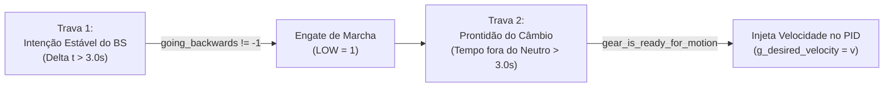
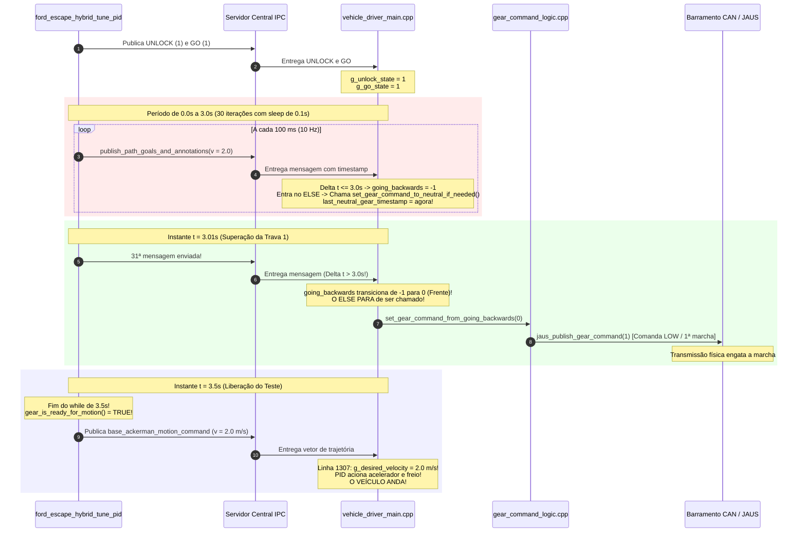

# Sincronização da Transmissão Mecânica: As Duas Travas de 3 Segundos e o Loop com `astro_ipc_sleep`

Este documento detalha o mecanismo interno de sincronização mecânica do `vehicle_driver`, explicando por que existem **duas travas consecutivas de 3 segundos**, o **ciclo vicioso (deadlock)** que impedia o veículo de andar sem o Behavior Selector, e como o loop contínuo de 3,5 segundos com `astro_ipc_sleep(0.1)` no `vehicle_driver_tune_pid.c` resolve essa sincronização.

---

## 1. O Problema: Por que um comando isolado não faz o carro andar?

Quando tentamos fazer o veículo andar no **Modo Normal** (sem `-tune_pid_mode on`) e sem os módulos superiores (`behavior_selector`, `route_planner`), enviar apenas uma mensagem de `UNLOCK`, uma de `GO` e publicar o `motion_command` não funciona: **o carro fica congelado no lugar com velocidade zero**.

Isso ocorre porque o `vehicle_driver` foi projetado para veículos pesados reais (caminhão Atego 1730 e Ford Escape), onde engatar uma marcha exige confirmações temporais rígidas para não quebrar a caixa de câmbio.

Existem **duas travas de 3 segundos** operando em série:



---

## 2. Detalhamento das Duas Travas de 3 Segundos

### Trava 1: Intenção Estável de Direção (Behavior Selector)
Localizada em [`vehicle_driver_main.cpp` (linhas 2270–2277)](file:///home/lume/astro/src/vehicle_driver/vehicle_driver_main.cpp#L2270-L2277):

```cpp
if (path_goals_and_annotations_message->poses[...].v < 0.0)
    current_intention = 1; // 1 = Ré
else
    current_intention = 0; // 0 = Frente

if (current_intention != last_behavior_selector_path_direction_change_intention)
{
    last_behavior_selector_path_direction_change_intention = current_intention;
    last_behavior_selector_path_direction_change_intention_timestamp = msg->timestamp;
}

// TRAVA TEMPORAL: Exige que a mesma intenção persista por mais de 3.0s!
if ((msg->timestamp - last_behavior_selector_path_direction_change_intention_timestamp) > 3.0)
{
    behavior_selector_going_backwards = current_intention; // Autoriza 0 ou 1
}
else
{
    behavior_selector_going_backwards = -1; // -1 = TRANSITÓRIO / INDECISO!
}
```

* **Função:** Impedir que o caminhão mude o sentido da marcha por ruído momentâneo no planejador.
* **Comportamento:** O sistema só define `behavior_selector_going_backwards` como `0` (Frente) ou `1` (Ré) se você provar que a intenção se manteve inalterada por **mais de 3,0 segundos contínuos**. Enquanto isso não acontece, o valor permanece `-1`.

---

### Trava 2: Prontidão Mecânica da Transmissão (`gear_is_ready_for_motion`)
Localizada em [`gear_command_logic.cpp` (linhas 93–109)](file:///home/lume/astro/src/vehicle_driver/gear_command_logic.cpp#L93-L109):

```cpp
bool gear_is_ready_for_motion(double last_XGV_gear_change_timestamp)
{
    // Exige mais de 3 segundos desde a última vez que esteve em Neutro
    // E mais de 3 segundos desde a última troca física de marcha do hardware
    return ((astro_get_time() - last_neutral_gear_timestamp > 3.0) && 
            (astro_get_time() - last_XGV_gear_change_timestamp > 3.0));
}

void set_gear_command_to_neutral_if_needed()
{
    set_g_gear_command(128); // 128 = Neutro
    last_neutral_gear_timestamp = astro_get_time(); // <--- RESET DO CRONÔMETRO!
}
```

* **Função:** Aguardar o tempo físico que os garfos pneumáticos da caixa de câmbio levam para engatar a engrenagem e sincronizar a embreagem.
* **Comportamento:** Retorna `false` se o carro acabou de sair do neutro há menos de 3.0 segundos.

---

## 3. O Ciclo Vicioso (Deadlock) que Travava o Veículo

Observe como o laço de controle principal em [`vehicle_driver_main.cpp` (linhas 1293–1343)](file:///home/lume/astro/src/vehicle_driver/vehicle_driver_main.cpp#L1293-L1343) conecta essas duas travas:

```cpp
if (g_go_state && g_unlock_state &&
    (behavior_selector_low_level_state != Stopped) &&
    (behavior_selector_low_level_state != End_Of_Path_Reached2) &&
    (behavior_selector_going_backwards != -1)) // <-- CONDICIONADO PELA TRAVA 1
{
    if (gear_is_ready_for_motion(last_XGV_gear_change_timestamp)) // <-- CONDICIONADO PELA TRAVA 2
    {
        g_desired_velocity = v; // Carro anda!
    }
    else
    {
        g_desired_velocity = 0.0; // Neutro recente
    }
}
else
{
    // <-- SE A TRAVA 1 FALHAR, CAI AQUI A CADA 25 ms (40 Hz)!
    g_desired_velocity = 0.0;
    set_gear_command_to_neutral_if_needed(); // <-- ATUALIZA last_neutral_gear_timestamp = agora!
}
```

### O que acontecia quando enviávamos apenas uma mensagem isolada:
1. Uma única mensagem de `path_goals_and_annotations` era enviada no instante $t = 0$.
2. O `vehicle_driver` calculava: $\Delta t = (0 - 0) = 0 \le 3.0\text{s}$.
3. Portanto, `behavior_selector_going_backwards` recebia `-1`.
4. Com `-1`, a condição do `if` falhava e o código caía no `else`.
5. O `else` executava `set_gear_command_to_neutral_if_needed()` 40 vezes por segundo.
6. A cada execução, `last_neutral_gear_timestamp` era atualizado para o tempo atual (`astro_get_time()`).
7. **Resultado:** O cronômetro do Neutro nunca saía do zero ($t - t_{\text{neutro}} = 0.00\text{s}$). O `gear_is_ready_for_motion` **jamais se tornava verdadeiro**, e a velocidade desejada ficava permanentemente zerada.

---

## 4. A Solução: O Loop de 3.5 segundos em `vehicle_driver_tune_pid.c`

Para quebrar esse ciclo vicioso, implementamos a função de armação em [`vehicle_driver_tune_pid.c` (linhas 624–643)](file:///home/lume/astro/src/vehicle_driver/vehicle_driver_tune_pid.c#L624-L643):

```c
static void
arm_vehicle_driver_for_motion(double target_velocity)
{
    astro_ford_escape_unlock();
    astro_navigator_ackerman_go();

    double start_wait = astro_get_time();

    while (astro_get_time() - start_wait < 3.5)
    {
        publish_behavior_selector_state(Initializing);
        publish_behavior_selector_path_goals_and_annotations(target_velocity);
        astro_ipc_sleep(0.1); // Envia 10 vezes por segundo
    }
}
```

### Linha do Tempo Segundo a Segundo da Execução do Loop:

| Tempo Decorrido | Ação do Teste (`tune_pid`) | Estado da Trava 1 (`going_backwards`) | Estado da Trava 2 (`last_neutral_timestamp`) | Estado da Marcha (`g_gear_command`) |
| :--- | :--- | :--- | :--- | :--- |
| **$t = 0.0\text{ s}$** | Envia 1ª mensagem | `-1` ($\Delta t = 0.0\text{s} \le 3.0$) | Resetado para $0.0\text{s}$ | `128` (Neutro) |
| **$t = 1.0\text{ s}$** | Envia 10ª mensagem | `-1` ($\Delta t = 1.0\text{s} \le 3.0$) | Resetado para $1.0\text{s}$ | `128` (Neutro) |
| **$t = 2.0\text{ s}$** | Envia 20ª mensagem | `-1` ($\Delta t = 2.0\text{s} \le 3.0$) | Resetado para $2.0\text{s}$ | `128` (Neutro) |
| **$t = 3.0\text{ s}$** | Envia 30ª mensagem | `-1` ($\Delta t = 3.0\text{s} \le 3.0$) | Resetado para $3.0\text{s}$ | `128` (Neutro) |
| **$t = 3.01\text{ s}$** | **Envia 31ª mensagem** | **Transiciona para `0` (Frente)!** ($\Delta t > 3.0\text{s}$) | **O `else` PARA de ser chamado! O cronômetro NÃO é mais resetado!** | **Comanda `1` (LOW / 1ª Marcha)!** |
| **$t = 3.1\text{ s}$ a $3.5\text{ s}$** | Mantém envio ativo | `0` (Estável) | O hardware da transmissão conclui o engate físico da marcha | `1` (Engatado) |
| **$t = 3.5\text{ s}$** | **Fim do loop!** Dispara o `motion_command` com $v = 2.0\text{ m/s}$ | `0` (Frente) | `gear_is_ready_for_motion() == true` | **PID recebe $g\_desired\_velocity = 2.0$ e o veículo anda!** |

---

## 5. Como Funciona o `astro_ipc_sleep(0.1)`?

Existia uma dúvida sobre o que esse comando realmente faz:
> *"O `astro_ipc_sleep` faz o IPC não receber nada durante o sleep? Bloqueia os outros programas?"*

### A Resposta:
1. **Ele dorme por frações de segundo:**
   O argumento é em segundos (`double`). Passar `0.1` significa pausar por **$100\text{ milissegundos}$**.
   Como $1\text{ segundo} / 0.1\text{ segundos} = 10$, o loop executa **10 vezes por segundo (10 Hz)**.
   Em 3,5 segundos, são transmitidas exatamente **35 mensagens**.

2. **Ele afeta APENAS o processo do teste:**
   No Linux, `vehicle_driver`, `simulator` e `ford_escape_hybrid_tune_pid` são processos completamente independentes. Quando o teste faz a pausa de 100 ms, o `vehicle_driver` e o simulador continuam executando normalmente a 40 Hz sem nenhuma interrupção.

3. **Ele NÃO bloqueia o IPC — ele processa a fila:**
   Diferente do `usleep()` padrão do C (que apenas congela a thread do sistema operacional), a documentação oficial em [`include/astro/ipc_wrapper.h`](file:///home/lume/astro/include/astro/ipc_wrapper.h#L83-L97) define:
   ```c
   /** Service IPC callbacks for timeout seconds.
    * Positive durations are rounded up to the next microsecond.
    */
   void astro_ipc_sleep(double timeout);
   ```
   *"Service IPC callbacks"* significa: durante os 100 ms de pausa, o processo fica escutando os descritores de arquivo (sockets) e executando callbacks de qualquer mensagem que chegar. Ele **não perde pacotes nem congela buffers**.

---

## 6. Diagrama de Sequência Completo



