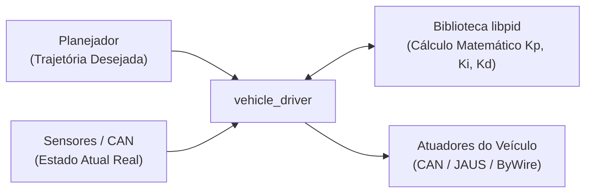
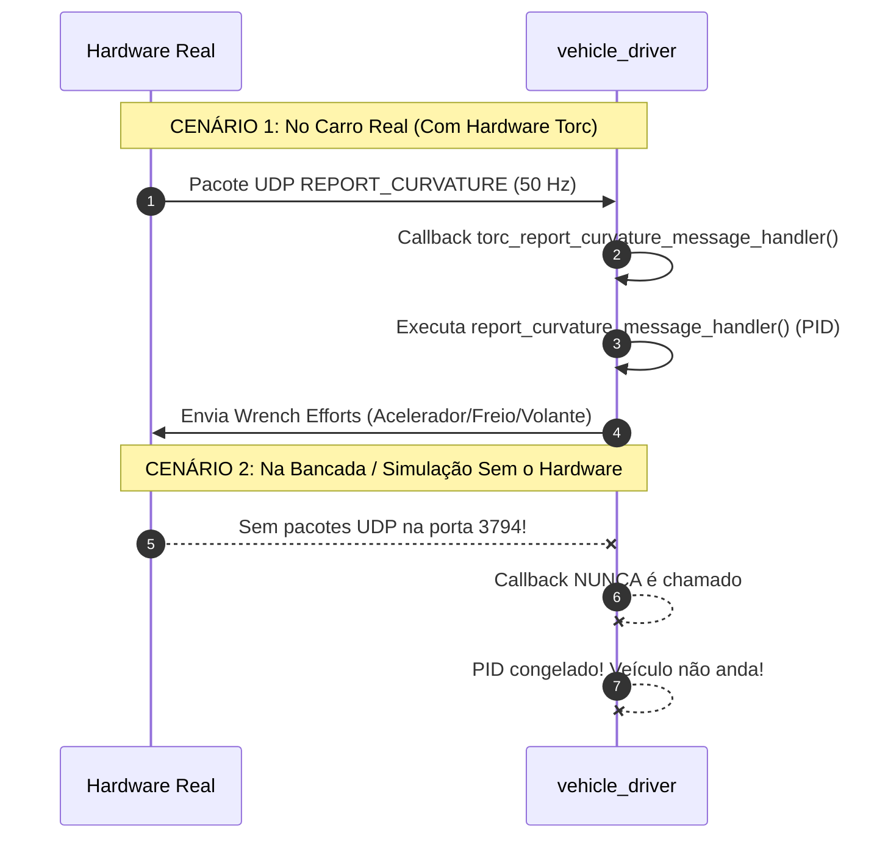

# Arquitetura e Fluxo de Execução: Controladores PID e Integração JAUS

Este documento descreve detalhadamente o papel dos controladores PID, o fluxo de dados no módulo `vehicle_driver` e a integração com o protocolo OpenJAUS/Torc, explicando o desafio de execução em bancada e a solução implementada.

---

## 1. O que é o PID e sua Relação com o Vehicle Driver

O **PID** (`sharedlib/libcontrol/libpid`) é a biblioteca matemática responsável por calcular os comandos físicos de freio, aceleração, volante e marcha necessários para manter o veículo atuando com a precisão e a velocidade de trajetória desejadas.

A biblioteca PID é puramente computacional: **ela não sabe como se comunicar com o hardware**. Ela funciona como uma ferramenta especializada utilizada pelo **`vehicle_driver`**, que é o módulo executivo responsável por arbitrar essas ordens e despachá-las para os barramentos físicos do veículo (barramento CAN e rede Ethernet Torc/JAUS), que são quem de fato acionam os atuadores.



### Entradas e Saídas do PID

O PID recebe continuamente o estado real do veículo comparado à referência desejada:
- **Entradas:**
  - Velocidade atual ($v_{atual}$) vs. Velocidade desejada ($v_{desejada}$).
  - Curvatura/ângulo atual ($\phi_{atual}$) vs. Curvatura/ângulo desejado ($\phi_{desejado}$).

- **Saídas (Esforços Físicos Calculados):**
  - **Acelerador (Throttle):** $0\%$ a $100\%$.
  - **Freio (Brakes):** $0\%$ a $\text{max\_brake}\%$.
  - **Volante / Esterçamento (Steering):** $-100\%$ a $+100\%$.
  - **Comando de Marcha (Gear):** Frente (*Drive / Low*) ou Ré (*Reverse*).

---

## 2. Resumo do Fluxo do Vehicle Driver

O ciclo de operação do `vehicle_driver` estrutura-se em 6 etapas sequenciais:

1. **Recebe o plano de navegação:**
   Escuta o planejador de trajetória e rotas via IPC (`motion_planner`, `rrt`, `obstacle_avoider`).
2. **Coleta os sensores:**
   Lê a velocidade real do veículo (odometria) e a posição angular das rodas vindas dos sensores e decodificadas do barramento CAN.
3. **Consulta o PID:**
   Passa os dados de erro ($e(t) = \text{alvo} - \text{atual}$) para a biblioteca de controle e pergunta: *"Quanto devo acelerar, frear e virar agora?"*.
4. **Aplica travas de segurança:**
   Verifica paradas de emergência, falhas em sensores críticos e se o motorista humano tocou no volante ou pedais (*manual override*).
5. **Comunica com a máquina:**
   Converte as porcentagens calculadas em bytes e pacotes dos protocolos específicos do veículo e os despacha para o barramento CAN (ou via interfaces ByWire, OpenJAUS, ODrive, etc.).
6. **Gera telemetria:**
   Publica mensagens de diagnóstico do PID para gravação na caixa-preta (`audit`) e visualização em tempo real nas telas (`viewer_3D`, `central_log_view`).

---

## 3. Modo Normal (Navegação) vs. Modo Tune PID (Calibração)

No `vehicle_driver`, existem dois contextos distintos de operação:

| Característica | Modo Normal (Navegação Autônoma) | Modo Tune PID (Calibração e Sintonia) |
| :--- | :--- | :--- |
| **Pré-requisitos** | Exige mapa, missão, GPS, desvio de obstáculos e autorização contínua do *Behavior Selector*. | Ignora missões, mapas e o *Behavior Selector*. |
| **Origem do Plano** | Vem de planejadores dinâmicos globais e locais (`route_planner`, `mpp`). | Vem de um programa de estímulo dedicado (`ford_escape_hybrid_tune_pid`). |
| **Estímulo Aplicado** | Trajetórias reais da via com curvas, pedestres e cruzamentos. | Injeção de perfis sintéticos padronizados (ex: rampa trapezoidal de 0 a 2 m/s, degraus de velocidade ou senoides no volante). |
| **Objetivo** | Levar o veículo do ponto A ao ponto B com segurança. | **Medir e calibrar os ganhos ($K_p, K_i, K_d$)**, verificando se o veículo oscila, ultrapassa o valor alvo (*overshoot*) ou demora para responder. |

---

## 4. Como os Comandos Chegam aos Atuadores: O Protocolo JAUS

Após o PID calcular os esforços percentuais de freio, acelerador e direção, esses valores precisam alcançar os servomotores físicos do veículo. No caso da Ford Escape Hybrid e dos veículos baseados na arquitetura ByWire Torc, isso é feito através do protocolo **OpenJAUS**:
- A comunicação ocorre via rede Ethernet através de pacotes UDP na porta padronizada **3794**.
- Alternativamente, em plataformas sem módulo Torc, essa comunicação é feita diretamente via barramento CAN nativo (modo DBC).

O `vehicle_driver` é o módulo responsável por empacotar esses esforços calculados pelo PID e transmiti-los ao JAUS.

---

## 5. O Desafio: Por que o JAUS não funcionava sem o veículo físico?

Durante os ensaios de bancada e simulação local, nos deparamos com o seguinte problema: **o PID não executava e o carro não se movia**.

### A Causa: Arquitetura Estritamente Orientada a Eventos (*Event-Driven*)

A implementação original do JAUS em [`vehicle_driver_jaus.cpp`](file:///home/lume/astro/src/vehicle_driver/vehicle_driver_jaus.cpp) foi projetada para ser **orientada a eventos físicos**:

1. A função central de controle do `vehicle_driver` (`report_curvature_message_handler()`) **não possuía um temporizador próprio**.
2. Ela dependia exclusivamente de um callback do OpenJAUS:
   ```cpp
   static void
   torc_report_curvature_message_handler(OjCmpt XGV_CCU, JausMessage curvature_message)
   {
       if (reportCurvature)
       {
           report_curvature_message_handler(); // Dispara o cálculo do PID
           publish_ford_escape_steering_throttle_and_brakes_command(XGV_CCU); // Envia os esforços
       }
   }
   ```
3. **No carro real:** A caixa física da Torc (computador CCU) conectada ao cabo de rede fica transmitindo pacotes UDP `REPORT_CURVATURE` continuamente a 40 Hz ~ 50 Hz. Toda vez que um pacote físico chega pela porta 3794, o OpenJAUS aciona o callback e o PID roda.
4. **Na bancada / simulação:** Como o hardware físico da Torc não existe na bancada, **nenhum pacote UDP chegava pela porta 3794**. O código ficava indefinidamente congelado à espera de um hardware inexistente, e o PID nunca era acionado.



---

## 6. A Solução: O Marca-Passo Periódico (*Heartbeat*)

Para permitir que o `vehicle_driver` opere em qualquer computador sem depender da presença física do veículo ou da caixa da Torc:

1. **Criação do Temporizador Periódico no `vehicle_driver_main.cpp`:**
   Adicionamos um timer cíclico de alta precisão via IPC (`astro_ipc_addPeriodicTimer`):
   ```cpp
   astro_ipc_addPeriodicTimer(FORD_ESCAPE_CYCLE_TIME, (TIMER_HANDLER_TYPE) tune_pid_timer_handler, NULL);
   ```

2. **O Papel do `tune_pid_timer_handler`:**
   Esse timer atua como um **marca-passo**: a cada ciclo (40 Hz / 25 ms), ele força a chamada de:
   ```cpp
   static void
   tune_pid_timer_handler(...)
   {
       report_curvature_message_handler(); // Executa o PID e atualiza marchas/velocidade
       jaus_publish_wrench_efforts();       // Envia os comandos para a rede/CAN
   }
   ```

3. **Proteção contra Duplicação no Veículo Real:**
   Para evitar que no carro real haja duplo envio de comandos (um pelo hardware Torc e outro pelo timer), o timer verifica se há dados reais chegando da Torc nos últimos 200 ms:
   ```cpp
   if ((astro_get_time() - last_torc_curvature_message_time) < 0.2)
   {
       return; // O hardware físico está ativo: o timer se cala e cede a vez ao Torc nativo!
   }
   ```

---

## 7. Conclusão

Com essa arquitetura:
- **Na bancada e no simulador CAN (`vcan0`):** O timer mantém o laço do PID pulsando continuamente a 40 Hz, permitindo a calibração precisa dos parâmetros do veículo sem travar.
- **No veículo real com Torc-JAUS:** O sistema detecta a presença dos pacotes físicos e preserva o fluxo nativo original, garantindo segurança total contra duplicação de comandos.

