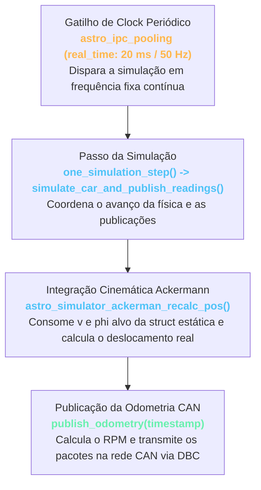
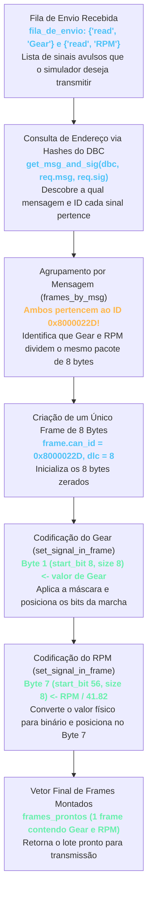

# Escrita e Envio de Odometria na Rede CAN (`publish_odometry`)

A via de envio do `simulator_ackerman_can` é responsável por fechar a malha de controle do veículo autônomo: ela simula a telemetria do caminhão (rotação do motor, velocidade e marcha engatada) e transmite periodicamente esses dados de volta para o barramento CAN através da função [`publish_odometry()`](file:///home/lume/astro/src/simulator_ackerman/simulator_ackerman_can_main.cpp#L683-L795).

---

## 1. O Ponto de Partida: O Loop Periódico de Simulação

Diferente da escuta (que fica bloqueada esperando frames chegarem no socket), o envio de telemetria é **orientado a tempo** (*time-driven*). Ele é disparado ciclicamente dentro do loop de pooling do simulador:



1. **`one_simulation_step()`**: Roda no período definido por `simulator_conf.real_time` (ex: a cada $20\text{ ms}$, equivalente a $50\text{ Hz}$).
2. **`astro_simulator_ackerman_recalc_pos()`**: Consome os alvos de velocidade $v$ e esterçamento $\phi$ (que foram gravados na estrutura estática `current_motion_command_vector` pela thread de escuta) e integra as equações cinemáticas do modelo Ackermann, atualizando a velocidade atual real `simulator_config->v` e a posição do carro no mapa.
3. **`publish_odometry(timestamp)`**: É acionada logo em seguida para gerar e transmitir a telemetria que a ECU do veículo real transmitiria nesse mesmo instante.

---

## 2. A Mensagem de Telemetria no DBC (`0x8000022D read`)

Conforme detalhado no [README 01](01_arquitetura_e_fluxo_geral.md#1-o-papel-do-simulator-can-na-pilha-autônoma-divisão-de-responsabilidades), o simulador envia suas informações de odometria usando as mensagens batizadas de **`read`** no arquivo `.dbc`, pois são as mensagens que o controlador autônomo ([`vehicle_driver`](file:///home/lume/astro/src/vehicle_driver/)) espera **ler** da CAN:

No arquivo [`ojAstro_fullDBC.dbc`](file:///home/lume/astro/src/astro_hal/dbc_file_example/ojAstro_fullDBC.dbc#L38-L43):

```dbc
#################### READ #########################

# marcha atual e rotação do motor
BO_ 0x8000022D read: 8 DRIVER
  SG_ Gear : 8|8@1+ (1,0) [0|255] "" CONTROLLER
  SG_ RPM : 56|8@1+ (41.82,0) [0|65535] "" CONTROLLER
VAL_ 0x8000022D Gear 59 "reverse_1" 61 "neutral" 60 "neutral" 62 "gear_1" ;
```

### O que o DBC define para essa mensagem?
* **Endereço CAN ID `0x8000022D`**: Pacote de **8 bytes (64 bits)** estendido transmitido para o barramento.
* **Sinal `Gear` (`8|8@1+`)**: Inicia no **bit 8 com largura de 8 bits** (ou seja, ocupa o **Byte 1** do payload).
* **Sinal `RPM` (`56|8@1+`)**: Inicia no **bit 56 com largura de 8 bits** (ou seja, ocupa o **Byte 7** do payload), com um fator de conversão de `41.82`.

```text
Endereço 0x8000022D (Mensagem 'read') — Payload de 8 Bytes:
+---------------+---------------+---------------+---------------+---------------+---------------+---------------+---------------+
|    Byte 0     |    Byte 1     |    Byte 2     |    Byte 3     |    Byte 4     |    Byte 5     |    Byte 6     |    Byte 7     |
| (Bits 0 a 7)  | (Bits 8 a 15) | (Bits 16 a 23)| (Bits 24 a 31)| (Bits 32 a 39)| (Bits 40 a 47)| (Bits 48 a 55)| (Bits 56 a 63)|
+---------------+---------------+---------------+---------------+---------------+---------------+---------------+---------------+
|     Livre     |     Gear      |     Livre     |     Livre     |     Livre     |     Livre     |     Livre     |      RPM      |
|   (8 bits)    |   (8 bits)    |   (8 bits)    |   (8 bits)    |   (8 bits)    |   (8 bits)    |   (8 bits)    |   (8 bits)    |
+---------------+---------------+---------------+---------------+---------------+---------------+---------------+---------------+
```

---

## 3. Simulação Física do Motor: O Cálculo do RPM

Ao entrar no bloco DBC de [`publish_odometry()`](file:///home/lume/astro/src/simulator_ackerman/simulator_ackerman_can_main.cpp#L695-L774):

```cpp
if (dbc_can_process.valid_parser == true)
{
    // 1. Tabela de proporções de marcha mockada no escopo
    double current_ratio = 0.0;

    switch (driver_outputs.current_gear)
    {
        case -1: current_ratio = 0.000781; break; // Ré
        case 1:  current_ratio = 0.000781; break; // 1ª marcha
        case 2:  current_ratio = 0.000833; break; // 2ª marcha
        case 3:  current_ratio = 0.001250; break; // 3ª marcha
        case 4:  current_ratio = 0.001666; break; // 4ª marcha
        case 5:  current_ratio = 0.002083; break; // 5ª marcha
        case 6:  current_ratio = 0.002500; break; // 6ª marcha
        case 7:  current_ratio = 0.003399; break; // 7ª marcha
        case 8:  current_ratio = 0.004461; break; // 8ª marcha
        default: current_ratio = 0.0;      break; // Neutro
    }

    // 2. Lógica base de RPM (marcha lenta padrão de 1400 RPM)
    double base_rpm = 1400.0;

    if (current_ratio > 0.000001)
    {
        base_rpm = astro_fmax(800, simulator_config->v / current_ratio);
    }

    // 3. Emulação estocástica (ruído e oscilação real de rotação do motor)
    driver_outputs.rpm = 1200 + sin(astro_get_time() / 5.0) * 50.0;
    double ttt = astro_uniform_random(0.0, 1.0);
    if (ttt < 0.2)
        driver_outputs.rpm += -50.0;
    else if (ttt > 0.8)
        driver_outputs.rpm += 50.0;
```

O simulador reproduz o comportamento de uma transmissão real:
1. Identifica a marcha atual engatada (`driver_outputs.current_gear`) e seleciona a relação mecânica (`current_ratio`).
2. Calcula o RPM proporcional à velocidade de translação do caminhão ($v / \text{ratio}$). Se o veículo estiver em ponto morto (`current_ratio == 0`), mantém o motor em marcha lenta.
3. Adiciona harmônicos senoidais e variações estocásticas (`sin(...)` e `astro_uniform_random`) para que o sensor de RPM não envie um sinal perfeitamente artificial, refletindo a vibração de um motor a combustão real.

---

## 4. Montagem da Fila de Envio em Lote (`SignalWriteRequest`)

Com o RPM calculado e a marcha atual identificada, o simulador prepara os sinais que devem ser transmitidos:

```cpp
    std::vector<astro_hal_can_interactions::SignalWriteRequest> fila_de_envio = {
        {"read", "Gear", current_gear},
        {"read", "RPM", driver_outputs.rpm}
    };
```

Cada item do vetor [`SignalWriteRequest`](file:///home/lume/astro/include/astro/astro_hal_can_interactions.hpp#L68-L73) especifica:
* **`msg_name`**: O grupo/mensagem no DBC (`"read"`);
* **`sig_name`**: O nome do sinal (`"Gear"` ou `"RPM"`);
* **`physical_value`**: O valor físico em ponto flutuante que desejamos transmitir (ex: `current_gear = 0x44` ou `rpm = 1250.0`).

---

## 5. O Empacotamento Inteligente em Lote (`build_can_frames_batch`)

Aqui ocorre uma das funções mais importantes do HAL. O simulador chama:

```cpp
    auto frames_prontos = astro_hal_can_interactions::build_can_frames_batch(dbc_can_process, fila_de_envio);
```

Dentro de [`build_can_frames_batch()`](file:///home/lume/astro/include/astro/astro_hal_can_interactions.hpp#L579-L627), o HAL executa o agrupamento inteligente:



### 5.1. Agrupamento Automático de Mensagens
Em vez de criar um frame para o `Gear` e outro para o `RPM`, o HAL utiliza o mapa `std::unordered_map<const Libdbc::Message*, BatchFrameResult> frames_by_msg`:
* Na primeira iteração (`"Gear"`), ele busca na hash `composite_to_message["read::gear"]` e descobre que o ID é `0x8000022D`. Como esse frame ainda não existe no lote, cria um `can_frame` vazio com ID `0x8000022D` e `dlc = 8`.
* Na segunda iteração (`"RPM"`), ele busca `composite_to_message["read::rpm"]` e descobre que o ID **também é `0x8000022D`**. O HAL reaproveita o mesmo frame já criado!

### 5.2. A Equação Inversa da Física (`set_signal_in_frame`)
Dentro de [`set_signal_in_frame()`](file:///home/lume/astro/include/astro/astro_hal_can_interactions.hpp#L453-L507), o HAL faz o caminho inverso do que vimos na leitura: ele transforma o número físico em bits brutos (*raw*):

$$\text{raw\_value} = \frac{\text{physical\_value} - \text{offset}}{\text{factor}}$$

* Para o **`RPM`**, onde `factor = 41.82` e `offset = 0`:
  $$\text{raw} = \frac{1250{,}0}{41{,}82} \approx 30$$
* Em seguida, o HAL aplica o deslocamento para o bit correto:
  ```cpp
  uint64_t payload = (raw_value << sig->start_bit); // Desloca 56 bits para o Byte 7
  ```
* E mescla esse payload com os dados do frame sem sobrescrever o `Gear` que já estava gravado no Byte 1:
  ```cpp
  frame->data[i] |= static_cast<unsigned char>((payload >> (i * 8)) & 0xFF);
  ```

---

## 6. Transmissão no Barramento CAN (`send_message_frame`)

Com o vetor de frames consolidado, o simulador percorre os lotes prontos e transmite cada pacote na rede CAN:

```cpp
    for (auto& lote : frames_prontos) 
    {
        astro_hal_can_interactions::send_message_frame(
            dbc_can_process,
            lote.anchor_msg_name,
            lote.anchor_sig_name,
            &lote.frame
        );
    }
```

Dentro de [`send_message_frame()`](file:///home/lume/astro/include/astro/astro_hal_can_interactions.hpp#L510-L548):
1. **Identificação da Interface de Rede:** A função consulta a hash `signal_to_interface` usando o sinal âncora (`lote.anchor_sig_name`, ex: `"read::gear"`) para descobrir em qual interface CAN aquele sinal deve trafegar (ex: `can0` ou `vcan0`).
2. **Obtenção do Socket:** Consulta a hash `interface_to_socket` para recuperar o descritor de arquivo aberto na inicialização (`can_sockfd`).
3. **Envio Físico:** Dispara a chamada de sistema do SocketCAN:
   ```cpp
   send_frame(socket_fd, frame);
   ```

Nesse exato momento, o frame com ID `0x8000022D` contendo a marcha atual e o RPM simulado do motor é colocado no barramento CAN. O `vehicle_driver`, que está escutando na outra ponta, lê esse pacote para atualizar seus controladores e fechar o ciclo de condução autônoma.
