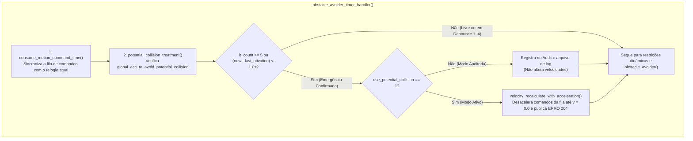
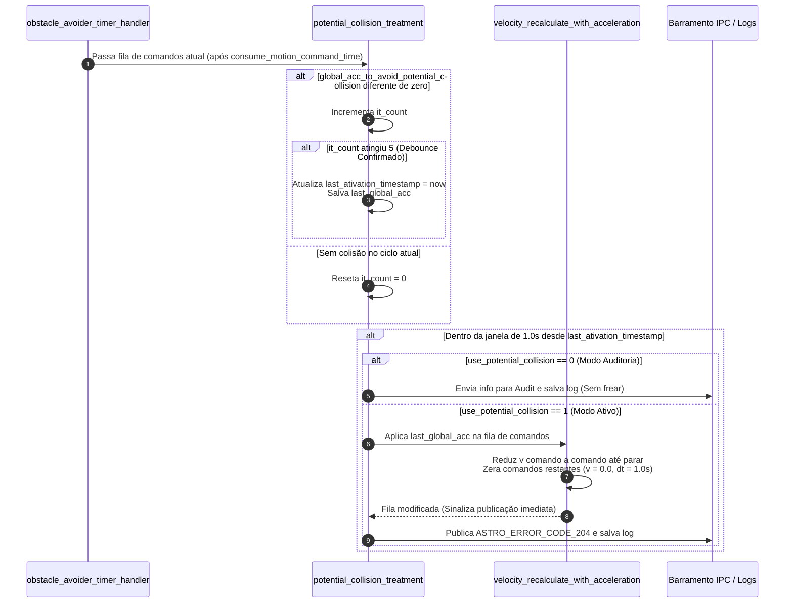

# Atuação de Emergência: `potential_collision_treatment()`

A função [`potential_collision_treatment()`](file:///home/lume/astro/src/obstacle_avoider/obstacle_avoider_main.cpp#L1205-L1312) é a **terceira e última etapa do ciclo de colisão de emergência (*Potential Collision*)**, executada dentro do [`obstacle_avoider_timer_handler()`](file:///home/lume/astro/src/obstacle_avoider/obstacle_avoider_main.cpp#L1389) logo após o consumo temporal da fila ([`05_consumo_temporal_e_sincronizacao.md`](05_consumo_temporal_e_sincronizacao.md)).

> [!IMPORTANT]
> **Resumo do Papel da `potential_collision_treatment()`:**
> * **Condição de entrada:** Lê a variável global de controle `global_acc_to_avoid_potential_collision`, que foi previamente preenchida no handler do `localize` pela **Etapa 1 ([`06_desaceleracao_preventiva_phi_fixo.md`](06_desaceleracao_preventiva_phi_fixo.md))** ou pela **Etapa 2 ([`07_extensao_seguranca_potential_collision.md`](07_extensao_seguranca_potential_collision.md))**.
> * **O problema que ela resolve:** Impede que um ruído isolado de sensor (um falso positivo de 1 único ciclo) cause uma freada brusca desnecessária, exigindo que o perigo se confirme por **5 iterações consecutivas (Debounce 5/5)** antes de intervir no plano.
> * **Como atua:** Uma vez atingido o Debounce 5/5, trava o estado de emergência ativo por **$1{,}0\text{ segundo}$** (`(now - last_ativation_timestamp) < 1.0`) e:
>   * Se `use_potential_collision == 0` (**Modo Auditoria**): Apenas grava o erro em log e envia para a auditoria, sem alterar as velocidades do plano.
>   * Se `use_potential_collision == 1` (**Modo Ativo**): Chama [`velocity_recalculate_with_acceleration()`](file:///home/lume/astro/src/obstacle_avoider/obstacle_avoider.cpp#L1060) para aplicar a desaceleração de alarme diretamente nos comandos do plano atual até zerar a velocidade do veículo, além de publicar o `ASTRO_ERROR_CODE_204`.

---

## 1. Posição no Fluxo de Execução

Dentro do escopo de [`obstacle_avoider_timer_handler()`](file:///home/lume/astro/src/obstacle_avoider/obstacle_avoider_main.cpp#L1359), a função atua imediatamente após a fila ter sido sincronizada no tempo por `consume_motion_command_time()`:



---

## 2. Fluxo de Funcionamento da `potential_collision_treatment()`

A lógica interna da função divide-se em três mecanismos sequenciais:

### Passo 1: Filtro de Persistência (Debounce de 5 Iterações)
Toda vez que `potential_collision_treatment()` é chamada, ela inspeciona se `global_acc_to_avoid_potential_collision` contém uma desaceleração de alarme (`fabs(global_acc_to_avoid_potential_collision) > EPSILON`):

```cpp
if (fabs(global_acc_to_avoid_potential_collision) > EPSILON)
{
    it_count++;
    ...
    if (it_count >= it_count_to_activate) // it_count_to_activate = 5
    {
        last_ativation_timestamp = astro_get_time();
        last_global_acc_to_avoid_potential_collision = global_acc_to_avoid_potential_collision;
    }
}
else
{
    it_count = 0;
}
```
* **Nas iterações 1 a 4 (`it_count < 5`):** O código apenas incrementa `it_count` e imprime `[DEBOUNCE x/5] Obstaculo detectado... Validando persistencia...`, sem frear o caminhão ainda. Se o obstáculo sumir antes da 5ª iteração, `it_count` volta a `0` (`[DEBOUNCE RESET]`).
* **A partir da 5ª iteração consecutiva (`it_count >= 5`):** Confirma-se que o obstáculo é real (`>>> [DEBOUNCE 5/5 CONFIRMADO -> FREIO DE EMERGENCIA ATIVADO!] <<<`). Nesse instante, salva-se o horário atual em `last_ativation_timestamp` e congela-se a desaceleração em `last_global_acc_to_avoid_potential_collision`.

---

### Passo 2: Janela de Retenção de $1{,}0\text{ s}$ e Modo Auditoria
Confirmado o debounce, o bloco de atuação permanece ativo por **$1{,}0\text{ segundo}$** a partir da última confirmação (`if ((now - last_ativation_timestamp) < 1.0)`), garantindo que a frenagem não oscile caso o sensor pisque por uma fração de segundo:

```cpp
if ((now - last_ativation_timestamp) < 1.0)
{
    int current_error = get_astro_error_for_oa_mediation_error_code();
    char *oa_mediation_error_custom_string = get_astro_error_for_oa_mediation_error_custom_string();

    if ((use_potential_collision == 0))
    {
        // Apenas registra no audit e em potential_collision_error_log.txt, e retorna sem frear
        EXEC_COOLDOWN(send_potential_collision_info_to_audit(oa_mediation_error_custom_string), 1.0);
        save_potential_collision_error();
        return;
    }
    ...
```
* Se o parâmetro `obstacle_avoider_use_potential_collision` estiver desligado (`0`), a função opera em **Modo Auditoria**: grava a ocorrência no log e envia para o módulo de auditoria, mas executa `return` antes de tocar no vetor de comandos.

---

### Passo 3: Recálculo das Velocidades do Plano (`velocity_recalculate_with_acceleration`)
Com `use_potential_collision == 1`, a função chama [`velocity_recalculate_with_acceleration()`](file:///home/lume/astro/src/obstacle_avoider/obstacle_avoider.cpp#L1060-L1177) para modificar diretamente o vetor de comandos ativo (`current_motion_commands_vector`):

```cpp
velocity_recalculate_with_acceleration(
    current_motion_commands_vector, 
    num_motion_commands,
    last_global_acc_to_avoid_potential_collision, 
    (should_print_act ? out_act : NULL)
);
```

Dentro de `velocity_recalculate_with_acceleration()`, cada comando $i$ da fila tem sua velocidade reduzida progressivamente usando a desaceleração de emergência (`acceleration`, ex.: $-1{,}00\text{ m/s}^2$) e seu tempo de passo reajustado proporcionalmente:

```cpp
for (i = 0; i < num_motion_commands; i++)
{
    if (i > 0)
        motion_commands_vector[i].v = motion_commands_vector[i - 1].v;

    motion_commands_vector[i].v += acceleration * motion_commands_vector[i].time;
    motion_commands_vector[i].time *= (1 - (motion_commands_vector[i].v / original_index_velocity)) + 1;

    set_new_motion_command_needs_to_be_published(1);

    bool stopped = (fabs(motion_commands_vector[i].v) < 0.05) ||
                   (first_sign != astro_sign(motion_commands_vector[i].v));
    if (stopped)
    {
        motion_commands_vector[i].time = 1.0;
        motion_commands_vector[i].v = 0.0;
        i++;
        break;
    }
}

// Zera todos os comandos restantes da fila após atingir a parada
for (; i < num_motion_commands; i++)
{
    motion_commands_vector[i].time = 1.0;
    motion_commands_vector[i].v = 0.0;
}
```
* Assim que a velocidade calculada cai abaixo de $0{,}05\text{ m/s}$ (ou inverte de sinal), aquele comando e **todos os comandos subsequentes da fila são cravados em `v = 0.0 m/s` e `time = 1.0 s`**.
* A flag `set_new_motion_command_needs_to_be_published(1)` avisa o final do `obstacle_avoider_timer_handler()` que o plano foi modificado pelo OA e precisa ser republicado imediatamente para o controle de baixo nível.
* Por fim, publica-se o erro **`ASTRO_ERROR_CODE_204`** via IPC (com cooldown de $0{,}5\text{ s}$) e registra-se o evento em `./potential_collision_error_log.txt`.

---

## 3. Diagrama de Sequência e Fluxo Interno


