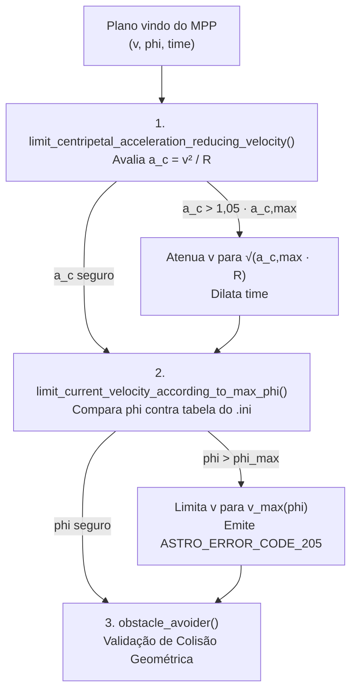

# 04 - Restrições de Dinâmica do Veículo: Aceleração Centrípeta e Limite de Esterçamento ($\phi$)

Antes de projetar os comandos no mapa de obstáculos e testar colisões geométricas, o `obstacle_avoider` avalia a **segurança dinâmica** do veículo. O objetivo é impedir que o caminhão entre em curvas com velocidade excessiva, o que causaria derrapagem lateral, risco de tombamento (*rollover*) ou efeito canivete (*jackknifing*) com os semirreboques.

Essa proteção é executada em cascata dentro de [`obstacle_avoider_timer_handler()`](file:///home/lume/astro/src/obstacle_avoider/obstacle_avoider_main.cpp#L1370) através de dois mecanismos complementares:

1. **[`limit_centripetal_acceleration_reducing_velocity()`](#1-limitação-contínua-por-aceleração-centrípeta-limit_centripetal_acceleration_reducing_velocity)**: Baseado na física contínua da aceleração lateral e no modelo de Ackerman.
2. **[`limit_current_velocity_according_to_max_phi()`](#2-limitação-tabelada-por-esterçamento-máximo-limit_current_velocity_according_to_max_phi)**: Baseado em uma tabela de pontos de calibração configurada no arquivo `.ini` (emite o `ASTRO_ERROR_CODE_205`).



---

## 1. Limitação Contínua por Aceleração Centrípeta (`limit_centripetal_acceleration_reducing_velocity`)

Essa função calcula analiticamente a força lateral em cada comando da trajetória utilizando o modelo cinemático de Ackerman.

### 1.1. Formulação Física

1. **Raio da Curva ($R$):**  
   A partir da distância entre eixos da cabine ($L$, parâmetro `distance_between_front_and_rear_axles`) e do ângulo de esterçamento $\phi$ do comando:

$$R = \frac{L}{|\tan(\phi)|}$$

2. **Aceleração Centrípeta Resultante ($a_c$):**  
   Utiliza a velocidade atual da odometria ($v_{\text{atual}}$) para avaliar a aceleração lateral caso o veículo entre na curva mantendo o ritmo atual:

$$a_c = \frac{v_{\text{atual}}^2}{R}$$

3. **Condição de Disparo (com margem de 5% de tolerância):**  
   Para evitar oscilações em pequenas variações de ângulo, a atenuação só dispara se a aceleração ultrapassar o limite configurado com 5% de histerese:

$$a_c > 1{,}05 \cdot a_{c,\max}$$

*(onde $a_{c,\max}$ é lido do parâmetro `robot_max_centripetal_acceleration` do `.ini`, tipicamente $1{,}0\text{ m/s}^2$)*.

4. **Velocidade Máxima Segura ($v_{\text{segura}}$):**  
   Invertendo a equação centrípeta para isolar a velocidade que restabelece $a_c \le a_{c,\max}$:

$$v_{\text{segura}} = \sqrt{a_{c,\max} \cdot R}$$

---

### 1.2. Implementação no Código

Trecho de [`obstacle_avoider.cpp`](file:///home/lume/astro/src/obstacle_avoider/obstacle_avoider.cpp#L368-L400):

```c
void limit_centripetal_acceleration_reducing_velocity(astro_robot_and_trailers_motion_command_t *motion_commands_vector, 
                                                     int num_motion_commands, 
                                                     double current_velocity, 
                                                     double robot_max_centripetal_acceleration, 
                                                     double distance_between_front_and_rear_axles)
{
    for (int i = 0; i < num_motion_commands; i++)
    {
        // 1. Linhas retas têm R -> infinito, sem força lateral
        if (fabs(motion_commands_vector[i].phi) > 0.001)
        {
            double radius_of_curvature = distance_between_front_and_rear_axles / fabs(tan(motion_commands_vector[i].phi));
            double centripetal_acceleration = (current_velocity * current_velocity) / radius_of_curvature;

            // 2. Excesso acima do teto com 5% de tolerância
            if (centripetal_acceleration > (1.05 * robot_max_centripetal_acceleration))
            {
                double v_for_centripetal = sqrt((robot_max_centripetal_acceleration) * radius_of_curvature);

                if (motion_commands_vector[i].v < 0.0)
                    v_for_centripetal = -v_for_centripetal;

                // 3. Dilatação proporcional do tempo para manter a geometria
                motion_commands_vector[i].time *= (1 - (v_for_centripetal / motion_commands_vector[i].v)) + 1;
                motion_commands_vector[i].v = v_for_centripetal;

                // 4. Solicita publicação imediata para a base ackerman
                if (get_new_motion_command_needs_to_be_published() == 0)
                {
                    set_new_motion_command_needs_to_be_published(1);
                }
            }
        }
    }
}
```

#### Preservação da Geometria da Curva
Note a expressão de dilatação temporal do comando:
```c
motion_commands_vector[i].time *= (1 - (v_for_centripetal / motion_commands_vector[i].v)) + 1;
```
Ela equivale a multiplicar o tempo por $\left(2 - \frac{v_{\text{novo}}}{v_{\text{antigo}}}\right)$, que é a aproximação linear de Taylor de $\frac{v_{\text{antigo}}}{v_{\text{novo}}}$.  
Ao reduzir a velocidade e dilatar o tempo, a distância percorrida pelo comando ($\Delta S = v \cdot \Delta t$) permanece praticamente idêntica, garantindo que o caminhão contorne a curva exatamente no traçado planejado pelo MPP, apenas mais devagar.

---

## 2. Limitação Tabelada por Esterçamento Máximo (`limit_current_velocity_according_to_max_phi`)

Enquanto a aceleração centrípeta avalia a dinâmica instantânea, essa segunda função aplica um **envelope experimental de operação**, calibrado para cada veículo no arquivo `.ini`.

### 2.1. Configuração via Arquivo `.ini`

A curva de calibração é definida pelo parâmetro:
```ini
obstacle_avoider_v_and_max_phi_reference_points  0.0,0.5235; 1.0,0.5235; 2.0,0.4000; 4.0,0.2000; 6.0,0.1000
```
Cada par `v, phi` define a velocidade e o ângulo máximo $\phi_{\max}$ (em radianos) permitido para aquela velocidade:
- Em manobra lenta ($0{,}0 \text{ a } 1{,}0\text{ m/s}$), o volante pode esterçar o máximo ($0{,}5235\text{ rad} \approx 30^\circ$);
- Em velocidades mais altas (ex: $4{,}0\text{ m/s} = 14{,}4\text{ km/h}$), o esterçamento é rigidamente limitado a $0{,}2000\text{ rad} \approx 11{,}5^\circ$.

---

### 2.2. Lógica de Atuação

Para cada comando do plano:
1. Obtém o teto de esterçamento permitido para a velocidade atual: $\phi_{\max} = f_{\text{lookup}}(v)$;
2. Obtém a velocidade máxima permitida para o esterçamento do comando: $v_{\max} = f_{\text{lookup}}(\phi)$;
3. Caso o ângulo exceda o limite ($\phi_{\text{cmd}} > \phi_{\max}$):
   - A velocidade linear é limitada para o teto da curva: $v = \min(v_{\text{atual}}, v_{\max})$;
   - O tempo de comando é dilatado na mesma proporção;
   - Emite o **`ASTRO_ERROR_CODE_205`** no barramento.

```c
if (current_phi > max_phi)
{
    current_velocity = fmin(current_velocity, max_velocity);
    ...
    motion_commands_vector[i].time *= (1 - (current_velocity / motion_commands_vector[i].v)) + 1;
    motion_commands_vector[i].v = current_velocity;
}
```

---

### 2.3. Código de Erro `ASTRO_ERROR_CODE_205`

Quando a velocidade é limitada pela tabela de esterçamento, o sistema publica:

* **Código:** `ASTRO_ERROR_CODE_205`
* **Severidade:** 4 (Aviso / Alerta operacional)
* **Identificador:** `OA_hold_velocity_to_reference_phi`
* **String de Diagnóstico:**  
  `"Current phi exceeds reference value (<phi_cmd> > <phi_ref>). Limit velocity (<v_antiga>m/s) to <v_nova>m/s"`
* **Ação tomada:** A velocidade do plano é atenuada imediatamente para manter a estabilidade lateral do conjunto cabine + semirreboques.

---

## 3. Resumo Comparativo dos Dois Mecanismos

| Propriedade | Limitação por Aceleração Centrípeta | Limitação por Tabela de Referência $\phi$ |
| :--- | :--- | :--- |
| **Função** | [`limit_centripetal_acceleration_reducing_velocity()`](file:///home/lume/astro/src/obstacle_avoider/obstacle_avoider.cpp#L368) | [`limit_current_velocity_according_to_max_phi()`](file:///home/lume/astro/src/obstacle_avoider/obstacle_avoider.cpp#L507) |
| **Princípio** | Físico analítico ($a_c = v^2 / R$) | Envelope tabelado calibrado no `.ini` |
| **Parâmetros `.ini`** | `robot_max_centripetal_acceleration`<br>`distance_between_front_and_rear_axles` | `obstacle_avoider_v_and_max_phi_reference_points`<br>`obstacle_avoider_use_hold_velocity_to_reference_phi` |
| **Gatilho** | $a_c > 1{,}05 \cdot a_{c,\max}$ | $|\phi| > \phi_{\max}(v)$ |
| **Ajuste de $v$** | $v_{\text{segura}} = \sqrt{a_{c,\max} \cdot R}$ | $v_{\text{segura}} = v_{\max}(\phi)$ |
| **Preservação de Trajeto** | Dilatação de `time` ($\Delta S = v \cdot \Delta t$) | Dilatação de `time` ($\Delta S = v \cdot \Delta t$) |
| **Erro Emitido** | Nenhum (apenas força publicação) | **`ASTRO_ERROR_CODE_205`** (Severidade 4) |

