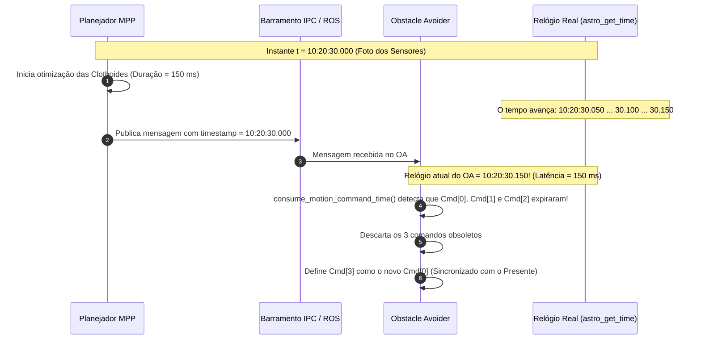
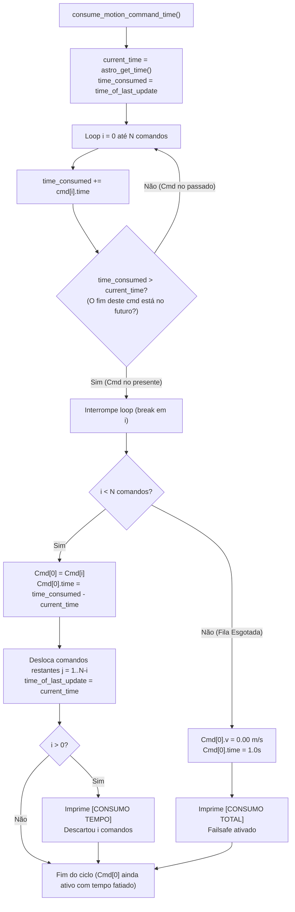

# Sincronização Temporal e Compensação de Latência (`consume_motion_command_time`)

A função [`consume_motion_command_time()`](file:///home/lume/astro/src/obstacle_avoider/obstacle_avoider_main.cpp#L387-L465) é a primeira etapa crítica executada dentro do [`obstacle_avoider_timer_handler()`](file:///home/lume/astro/src/obstacle_avoider/obstacle_avoider_main.cpp#L1300). Ela é responsável por manter a fila de comandos de movimento rigorosamente sincronizada com o relógio do veículo, resolvendo os dois maiores desafios da robótica móvel em malha fechada: **a latência de cálculo do planejador (MPP)** e **o avanço temporal contínuo da fila de comandos durante a condução**.

---

## 1. Por que essa função é indispensável?

Em um veículo autônomo, o planejador de trajetória ([MPP - Model Predictive Planner](file:///home/lume/astro/src/mpp/)) e o controlador de segurança ([Obstacle Avoider](file:///home/lume/astro/src/obstacle_avoider/)) rodam em frequências e processos distintos:

1. **O MPP opera em escala de centenas de milissegundos:**  
   Ele precisa integrar equações de clothoides, calcular envelopes de colisão, resolver otimizações e gerar até 400 comandos à frente. Esse cálculo consome tipicamente entre $100\text{ ms}$ e $350\text{ ms}$.
2. **O relógio do robô não para:**  
   Enquanto o MPP calculava o novo plano, o caminhão continuou se deslocando fisicamente pelo asfalto.
3. **O problema do atraso acumulado:**  
   Se o Obstacle Avoider recebesse o novo plano e simplesmente executasse o primeiro comando (`Cmd[0]`), o veículo estaria executando uma ordem que foi pensada para onde ele estava **no passado**. O resultado seria erro de perseguição de trajetória (*tracking error*), solavancos no volante e desvios de rota.

> [!IMPORTANT]
> **Missão da Função:**  
> `consume_motion_command_time()` garante que o comando na posição zero da fila (`Cmd[0]`) corresponda **exatamente ao instante presente no relógio do veículo**, descartando fatias obsoletas do passado e fatiando o comando ativo no tempo.

---

## 2. Anatomia dos Comandos de Movimento

Cada elemento do vetor `motion_commands_vector[i]` é da estrutura `astro_robot_and_trailers_motion_command_t`:

```cpp
typedef struct
{
    double v;       // Velocidade linear longitudinal desejada (m/s)
    double phi;     // Ângulo de esterçamento do rodado dianteiro (radianos)
    double time;    // Duração deste degrau de comando (dt em segundos!)
} astro_robot_and_trailers_motion_command_t;
```

> [!NOTE]
> O campo `.time` **NÃO é uma data absoluta (timestamp)**. Ele é um **intervalo de tempo ($\Delta t$)**, como $0.05\text{ s}$ ($50\text{ ms}$) ou $0.02\text{ s}$ ($20\text{ ms}$).  
> Um vetor com 400 comandos de $0.05\text{ s}$ projeta um horizonte de predição de:
> $$T_{\text{horizonte}} = 400 \times 0{,}05\text{ s} = 20{,}0\text{ segundos no futuro}$$

---

## 3. O Algoritmo Passo a Passo e a Lógica Matemática

O código de [`consume_motion_command_time()`](file:///home/lume/astro/src/obstacle_avoider/obstacle_avoider_main.cpp#L387-L465) inicia obtendo o relógio atual do robô e o carimbo de referência:

```cpp
static void
consume_motion_command_time(int motion_command_vetor, FILE *out_act)
{
    int i, j;
    double current_time, time_consumed;

    if (use_timestamp_from_audit)
        current_time = timestamp_of_motion_commands_vector[motion_command_vetor];
    else
        current_time = astro_get_time();

    time_consumed = astro_robot_ackerman_motion_command_time_of_last_update;
```

* **`current_time`**: O relógio do sistema no exato instante presente (`astro_get_time()`).
* **`time_consumed`**: Inicia com `astro_robot_ackerman_motion_command_time_of_last_update`. Essa variável guarda:
  * O timestamp em que o MPP gerou o plano (quando chega um novo plano do MPP); OU
  * O timestamp do último consumo efetuado (quando o timer periódico está rodando).

---

### Etapa 1: A Varredura de Término dos Comandos

```cpp
    for (i = 0; i < num_motion_commands_in_vector[motion_command_vetor]; i++)
    {
        time_consumed += motion_commands_vector[motion_command_vetor][i].time;

        if (time_consumed > current_time)
        {
            break;
        }
    }
```

A cada iteração do `for`, a pergunta matemática que está sendo feita é:
> **"Em que segundo exato do relógio o comando $i$ vai terminar de ser executado?"**

* `time_consumed` começa no instante de referência inicial (`time_of_last_update`).
* A cada comando somado (`time_consumed += Cmd[i].time`), `time_consumed` avança para o instante em que **aquele comando termina**.
* O teste `if (time_consumed > current_time)` pergunta:
  > **"O término deste comando $i$ está no futuro (depois do agora)?"**
  * **Se for NÃO** (`time_consumed <= current_time`): Esse comando já expirou no passado! O carro já deveria tê-lo executado. O loop continua para o próximo comando.
  * **Se for SIM** (`time_consumed > current_time`): **`break`!** Encontramos o primeiro comando cujo término ainda está no futuro. **É este comando que o carro deve estar executando EXATAMENTE AGORA!**

---

### Exemplo Prático com Linha do Tempo

Imagine o seguinte cenário de condução real:

1. **O MPP gera um plano:**
   * O MPP tira uma foto dos sensores às **`10:20:30.000`** e começa a calcular a trajetória.
   * `timestamp = 10:20:30.000`.
   * Cada comando do plano dura $\Delta t = 0{,}050\text{ s}$ ($50\text{ ms}$).

2. **A latência do MPP:**
   * O MPP demora **$120\text{ ms}$** para calcular as clothoides, resolver otimizações e transmitir a mensagem via IPC/ROS.
   * Quando a mensagem chega no Obstacle Avoider, o relógio real do robô (`current_time = astro_get_time()`) já avançou e marca:
     $$t_{\text{atual}} = \mathbf{10:20:30.120}$$

3. **O que acontece dentro do loop:**
   * `time_consumed` inicia em `10:20:30.000`.
   * **$i = 0$:** `time_consumed += 0.050` $\to \mathbf{10:20:30.050}$.  
     *Termina em 30.050s, mas já são 30.120s!* $\to$ **Já passou! (Passado)**
   * **$i = 1$:** `time_consumed += 0.050` $\to \mathbf{10:20:30.100}$.  
     *Termina em 30.100s, mas já são 30.120s!* $\to$ **Já passou! (Passado)**
   * **$i = 2$:** `time_consumed += 0.050` $\to \mathbf{10:20:30.150}$.  
     *Termina em 30.150s, e o relógio marca 30.120s!* $\to$ Término no futuro!  
     **`break` no $i = 2$!**

```
Linha do Tempo:
30.000s               30.050s               30.100s        30.120s        30.150s
  |------ Cmd[0] ------|------ Cmd[1] ------|------ Cmd[2] ---*---|-- Cmd[3] --|
  [==== Descartado ===][==== Descartado ===][  Consumido  | Resta ]
                                                          ^
                                                      AGORA (current_time = 30.120s)
```

---

### Etapa 2: Reindexação e Descarte da Fila

Ao sair do loop, o índice `i` aponta para o comando que deve ser executado no presente:

```cpp
    if (i < num_motion_commands_in_vector[motion_command_vetor])
    {
        // 1. Move o comando vigente (Cmd[i]) para a posição zero da fila
        motion_commands_vector[motion_command_vetor][0] = motion_commands_vector[motion_command_vetor][i];

        // 2. Ajusta a duração residual que resta do Cmd[0]
        motion_commands_vector[motion_command_vetor][0].time = time_consumed - current_time;

        // 3. Desloca todos os comandos futuros para a esquerda
        for (j = 1; (j + i) < num_motion_commands_in_vector[motion_command_vetor]; j++)
        {
            motion_commands_vector[motion_command_vetor][j] = motion_commands_vector[motion_command_vetor][j + i];
        }

        num_motion_commands_in_vector[motion_command_vetor] = j;
        astro_robot_ackerman_motion_command_time_of_last_update = current_time;
```

#### O Ajuste Milimétrico do Tempo Residual:
No nosso exemplo, o `Cmd[2]` terminaria em `10:20:30.150`, mas o instante presente é `10:20:30.120`. Logo, esse degrau já foi executado por $20\text{ ms}$, restando apenas:
$$\Delta t_{\text{restante}} = t_{\text{fim}} - t_{\text{atual}} = 30{,}150 - 30{,}120 = \mathbf{0{,}030\text{ s}}\ (30\text{ ms})$$

O código grava exatamente $0{,}030\text{ s}$ no `Cmd[0].time`, descartando os comandos `Cmd[0]` e `Cmd[1]`. O `Cmd[2]` passa a ser o novo `Cmd[0]`, sincronizado com o instante exato do caminhão.

---

### Etapa 3: Tratamento de Esgotamento Total (*Failsafe*)

Se o tempo decorrido for maior do que a soma de **todos** os comandos da fila (por exemplo, se o MPP travar e parar de enviar planos):

```cpp
    else
    {
        num_motion_commands_in_vector[motion_command_vetor] = 1;
        motion_commands_vector[motion_command_vetor][0].v = 0.0;
        motion_commands_vector[motion_command_vetor][0].time = 1.0;

        if (!printed_total_consumed && out_act)
        {
            printed_total_consumed = true;
            fprintf(out_act, "  \033[1;31m[CONSUMO TOTAL]\033[0m O tempo consumiu todos os comandos! Fila esgotada -> Forcando Cmd[0] v = 0.00 m/s\n\n");
            fflush(out_act);
        }
    }
```
O sistema protege o veículo forçando a velocidade imediatamente a $0{,}00\text{ m/s}$, impedindo que o caminhão prossiga sem planejamento válido.

---

## 4. Diagrama de Sequência e Linha do Tempo

A relação temporal entre a emissão do plano pelo MPP e a compensação de latência pelo Obstacle Avoider é ilustrada abaixo:



---

## 5. Comportamento Contínuo nos Ciclos Periódicos do Timer

O que acontece nos ciclos seguintes, enquanto o MPP ainda não enviou outro plano?

O `obstacle_avoider_timer_handler()` é chamado periodicamente a cada $\approx 20\text{ ms}$ ($0{,}020\text{ s}$):

1. **Ciclo seguinte ($20\text{ ms}$ depois, $t = 10:20:30.140$):**
   * `time_consumed` inicia em `10:20:30.120`.
   * $i = 0$: `time_consumed += Cmd[0].time` ($0{,}030\text{ s}$) $\to 10:20:30.150$.
   * Como $10:20:30.150 > 10:20:30.140$, ocorre o **`break` no $i = 0$**.
   * Nenhum comando é descartado! O `Cmd[0]` continua ativo, mas sua duração residual é atualizada para:
     $$\Delta t = 30{,}150 - 30{,}140 = \mathbf{0{,}010\text{ s}}\ (10\text{ ms})$$
   * `time_of_last_update` é atualizado para `10:20:30.140`.

2. **Segundo ciclo ($40\text{ ms}$ depois, $t = 10:20:30.160$):**
   * `time_consumed` inicia em `10:20:30.140`.
   * $i = 0$: `time_consumed += Cmd[0].time` ($0{,}010\text{ s}$) $\to 10:20:30.150 \le 10:20:30.160$ (O `Cmd[0]` expirou!).
   * $i = 1$: `time_consumed += Cmd[1].time` ($0{,}050\text{ s}$) $\to 10:20:30.200 > 10:20:30.160$ (**`break` no $i = 1$**).
   * O comando antigo é descartado, `Cmd[1]` vira o novo `Cmd[0]`, e o log avisa:
     ```text
     [CONSUMO TEMPO] O tempo passou! Descartou 1 comando(s)...
     ```

---

### 5.1 Detalhes de Implementação: Disparo dos Handlers e Sincronização Envio-Recebimento

> [!NOTE]
> **Frequência Efetiva e o Filtro de 70 ms:**  
> Como detalhado no documento [`01_arquitetura_e_fluxo_geral.md`](file:///home/lume/astro/src/obstacle_avoider/docs/01_arquitetura_e_fluxo_geral.md), a função central é orientada a eventos. Quando novos planos do MPP chegam, ela executa **imediatamente**; na ausência de novos planos, as chamadas periódicas são disparadas pelos handlers de odometria/GPS e mapa sob o estrangulador `can_execute_obstacle_avoider_handler()` ($> 70\text{ ms}$, ou seja, $\approx 12\text{ a }14\text{ Hz}$).

#### Por que o MPP Carimba o Timestamp no Início (Sensores) e Não no Fim do Cálculo?
Surge frequentemente a dúvida: *"Se o MPP carimbasse o timestamp após concluir o cálculo, não teríamos apenas a latência da rede IPC, sem precisar compensar o tempo do cálculo?"*

A razão técnica é a **ancoragem física da trajetória**:
1. **Condição Inicial do Planejador:** O MPP calcula as clothoides partindo exatamente da posição, velocidade e orientação medidas pelos sensores no instante $t_0$. Logo, o `Cmd[0]` prescreve o movimento a partir de $t_0$.
2. **O Risco do Carimbo Pós-Cálculo:** Se o MPP carimbasse o plano com o horário de término $t_1 = t_0 + 1{,}0\text{ s}$, o Obstacle Avoider interpretaria que o `Cmd[0]` (velocidade e esterçamento do passado) deveria ser executado no presente. Isso introduziria um atraso de transporte (*pure phase delay*) severo na malha fechada, comandando manobras defasadas no caminhão.
3. **Divisão de Responsabilidades:** O MPP trabalha com a verdade sólida da captura inicial ($t_0$) sem precisar prever tempo de CPU ou *jitter* de otimização. Cabe ao Obstacle Avoider, em posse do relógio de tempo real (`astro_get_time()`), medir a latência total acumulada ($\Delta t = t_{\text{atual}} - t_0$) e descartar os comandos que o caminhão já percorreu fisicamente na pista.

---

## 6. Estudo de Caso Real: Transição de Plano e o Descarte de 50 Comandos

Durante um teste em veículo real com a telemetria aprimorada em horas, minutos e segundos (`HH:MM:SS.mmm`), registrou-se exatamente o comportamento do algoritmo na transição entre o consumo normal de um plano anterior e a chegada de um novo plano do MPP.

### 6.1 Fase 1: Condução Normal e Consumo Degrau a Degrau no Plano Inicial
O robô trafegava executando o plano anterior. Observe como, nos ciclos periódicos, o timer descarta comandos conforme o tempo avança a cada $\approx 70\text{ ms} \dots 90\text{ ms}$:

```text
plano atual (base_time = 10:43:39.712 | current_time = 10:43:39.790 | latencia = 0.078s):
   0 --> v = 0.238041 | dt = 0.035774 | t_fim = 10:43:39.748 [PASSADO - EXPIRADO]
   1 --> v = 0.246283 | dt = 0.060000 | t_fim = 10:43:39.808 [FUTURO - ATIVO]
   2 --> v = 0.254526 | dt = 0.060000 | t_fim = 10:43:39.868 [FUTURO - ATIVO]
   3 --> v = 0.262769 | dt = 0.060000 | t_fim = 10:43:39.928 [FUTURO - ATIVO]
 [...]
 soma_tempo: 18.151193

  [CONSUMO TEMPO] [10:43:39.790] O tempo passou! Descartou 1 comando(s) executado(s) (v_antiga=0.24 m/s). Novo Cmd[0]: v=0.25 m/s (Restam 302 cmds na fila)
```

Poucos ciclos depois, imediatamente antes da chegada do novo plano:
```text
  [CONSUMO TEMPO] [10:43:39.961] O tempo passou! Descartou 1 comando(s) executado(s) (v_antiga=0.26 m/s). Novo Cmd[0]: v=0.27 m/s (Restam 299 cmds na fila)
```
* O veículo estava fisicamente em movimento a $v \approx 0{,}26\text{ m/s} \dots 0{,}27\text{ m/s}$.

---

### 6.2 Fase 2: Chegada do Novo Plano do MPP (Antes do Consumo)
Em seguida, o MPP transmitiu um novo plano contendo **380 comandos** (índices `0` a `379`). O print capturou esse plano recém-chegado com os timestamps absolutos calculados em relação ao `base_time` da mensagem:

```text
plano atual (base_time = 10:43:38.973 | current_time = 10:43:39.986 | latencia = 1.013s):
   0 --> v = -0.000999 | dt = 0.020000 | t_fim = 10:43:38.993 [PASSADO - EXPIRADO]
   1 --> v =  0.001749 | dt = 0.020000 | t_fim = 10:43:39.013 [PASSADO - EXPIRADO]
   2 --> v =  0.004496 | dt = 0.020000 | t_fim = 10:43:39.033 [PASSADO - EXPIRADO]
   3 --> v =  0.007244 | dt = 0.020000 | t_fim = 10:43:39.053 [PASSADO - EXPIRADO]
  [...]
  48 --> v =  0.130886 | dt = 0.020000 | t_fim = 10:43:39.953 [PASSADO - EXPIRADO]
  49 --> v =  0.133633 | dt = 0.020000 | t_fim = 10:43:39.973 [PASSADO - EXPIRADO]
  50 --> v =  0.136381 | dt = 0.020000 | t_fim = 10:43:39.993 [FUTURO - ATIVO]
  51 --> v =  0.139129 | dt = 0.020000 | t_fim = 10:43:40.013 [FUTURO - ATIVO]
  52 --> v =  0.141876 | dt = 0.020000 | t_fim = 10:43:40.033 [FUTURO - ATIVO]
  [...]
 378 --> v =  2.719122 | dt = 0.060000 | t_fim = 10:43:58.833 [FUTURO - ATIVO]
 379 --> v =  2.726719 | dt = 0.055294 | t_fim = 10:43:58.888 [FUTURO - ATIVO]
 soma_tempo: 19.915294
```

> [!CAUTION]
> **Esclarecimento Crucial: O Descarte é 100% TEMPORAL (Não por Velocidade):**  
> A função `consume_motion_command_time()` **não consulta a velocidade ($v$)** para decidir quais comandos descartar. O critério de descarte é **estritamente cronológico baseado no relógio**:
> * Se o instante de término do comando for anterior ou igual ao relógio atual ($t_{\text{fim}} \le t_{\text{atual}}$, ou seja, `time_consumed <= current_time`), o comando pertence ao passado e é descartado.
> * Se o instante de término for estritamente posterior ($t_{\text{fim}} > t_{\text{atual}}$), o comando pertence ao presente/futuro. O loop sofre um `break` e esse comando se torna o novo início da fila.

Ao somar o timestamp base do plano ($T_{\text{base}} = \text{10:43:38.973}$) com a duração $\Delta t$ de cada degrau, a linha do tempo absoluta de cada comando fica evidente:

| Índice | Velocidade ($v$) | Duração ($\Delta t$) | Timestamp de Término ($t_{\text{fim}}$) | Comparação com o Relógio Atual ($t_{\text{atual}} = \text{10:43:39.986}$) | Decisão do OA |
| :---: | :---: | :---: | :---: | :---: | :---: |
| `Cmd[0]` | $-0{,}001\text{ m/s}$ | $0{,}020\text{ s}$ | `10:43:38.993` | $38{,}993 \le 39{,}986$ | **PASSADO** (Expirado!) |
| `Cmd[1]` | $+0{,}002\text{ m/s}$ | $0{,}020\text{ s}$ | `10:43:39.013` | $39{,}013 \le 39{,}986$ | **PASSADO** (Expirado!) |
| `Cmd[2]` | $+0{,}004\text{ m/s}$ | $0{,}020\text{ s}$ | `10:43:39.033` | $39{,}033 \le 39{,}986$ | **PASSADO** (Expirado!) |
| ... | ... | ... | ... | ... | ... |
| `Cmd[48]` | $+0{,}131\text{ m/s}$ | $0{,}020\text{ s}$ | `10:43:39.953` | $39{,}953 \le 39{,}986$ | **PASSADO** (Expirado!) |
| `Cmd[49]` | $+0{,}134\text{ m/s}$ | $0{,}020\text{ s}$ | `10:43:39.973` | $39{,}973 \le 39{,}986$ | **PASSADO** (Expirado!) |
| `Cmd[50]` | $+0{,}136\text{ m/s}$ | $0{,}020\text{ s}$ | `10:43:39.993` | $39{,}993 > 39{,}986$ | **PRESENTE!** (`break` no $i = 50$) |
| `Cmd[51]` | $+0{,}139\text{ m/s}$ | $0{,}020\text{ s}$ | `10:43:40.013` | $40{,}013 > 39{,}986$ | Futuro (Ativo) |

---

### 6.3 Fase 3: A Compensação de Latência em Ação
O MPP gerou o plano com timestamp base `10:43:38.973`. Entre a captura dos sensores, cálculo das clothoides e transmissão IPC, a mensagem chegou ao Obstacle Avoider quando o relógio já marcava `10:43:39.986`.
* **Latência real medida:**
  $$\text{Latência} = t_{\text{atual}} - T_{\text{base}} = 39{,}986 - 38{,}973 = \mathbf{1{,}013\text{ segundos}}$$

Durante esse $1{,}013\text{ s}$, o caminhão continuou trafegando no mundo real.
Ao executar `consume_motion_command_time()`, a função detectou que os índices `0` a `49` (**exatamente 50 comandos**) pertenciam ao passado e realizou o descarte em bloco:

```text
  [CONSUMO TEMPO] [10:43:39.986] O tempo passou! Descartou 50 comando(s) executado(s) (v_antiga=-0.00 m/s). Novo Cmd[0]: v=0.14 m/s (Restam 330 cmds na fila)
```
* **Contagem de comandos:** $380\text{ comandos originais} - 50\text{ descartados} = \mathbf{330\text{ comandos restantes}}$.

---

### 6.4 Fase 4: O Plano Sincronizado Resultante e a Precisão Residual
No ciclo seguinte, a telemetria confirma que o antigo `Cmd[50]` assumiu a posição inicial da fila (`Cmd[0]`):

```text
plano atual (base_time = 10:43:39.986 | current_time = 10:43:40.078 | latencia = 0.093s):
   0 --> v = 0.136381 | dt = 0.007277 | t_fim = 10:43:39.993 [PASSADO - EXPIRADO]
   1 --> v = 0.139129 | dt = 0.020000 | t_fim = 10:43:40.013 [PASSADO - EXPIRADO]
   2 --> v = 0.141876 | dt = 0.020000 | t_fim = 10:43:40.033 [PASSADO - EXPIRADO]
   3 --> v = 0.144624 | dt = 0.020000 | t_fim = 10:43:40.053 [PASSADO - EXPIRADO]
   4 --> v = 0.147371 | dt = 0.020000 | t_fim = 10:43:40.073 [PASSADO - EXPIRADO]
   5 --> v = 0.150119 | dt = 0.020000 | t_fim = 10:43:40.093 [FUTURO - ATIVO]
   [...]
```

#### A Precisão Matemática do Tempo Residual:
O comando 50 original tinha duração nominal de $\Delta t = 0{,}020\text{ s}$ e terminava em `10:43:39.993277`.  
O relógio atual no instante do descarte era `10:43:39.986000`.  
Portanto, a fatia temporal restante desse comando era:
$$\Delta t_{\text{restante}} = t_{\text{fim}} - t_{\text{atual}} = 39{,}993277 - 39{,}986000 = \mathbf{0{,}007277\text{ s}}\ (7{,}277\text{ ms})$$

O campo `dt` do novo `Cmd[0]` recebeu com exatidão cirúrgica **`0.007277`**, e o `base_time` foi atualizado para `10:43:39.986`.

> [!TIP]
> **Impacto na Condução:**  
> Se esse descarte de 50 comandos não existisse, o caminhão receberia um comando de velocidade quase nula ($-0{,}001\text{ m/s}$, gerado pelo MPP 1 segundo atrás antes de acelerar), provocando um solavanco indevido na transmissão. A compensação de latência garantiu que o caminhão continuasse sua trajetória com total suavidade.

---

## 7. Diagrama de Fluxo Interno da Função


