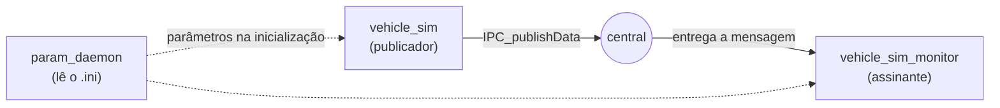

# Manual: Criando um Novo Módulo no ASTRO

Este manual ensina, passo a passo, a criar um módulo novo no ASTRO que se comunica com os demais por **IPC** (*Inter-Process Communication*). O conteúdo usa como exemplo condutor dois módulos, [`vehicle_sim`](file:///home/lume/astro/src/vehicle_sim) (publica) e [`vehicle_sim_monitor`](file:///home/lume/astro/src/vehicle_sim_monitor) (assina), que **compilam e foram testados**: as saídas mostradas nos capítulos são saídas reais.

> [!IMPORTANT]
> **Resumo:**
> * Cada módulo do ASTRO é um **processo independente** (um executável em `bin/`). Eles não chamam funções uns dos outros; trocam **mensagens** por meio de um processo central.
> * Quem envia uma mensagem **publica** (*publish*); quem quer recebê-la **assina** (*subscribe*) e registra um *handler* (callback) que o IPC chama a cada chegada.
> * Um módulo novo precisa de: um `Makefile`, um `_main.cpp` (inicialização, handlers e publicadores) e, se definir mensagens próprias, um `_messages.h` e um `_interface.cpp/.h`.
> * Para rodar é preciso ter `central` e `param_daemon` ativos, e todo parâmetro lido pelo módulo precisa existir no `.ini` do robô.

---

## 1. Como os módulos conversam



| Processo | Papel |
|---|---|
| `central` | Servidor IPC. Registra as mensagens definidas e distribui cada publicação aos assinantes. Deve estar no ar antes de qualquer módulo. |
| `param_daemon` | Lê o arquivo `.ini` do robô e responde aos módulos que pedem seus parâmetros. |
| Seu módulo | Conecta-se à `central`, define/publica/assina mensagens e lê parâmetros. |

Os módulos compartilham apenas **o nome e o formato da mensagem**. Quem publica não sabe quem assina, e vice-versa.

---

## 2. Pré-requisitos

1. Repositório do ASTRO compilado (as bibliotecas `libipc`, `libglobal` e `libparam_interface` em `lib/`, e os executáveis `central` e `param_daemon` em `bin/`).
2. A variável de ambiente `ASTRO_HOME` apontando para a raiz do ASTRO. Sem ela o `Makefile` aborta com `ASTRO_HOME environment variable not set`:

```bash
export ASTRO_HOME=/home/lume/astro
```

---

## 3. Mapa do manual

| Capítulo | Assunto |
|---|---|
| [`01_estrutura_de_um_modulo.md`](01_estrutura_de_um_modulo.md) | Arquivos, responsabilidades, convenções e `Makefile` |
| `02_configuracao_ipc.md` | Conexão com a central, parâmetros e encerramento |
| `03_criacao_de_mensagens.md` | Struct, nome e formato da mensagem |
| `04_subscribe.md` | Assinatura e handlers |
| `05_publish.md` | Publicação |
| `06_integracao_e_validacao.md` | Executar e validar a comunicação |
| `07_boas_praticas.md` | Padrões e erros comuns |
| `08_template_de_modulo.md` | Esqueleto reutilizável |

---

## 4. Os módulos de exemplo

O exemplo usa **dois módulos**, como acontece no ASTRO real: um dono da mensagem, que publica, e um consumidor, que assina.

| Módulo | Pasta | O que faz |
|---|---|---|
| `vehicle_sim` | [`src/vehicle_sim/`](file:///home/lume/astro/src/vehicle_sim) | **Dono da mensagem** `astro_vehicle_sim_pose`. Simula um veículo em movimento, publica sua pose e velocidade a cada 1 s e disponibiliza `_messages.h` e `libvehicle_sim_interface.a` para os outros módulos. |
| `vehicle_sim_monitor` | [`src/vehicle_sim_monitor/`](file:///home/lume/astro/src/vehicle_sim_monitor) | **Consumidor**: faz link com a interface do `vehicle_sim`, assina a mensagem, imprime a pose e **alerta** quando a velocidade passa de um limite lido do `.ini`. Só tem `_main.cpp` e `Makefile`. |

A mensagem `astro_vehicle_sim_pose` é uma versão enxuta da mensagem real de localização do ASTRO (`astro_localize_ackerman_globalpos`, que também tem posição, `v`, `timestamp` e `host`):

| Campo | Tipo | Significado |
|---|---|---|
| `x`, `y` | `double` | Posição no referencial global (m) |
| `theta` | `double` | Orientação (rad) |
| `v` | `double` | Velocidade linear (m/s) |
| `timestamp`, `host` | `double`, `char *` | Obrigatórios em toda mensagem |

> [!NOTE]
> Os dados são **simulados**: o `vehicle_sim` faz o veículo andar numa curva suave com a velocidade oscilando entre 1 e 3 m/s, e calcula a posição a partir dela. Não é uma fonte real do ASTRO.

Saída real da execução dos dois juntos (limite de velocidade em 2,5 m/s):

```text
vehicle_sim: publicou x=2.83 y=0.28 theta=0.10 v=2.84
vehicle_sim: publicou x=5.68 y=0.86 theta=0.20 v=2.91
vehicle_sim: publicou x=7.72 y=1.49 theta=0.30 v=2.14
...
vehicle_sim_monitor: x=2.83 y=0.28 theta=0.10 v=2.84 (de vehicle_sim@lume-M, t=1795463342.478)
vehicle_sim_monitor: ALERTA velocidade 2.84 m/s acima do limite 2.50 m/s
vehicle_sim_monitor: x=7.72 y=1.49 theta=0.30 v=2.14 (de vehicle_sim@lume-M, t=1795463344.480)
```

> [!NOTE]
> O repositório já tem outros exemplos: [`src/simple_module_example`](file:///home/lume/astro/src/simple_module_example) (em C, só publish/subscribe) e [`src/skeleton_package`](file:///home/lume/astro/src/skeleton_package) (padrão sensor/filter com interface Qt). Este manual usa **C++**, linguagem da maioria dos módulos atuais (a API de IPC é a mesma).
