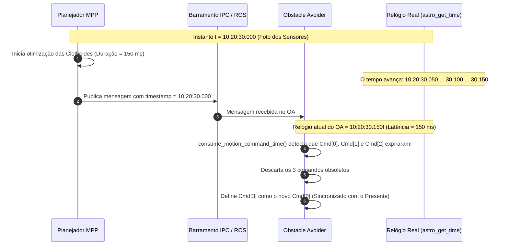
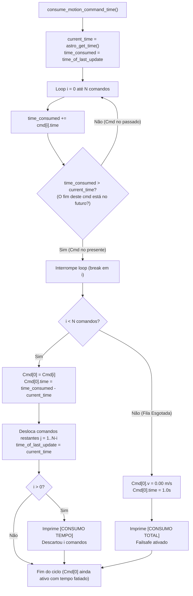

# Sincronização Temporal e Compensação de Latência (`consume_motion_command_time`)

A função [`consume_motion_command_time()`](file:///home/lume/astro/src/obstacle_avoider/obstacle_avoider_main.cpp#L387-L465) é a primeira etapa crítica executada dentro do [`obstacle_avoider_timer_handler()`](file:///home/lume/astro/src/obstacle_avoider/obstacle_avoider_main.cpp#L1300). Ela é responsável por manter a fila de comandos de movimento rigorosamente sincronizada com o relógio do veículo, resolvendo os dois maiores desafios da robótica móvel em malha fechada: **a latência de cálculo do planejador (MPP)** e **o avanço temporal contínuo da fila de comandos durante a condução**.

---

## 1. Por que essa função é indispensável?

Em um veículo autônomo, o planejador de trajetória ([MPP - Model Predictive Planner](file:///home/lume/astro/src/mpp/)) e o controlador de segurança ([Obstacle Avoider](file:///home/lume/astro/src/obstacle_avoider/)) rodam em frequências e processos distintos:

1. **O MPP opera em escala de centenas de milissegundos:**  
   Ele precisa integrar equações de clothoides, calcular envelopes de colisão, resolver otimizações e gerar até 400 comandos à frente. Esse cálculo consome tipicamente entre $100\text{ ms}$ e $350\text{ ms}$.
2. **O relógio do robô não para:**  
   Enquanto o MPP calculava o novo plano, o caminhão continuou se deslocando fisicamente pelo asfalto.
3. **O problema do atraso acumulado:**  
   Se o Obstacle Avoider recebesse o novo plano e simplesmente executasse o primeiro comando (`Cmd[0]`), o veículo estaria executando uma ordem que foi pensada para onde ele estava **no passado**. O resultado seria erro de perseguição de trajetória (*tracking error*), solavancos no volante e desvios de rota.

> [!IMPORTANT]
> **Missão da Função:**  
> `consume_motion_command_time()` garante que o comando na posição zero da fila (`Cmd[0]`) corresponda **exatamente ao instante presente no relógio do veículo**, descartando fatias obsoletas do passado e fatiando o comando ativo no tempo.

---

## 2. Anatomia dos Comandos de Movimento

Cada elemento do vetor `motion_commands_vector[i]` é da estrutura `astro_robot_and_trailers_motion_command_t`:

```cpp
typedef struct
{
    double v;       // Velocidade linear longitudinal desejada (m/s)
    double phi;     // Ângulo de esterçamento do rodado dianteiro (radianos)
    double time;    // Duração deste degrau de comando (dt em segundos!)
} astro_robot_and_trailers_motion_command_t;
```

> [!NOTE]
> O campo `.time` **NÃO é uma data absoluta (timestamp)**. Ele é um **intervalo de tempo ($\Delta t$)**, como $0.05\text{ s}$ ($50\text{ ms}$) ou $0.02\text{ s}$ ($20\text{ ms}$).  
> Um vetor com 400 comandos de $0.05\text{ s}$ projeta um horizonte de predição de:
> $$T_{\text{horizonte}} = 400 \times 0{,}05\text{ s} = 20{,}0\text{ segundos no futuro}$$

---

## 3. O Algoritmo Passo a Passo e a Lógica Matemática

O código de [`consume_motion_command_time()`](file:///home/lume/astro/src/obstacle_avoider/obstacle_avoider_main.cpp#L387-L465) inicia obtendo o relógio atual do robô e o carimbo de referência:

```cpp
static void
consume_motion_command_time(int motion_command_vetor, FILE *out_act)
{
    int i, j;
    double current_time, time_consumed;

    if (use_timestamp_from_audit)
        current_time = timestamp_of_motion_commands_vector[motion_command_vetor];
    else
        current_time = astro_get_time();

    time_consumed = astro_robot_ackerman_motion_command_time_of_last_update;
```

* **`current_time`**: O relógio do sistema no exato instante presente (`astro_get_time()`).
* **`time_consumed`**: Inicia com `astro_robot_ackerman_motion_command_time_of_last_update`. Essa variável guarda:
  * O timestamp em que o MPP gerou o plano (quando chega um novo plano do MPP); OU
  * O timestamp do último consumo efetuado (quando o timer periódico está rodando).

---

### Etapa 1: A Varredura de Término dos Comandos

```cpp
    for (i = 0; i < num_motion_commands_in_vector[motion_command_vetor]; i++)
    {
        time_consumed += motion_commands_vector[motion_command_vetor][i].time;

        if (time_consumed > current_time)
        {
            break;
        }
    }
```

A cada iteração do `for`, a pergunta matemática que está sendo feita é:
> **"Em que segundo exato do relógio o comando $i$ vai terminar de ser executado?"**

* `time_consumed` começa no instante de referência inicial (`time_of_last_update`).
* A cada comando somado (`time_consumed += Cmd[i].time`), `time_consumed` avança para o instante em que **aquele comando termina**.
* O teste `if (time_consumed > current_time)` pergunta:
  > **"O término deste comando $i$ está no futuro (depois do agora)?"**
  * **Se for NÃO** (`time_consumed <= current_time`): Esse comando já expirou no passado! O carro já deveria tê-lo executado. O loop continua para o próximo comando.
  * **Se for SIM** (`time_consumed > current_time`): **`break`!** Encontramos o primeiro comando cujo término ainda está no futuro. **É este comando que o carro deve estar executando EXATAMENTE AGORA!**

---

### Exemplo Prático com Linha do Tempo

Imagine o seguinte cenário de condução real:

1. **O MPP gera um plano:**
   * O MPP tira uma foto dos sensores às **`10:20:30.000`** e começa a calcular a trajetória.
   * `timestamp = 10:20:30.000`.
   * Cada comando do plano dura $\Delta t = 0{,}050\text{ s}$ ($50\text{ ms}$).

2. **A latência do MPP:**
   * O MPP demora **$120\text{ ms}$** para calcular as clothoides, resolver otimizações e transmitir a mensagem via IPC/ROS.
   * Quando a mensagem chega no Obstacle Avoider, o relógio real do robô (`current_time = astro_get_time()`) já avançou e marca:
     $$t_{\text{atual}} = \mathbf{10:20:30.120}$$

3. **O que acontece dentro do loop:**
   * `time_consumed` inicia em `10:20:30.000`.
   * **$i = 0$:** `time_consumed += 0.050` $\to \mathbf{10:20:30.050}$.  
     *Termina em 30.050s, mas já são 30.120s!* $\to$ **Já passou! (Passado)**
   * **$i = 1$:** `time_consumed += 0.050` $\to \mathbf{10:20:30.100}$.  
     *Termina em 30.100s, mas já são 30.120s!* $\to$ **Já passou! (Passado)**
   * **$i = 2$:** `time_consumed += 0.050` $\to \mathbf{10:20:30.150}$.  
     *Termina em 30.150s, e o relógio marca 30.120s!* $\to$ Término no futuro!  
     **`break` no $i = 2$!**

```
Linha do Tempo:
30.000s               30.050s               30.100s        30.120s        30.150s
  |------ Cmd[0] ------|------ Cmd[1] ------|------ Cmd[2] ---*---|-- Cmd[3] --|
  [==== Descartado ===][==== Descartado ===][  Consumido  | Resta ]
                                                          ^
                                                      AGORA (current_time = 30.120s)
```

---

### Etapa 2: Reindexação e Descarte da Fila

Ao sair do loop, o índice `i` aponta para o comando que deve ser executado no presente:

```cpp
    if (i < num_motion_commands_in_vector[motion_command_vetor])
    {
        // 1. Move o comando vigente (Cmd[i]) para a posição zero da fila
        motion_commands_vector[motion_command_vetor][0] = motion_commands_vector[motion_command_vetor][i];

        // 2. Ajusta a duração residual que resta do Cmd[0]
        motion_commands_vector[motion_command_vetor][0].time = time_consumed - current_time;

        // 3. Desloca todos os comandos futuros para a esquerda
        for (j = 1; (j + i) < num_motion_commands_in_vector[motion_command_vetor]; j++)
        {
            motion_commands_vector[motion_command_vetor][j] = motion_commands_vector[motion_command_vetor][j + i];
        }

        num_motion_commands_in_vector[motion_command_vetor] = j;
        astro_robot_ackerman_motion_command_time_of_last_update = current_time;
```

#### O Ajuste Milimétrico do Tempo Residual:
No nosso exemplo, o `Cmd[2]` terminaria em `10:20:30.150`, mas o instante presente é `10:20:30.120`. Logo, esse degrau já foi executado por $20\text{ ms}$, restando apenas:
$$\Delta t_{\text{restante}} = t_{\text{fim}} - t_{\text{atual}} = 30{,}150 - 30{,}120 = \mathbf{0{,}030\text{ s}}\ (30\text{ ms})$$

O código grava exatamente $0{,}030\text{ s}$ no `Cmd[0].time`, descartando os comandos `Cmd[0]` e `Cmd[1]`. O `Cmd[2]` passa a ser o novo `Cmd[0]`, sincronizado com o instante exato do caminhão.

---

### Etapa 3: Tratamento de Esgotamento Total (*Failsafe*)

Se o tempo decorrido for maior do que a soma de **todos** os comandos da fila (por exemplo, se o MPP travar e parar de enviar planos):

```cpp
    else
    {
        num_motion_commands_in_vector[motion_command_vetor] = 1;
        motion_commands_vector[motion_command_vetor][0].v = 0.0;
        motion_commands_vector[motion_command_vetor][0].time = 1.0;

        if (!printed_total_consumed && out_act)
        {
            printed_total_consumed = true;
            fprintf(out_act, "  \033[1;31m[CONSUMO TOTAL]\033[0m O tempo consumiu todos os comandos! Fila esgotada -> Forcando Cmd[0] v = 0.00 m/s\n\n");
            fflush(out_act);
        }
    }
```
O sistema protege o veículo forçando a velocidade imediatamente a $0{,}00\text{ m/s}$, impedindo que o caminhão prossiga sem planejamento válido.

---

## 4. Diagrama de Sequência e Linha do Tempo

A relação temporal entre a emissão do plano pelo MPP e a compensação de latência pelo Obstacle Avoider é ilustrada abaixo:



---

## 5. Comportamento Contínuo nos Ciclos Periódicos do Timer

O que acontece nos ciclos seguintes, enquanto o MPP ainda não enviou outro plano?

O `obstacle_avoider_timer_handler()` é chamado periodicamente a cada $\approx 20\text{ ms}$ ($0{,}020\text{ s}$):

1. **Ciclo seguinte ($20\text{ ms}$ depois, $t = 10:20:30.140$):**
   * `time_consumed` inicia em `10:20:30.120`.
   * $i = 0$: `time_consumed += Cmd[0].time` ($0{,}030\text{ s}$) $\to 10:20:30.150$.
   * Como $10:20:30.150 > 10:20:30.140$, ocorre o **`break` no $i = 0$**.
   * Nenhum comando é descartado! O `Cmd[0]` continua ativo, mas sua duração residual é atualizada para:
     $$\Delta t = 30{,}150 - 30{,}140 = \mathbf{0{,}010\text{ s}}\ (10\text{ ms})$$
   * `time_of_last_update` é atualizado para `10:20:30.140`.

2. **Segundo ciclo ($40\text{ ms}$ depois, $t = 10:20:30.160$):**
   * `time_consumed` inicia em `10:20:30.140`.
   * $i = 0$: `time_consumed += Cmd[0].time` ($0{,}010\text{ s}$) $\to 10:20:30.150 \le 10:20:30.160$ (O `Cmd[0]` expirou!).
   * $i = 1$: `time_consumed += Cmd[1].time` ($0{,}050\text{ s}$) $\to 10:20:30.200 > 10:20:30.160$ (**`break` no $i = 1$**).
   * O comando antigo é descartado, `Cmd[1]` vira o novo `Cmd[0]`, e o log avisa:
     ```text
     [CONSUMO TEMPO] O tempo passou! Descartou 1 comando(s)...
     ```

---

## 6. Interpretação dos Logs Reais no `/tmp/potencial_collision.log`

Monitorando a execução real com `tail -f /tmp/potencial_collision.log`, você verá dois padrões claros de log:

### Padrão A: Descarte em Massa (Novo Plano do MPP com Latência)
```text
  [CONSUMO TEMPO] O tempo passou! Descartou 51 comando(s) executado(s) (v_antiga=1.66 m/s). Novo Cmd[0]: v=1.60 m/s (Restam 317 cmds na fila)
```
* **O que significa:** O MPP demorou cerca de $250\text{ ms}$ entre tirar a foto dos sensores e o plano chegar ao Obstacle Avoider.
* **O que a função fez:** Eliminou de imediato os 51 comandos que correspondiam a esses $250\text{ ms}$ do passado. O caminhão começa executando a trajetória exatamente a partir da sua posição presente.

### Padrão B: Descarte Unitário Contínuo (Ciclos do Timer)
```text
  [CONSUMO TEMPO] O tempo passou! Descartou 1 comando(s) executado(s) (v_antiga=1.62 m/s). Novo Cmd[0]: v=1.56 m/s (Restam 188 cmds na fila)
```
* **O que significa:** O timer do Obstacle Avoider rodou, e o tempo decorrido foi suficiente para consumir e encerrar o degrau de tempo do comando do topo.
* **O que a função fez:** Descartou o comando concluído e avançou a fila suavemente degrau por degrau.

---

## 7. Diagrama de Fluxo Interno da Função


