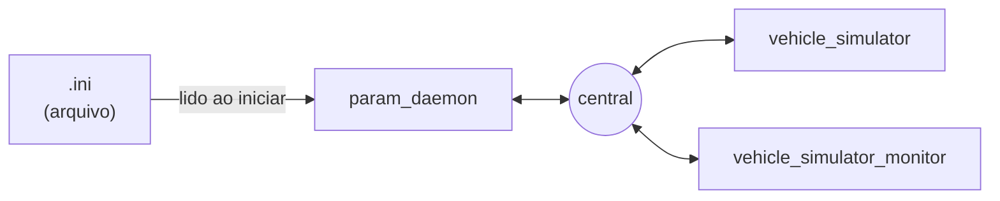

# 5. Parâmetros: configurando os módulos pelo `.ini`

Os valores do `vehicle_simulator` estão escritos no código: o tempo de cada passo (`dt`), a velocidade média e a taxa de giro. Para mudar qualquer um, é preciso editar o código e recompilar. Em um robô real isso é inviável: o mesmo módulo roda em veículos diferentes, com ajustes diferentes.

A solução do ASTRO são os **parâmetros**: valores escritos em um arquivo de texto (o `.ini`) e lidos pelo módulo **ao iniciar**. Neste capítulo vamos:

1. criar um `.ini` e subir o programa que o serve;
2. fazer o `vehicle_simulator` ler o `dt`, e depois mais dois parâmetros;
3. fazer o `vehicle_simulator_monitor` ler um **limite de velocidade** e **alertar** quando ele for ultrapassado.

## 5.1 Como os parâmetros chegam ao módulo

Uma coisa que surpreende: **o módulo não lê o arquivo `.ini`**. Quem lê é um processo à parte, o **`param_daemon`**, e o módulo **pede** os valores a ele, pelo mesmo IPC que já conhecemos.



| Processo | Papel |
|---|---|
| `param_daemon` | Lê o `.ini` uma vez, guarda os valores, e responde aos módulos que os pedem |
| Seu módulo | Ao iniciar, pergunta ao `param_daemon` o valor de cada parâmetro que usa |

Daí vem uma consequência: para um módulo que lê parâmetros subir, **a `central` e o `param_daemon` precisam estar no ar**.

## 5.2 O arquivo `.ini`

Um `.ini` do ASTRO é um arquivo de texto com uma linha por parâmetro: o **nome** e o **valor**, separados por espaço. As linhas começadas por `#` são comentários, e `[*]` indica que os parâmetros valem para **todos os robôs**.

Um `.ini` de robô real tem milhares de parâmetros. Para não mexer nele, vamos criar um `.ini` só para o nosso exemplo. Crie o arquivo `vehicle_simulator.ini` na pasta do módulo:

```ini
[*]

# Parametros do exemplo vehicle_simulator
vehicle_simulator_dt                    1.0
vehicle_simulator_mean_velocity         2.0
vehicle_simulator_yaw_rate              0.1
vehicle_simulator_monitor_max_velocity  2.5
```

O nome de cada parâmetro segue o padrão:

```text
<modulo>_<parametro>
```

| Parâmetro | Módulo | Significado | Unidade |
|---|---|---|---|
| `vehicle_simulator_dt` | `vehicle_simulator` | Tempo de cada passo da simulação | s |
| `vehicle_simulator_mean_velocity` | `vehicle_simulator` | Velocidade média do veículo | m/s |
| `vehicle_simulator_yaw_rate` | `vehicle_simulator` | Taxa de giro da orientação | rad/s |
| `vehicle_simulator_monitor_max_velocity` | `vehicle_simulator_monitor` | Velocidade acima da qual o monitor alerta | m/s |

Os valores são os que estavam no código, então, de início, nada vai mudar no comportamento.

## 5.3 Subindo o `param_daemon`

Com a `central` no ar, em outro terminal, inicie o `param_daemon` apontando para o `.ini`:

```bash
cd $ASTRO_HOME/bin
./param_daemon ../src/vehicle_simulator/vehicle_simulator.ini
```

```text
Loading parameters for default robot using param file ../src/vehicle_simulator/vehicle_simulator.ini
1 modules and 4 parameters loaded
ASTRO - LUME ROBOTICS SYSTEM Version 0.8.0
```

O `param_daemon` leu os 4 parâmetros e fica rodando, esperando os pedidos.

(FOTO AQUI DE: os terminais com a `central` e o `param_daemon` no ar, mostrando `1 modules and 4 parameters loaded`.)

## 5.4 Passo 1: o simulador lê o `dt`

### Declarando o parâmetro

Até agora `dt` era uma constante. Para receber o valor do `.ini`, ela passa a ser uma **variável** com um valor inicial qualquer (que será sobrescrito):

```cpp
static double dt = 1.0;	// tempo de cada passo (s), vem do .ini
```

### A função que lê os parâmetros

Acrescente ao `vehicle_simulator_main.cpp`:

```cpp
static void
read_parameters(int argc, char **argv)
{
	astro_param_t param_list[] =
	{
		{ "vehicle_simulator", "dt", ASTRO_PARAM_DOUBLE, &dt, 0, NULL }
	};

	astro_param_install_params(argc, argv, param_list, sizeof(param_list) / sizeof(param_list[0]));
}
```

Há uma **lista** de parâmetros (`param_list`), e cada item descreve um parâmetro com seis campos:

| Campo | No nosso exemplo | Significado |
|---|---|---|
| módulo | `"vehicle_simulator"` | O nome do módulo |
| variável | `"dt"` | O nome do parâmetro. Junto com o módulo forma o nome no `.ini`: `vehicle_simulator_dt` |
| tipo | `ASTRO_PARAM_DOUBLE` | O tipo do valor: precisa **combinar** com o tipo da variável em C |
| ponteiro | `&dt` | O endereço da variável que receberá o valor |
| `0` | `0` | Se o valor deve ser atualizado quando alguém o alterar em execução. Não usaremos |
| `NULL` | `NULL` | Função a chamar nessa alteração. Também não usaremos |

Os tipos mais comuns são:

| Tipo | Variável em C | Exemplo no `.ini` |
|---|---|---|
| `ASTRO_PARAM_INT` | `int` | `vehicle_simulator_count 5` |
| `ASTRO_PARAM_DOUBLE` | `double` | `vehicle_simulator_dt 1.0` |
| `ASTRO_PARAM_ONOFF` | `int` (0 ou 1) | `vehicle_simulator_enabled on` |
| `ASTRO_PARAM_STRING` | `char *` | `vehicle_simulator_name carro` |

A chamada `astro_param_install_params` percorre a lista e, para cada item, **pede o valor ao `param_daemon` e o coloca na variável**.

### Onde chamar, no `main`

```cpp
int
main(int argc, char **argv)
{
	astro_ipc_initialize(argc, argv);
	astro_param_check_version(argv[0]);
	signal(SIGINT, shutdown_module);

	read_parameters(argc, argv);

	astro_vehicle_simulator_define_pose_message();

	astro_ipc_addPeriodicTimer(dt, (TIMER_HANDLER_TYPE) simulation_step, NULL);

	astro_ipc_dispatch();

	return 0;
}
```

Duas linhas são novas: `astro_param_check_version(argv[0])` e `read_parameters(argc, argv)`.

| Linha | O que faz |
|---|---|
| `astro_param_check_version(argv[0])` | Confere se o `param_daemon` é da **mesma versão do ASTRO** que o módulo. Se não for, o módulo encerra |
| `read_parameters(argc, argv)` | Carrega os parâmetros nas variáveis |

> [!WARNING]
> **A ordem importa.** `read_parameters` precisa vir **antes** de `astro_ipc_addPeriodicTimer`, porque o timer usa o `dt`. Se o timer fosse registrado primeiro, ele usaria o valor inicial do código (`1.0`) e não o do `.ini`.

### O `Makefile`

O módulo passa a usar a biblioteca de parâmetros. Acrescente `-lparam_interface` ao `LFLAGS` do `vehicle_simulator`:

```makefile
LFLAGS += -lvehicle_simulator_interface -lparam_interface -lglobal -lipc -lpthread
```

Sem ela, o módulo **compila** (as declarações vêm de `<astro/astro.h>`), mas o link falha, como já vimos no capítulo 3 com a interface:

```text
undefined reference to `astro_param_check_version'
undefined reference to `astro_param_install_params'
```

### Executando

Compile e execute, com a `central` e o `param_daemon` no ar:

```bash
cd $ASTRO_HOME/src/vehicle_simulator
make
cd $ASTRO_HOME/bin
./vehicle_simulator
```

```text
vehicle_simulator: publicou x=2.83 y=0.28 theta=0.10 v=2.84
vehicle_simulator: publicou x=5.68 y=0.86 theta=0.20 v=2.91
vehicle_simulator: publicou x=7.72 y=1.49 theta=0.30 v=2.14
vehicle_simulator: publicou x=8.87 y=1.98 theta=0.40 v=1.24
vehicle_simulator: publicou x=9.78 y=2.48 theta=0.50 v=1.04
```

A saída é **idêntica à do capítulo 4**: o `.ini` tem os mesmos valores que estavam no código.

### O experimento: mudar o `dt` sem recompilar

Edite o `.ini` e troque o `dt` para `0.5`:

```ini
vehicle_simulator_dt                    0.5
```

Reinicie o `param_daemon` (Ctrl+C e subir de novo, para ele reler o arquivo) e o `vehicle_simulator`. **Sem compilar nada**:

```text
vehicle_simulator: publicou x=1.24 y=0.06 theta=0.05 v=2.48
vehicle_simulator: publicou x=2.65 y=0.20 theta=0.10 v=2.84
vehicle_simulator: publicou x=4.13 y=0.43 theta=0.15 v=3.00
vehicle_simulator: publicou x=5.56 y=0.72 theta=0.20 v=2.91
vehicle_simulator: publicou x=6.82 y=1.04 theta=0.25 v=2.60
vehicle_simulator: publicou x=7.84 y=1.35 theta=0.30 v=2.14
```

(FOTO AQUI DE: o `vehicle_simulator` publicando duas linhas por segundo, depois de mudar o `dt` para `0.5` no `.ini`.)

O comportamento mudou: os passos agora são de **meio segundo**, a pose é publicada **duas vezes por segundo**, e o `x` avança menos a cada passo. Tudo isso só editando um arquivo de texto.

## 5.5 Passo 2: mais dois parâmetros

Os outros dois valores seguem o mesmo padrão. Em `vehicle_simulator_main.cpp`, declare as variáveis junto com o `dt`:

```cpp
static double dt = 1.0;			// tempo de cada passo (s)
static double mean_velocity = 2.0;	// velocidade media (m/s)
static double yaw_rate = 0.1;		// taxa de giro (rad/s)
```

Acrescente os dois itens à lista de `read_parameters`:

```cpp
	astro_param_t param_list[] =
	{
		{ "vehicle_simulator", "dt", ASTRO_PARAM_DOUBLE, &dt, 0, NULL },
		{ "vehicle_simulator", "mean_velocity", ASTRO_PARAM_DOUBLE, &mean_velocity, 0, NULL },
		{ "vehicle_simulator", "yaw_rate", ASTRO_PARAM_DOUBLE, &yaw_rate, 0, NULL }
	};
```

E use as variáveis em `simulation_step`, no lugar dos números que estavam escritos:

```cpp
static void
simulation_step(void)
{
	sim_time += dt;
	v = mean_velocity + 1.0 * sin(sim_time);
	theta += yaw_rate * dt;
	x += v * cos(theta) * dt;
	y += v * sin(theta) * dt;

	publish_pose();
}
```

Compile. Com o `.ini` no estado original, a saída é a mesma de antes. Para ver o efeito, volte o `dt` para `1.0` e troque a taxa de giro por zero:

```ini
vehicle_simulator_yaw_rate              0.0
```

Reiniciando o `param_daemon` e o simulador:

```text
vehicle_simulator: publicou x=2.84 y=0.00 theta=0.00 v=2.84
vehicle_simulator: publicou x=5.75 y=0.00 theta=0.00 v=2.91
vehicle_simulator: publicou x=7.89 y=0.00 theta=0.00 v=2.14
vehicle_simulator: publicou x=9.14 y=0.00 theta=0.00 v=1.24
vehicle_simulator: publicou x=10.18 y=0.00 theta=0.00 v=1.04
```

Sem giro, o `theta` fica em zero e o veículo anda em **linha reta**: o `y` nunca sai de zero, enquanto a velocidade continua oscilando. Volte a taxa de giro para `0.1` antes de seguir.

## 5.6 Passo 3: o monitor lê o limite e alerta

Agora o outro lado. O `vehicle_simulator_monitor` vai ler um limite de velocidade e **alertar** quando a pose recebida ultrapassar esse limite.

Em `vehicle_simulator_monitor_main.cpp`, declare o parâmetro e a função que o lê, com o mesmo padrão do simulador:

```cpp
static double max_velocity = 2.5;	// limite de velocidade (m/s), vem do .ini

static void
read_parameters(int argc, char **argv)
{
	astro_param_t param_list[] =
	{
		{ "vehicle_simulator_monitor", "max_velocity", ASTRO_PARAM_DOUBLE, &max_velocity, 0, NULL }
	};

	astro_param_install_params(argc, argv, param_list, sizeof(param_list) / sizeof(param_list[0]));
}
```

O módulo agora é `"vehicle_simulator_monitor"`, e por isso o nome no `.ini` é `vehicle_simulator_monitor_max_velocity`. O **mesmo `.ini` e o mesmo `param_daemon`** servem aos dois módulos.

Acrescente a verificação ao *handler*:

```cpp
static void
pose_message_handler(astro_vehicle_simulator_pose_message *message)
{
	printf("vehicle_simulator_monitor: x=%.2f y=%.2f theta=%.2f v=%.2f (de %s, t=%.3f)\n",
			message->x, message->y, message->theta, message->v, message->host, message->timestamp);

	if (message->v > max_velocity)
		printf("vehicle_simulator_monitor: ALERTA velocidade %.2f m/s acima do limite %.2f m/s\n",
				message->v, max_velocity);
}
```

E no `main`, as mesmas duas linhas do simulador:

```cpp
	astro_ipc_initialize(argc, argv);
	astro_param_check_version(argv[0]);
	signal(SIGINT, shutdown_module);

	read_parameters(argc, argv);

	astro_vehicle_simulator_subscribe_pose_message(NULL, (astro_handler_t) pose_message_handler, ASTRO_SUBSCRIBE_LATEST);
```

Acrescente `-lparam_interface` ao `LFLAGS` do `Makefile` do monitor, como no simulador:

```makefile
LFLAGS += -lvehicle_simulator_interface -lparam_interface -lglobal -lipc -lpthread
```

Compile e execute os dois módulos, com a `central` e o `param_daemon` no ar:

```text
vehicle_simulator_monitor: aguardando mensagens.
vehicle_simulator_monitor: x=2.83 y=0.28 theta=0.10 v=2.84 (de vehicle_simulator@lume-M, t=1795554534.224)
vehicle_simulator_monitor: ALERTA velocidade 2.84 m/s acima do limite 2.50 m/s
vehicle_simulator_monitor: x=5.68 y=0.86 theta=0.20 v=2.91 (de vehicle_simulator@lume-M, t=1795554535.225)
vehicle_simulator_monitor: ALERTA velocidade 2.91 m/s acima do limite 2.50 m/s
vehicle_simulator_monitor: x=7.72 y=1.49 theta=0.30 v=2.14 (de vehicle_simulator@lume-M, t=1795554536.225)
vehicle_simulator_monitor: x=8.87 y=1.98 theta=0.40 v=1.24 (de vehicle_simulator@lume-M, t=1795554537.226)
vehicle_simulator_monitor: x=9.78 y=2.48 theta=0.50 v=1.04 (de vehicle_simulator@lume-M, t=1795554538.227)
```

(FOTO AQUI DE: o `vehicle_simulator_monitor` mostrando as linhas de `ALERTA` quando a velocidade passa de 2,50 m/s.)

O alerta aparece só quando `v` passa de **2,5 m/s**: nos dois primeiros passos (2,84 e 2,91) e não nos seguintes (2,14, 1,24 e 1,04). Para mudar o limite, basta editar `vehicle_simulator_monitor_max_velocity` no `.ini`, reiniciar o `param_daemon` e o monitor.

## 5.7 Erros comuns

### Parâmetro que não está no `.ini`

Se o módulo pede um parâmetro que o `.ini` não tem (por exemplo, você apagou a linha do `dt`), o módulo termina assim:

```text
The parameter server contains no definition for vehicle_simulator_dt,
requested by this program. You may have started the param_daemon with
an out-of-date astro.ini file. Or, this may be a bug in this program
(but probably not the parameter server).
```

A mensagem diz exatamente qual nome faltou. Se você acabou de acrescentar um parâmetro ao módulo, o mais provável é ter esquecido de pô-lo no `.ini` (ou de reiniciar o `param_daemon` depois de editá-lo).

### `param_daemon` fora do ar

Se o módulo é iniciado **sem o `param_daemon`**, o pedido de parâmetros não é respondido:

```text
IPC_ERROR : Message timed out : message astro_param_query_version
IPC_ERROR : Message timed out : message astro_param_query_double

Did you remember to start the parameter server?
Remember, this program loads its parameters from the param_daemon.
```

O `timed out` quer dizer que ninguém respondeu: o pedido ficou sem resposta até o tempo esgotar. A última linha já diz a solução: inicie o `param_daemon`.

## 5.8 Checkpoint

Neste ponto você tem:

- [x] um `.ini` próprio do exemplo, com os parâmetros no padrão `<modulo>_<parametro>`;
- [x] a noção de que **o módulo não lê o `.ini`**: pede os valores ao `param_daemon`, pelo IPC, e por isso `central` e `param_daemon` precisam estar no ar;
- [x] a função `read_parameters`, com a lista `astro_param_t` e a chamada `astro_param_install_params`;
- [x] o cuidado de **ler os parâmetros antes de usá-los** (o `dt` antes do timer);
- [x] o `-lparam_interface` no `LFLAGS` dos módulos que leem parâmetros;
- [x] um simulador configurável sem recompilar, e um monitor com um alerta de velocidade configurável.

**Próximo capítulo:** até aqui rodamos tudo à mão, com um terminal para cada processo. No ASTRO real, os módulos sobem juntos, descritos em um arquivo de processos. Vamos **integrar** o `vehicle_simulator` e o monitor ao sistema e validar a execução conjunta.
