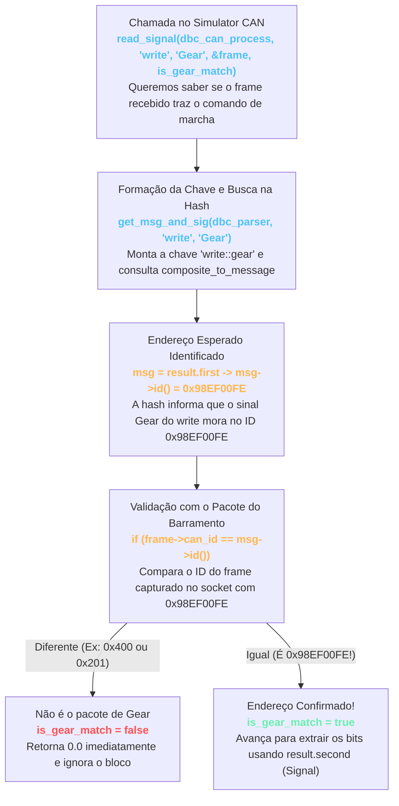

# Processamento do DBC, Tabelas Hash e Comandos `write` (`process_frame_from_dbc_mode`)

A função [`process_frame_from_dbc_mode()`](file:///home/lume/astro/src/simulator_ackerman/simulator_ackerman_can_main.cpp#L2848-L2956) é o núcleo de recepção do simulador quando executado com um arquivo `.dbc` (parâmetro `--dbc_path`). Ela é chamada continuamente pela thread [`update_state_thread()`](file:///home/lume/astro/src/simulator_ackerman/simulator_ackerman_can_main.cpp#L2992-L3007) para cada pacote capturado na rede CAN.

---

## 1. Por que o Simulador lê da mensagem chamada `"write"`?

Conforme detalhado na [Seção 1 da Arquitetura Geral](01_arquitetura_e_fluxo_geral.md#1-o-papel-do-simulator-can-na-pilha-autônoma-divisão-de-responsabilidades), os nomes das mensagens nos arquivos `.dbc` do projeto (como o [`ojAstro_fullDBC.dbc`](file:///home/lume/astro/src/astro_hal/dbc_file_example/ojAstro_fullDBC.dbc)) foram definidos a partir da **perspectiva do controlador de direção (`vehicle_driver`)**:

* **`write`**: Mensagens de comando que o `vehicle_driver` **escreve** na CAN para atuar no veículo (acelerador, freio, volante, marcha).
* **`read`**: Mensagens de sensores/telemetria que o `vehicle_driver` **lê** da CAN (velocidade das rodas, ângulo do volante, RPM, marcha engatada).

> [!IMPORTANT]
> **Perspectiva Invertida no Simulador:**  
> Como o `simulator_ackerman_can` faz o papel do **veículo físico**, ele opera no sentido oposto ao `vehicle_driver`:
> 1. Para **receber os comandos** que o robô enviou, o simulador faz `read_signal()` na mensagem batizada de **`"write"`**.
> 2. Para **devolver a telemetria** simulada, o simulador empacota e transmite a mensagem batizada de **`"read"`**.

---

## 2. O Caminho do Frame: De `update_state_thread()` até `process_frame_from_dbc_mode()`

Como vimos na arquitetura geral, o `simulator_ackerman_can` possui duas vias muito importantes: **escutar** e **enviar** para o barramento CAN.

A via de escuta é realizada dentro de [`update_state_thread()`](file:///home/lume/astro/src/simulator_ackerman/simulator_ackerman_can_main.cpp#L2992-L3007), onde `recv_frame()` escuta o barramento e armazena o frame capturado, e [`update_state_from_can()`](file:///home/lume/astro/src/simulator_ackerman/simulator_ackerman_can_main.cpp#L2960-L2966) é responsável por passar adiante esse frame para tratamento pelo `simulator_can` (o nosso veículo virtual):

```cpp
void *
update_state_thread(void *arg __attribute__ ((unused)))
{
    struct can_frame frame;

    while (1)
    {
        if (can_sockfd != -1)
        {
            recv_frame(can_sockfd, &frame);
            update_state_from_can(frame);
        }
    }

    return (NULL);
}
```

Por sua vez, `update_state_from_can(frame)` identifica se estamos trabalhando com a comunicação via **DBC** (`dbc_can_process.valid_parser == true`) ou com o modo legado/JAUS. Sendo via DBC, ela processa esse frame chamando [`process_frame_from_dbc_mode(frame)`](file:///home/lume/astro/src/simulator_ackerman/simulator_ackerman_can_main.cpp#L2848-L2956):

```cpp
void
update_state_from_can(struct can_frame frame)
{
    if (dbc_can_process.valid_parser == true)
    {
        process_frame_from_dbc_mode(frame);
        return;
    }
    // Caso contrário, segue para o tratamento legado...
}
```

### Como `process_frame_from_dbc_mode()` inicia a avaliação do frame?

Logo na primeira linha útil de `process_frame_from_dbc_mode()`, há uma tentativa de verificar se o comando de marcha (`"Gear"`) veio naquele frame:

```cpp
bool is_gear_match = false;
astro_hal_can_interactions::read_signal(dbc_can_process, "write", "Gear", &frame, is_gear_match);
```

Nessa chamada passamos:
1. **`dbc_can_process`**: A estrutura (`astro_hal_can_interactions_t`) que na inicialização carregou o arquivo `.dbc`;
2. **`"write"`**: O tipo/grupo de mensagem no DBC que queremos verificar;
3. **`"Gear"`**: O sinal específico que estamos procurando;
4. **`&frame`**: O frame que acabou de ser capturado da rede CAN.

---

## 3. Destrinchando o Arquivo DBC e a Criação da Hash de Endereços (`composite_to_message`)

Para entender como o `dbc_can_process` descobre se o `&frame` contém o sinal `"Gear"`, vamos olhar diretamente para o trecho de comandos `WRITE` configurado no arquivo [`ojAstro_fullDBC.dbc`](file:///home/lume/astro/src/astro_hal/dbc_file_example/ojAstro_fullDBC.dbc#L8-L31):

```dbc
#################### WRITE #########################

# aceleração e freio (throttle and brake)
BO_ 0x98EF00FE write: 8 DRIVER
 SG_ ThrottleEffort : 16|16@1+ (0.1,0) [0|100] "" DRIVER
 SG_ BrakesEffort : 0|16@1+ (0.1,0) [0|100] "" DRIVER
 SG_ SignalsByte : 48|8@1+ (1,0) [0|100] "" DRIVER
 SG_ SteeringEffort : 32|16@1- (0.1,0) [-100|100] "" DRIVER

BO_ 0x98EF00FE write: 8 DRIVER
 SG_ Gear : 56|8@1+ (1,0) [0|255] "" DRIVER
VAL_ 0x98EF00FE Gear 16 "drive" 32 "reverse" 8 "neutral" ;

# signals 
BO_ 0x400 write: 2 DRIVER
 SG_ Headlights : 0|5@1+ (1,0) [0|1] "" DRIVER
 SG_ TurnSignal : 5|3@1+ (1,0) [0|1] "" DRIVER
 SG_ Horn : 8|3@1+ (1,0) [0|1] "" DRIVER
 SG_ Retarder : 11|3@1+ (1,0) [0|1] "" DRIVER

# engine_state and vehicle_panel 
BO_ 0x500 write: 1 DRIVER
 SG_ Engine : 0|8@1+ (1,0) [0|1] "" DRIVER
```

### 3.1. O que significam as tags `BO_`, `SG_` e `VAL_`?

O arquivo `.dbc` utiliza três palavras-chave principais para estruturar os pacotes da rede CAN:

| Tag DBC | Nome / Conceito | Estrutura Sintática | O que define no trecho acima? |
| :--- | :--- | :--- | :--- |
| **`BO_`** | **Message** *(Bloco/Cabeçalho da Mensagem CAN)* | `BO_ <CAN_ID> <NomeMsg>: <TamanhoBytes> <Transmissor>` | Define o **endereço CAN** (ex: `0x98EF00FE`, `0x400`, `0x500`), batiza o grupo como `write` e define quantos bytes (DLC) o pacote possui (`8`, `2` ou `1` byte). |
| **`SG_`** | **Signal** *(Sinal empacotado dentro da mensagem)* | `SG_ <NomeSinal> : <BitInicio>\|<Tamanho>@<Ordem><Sinal> (<Fator>,<Offset>) [<Min>\|<Max>] "<Unidade>" <Receptor>` | Define **quais sinais viajam dentro daquele endereço `BO_`** logo acima dele e em quais bits/bytes cada informação fica gravada. |
| **`VAL_`** | **Value Table** *(Dicionário de estados discretos)* | `VAL_ <CAN_ID> <NomeSinal> <Num1> "<Texto1>" <Num2> "<Texto2>" ;` | Traduz números inteiros brutos de um sinal em palavras legíveis (ex: no endereço `0x98EF00FE`, para o sinal `Gear`: `16` = `"drive"`, `32` = `"reverse"`, `8` = `"neutral"`). |

---

### 3.2. Organização dos Sinais por Endereço CAN no Bloco `WRITE`

Esses são todos os comandos de `write` configurados no DBC — ou seja, é o padrão que o **Vehicle Driver (VD)** segue para enviar seus comandos de atuação e como o **Simulator CAN (veículo virtual)** deve lê-los.

Analisando o trecho do DBC acima, observamos que o VD escreve em **3 endereços distintos**, padronizando o envio dos seguintes sinais em cada endereço:

* **Endereço `0x98EF00FE` (`write`, 8 bytes):**
  * `SG_ ThrottleEffort` *(Esforço de aceleração)*
  * `SG_ BrakesEffort` *(Esforço de frenagem)*
  * `SG_ SignalsByte` *(Byte de sinais auxiliares)*
  * `SG_ SteeringEffort` *(Esforço de esterçamento do volante)*
  * `SG_ Gear` *(Comando de marcha)*
* **Endereço `0x400` (`write`, 2 bytes):**
  * `SG_ Headlights` *(Faróis)*
  * `SG_ TurnSignal` *(Setas)*
  * `SG_ Horn` *(Buzina)*
  * `SG_ Retarder` *(Freio motor / Retarder)*
* **Endereço `0x500` (`write`, 1 byte):**
  * `SG_ Engine` *(Estado do motor)*

---

### 3.3. A Criação da Hash de Endereços (`composite_to_message`)

Quando o simulador captura um `frame` na rede CAN, centenas de pacotes de diferentes endereços estão passando pelo cabo. Para filtrar rapidamente **qual é o endereço esperado de um sinal** sem precisar varrer o arquivo DBC toda vez, o HAL cria na inicialização ([`process_dbc_file()`](file:///home/lume/astro/include/astro/astro_hal_can_interactions.hpp#L95-L150)) uma **Hash de Mensagens/Endereços** chamada `composite_to_message`.

Para montar a **Chave (Key)** dessa hash, o HAL junta o nome da mensagem (`BO_`) com o nome do sinal (`SG_`) em letras minúsculas, separados por `"::"`:

$$\text{Chave} = \text{"<nome\_da\_msg>::<nome\_do\_sinal>"}$$

A partir do trecho `WRITE` do DBC acima, a tabela hash `composite_to_message` fica armazenada na memória RAM exatamente assim:

| Chave na Hash (`composite_key`) | Valor Armazenado (`const Libdbc::Message*`) | Endereço (`msg->id()`) | Tamanho (`msg->size()`) |
| :--- | :--- | :--- | :--- |
| `"write::throttleeffort"` | Ponteiro para `Message (0x98EF00FE)` | **`0x98EF00FE`** | `8 bytes` |
| `"write::brakeseffort"` | Ponteiro para `Message (0x98EF00FE)` | **`0x98EF00FE`** | `8 bytes` |
| `"write::signalsbyte"` | Ponteiro para `Message (0x98EF00FE)` | **`0x98EF00FE`** | `8 bytes` |
| `"write::steeringeffort"` | Ponteiro para `Message (0x98EF00FE)` | **`0x98EF00FE`** | `8 bytes` |
| **`"write::gear"`** | Ponteiro para `Message (0x98EF00FE)` | **`0x98EF00FE`** | `8 bytes` |
| `"write::headlights"` | Ponteiro para `Message (0x400)` | **`0x400`** | `2 bytes` |
| `"write::turnsignal"` | Ponteiro para `Message (0x400)` | **`0x400`** | `2 bytes` |
| `"write::horn"` | Ponteiro para `Message (0x400)` | **`0x400`** | `2 bytes` |
| `"write::retarder"` | Ponteiro para `Message (0x400)` | **`0x400`** | `2 bytes` |
| `"write::engine"` | Ponteiro para `Message (0x500)` | **`0x500`** | `1 byte` |

---

### 3.4. Como `get_msg_and_sig()` e `read_signal()` Utilizam essa Hash na Prática

Voltando à nossa chamada lá no simulador:
```cpp
astro_hal_can_interactions::read_signal(dbc_can_process, "write", "Gear", &frame, is_gear_match);
```

Dentro de [`read_signal()`](file:///home/lume/astro/include/astro/astro_hal_can_interactions.hpp#L402-L430), o código invoca [`get_msg_and_sig()`](file:///home/lume/astro/include/astro/astro_hal_can_interactions.hpp#L190-L213) para formar a chave e buscar o endereço na hash:

```cpp
// 1. Dentro de get_msg_and_sig(dbc_parser, "write", "Gear"):
std::string composite_key = to_lowercase(msg_name) + "::" + to_lowercase(sig_name);
// Resultado: composite_key = "write::gear"

auto it_msg = dbc_parser.composite_to_message.find("write::gear");
auto it_sig = dbc_parser.composite_to_signal.find("write::gear");

return std::make_pair(it_msg->second, it_sig->second);
```

Em seguida, `read_signal()` recebe esse resultado em `auto result` e faz o **filtro de endereço**:

```cpp
// 2. Dentro de read_signal():
auto result = get_msg_and_sig(dbc_parser, msg_name, sig_name);
const Libdbc::Message *msg = result.first; // Ponteiro obtido da hash composite_to_message

is_msg_match = false;

// Compara o endereço do frame que chegou na rede com o endereço guardado na Hash!
if (frame->can_id == msg->id()) // Ex: frame->can_id == 0x98EF00FE ?
{
    is_msg_match = true;
    return (decode_signal(result.second, frame->data));
}
```


