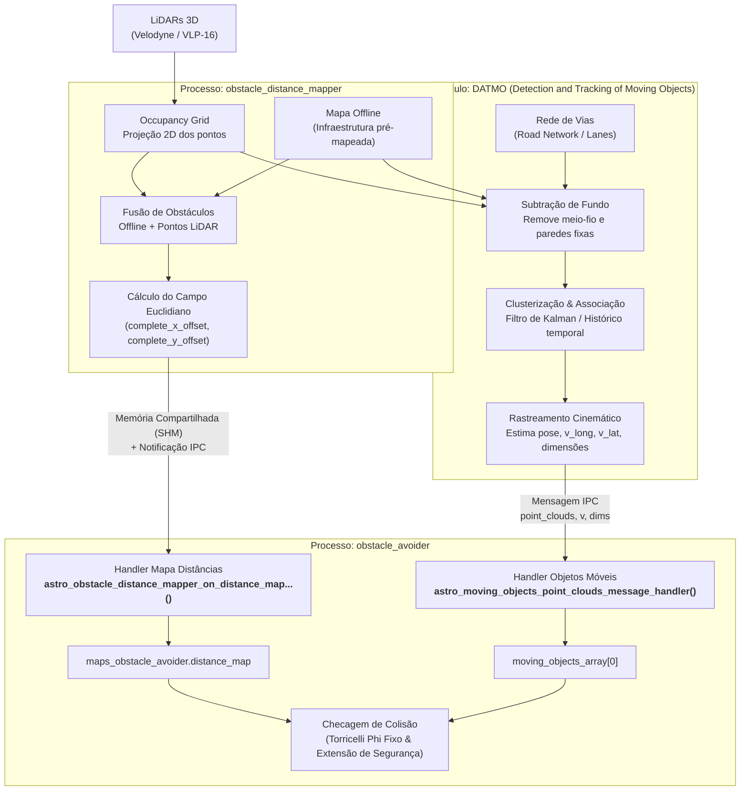

# Fusão e Intersecção: Distance Map vs. Moving Objects (DATMO)

O subsistema de percepção e prevenção de colisões do **`obstacle_avoider`** combina diferentes representações do ambiente para garantir que o caminhão nunca colida com obstáculos estáticos ou dinâmicos.

> [!IMPORTANT]
> **Conceitos Fundamentais de Arquitetura:**
> * **O `distance_map` agrega o Offline + Online:** O mapa de distâncias ([`obstacle_distance_map`](file:///home/lume/astro/src/obstacle_avoider/obstacle_avoider.cpp#L20)) contém tanto a infraestrutura pré-mapeada ([`offline_map`](file:///home/lume/astro/src/obstacle_avoider/obstacle_avoider_main.cpp#L129) com paredes, guias e prédios) quanto os feixes de laser do LiDAR refletidos por obstáculos novos em tempo real.
> * **Ter Velocidade $\neq$ Ser Objeto Móvel:** Nem todo obstáculo na pista está em movimento. Caixas caídas, cones, paletes ou um caminhão estacionado/desligado têm velocidade $v = 0$, mas são capturados em tempo real pelo LiDAR e projetados na grade do `distance_map`.
> * **O papel do DATMO (*Detection And Tracking of Moving Objects*):** O DATMO é o módulo responsável por rastrear entidades dinâmicas (outros veículos, pedestres, empilhadeiras). Ele utiliza o `offline_map` para subtrair e ignorar o meio-fio e estruturas fixas, isolando o que é tráfego e emitindo a mensagem [`astro_moving_objects_point_clouds_message`](file:///home/lume/astro/include/astro/moving_objects_messages.h#L52).
> * **Intersecção e Redundância:** Quando um objeto móvel (ou simulado) está na pista, ele é atingido pelos feixes do LiDAR. Portanto, ele existe **simultaneamente** na grade do `distance_map` e na nuvem de entidades do `DATMO`. Essa sobreposição garante que, mesmo que o rastreamento do DATMO falhe ou atrase, a presença física do objeto no mapa de distâncias ainda acionará a frenagem de emergência.

---

## 1. Arquitetura de Percepção e Fluxo de Dados

A figura abaixo ilustra como os feixes de LiDAR e o mapa offline fluem através do sistema até chegarem aos handlers do [`obstacle_avoider`](file:///home/lume/astro/src/obstacle_avoider/obstacle_avoider_main.cpp):



---

## 2. A Composição do `Obstacle Distance Map`

O mapa de distâncias gerenciado por [`obstacle_avoider_update_map()`](file:///home/lume/astro/src/obstacle_avoider/obstacle_avoider.cpp#L114) recebe uma estrutura [`astro_obstacle_distance_mapper_map_t`](file:///home/lume/astro/include/astro/obstacle_distance_mapper_messages.h#L40-L46).

Diferente de um mapa de ocupação binário (onde cada célula é apenas `0` ou `1`), o `distance_map` é um **Campo de Distâncias Euclidiano (*Euclidean Distance Field*)**:
* Possui dimensões típicas de $200 \times 200$ ou $400 \times 400$ células.
* Para cada célula da grade, ele armazena dois deslocamentos vetoriais pré-calculados:
  * `complete_x_offset[index]`
  * `complete_y_offset[index]`
* Ao consultar qualquer ponto $(X, Y)$ no mundo via [`astro_obstacle_avoider_distance_from_global_point_to_obstacle()`](file:///home/lume/astro/src/obstacle_avoider/collision_detection.cpp#L734), o algoritmo obtém a distância euclidiana exata até o obstáculo mais próximo em $O(1)$:
  $$\text{dist} = \sqrt{dx^2 + dy^2} \times \text{resolução}$$
* Células que contêm obstáculos diretos possuem offset nulo ($dx \approx 0, dy \approx 0 \implies \text{dist} = 0{,}0\text{ m}$).

### De onde vêm esses obstáculos?
1. **Infraestrutura Estática (Offline):** Paredes, mourões, colunas de galpões e muretas pré-carregadas.
2. **Novos Obstáculos Físicos:** Qualquer ponto refletido pelo laser que não pertence ao chão (piso) é inserido na grade como célula ocupada, gerando um campo de repulsão de distâncias ao redor dele.

---

## 3. O Funcionamento do DATMO (*Detection And Tracking of Moving Objects*)

O módulo DATMO opera sob o princípio de que **não basta saber que há um obstáculo; é preciso saber se ele é uma entidade em movimento ou com potencial cinemático**.

### Pipeline de Processamento do DATMO:
1. **Entrada do Grid de Ocupação:** Recebe a grade de pontos brutos gerada pelo LiDAR.
2. **Subtração do Mapa Offline:** Cruza os pontos com o [`offline_map`](file:///home/lume/astro/src/obstacle_avoider/obstacle_avoider_main.cpp#L129). Se um ponto coincide com uma parede ou guia pré-existente, ele é descartado da análise de tráfego.
3. **Agrupamento em Clusters e Faixas:** Os pontos restantes são projetados nas faixas de tráfego ([`road_network`](file:///home/lume/astro/src/obstacle_distance_mapper/README.md#L25)) e agrupados em objetos (caixas delimitadoras 3D).
4. **Filtro de Rastreamento (Tracking Temporal):** Associa os clusters ao longo do tempo (usando Filtro de Kalman ou Monte Carlo), estimando:
   * Posição global $(X, Y, Z)$.
   * Vetor de velocidade ($\vec{v}_{\text{longitudinal}}, \vec{v}_{\text{lateral}}$).
   * Dimensões médias (comprimento, largura, altura).
   * Nuvem de pontos 3D que compõe a carcaça do objeto.
5. **Publicação IPC:** Emite a mensagem [`astro_moving_objects_point_clouds_message`](file:///home/lume/astro/include/astro/moving_objects_messages.h#L52), recebida no `obstacle_avoider` através de [`astro_moving_objects_point_clouds_message_handler()`](file:///home/lume/astro/src/obstacle_avoider/obstacle_avoider_main.cpp#L1876).

---

## 4. Distinção Conceitual: Classes de Obstáculos

| Categoria | Exemplo | Presença no `offline_map` | Tem Velocidade? | Como o `distance_map` trata? | Como o `DATMO` trata? |
| :--- | :--- | :---: | :---: | :--- | :--- |
| **Estático de Infraestrutura** | Parede, pilar, meio-fio | **Sim** | Não ($v = 0$) | Presente permanentemente no campo de distâncias. | **Subtraído/Filtrado** (não gera objeto móvel). |
| **Estático Novo / Temporário** | Caixa caída, cone, veículo parado/estacionado | **Não** | Não ($v = 0$) | **Captado pelos feixes do LiDAR** e inserido na grade em tempo real. | Pode ser ignorado após confirmar velocidade nula persistente ou mantido como obstáculo estático de pista. |
| **Dinâmico / Móvel** | Pedestre, empilhadeira, caminhão em tráfego | **Não** | **Sim** ($v > 0$) | **Captado pelo laser** (gera células ocupadas no instante $t$). | **Rastreado ativamente** com vetor de velocidade, histórico e predição de trajetória. |

---

## 5. A Intersecção de Atuação e a Ordem de Prioridade

Como tanto o `obstacle_distance_mapper` quanto o `DATMO` consom as mesmas nuvens de pontos dos LiDARs, **qualquer obstáculo colocado na pista produz dados em ambas as fontes**.

### Por que a ordem dos testes importa?
Na verificação de colisão do *Potential Collision* (Etapa 1 em [`check_collision_in_trajectory`](file:///home/lume/astro/src/obstacle_avoider/obstacle_avoider.cpp#L1019) e Etapa 2 em [`set_extension_trajectory_from_deceleration`](file:///home/lume/astro/src/obstacle_avoider/obstacle_avoider.cpp#L1238)):

#### Ordem Original (Prioridade do Mapa de Distâncias):
```cpp
// 1º: Testa os mapas
if (collision_result.has_collision)
{
    collision_map_name = collision_result.map_name; // -> "Obstacle Distance Map"
}
// 2º: Só testava Moving Objects se os mapas NÃO acusassem colisão
else if (pose_collides_with_moving_objects(...))
{
    collision_map_name = "Moving Objects";
}
```
* **Comportamento observado:** Como o obstáculo físico refletia feixes de laser que entravam no grid do `distance_map`, o primeiro `if` era satisfeito na marca dos $8\text{ m}$. Por avaliação de curto-circuito do C++, o `else if (pose_collides_with_moving_objects)` era ignorado e o alarme sempre saía rotulado como `[Obstacle Distance Map]`.

#### Ordem Invertida (Prioridade de Entidades Dinâmicas):
```cpp
// 1º: Testa primeiro se o obstáculo é uma entidade rastreada pelo DATMO
if (pose_collides_with_moving_objects(iterative_pose, safe_distance, &distance_to_mo))
{
    collision_map_name = "Moving Objects";
    flag_check_collision = true;
    ASTRO_ERROR_METADATA("ASTRO_ERROR_CODE_204", "Houve colisão na extensão da trajetória do potential collision. (Moving Objects)");
}
// 2º: Se não for entidade rastreada, testa o grid do mapa de distâncias / especiais
else if (collision_result.has_collision)
{
    collision_map_name = collision_result.map_name;
    flag_check_collision = true;
}
```
* **Comportamento observado:** Agora, ao projetar as poses à frente, a verificação consulta a lista de nuvens de pontos de objetos móveis em [`moving_objects_array[0]`](file:///home/lume/astro/src/obstacle_avoider/obstacle_avoider_main.cpp#L1883). Como o objeto à frente está sendo rastreado pelo DATMO, o primeiro `if` é acionado e o log acusa com precisão:
  ```text
  [EXTENSÃO ALERTA - ERRO 204] COLISÃO DETECTADA no Passo 162 (dist: 8.04m < 10.00m)!
  Fonte: [Moving Objects] | Freio acionado: acc = -1.00 m/s^2
  ```

---

## 6. O Princípio da Defesa em Profundidade (Redundância de Segurança)

Essa sobreposição intencional entre o `distance_map` e o `Moving Objects` é a base da segurança funcional do veículo:

1. **Se o DATMO falhar ou atrasar:** Se o algoritmo de tracking perder a associação de um pedestre ou se o objeto tiver uma geometria atípica que o clusterizador não reconheça, os feixes do LiDAR ainda atingem a grade do `distance_map`, forçando a parada de emergência.
2. **Se o Mapa de Distâncias atrasar ou falhar no decay:** Se o veículo estiver em alta velocidade ou manobrando rápido e a projeção de células da grade sofrer latência, as coordenadas do cluster 3D do DATMO garantem que a colisão seja interceptada imediatamente nas coordenadas globais.
3. **Múltiplos Sensores:** Fontes que não desenham no mapa 2D (como radares automotivos ou detecção de pedestres por redes neurais em câmeras) injetam dados diretamente em `moving_objects_array[1..5]`, garantindo proteção 360° em qualquer cenário operacional.

