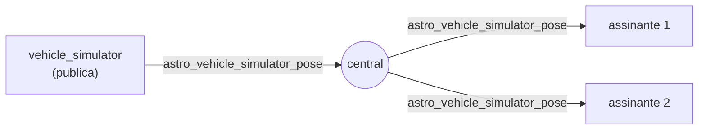

# 2. Criando a mensagem e sua interface

No capítulo anterior o `vehicle_simulator` se conectou à `central`, mas não tinha nada a dizer. Agora vamos dar a ele uma mensagem: a **pose do veículo** (posição, orientação e velocidade). Ao fim deste capítulo o módulo publicará essa mensagem uma vez por segundo.

Os valores serão fixos por enquanto. O veículo só começa a se mover em um capítulo posterior.

O trabalho é dividido em arquivos desde o início, como nos módulos do ASTRO:

| Arquivo | Responsabilidade |
|---|---|
| `vehicle_simulator_messages.h` | **Descreve** a mensagem: struct, nome e formato |
| `vehicle_simulator_interface.h/.cpp` | **Funções** para definir e publicar a mensagem |
| `vehicle_simulator_main.cpp` | **Lógica do módulo**: usa as funções da interface |

## 2.1 Mensagem, publicador e assinante

No IPC, uma **mensagem** é um pacote de dados com um **nome** e um **formato**. Quem produz o dado **publica** (*publish*) a mensagem na `central`. Quem quer o dado **assina** (*subscribe*) a mensagem pelo nome. A `central` entrega cada publicação a todos os assinantes.



O publicador não sabe quem está assinando, e pode haver zero, um ou vários assinantes. Neste capítulo só vamos publicar. O assinante vem no próximo.

Para publicar, o módulo precisa de três coisas, que veremos nesta ordem:

1. **Descrever a mensagem**: a struct em C e o nome e o formato que a `central` vai conhecer.
2. **Criar a interface da mensagem**: as funções que definem e publicam essa mensagem.
3. **Usar a interface no `main`**: preencher os dados e publicar.

## 2.2 Descrevendo a mensagem

Crie o arquivo `vehicle_simulator_messages.h`, na pasta do módulo:

```cpp
#ifndef ASTRO_VEHICLE_SIMULATOR_MESSAGES_H
#define ASTRO_VEHICLE_SIMULATOR_MESSAGES_H

#ifdef __cplusplus
extern "C"
{
#endif

typedef struct
{
	double x;		/**< Posicao x no referencial global (m) */
	double y;		/**< Posicao y no referencial global (m) */
	double theta;		/**< Orientacao do veiculo (rad) */
	double v;		/**< Velocidade linear (m/s) */
	double timestamp;	/**< Obrigatorio: instante de criacao da mensagem */
	char *host;		/**< Obrigatorio: host de origem da mensagem */
} astro_vehicle_simulator_pose_message;

#define ASTRO_VEHICLE_SIMULATOR_POSE_MESSAGE_NAME	"astro_vehicle_simulator_pose"
#define ASTRO_VEHICLE_SIMULATOR_POSE_MESSAGE_FMT	"{double,double,double,double,double,string}"

#ifdef __cplusplus
}
#endif

#endif
```

O arquivo tem três partes:

| Parte | Para que serve |
|---|---|
| **A struct** `astro_vehicle_simulator_pose_message` | Os dados da mensagem, em C. É o que você preenche ao publicar e lê ao receber |
| **`..._MESSAGE_NAME`** | O **nome** da mensagem na `central`. É por ele que os assinantes a encontram |
| **`..._MESSAGE_FMT`** | O **formato** da mensagem: a descrição, em texto, dos campos da struct |

### O formato precisa espelhar a struct

A `central` não enxerga a struct em C, então precisa do formato para saber como transportar os bytes. Por isso o formato lista **os mesmos campos, na mesma ordem**:

| Campo da struct | Tipo em C | No formato |
|---|---|---|
| `x` | `double` | `double` |
| `y` | `double` | `double` |
| `theta` | `double` | `double` |
| `v` | `double` | `double` |
| `timestamp` | `double` | `double` |
| `host` | `char *` | `string` |

Outros tipos que você vai encontrar: `int` é `int`, e `char *` é sempre `string`. O formato todo vai entre chaves.

> [!WARNING]
> **Struct e formato têm que ficar sincronizados.** Se você acrescentar um campo na struct e esquecer o formato (ou trocar a ordem), o programa compila normalmente, mas os dados chegam trocados ou corrompidos. O compilador não consegue avisar, porque o formato é só um texto.

### Os campos `timestamp` e `host`

**Toda mensagem do ASTRO tem `double timestamp` e `char *host`**, sempre no fim da struct. O `timestamp` registra quando a mensagem foi criada, e o `host` guarda o computador de origem. Quem recebe usa esses campos para saber a idade do dado e de onde ele veio. Quem preenche esses campos é a função de publicação, como veremos na interface.

### Por que o `extern "C"`

O módulo é em C++, mas a biblioteca de IPC é em C. O `extern "C"` garante que os nomes das macros e da struct sejam entendidos igualmente pelas duas linguagens. Mantenha-o em todo arquivo `_messages.h`.

### Unidades e referencial nos comentários

Repare que cada campo tem a **unidade** e o **referencial** no comentário (m, rad, m/s, referencial global). Dois módulos podem interpretar `v` de formas diferentes (m/s ou km/h?) e o compilador não sabe. Documente isso sempre na struct.

## 2.3 A interface da mensagem

O `_messages.h` só **descreve** a mensagem. Para usá-la, alguém precisa chamar `IPC_defineMsg`, `IPC_publishData`, `astro_subscribe_message`... sempre com o mesmo nome, o mesmo formato e a mesma verificação de erro. Se cada módulo fizesse isso por conta própria, bastaria um erro de digitação no nome ou no formato para criar uma mensagem incompatível, sem nenhum aviso.

A solução do ASTRO é um arquivo de **interface**: o módulo dono da mensagem oferece **funções prontas** para trabalhar com ela. Quem precisa da mensagem só chama essas funções, sem conhecer nome nem formato.

Uma interface completa tem funções para **definir**, **publicar** e **assinar** a mensagem. Neste capítulo só precisamos das duas primeiras, porque o módulo apenas publica. A função de assinar será acrescentada no próximo capítulo, quando o módulo que assina existir.

### O padrão dos nomes

Os nomes das funções da interface seguem o padrão:

```text
astro_<modulo>_<ação>_<mensagem>_message
```

| Função | O que faz |
|---|---|
| `astro_vehicle_simulator_define_pose_message` | Define a mensagem na `central` |
| `astro_vehicle_simulator_publish_pose_message` | Publica a mensagem |

A ação pode ainda ser `subscribe` ou `unsubscribe`, que virão com o assinante.

> [!NOTE]
> A **definição** da mensagem aparece de formas diferentes nos módulos do projeto: em alguns é feita dentro da função de publicação, na primeira chamada; em outros há uma função de definição única para todas as mensagens do módulo (`..._define_messages`); e em outros, uma função por mensagem, como aqui. Escolhemos **uma função por mensagem, chamada explicitamente**, porque deixa claro no `main` o momento em que a mensagem é definida.

### O header da interface

Crie o `vehicle_simulator_interface.h`:

```cpp
#ifndef ASTRO_VEHICLE_SIMULATOR_INTERFACE_H
#define ASTRO_VEHICLE_SIMULATOR_INTERFACE_H

#include <astro/astro.h>
#include <astro/vehicle_simulator_messages.h>

#ifdef __cplusplus
extern "C"
{
#endif

void
astro_vehicle_simulator_define_pose_message(void);

void
astro_vehicle_simulator_publish_pose_message(astro_vehicle_simulator_pose_message *message, double timestamp);

#ifdef __cplusplus
}
#endif

#endif
```

O header inclui `<astro/vehicle_simulator_messages.h>` com `<astro/...>`: é o caminho em que o header fica **publicado** depois do `make` (veremos na seção 2.4).

### A implementação

Crie o `vehicle_simulator_interface.cpp`:

```cpp
#include <astro/astro.h>
#include <astro/vehicle_simulator_interface.h>

void
astro_vehicle_simulator_define_pose_message(void)
{
	IPC_RETURN_TYPE err;

	err = IPC_defineMsg(ASTRO_VEHICLE_SIMULATOR_POSE_MESSAGE_NAME, IPC_VARIABLE_LENGTH, ASTRO_VEHICLE_SIMULATOR_POSE_MESSAGE_FMT);
	astro_test_ipc_exit(err, "Could not define", ASTRO_VEHICLE_SIMULATOR_POSE_MESSAGE_NAME);
}

void
astro_vehicle_simulator_publish_pose_message(astro_vehicle_simulator_pose_message *message, double timestamp)
{
	IPC_RETURN_TYPE err;

	message->timestamp = timestamp;
	message->host = astro_get_host();

	err = IPC_publishData(ASTRO_VEHICLE_SIMULATOR_POSE_MESSAGE_NAME, message);
	astro_test_ipc_exit(err, "Could not publish", ASTRO_VEHICLE_SIMULATOR_POSE_MESSAGE_NAME);
}
```

Vamos às duas funções, uma a uma.

#### Definir a mensagem

A `central` só entrega mensagens que ela conhece, então a mensagem precisa ser **definida** antes de ser publicada.

| Trecho | O que faz |
|---|---|
| `IPC_defineMsg(nome, tamanho, formato)` | Registra a mensagem na `central`, com seu nome e formato |
| `IPC_VARIABLE_LENGTH` | Indica que o tamanho da mensagem pode variar. É o valor usado nas mensagens do ASTRO, pois campos `string` têm tamanho livre. Use-o sempre |
| `IPC_RETURN_TYPE err` | O resultado da chamada: se deu certo ou não |
| `astro_test_ipc_exit(err, texto, nome)` | Verifica o resultado. Se houve erro, imprime o `texto` junto com o nome da mensagem e **encerra o módulo** |

A verificação de erro depois de cada chamada de IPC é um padrão do ASTRO. Falhar na definição de uma mensagem é grave, então o módulo termina.

#### Publicar a mensagem

A função recebe a struct com os dados e o instante da publicação, e faz três coisas:

1. **Preenche `timestamp` e `host`**: `message->timestamp = timestamp;` e `message->host = astro_get_host();`. O `astro_get_host()` devolve o nome do módulo e da máquina. Como o preenchimento está **dentro da interface**, quem publica não precisa lembrar desses campos obrigatórios, e eles saem sempre do mesmo jeito.
2. **Publica**: `IPC_publishData(nome, message)` envia a struct para a `central`, que a distribui aos assinantes.
3. **Verifica o erro**, como na definição.

> [!NOTE]
> **Nome da mensagem e struct têm que combinar.** A chamada usa o nome `ASTRO_VEHICLE_SIMULATOR_POSE_MESSAGE_NAME` junto com um ponteiro para `astro_vehicle_simulator_pose_message`. A `central` confia que a struct tem o formato definido. Passar a struct de outra mensagem compila, mas corrompe os dados. Ter o nome e a struct dentro da mesma função de interface é justamente o que evita esse erro.

## 2.4 Publicando a interface pelo `Makefile`

O módulo agora produz uma **biblioteca** (a interface) além do executável, e precisa **publicar** os headers e a biblioteca para outros módulos usarem. Atualize o `Makefile`:

```makefile
include ../Makefile.conf

MODULE_NAME = VEHICLE SIMULATOR
MODULE_COMMENT = Modulo de exemplo: simula um veiculo e publica sua pose

LFLAGS += -lvehicle_simulator_interface -lglobal -lipc -lpthread

SOURCES = vehicle_simulator_main.cpp vehicle_simulator_interface.cpp

PUBLIC_INCLUDES = vehicle_simulator_messages.h vehicle_simulator_interface.h
PUBLIC_LIBRARIES = libvehicle_simulator_interface.a
PUBLIC_BINARIES = vehicle_simulator

TARGETS = libvehicle_simulator_interface.a vehicle_simulator

libvehicle_simulator_interface.a: vehicle_simulator_interface.o

vehicle_simulator: vehicle_simulator_main.o

include ../Makefile.rules
```

O que foi acrescentado em relação ao capítulo 1:

| Linha | Significado |
|---|---|
| `-lvehicle_simulator_interface` em `LFLAGS` | O executável faz link com a própria biblioteca de interface. Deve vir **antes** de `-lglobal -lipc` (mesma regra de ordem do capítulo 1) |
| `SOURCES` com `vehicle_simulator_interface.cpp` | O novo arquivo faz parte do módulo |
| `PUBLIC_INCLUDES` | Os dois headers são **copiados** para `$ASTRO_HOME/include/astro/`. É por isso que `#include <astro/vehicle_simulator_interface.h>` funciona em qualquer módulo |
| `PUBLIC_LIBRARIES` | A biblioteca é copiada para `$ASTRO_HOME/lib/`, onde qualquer módulo pode fazer link com ela |
| `libvehicle_simulator_interface.a: ...o` | Constrói a biblioteca a partir do objeto da interface |
| `TARGETS` com a biblioteca | O `make` passa a construí-la também |

Compile:

```bash
cd $ASTRO_HOME/src/vehicle_simulator
make
```

Confira que os arquivos foram publicados:

```bash
ls $ASTRO_HOME/include/astro/vehicle_simulator_*
ls $ASTRO_HOME/lib/libvehicle_simulator_interface.a
```

(FOTO AQUI DE: o `make` do `vehicle_simulator` com a compilação do `vehicle_simulator_interface.cpp` e a criação da biblioteca, seguido do `ls` dos arquivos públicos.)

> [!WARNING]
> **Os headers são copiados, não ligados.** O que fica em `include/astro/` é uma **cópia** do arquivo da pasta do módulo. Se você alterar a struct ou o formato em `vehicle_simulator_messages.h`, rode `make` no `vehicle_simulator` **de novo** para atualizar a cópia, e recompile também os módulos que usam a mensagem. Caso contrário, quem assina e quem publica passam a ter structs diferentes e os dados chegam corrompidos, sem nenhum aviso.

## 2.5 Usando a interface no `main`

Agora o `main` só precisa chamar a interface. Edite o `vehicle_simulator_main.cpp`:

```cpp
#include <astro/astro.h>
#include <astro/vehicle_simulator_interface.h>

static void
publish_pose(void)
{
	astro_vehicle_simulator_pose_message message;

	message.x = 0.0;
	message.y = 0.0;
	message.theta = 0.0;
	message.v = 2.0;

	astro_vehicle_simulator_publish_pose_message(&message, astro_get_time());

	printf("vehicle_simulator: publicou x=%.2f y=%.2f theta=%.2f v=%.2f\n", message.x, message.y, message.theta, message.v);
}

static void
shutdown_module(int signo)
{
	if (signo == SIGINT)
	{
		astro_ipc_disconnect();
		printf("vehicle_simulator: desconectado.\n");
		exit(0);
	}
}

int
main(int argc, char **argv)
{
	astro_ipc_initialize(argc, argv);
	signal(SIGINT, shutdown_module);

	astro_vehicle_simulator_define_pose_message();

	astro_ipc_addPeriodicTimer(1.0, (TIMER_HANDLER_TYPE) publish_pose, NULL);

	astro_ipc_dispatch();

	return 0;
}
```

A função `shutdown_module` é a mesma do capítulo 1. O que há de novo:

### `publish_pose()`

Preenche **só os dados do veículo**: `x`, `y`, `theta` e `v`, com valores fixos (o veículo está parado na origem, com `v = 2.0`). Em seguida chama a função de publicação, passando o instante atual com `astro_get_time()`. O `timestamp` e o `host` são preenchidos por dentro da interface. O `printf` serve para você acompanhar no terminal o que está sendo enviado.

### O `main`

A ordem é importante:

1. **Conectar** à `central` e registrar o tratamento do Ctrl+C (como no capítulo 1);
2. **Definir a mensagem** com `astro_vehicle_simulator_define_pose_message()`, **antes de qualquer publicação**;
3. **Registrar o timer** que vai publicar;
4. **Entrar no `dispatch`**.

### O timer periódico

Falta chamar `publish_pose()` repetidamente. O ASTRO tem um **timer periódico** do IPC, que chama uma função a cada intervalo de tempo:

```cpp
astro_ipc_addPeriodicTimer(1.0, (TIMER_HANDLER_TYPE) publish_pose, NULL);
```

| Argumento | Significado |
|---|---|
| `1.0` | Intervalo entre as chamadas, **em segundos** |
| `(TIMER_HANDLER_TYPE) publish_pose` | A função a ser chamada |
| `NULL` | Dado extra opcional para a função (não usamos) |

O timer é disparado pelo `astro_ipc_dispatch()` que já está no fim do `main`: é lá que o módulo "vive" e responde a eventos, sejam mensagens recebidas ou timers.

## 2.6 Compilando e executando

```bash
cd $ASTRO_HOME/src/vehicle_simulator
make
```

Com a `central` rodando em outro terminal, execute:

```bash
cd $ASTRO_HOME/bin
./vehicle_simulator
```

```text
ASTRO - LUME ROBOTICS SYSTEM Version 0.8.0

vehicle_simulator: publicou x=0.00 y=0.00 theta=0.00 v=2.00
vehicle_simulator: publicou x=0.00 y=0.00 theta=0.00 v=2.00
vehicle_simulator: publicou x=0.00 y=0.00 theta=0.00 v=2.00
```

(FOTO AQUI DE: a `central` em um terminal e o `vehicle_simulator` publicando no outro.)

Uma linha por segundo. Ctrl+C encerra o módulo normalmente.

> [!NOTE]
> O `printf` só mostra que o módulo **enviou**. Ainda não temos como saber se alguém **recebeu**, e não é problema: como vimos, o publicador não depende de haver assinantes. O módulo que vai receber será criado no próximo capítulo.

### O erro mais comum: esquecer de definir a mensagem

Para ver o que acontece, comente a linha `astro_vehicle_simulator_define_pose_message();` no `main`, recompile e execute com uma `central` recém-iniciada:

```text
ASTRO - LUME ROBOTICS SYSTEM Version 0.8.0

IPC_ERROR : Could not publish : message astro_vehicle_simulator_pose
          : IPC message not defined
This is a fatal error. Exiting.
```

O módulo termina na primeira publicação, porque a `central` não conhece a mensagem. Foi para isso que colocamos o `astro_test_ipc_exit`: o erro aparece com o nome da mensagem e o módulo não segue em frente com um estado inconsistente. Desfaça o comentário antes de continuar.

> [!TIP]
> A `central` lembra as mensagens que já foram definidas enquanto estiver no ar. Se outro módulo já a definiu, a publicação sem a definição pode "funcionar" por acaso, e o erro só apareceria numa `central` nova. Defina sempre a mensagem no módulo que a publica.

## 2.7 Checkpoint

Neste ponto você tem:

- [x] `vehicle_simulator_messages.h` com a struct, o nome e o formato da mensagem de pose;
- [x] `vehicle_simulator_interface.h/.cpp` com as funções `define` e `publish` da mensagem, no padrão `astro_<modulo>_<ação>_<mensagem>_message`;
- [x] um `Makefile` que publica os headers e a biblioteca `libvehicle_simulator_interface.a` para outros módulos;
- [x] um `main` que só usa a interface: define a mensagem uma vez e publica a pose a cada segundo, com um timer periódico;
- [x] a noção de que **struct e formato devem espelhar um ao outro**, e de que toda chamada de IPC tem seu resultado verificado, agora dentro da interface.

**Próximo capítulo:** vamos criar um segundo módulo, o `vehicle_simulator_monitor`, que **assina** essa mensagem. Para isso, acrescentaremos a função `subscribe` à interface.
