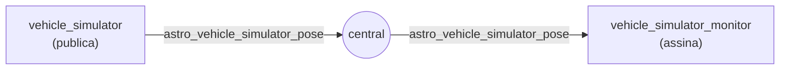

# 3. Assinando a mensagem: o segundo módulo

No capítulo anterior o `vehicle_simulator` passou a publicar a pose do veículo, mas ninguém a recebia. Agora vamos criar um **segundo módulo**, o `vehicle_simulator_monitor`, que **assina** essa mensagem e imprime o que chega.

Esse é o desenho típico do ASTRO: um módulo produz um dado, outro o consome, e nenhum conhece o outro. Só compartilham o nome e o formato da mensagem.



Este capítulo tem três passos:

1. **Tornar a mensagem acessível** a outros módulos (ela hoje só existe dentro da pasta do `vehicle_simulator`).
2. **Criar o módulo monitor**, com um *handler*: a função que o IPC chama a cada mensagem recebida.
3. **Assinar** a mensagem e ver os dados chegando.

## 3.1 Tornando o header da mensagem público

O `vehicle_simulator_messages.h` está na pasta do `vehicle_simulator`, e o monitor vai ficar em outra pasta. Para o monitor enxergar a struct e as macros da mensagem, o header precisa ser **publicado** em uma pasta comum, a `$ASTRO_HOME/include/astro/`. Quem faz essa cópia é o `Makefile`.

Abra o `Makefile` do `vehicle_simulator` e acrescente a linha `PUBLIC_INCLUDES`:

```makefile
include ../Makefile.conf

MODULE_NAME = VEHICLE SIMULATOR
MODULE_COMMENT = Modulo de exemplo: simula um veiculo e publica sua pose

LFLAGS += -lglobal -lipc -lpthread

SOURCES = vehicle_simulator_main.cpp

PUBLIC_INCLUDES = vehicle_simulator_messages.h
PUBLIC_BINARIES = vehicle_simulator
TARGETS = vehicle_simulator

vehicle_simulator: vehicle_simulator_main.o

include ../Makefile.rules
```

Recompile o módulo:

```bash
cd $ASTRO_HOME/src/vehicle_simulator
make
```

E confira que o header foi copiado:

```bash
ls $ASTRO_HOME/include/astro/vehicle_simulator_messages.h
```

Agora qualquer módulo pode fazer `#include <astro/vehicle_simulator_messages.h>`, com `astro/` e os sinais `<>`.

(FOTO AQUI DE: terminal com o `make` do vehicle_simulator e, em seguida, o `ls` mostrando o header em `include/astro/`.)

> [!WARNING]
> **O header é copiado, não ligado.** O que fica em `include/astro/` é uma **cópia**. Se você alterar a struct ou o formato em `vehicle_simulator_messages.h`, precisa rodar `make` no `vehicle_simulator` **de novo**, para a cópia ser atualizada, e depois recompilar todos os módulos que usam a mensagem. Esquecer isso deixa o monitor lendo uma struct diferente da que o publicador envia, e os dados chegam corrompidos sem nenhum aviso.

## 3.2 Criando o módulo monitor

Crie a pasta do módulo ao lado do `vehicle_simulator`:

```bash
mkdir $ASTRO_HOME/src/vehicle_simulator_monitor
cd $ASTRO_HOME/src/vehicle_simulator_monitor
```

### O `main`, de novo, do começo

Crie o `vehicle_simulator_monitor_main.cpp`. Você já conhece a estrutura (capítulo 1): conectar, tratar o Ctrl+C e entrar no `dispatch`. A novidade é o trecho que **assina** a mensagem:

```cpp
#include <astro/astro.h>
#include <astro/vehicle_simulator_messages.h>

static void
pose_message_handler(astro_vehicle_simulator_pose_message *message)
{
	printf("vehicle_simulator_monitor: x=%.2f y=%.2f theta=%.2f v=%.2f (de %s, t=%.3f)\n",
			message->x, message->y, message->theta, message->v, message->host, message->timestamp);
}

static void
shutdown_module(int signo)
{
	if (signo == SIGINT)
	{
		astro_ipc_disconnect();
		printf("vehicle_simulator_monitor: desconectado.\n");
		exit(0);
	}
}

int
main(int argc, char **argv)
{
	astro_ipc_initialize(argc, argv);
	signal(SIGINT, shutdown_module);

	astro_subscribe_message(ASTRO_VEHICLE_SIMULATOR_POSE_MESSAGE_NAME, ASTRO_VEHICLE_SIMULATOR_POSE_MESSAGE_FMT,
			NULL, sizeof(astro_vehicle_simulator_pose_message),
			(astro_handler_t) pose_message_handler, ASTRO_SUBSCRIBE_LATEST);

	printf("vehicle_simulator_monitor: aguardando mensagens.\n");

	astro_ipc_dispatch();

	return 0;
}
```

Vamos por partes.

### O *handler*

```cpp
static void
pose_message_handler(astro_vehicle_simulator_pose_message *message)
{
	printf(...);
}
```

O **handler** é uma função sua, que **você não chama**. Quem a chama é o IPC, **uma vez para cada mensagem que chega**. O argumento `message` é um ponteiro para a struct já preenchida com os dados recebidos. Aqui o handler só imprime os campos.

### A assinatura

```cpp
astro_subscribe_message(ASTRO_VEHICLE_SIMULATOR_POSE_MESSAGE_NAME, ASTRO_VEHICLE_SIMULATOR_POSE_MESSAGE_FMT,
		NULL, sizeof(astro_vehicle_simulator_pose_message),
		(astro_handler_t) pose_message_handler, ASTRO_SUBSCRIBE_LATEST);
```

| Argumento | Significado |
|---|---|
| `..._MESSAGE_NAME` | O nome da mensagem que queremos receber |
| `..._MESSAGE_FMT` | O formato da mensagem, o mesmo usado pelo publicador |
| `NULL` | Onde guardar a mensagem recebida. Com `NULL`, **o próprio IPC aloca a memória**. É o jeito mais simples e o que usamos |
| `sizeof(...)` | O tamanho da struct, para o IPC saber quanto alocar |
| `(astro_handler_t) pose_message_handler` | O handler a ser chamado a cada mensagem. O *cast* para `astro_handler_t` é necessário porque o IPC espera uma função que recebe um `void *` |
| `ASTRO_SUBSCRIBE_LATEST` | A política de entrega, explicada a seguir |

### `ASTRO_SUBSCRIBE_LATEST` ou `ASTRO_SUBSCRIBE_ALL`

Imagine que mensagens chegam mais rápido do que o handler consegue processar. O IPC precisa decidir o que fazer com as que ficam esperando:

| Política | Comportamento |
|---|---|
| `ASTRO_SUBSCRIBE_LATEST` | Mantém **só a mais recente** na fila. Se o handler está ocupado, as mensagens antigas são descartadas |
| `ASTRO_SUBSCRIBE_ALL` | Mantém uma **fila longa** (até 1000 mensagens), sem descartar nenhuma |

Para um dado de estado, como uma pose, o que importa é o **valor mais recente**, então usamos `LATEST`. `ALL` é para quando perder uma mensagem causa um problema (um comando que não pode ser perdido, por exemplo).

### Tempo de vida dos dados no handler

> [!WARNING]
> **O que o handler recebe só vale durante a chamada do handler.** O IPC reaproveita a mesma memória a cada nova mensagem: quando a próxima chega, a anterior é liberada. Os campos numéricos você pode ler à vontade dentro do handler, mas o ponteiro `message->host` (uma `string`) **deixa de ser válido** depois dele. Se precisar guardar um valor para usar depois, **copie-o** (um `double` com `x = message->x;`, uma string com `strdup` ou `strcpy`). Guardar o ponteiro da string leva a erros difíceis de achar.

## 3.3 O `Makefile` do monitor

Crie o `Makefile` na pasta do monitor:

```makefile
include ../Makefile.conf

MODULE_NAME = VEHICLE SIMULATOR MONITOR
MODULE_COMMENT = Modulo de exemplo: assina a pose publicada pelo vehicle_simulator

LFLAGS += -lglobal -lipc -lpthread

SOURCES = vehicle_simulator_monitor_main.cpp

PUBLIC_BINARIES = vehicle_simulator_monitor
TARGETS = vehicle_simulator_monitor

vehicle_simulator_monitor: vehicle_simulator_monitor_main.o

include ../Makefile.rules
```

É o mesmo `Makefile` do capítulo 1, mudando só os nomes. O monitor **não tem** `PUBLIC_INCLUDES`, porque ele não define mensagens, só consome a do `vehicle_simulator`.

Compile:

```bash
cd $ASTRO_HOME/src/vehicle_simulator_monitor
make
```

### Se esquecer o passo 3.1

Se você compilar o monitor sem ter publicado o header, o erro é este:

```text
vehicle_simulator_monitor_main.cpp:2:10: fatal error: astro/vehicle_simulator_messages.h: No such file or directory
```

A solução é voltar à seção 3.1: rodar o `make` no `vehicle_simulator` com o `PUBLIC_INCLUDES` configurado.

## 3.4 Executando os dois módulos

Você vai precisar de **três terminais**:

| Terminal | Comando |
|---|---|
| 1 | `cd $ASTRO_HOME/bin && ./central` |
| 2 | `cd $ASTRO_HOME/bin && ./vehicle_simulator_monitor` |
| 3 | `cd $ASTRO_HOME/bin && ./vehicle_simulator` |

Inicie nesta ordem. No terminal 2, o monitor fica esperando:

```text
ASTRO - LUME ROBOTICS SYSTEM Version 0.8.0

vehicle_simulator_monitor: aguardando mensagens.
```

Ao iniciar o `vehicle_simulator` no terminal 3, ele começa a publicar:

```text
ASTRO - LUME ROBOTICS SYSTEM Version 0.8.0

vehicle_simulator: publicou x=0.00 y=0.00 theta=0.00 v=2.00
vehicle_simulator: publicou x=0.00 y=0.00 theta=0.00 v=2.00
vehicle_simulator: publicou x=0.00 y=0.00 theta=0.00 v=2.00
```

E no terminal 2, o monitor mostra o que recebeu, um por segundo:

```text
vehicle_simulator_monitor: x=0.00 y=0.00 theta=0.00 v=2.00 (de vehicle_simulator@lume-M, t=1795540138.333)
vehicle_simulator_monitor: x=0.00 y=0.00 theta=0.00 v=2.00 (de vehicle_simulator@lume-M, t=1795540139.333)
vehicle_simulator_monitor: x=0.00 y=0.00 theta=0.00 v=2.00 (de vehicle_simulator@lume-M, t=1795540140.335)
```

(FOTO AQUI DE: os três terminais lado a lado: `central` em um, `vehicle_simulator_monitor` recebendo as linhas no outro e `vehicle_simulator` publicando no terceiro.)

Pela primeira vez a mensagem foi de um módulo a outro. Repare no que aparece na linha do monitor:

* `x`, `y`, `theta` e `v` são os valores publicados, que chegaram sem alteração.
* `host` mostra o **módulo e a máquina de origem** (`vehicle_simulator@lume-M`), preenchido por `astro_get_host()` lá no publicador.
* `t` é o `timestamp` preenchido pelo publicador, em segundos.

### Experimentos

Vale testar o comportamento do desacoplamento:

1. **Pare o `vehicle_simulator`** (Ctrl+C). O monitor não reclama: continua em `aguardando mensagens`, porque assinar não depende de o publicador estar vivo.
2. **Inicie-o de novo.** As mensagens voltam a chegar no monitor, sem precisar reiniciá-lo.
3. **Abra um segundo monitor** em outro terminal. Os dois recebem **as mesmas mensagens**: a `central` entrega a cada assinante.
4. **Inverta a ordem**: inicie o publicador antes do monitor. Funciona também: a mensagem só passa a chegar depois que o monitor se inscreve.

> [!NOTE]
> **Por que o monitor pode iniciar antes do publicador.** A função `astro_subscribe_message` também **define a mensagem** na `central`, "por precaução", como diz o comentário do próprio código. Então, mesmo que o publicador ainda não tenha rodado, a `central` já conhece a mensagem quando o monitor se inscreve. Isso **não** dispensa o `define_messages()` no publicador: o módulo que publica deve sempre definir o que publica.

## 3.5 Checkpoint

Neste ponto você tem:

- [x] o header da mensagem publicado em `include/astro/` via `PUBLIC_INCLUDES`, e a noção de que ele é **copiado**, não ligado;
- [x] um segundo módulo, `vehicle_simulator_monitor`, que assina a mensagem com `astro_subscribe_message`;
- [x] um **handler** que o IPC chama a cada mensagem recebida;
- [x] a diferença entre `ASTRO_SUBSCRIBE_LATEST` e `ASTRO_SUBSCRIBE_ALL`;
- [x] o cuidado de que os dados do handler só valem durante a chamada;
- [x] os dois módulos conversando por meio da `central`.

**Próximo capítulo:** o veículo ainda está parado na origem. Vamos fazê-lo se mover: a pose passará a ser calculada a cada ciclo a partir da velocidade, e o monitor vai ganhar um alerta de velocidade.
