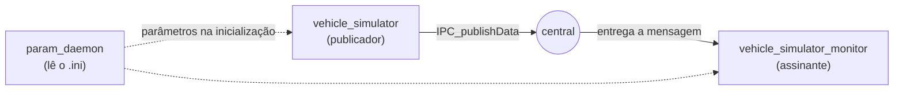

# Manual: Criando um Novo Módulo no ASTRO

Este manual ensina, passo a passo, a criar um módulo novo no ASTRO que se comunica com os demais por **IPC** (*Inter-Process Communication*). Você constrói, junto com o texto, um par de módulos de exemplo, [`vehicle_simulator`](file:///home/lume/astro/src/vehicle_simulator) (publica) e [`vehicle_simulator_monitor`](file:///home/lume/astro/src/vehicle_simulator_monitor) (assina), e no final recebe um **template** para começar os seus. O código mostrado nos capítulos **compila e foi testado**, e as saídas são saídas reais.

> [!IMPORTANT]
> **Resumo:**
> * Cada módulo do ASTRO é um **processo independente** (um executável em `bin/`). Eles não chamam funções uns dos outros; trocam **mensagens** por meio de um processo central, a `central`.
> * Quem envia uma mensagem **publica** (*publish*); quem quer recebê-la **assina** (*subscribe*) e registra um *handler* (callback) que o IPC chama a cada chegada.
> * Uma mensagem é descrita em um `_messages.h`, e as funções que a definem, publicam e assinam ficam em um `_interface.cpp/.h`. A lógica do módulo fica no `_main.cpp`.
> * Os valores configuráveis de um módulo vêm de um arquivo `.ini`, servidos pelo `param_daemon`.
> * No sistema real, os módulos sobem juntos, descritos em um arquivo de processos, pelo `proccontrol`.

---

## 1. Como os módulos conversam



| Processo | Papel |
|---|---|
| `central` | Servidor IPC. Registra as mensagens definidas e distribui cada publicação aos assinantes. Deve estar no ar antes de qualquer módulo |
| `param_daemon` | Lê o arquivo `.ini` e responde aos módulos que pedem seus parâmetros |
| Seu módulo | Conecta-se à `central`, define, publica e assina mensagens, e lê parâmetros |

Os módulos compartilham apenas **o nome e o formato da mensagem**. Quem publica não sabe quem assina, e vice-versa.

---

## 2. Pré-requisitos

1. Repositório do ASTRO compilado: as bibliotecas `libipc`, `libglobal` e `libparam_interface` em `lib/`, e os executáveis `central` e `param_daemon` em `bin/`.
2. A variável de ambiente `ASTRO_HOME` apontando para a raiz do ASTRO. Sem ela o `Makefile` aborta com `ASTRO_HOME environment variable not set`:

```bash
export ASTRO_HOME=/home/lume/astro
```

---

## 3. Como ler este manual

O manual é **cumulativo**: cada capítulo parte do código do anterior e acrescenta uma peça. Para aproveitar mais:

* **Digite o código junto.** Os trechos aparecem na ordem em que são explicados, e cada passo pode ser compilado e executado.
* **Confira o checkpoint** no fim de cada capítulo: ele lista o que você deve ter a essa altura.
* Quando algo falhar, os erros reais que encontramos estão explicados nos próprios capítulos e reunidos na **tabela do capítulo 7**.

---

## 4. Mapa do manual

| Capítulo | Assunto |
|---|---|
| [1. Seu primeiro módulo](01_primeiro_modulo_conectando_ao_ipc.md) | Conectar à `central`, `dispatch` e encerrar com Ctrl+C |
| [2. A mensagem e sua interface](02_definindo_e_publicando_a_mensagem.md) | A mensagem (struct, nome, formato), a interface com `define` e `publish`, e a publicação periódica |
| [3. Assinando a mensagem](03_assinando_a_mensagem.md) | O segundo módulo, o `subscribe` e o handler, e como um módulo oferece sua interface a outros |
| [4. Movendo o veículo](04_movendo_o_veiculo.md) | O simulador passa a calcular a pose em passos |
| [5. Parâmetros do `.ini`](05_parametros_do_ini.md) | O `param_daemon`, a leitura de parâmetros e o alerta de velocidade configurável no monitor |
| [6. Integração com o ASTRO](06_integracao_com_o_astro.md) | O arquivo de processos, o `proccontrol` e a inclusão no build completo |
| [7. Boas práticas e erros comuns](07_boas_praticas.md) | Os cuidados reunidos, e a tabela de erros comuns |
| [8. O template](08_template_de_modulo.md) | O esqueleto de módulo pronto para copiar, e como criar um módulo novo a partir dele |

---

## 5. Os módulos de exemplo

O exemplo usa **dois módulos**, como acontece no ASTRO real: um dono da mensagem, que publica, e um consumidor, que assina.

| Módulo | Pasta | O que faz |
|---|---|---|
| `vehicle_simulator` | [`src/vehicle_simulator/`](file:///home/lume/astro/src/vehicle_simulator) | **Dono da mensagem** `astro_vehicle_simulator_pose`. Simula um veículo em movimento, publica sua pose e velocidade e oferece a interface da mensagem aos outros módulos |
| `vehicle_simulator_monitor` | [`src/vehicle_simulator_monitor/`](file:///home/lume/astro/src/vehicle_simulator_monitor) | **Consumidor**: assina a mensagem, imprime a pose e **alerta** quando a velocidade passa de um limite lido do `.ini` |

Os campos da mensagem `astro_vehicle_simulator_pose`:

| Campo | Tipo | Significado |
|---|---|---|
| `x`, `y` | `double` | Posição no referencial global (m) |
| `theta` | `double` | Orientação (rad) |
| `v` | `double` | Velocidade linear (m/s) |
| `timestamp`, `host` | `double`, `char *` | Obrigatórios em toda mensagem |

Saída real dos dois módulos juntos, com o limite de velocidade em 2,5 m/s:

```text
vehicle_simulator: publicou x=2.83 y=0.28 theta=0.10 v=2.84
vehicle_simulator: publicou x=5.68 y=0.86 theta=0.20 v=2.91
vehicle_simulator: publicou x=7.72 y=1.49 theta=0.30 v=2.14
...
vehicle_simulator_monitor: x=2.83 y=0.28 theta=0.10 v=2.84 (de vehicle_simulator@lume-M, t=1795554534.224)
vehicle_simulator_monitor: ALERTA velocidade 2.84 m/s acima do limite 2.50 m/s
vehicle_simulator_monitor: x=7.72 y=1.49 theta=0.30 v=2.14 (de vehicle_simulator@lume-M, t=1795554536.225)
```

Ao final, o capítulo 8 entrega o **template** (`src/template_module/` e `src/template_module_consumer/`): os mesmos dois módulos, sem a simulação e sem o alerta, para você copiar.
