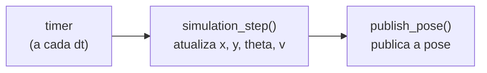

# 4. Fazendo o veículo se mover

Até aqui o `vehicle_simulator` publica sempre a mesma pose: o veículo está parado na origem. Neste capítulo ele vai **se mover**: a cada ciclo, a posição será calculada a partir da velocidade e da orientação.

Só o `vehicle_simulator_main.cpp` muda. A mensagem, a interface e o monitor **continuam como estão**. O monitor vai mostrar o veículo andando sem que você toque nele, e isso é uma boa demonstração do que o IPC entrega: quem consome não precisa saber como o dado é produzido.

Vamos em três passos, e cada um pode ser executado:

1. **Linha reta**: o veículo anda em frente com velocidade constante.
2. **Curva**: a orientação passa a mudar.
3. **Velocidade variável**: a velocidade oscila.

## 4.1 A ideia: simular em passos

Uma simulação de movimento é um laço de **passos pequenos**. A cada passo, o veículo avança um pouco, a partir de onde estava. Quem dispara cada passo é o **timer** que já temos: ele chama uma função a cada `dt` segundos.



A atualização da posição, em cada passo, vem da cinemática básica:

```text
x = x + v · cos(theta) · dt
y = y + v · sin(theta) · dt
```

| Símbolo | Significado | Unidade |
|---|---|---|
| `x`, `y` | Posição do veículo | m |
| `theta` | Orientação: o ângulo para onde o veículo aponta | rad |
| `v` | Velocidade linear | m/s |
| `dt` | Tempo de um passo | s |

Se o veículo aponta para `theta` e anda com velocidade `v` durante `dt` segundos, ele percorre `v · dt` metros nessa direção. A parte `cos(theta)` dessa distância vai para o eixo `x`, e a parte `sin(theta)` para o eixo `y`.

## 4.2 Guardando o estado

A pose precisa **sobreviver entre um passo e o próximo**: o `x` de agora é o `x` do passo anterior mais o deslocamento. Variáveis declaradas **dentro** de uma função desaparecem quando ela termina, então o estado do veículo vai em variáveis **`static` fora das funções**, que duram o programa inteiro.

Essa é a única informação que o `vehicle_simulator` passa a guardar:

```cpp
static double x = 0.0;
static double y = 0.0;
static double theta = 0.0;
static double v = 2.0;
```

O veículo começa na origem, apontando para o eixo `x` (`theta = 0`), com `v = 2.0` m/s.

## 4.3 Passo 1: linha reta

Abra o `vehicle_simulator_main.cpp`. Vamos mudar três coisas: o estado, a função que publica e a função que o timer chama.

```cpp
#include <math.h>
#include <astro/astro.h>
#include <astro/vehicle_simulator_interface.h>

static const double dt = 1.0;	// tempo de cada passo (s)

static double x = 0.0;
static double y = 0.0;
static double theta = 0.0;
static double v = 2.0;

static void
publish_pose(void)
{
	astro_vehicle_simulator_pose_message message;

	message.x = x;
	message.y = y;
	message.theta = theta;
	message.v = v;

	astro_vehicle_simulator_publish_pose_message(&message, astro_get_time());

	printf("vehicle_simulator: publicou x=%.2f y=%.2f theta=%.2f v=%.2f\n", x, y, theta, v);
}

static void
simulation_step(void)
{
	x += v * cos(theta) * dt;
	y += v * sin(theta) * dt;

	publish_pose();
}
```

E no `main`, o timer chama agora a função de passo, e usa o mesmo `dt`:

```cpp
	astro_ipc_addPeriodicTimer(dt, (TIMER_HANDLER_TYPE) simulation_step, NULL);
```

O que mudou em relação ao capítulo anterior:

| Mudança | Motivo |
|---|---|
| `#include <math.h>` | Traz o `cos` e o `sin` |
| `dt` e as quatro variáveis de estado | O estado que guardamos entre os passos |
| `publish_pose()` | Em vez de valores fixos, **lê o estado** (`message.x = x;`...) |
| `simulation_step()` | **Atualiza o estado** pela cinemática e depois publica |
| O timer chama `simulation_step` | Antes chamava `publish_pose` diretamente |

A divisão é a mesma ideia de separar responsabilidades que usamos nos arquivos: `simulation_step` **calcula**, e `publish_pose` **publica**.

> [!NOTE]
> **Uma constante só para os dois usos.** O mesmo `dt` é o intervalo do timer **e** o tempo usado no cálculo. Assim, um segundo de simulação corresponde a um segundo real. Se o timer rodasse a cada 0,5 s e o cálculo usasse `dt = 1.0`, o veículo pareceria andar o dobro da velocidade.

Compile, e com a `central` no ar execute o monitor e o `vehicle_simulator`, como no capítulo 3:

```bash
cd $ASTRO_HOME/src/vehicle_simulator
make
```

```text
vehicle_simulator: publicou x=2.00 y=0.00 theta=0.00 v=2.00
vehicle_simulator: publicou x=4.00 y=0.00 theta=0.00 v=2.00
vehicle_simulator: publicou x=6.00 y=0.00 theta=0.00 v=2.00
vehicle_simulator: publicou x=8.00 y=0.00 theta=0.00 v=2.00
vehicle_simulator: publicou x=10.00 y=0.00 theta=0.00 v=2.00
```

(FOTO AQUI DE: o `vehicle_simulator` publicando com `x` crescendo de 2 em 2 e o `vehicle_simulator_monitor` recebendo os mesmos valores.)

O `x` cresce de **2 em 2 metros** (`v · dt = 2 · 1`), e o `y` fica em zero, porque `theta` é zero. O veículo anda em linha reta, e o monitor mostra o mesmo, sem nenhuma alteração.

## 4.4 Passo 2: curva

Para o veículo fazer uma curva, a orientação precisa mudar com o tempo. Acrescente uma linha em `simulation_step`, **antes** de atualizar a posição:

```cpp
static void
simulation_step(void)
{
	theta += 0.1 * dt;
	x += v * cos(theta) * dt;
	y += v * sin(theta) * dt;

	publish_pose();
}
```

A linha nova gira o veículo a **0,1 rad/s** (cerca de 5,7 graus por segundo). A cada passo ele aponta um pouco mais para o lado, e o deslocamento do passo acompanha a nova direção.

```text
vehicle_simulator: publicou x=1.99 y=0.20 theta=0.10 v=2.00
vehicle_simulator: publicou x=3.95 y=0.60 theta=0.20 v=2.00
vehicle_simulator: publicou x=5.86 y=1.19 theta=0.30 v=2.00
vehicle_simulator: publicou x=7.70 y=1.97 theta=0.40 v=2.00
vehicle_simulator: publicou x=9.46 y=2.93 theta=0.50 v=2.00
```

Agora o `theta` cresce de 0,10 em 0,10, e o `y` sai de zero, com o `x` avançando cada vez menos por passo: o veículo está **curvando para a esquerda**.

> [!NOTE]
> A orientação é atualizada **antes** da posição. Isso é uma escolha: o passo usa a orientação já girada. Fazer ao contrário também seria uma simulação válida, com números ligeiramente diferentes. O que importa é manter a mesma ordem sempre.

## 4.5 Passo 3: velocidade variável

Por fim, vamos fazer a velocidade oscilar, como se o motorista acelerasse e freasse. Precisamos de um **relógio da simulação**, uma variável que conta quantos segundos simulados já passaram. Acrescente ao estado:

```cpp
static double sim_time = 0.0;
```

E em `simulation_step`, antes das outras linhas:

```cpp
static void
simulation_step(void)
{
	sim_time += dt;
	v = 2.0 + 1.0 * sin(sim_time);
	theta += 0.1 * dt;
	x += v * cos(theta) * dt;
	y += v * sin(theta) * dt;

	publish_pose();
}
```

A linha nova faz `v` oscilar em torno de 2 m/s, com amplitude de 1 m/s, ou seja, entre **1 e 3 m/s**.

```text
vehicle_simulator: publicou x=2.83 y=0.28 theta=0.10 v=2.84
vehicle_simulator: publicou x=5.68 y=0.86 theta=0.20 v=2.91
vehicle_simulator: publicou x=7.72 y=1.49 theta=0.30 v=2.14
vehicle_simulator: publicou x=8.87 y=1.98 theta=0.40 v=1.24
vehicle_simulator: publicou x=9.78 y=2.48 theta=0.50 v=1.04
```

(FOTO AQUI DE: o `vehicle_simulator` publicando com `v` variando e o `vehicle_simulator_monitor` recebendo a mesma sequência.)

Repare na relação entre `v` e o deslocamento: nos primeiros passos, com `v` perto de 2,9 m/s, o `x` anda cerca de 2,8 m por passo; mais adiante, com `v` caindo para 1,04 m/s, ele anda só cerca de 0,9 m. A posição é **consistente** com a velocidade publicada.

## 4.6 Checkpoint

Neste ponto você tem:

- [x] um `vehicle_simulator` que **simula o movimento** do veículo em passos, a partir de um estado (`x`, `y`, `theta`, `v`) guardado em variáveis `static`;
- [x] a separação entre `simulation_step`, que **calcula** o novo estado, e `publish_pose`, que **publica**;
- [x] uma constante `dt` que serve de intervalo do timer e de tempo de cada passo;
- [x] um monitor que **continua igual** e mostra o veículo andando: a mudança foi só no publicador.

**Próximo capítulo:** os valores do simulador ainda estão escritos no código: o intervalo `dt`, a velocidade média, a taxa de giro. Vamos passá-los para o **arquivo `.ini`**, lendo-os como **parâmetros**, e o monitor ganhará um **alerta de velocidade** com um limite também configurável.
