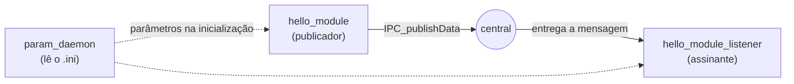

# Manual: Criando um Novo Módulo no ASTRO

Este manual ensina, passo a passo, a criar um módulo novo no ASTRO que se comunica com os demais por **IPC** (*Inter-Process Communication*). Todo o conteúdo usa como exemplo condutor o módulo [`hello_module`](file:///home/lume/astro/src/hello_module), que **compila e foi testado**: as saídas mostradas nos capítulos são saídas reais.

> [!IMPORTANT]
> **Resumo:**
> * Cada módulo do ASTRO é um **processo independente** (um executável em `bin/`). Eles não chamam funções uns dos outros; trocam **mensagens** por meio de um processo central.
> * Quem envia uma mensagem **publica** (*publish*); quem quer recebê-la **assina** (*subscribe*) e registra um *handler* (callback) que o IPC chama a cada chegada.
> * Um módulo novo precisa de: um `Makefile`, um `_main.cpp` (inicialização, handlers e publicadores) e, se definir mensagens próprias, um `_messages.h` e um `_interface.cpp/.h`.
> * Para rodar é preciso ter `central` e `param_daemon` ativos, e todo parâmetro lido pelo módulo precisa existir no `.ini` do robô.

---

## 1. Como os módulos conversam



| Processo | Papel |
|---|---|
| `central` | Servidor IPC. Registra as mensagens definidas e distribui cada publicação aos assinantes. Deve estar no ar antes de qualquer módulo. |
| `param_daemon` | Lê o arquivo `.ini` do robô e responde aos módulos que pedem seus parâmetros. |
| Seu módulo | Conecta-se à `central`, define/publica/assina mensagens e lê parâmetros. |

Os módulos compartilham apenas **o nome e o formato da mensagem**. Quem publica não sabe quem assina, e vice-versa.

---

## 2. Pré-requisitos

1. Repositório do ASTRO compilado (as bibliotecas `libipc`, `libglobal` e `libparam_interface` em `lib/`, e os executáveis `central` e `param_daemon` em `bin/`).
2. A variável de ambiente `ASTRO_HOME` apontando para a raiz do ASTRO. Sem ela o `Makefile` aborta com `ASTRO_HOME environment variable not set`:

```bash
export ASTRO_HOME=/home/lume/astro
```

---

## 3. Mapa do manual

| Capítulo | Assunto |
|---|---|
| [`01_estrutura_de_um_modulo.md`](01_estrutura_de_um_modulo.md) | Arquivos, responsabilidades, convenções e `Makefile` |
| `02_configuracao_ipc.md` | Conexão com a central, parâmetros e encerramento |
| `03_criacao_de_mensagens.md` | Struct, nome e formato da mensagem |
| `04_subscribe.md` | Assinatura e handlers |
| `05_publish.md` | Publicação |
| `06_integracao_e_validacao.md` | Executar e validar a comunicação |
| `07_boas_praticas.md` | Padrões e erros comuns |
| `08_template_de_modulo.md` | Esqueleto reutilizável |

---

## 4. O módulo de exemplo

O `hello_module` tem dois executáveis:

* **`hello_module`**: publica a cada 1 s a mensagem `astro_hello_module_message` (contador, texto, `timestamp`, `host`).
* **`hello_module_listener`**: assina essa mensagem e imprime o conteúdo.

Saída real da execução dos dois juntos:

```text
hello_module: publicou #0
hello_module: publicou #1
...
hello_module_listener: recebeu #0 'Ola do hello_module' de hello_module@lume-M (t=1795460091.067)
hello_module_listener: recebeu #1 'Ola do hello_module' de hello_module@lume-M (t=1795460092.067)
```

> [!NOTE]
> O repositório já tem outros exemplos: [`src/simple_module_example`](file:///home/lume/astro/src/simple_module_example) (em C, só publish/subscribe) e [`src/skeleton_package`](file:///home/lume/astro/src/skeleton_package) (padrão sensor/filter com interface Qt). Este manual usa **C++**, linguagem da maioria dos módulos atuais (a API de IPC é a mesma).
