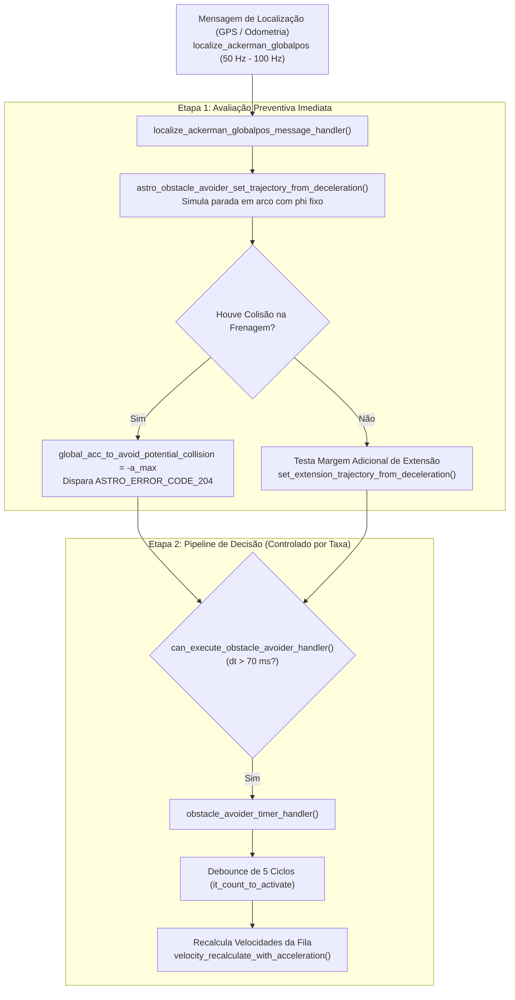

# Desaceleração Preventiva com Ângulo de Esterçamento Fixo (`phi` Fixo)

A função [`astro_obstacle_avoider_set_trajectory_from_deceleration()`](file:///home/lume/astro/src/obstacle_avoider/obstacle_avoider.cpp#L1308-L1401) constitui a **primeira linha de defesa preventiva** do Obstacle Avoider contra colisões catastróficas. 

Antes mesmo que o módulo avalie o plano de trajetória do planejador ou verifique a fila de comandos de movimento, esta função simula continuamente uma pergunta física crucial:
> *"Se o veículo acionar a frenagem máxima neste exato milissegundo, mantendo a direção atual do volante, ele conseguirá parar completamente antes de atingir qualquer obstáculo?"*

Se a resposta for **NÃO** (ou seja, se a trajetória de frenagem cruzar qualquer obstáculo no mapa), o módulo calcula imediatamente a aceleração de emergência necessária (`global_acc_to_avoid_potential_collision`) para mitigar ou evitar o impacto.

---

## 1. Posição no Fluxo de Execução

Ao contrário do consumo temporal da fila (que ocorre dentro do ciclo do timer de decisão), a desaceleração preventiva é disparada no handler de alta frequência da localização:



### Por que executar no Handler do `localize`?
1. **Sensibilidade Imediata:** A odometria e o GPS publicam poses a $50\text{ Hz} \dots 100\text{ Hz}$ ($10\text{ ms} \dots 20\text{ ms}$). Se o caminhão acelerar em direção a um obstáculo repentino, a colisão em potencial é detectada na primeira amostra de posição, sem esperar a janela de $70\text{ ms}$ do rate limiter do timer.
2. **Atualização do Estado de Alerta:** A variável global `global_acc_to_avoid_potential_collision` é mantida sempre atualizada. Quando o `obstacle_avoider_timer_handler()` é liberado para atuar, ele já encontra o diagnóstico de risco pronto para aplicação no debounce.

---

## 2. Anatomia da Função

A função é declarada em [`src/obstacle_avoider/obstacle_avoider.h`](file:///home/lume/astro/src/obstacle_avoider/obstacle_avoider.h) e implementada em [`src/obstacle_avoider/obstacle_avoider.cpp`](file:///home/lume/astro/src/obstacle_avoider/obstacle_avoider.cpp#L1308):

```cpp
double
astro_obstacle_avoider_set_trajectory_from_deceleration(
    astro_robot_and_trailers_traj_point_t pose, 
    astro_robot_ackerman_config_t astro_robot_ackerman_config,
    astro_semi_trailers_config_t astro_semi_trailer_config, 
    astro_map_t *occupancy_map, 
    int manual_override, 
    double odometry_velocity, 
    double odometry_phi, 
    double timestamp
);
```

### Parâmetros de Entrada:
* **`pose`:** Posição inicial real do veículo no mapa global no instante $t$ ($x$, $y$, $\theta$, e ângulos das carretas `trailer_theta[z]`).
* **`astro_robot_ackerman_config`:** Configurações físicas da **cabine** (unidade tratora): distância entre eixos ($L$), largura, raio mínimo de giro, e a desaceleração máxima permitida (`maximum_deceleration_forward`).
* **`astro_semi_trailer_config`:** Geometria e engates dos **semirreboques (carretas)**: quantidade de reboques atrelados, distância dos pinos de engate e limitações angulares de articulação.
* **`occupancy_map`:** Mapa de grade de ocupação bidimensional (*grid map*) consolidado com obstáculos estáticos e dinâmicos detectados por LiDARs e radares.
* **`manual_override`:** Flag indicando se um operador humano assumiu o controle do volante/pedais. Se ativo e habilitado, a função encerra retornando `0.0`, sem interferir no controle manual.
* **`odometry_velocity` ($v_0$):** Velocidade escalar instantânea medida pelos sensores de roda e transmissão.
* **`odometry_phi` ($\phi$):** Ângulo de esterçamento atual das rodas dianteiras da cabine.
* **`timestamp`:** Horário exato da leitura dos sensores.

---

## 3. Fluxo de Funcionamento da `astro_obstacle_avoider_set_trajectory_from_deceleration()`

O objetivo central da [`astro_obstacle_avoider_set_trajectory_from_deceleration()`](file:///home/lume/astro/src/obstacle_avoider/obstacle_avoider.cpp#L1308-L1401) é **tentar parar o veículo mantendo seu ângulo de esterçamento ($\phi$) fixo** e verificar se essa trajetória até a parada completa é segura.

Para fazer isso, a função executa um loop iterativo (`while (fabs(current_velocity) > 0.0)`) que projeta o futuro passo a passo:

### Passo 1: Previsão da Pose Futura ("Passinho" de $0{,}1\text{ s}$)
A partir da pose atual vinda do `localize`, a função utiliza a [`astro_libcarmodel_recalc_pos_ackerman()`](file:///home/lume/astro/src/obstacle_avoider/obstacle_avoider.cpp#L1358) para calcular a coordenada espacial onde o veículo (cabine e carretas) estará daqui a **$0{,}1\text{ s}$** (`full_time_interval = 0.1`, integrado com `delta_t = 0.05` e velocidade de referência `0.5 m/s` apenas para gerar o deslocamento geométrico na curva com `odometry_phi` fixo):

```cpp
iterative_pose = astro_libcarmodel_recalc_pos_ackerman(
    &iterative_pose, vel_sign * 0.5, odometry_phi, 
    full_time_interval, &distance_traveled, delta_t, 
    &astro_robot_ackerman_config, &astro_semi_trailer_config
);
```
> *Nota:* O objetivo dessa chamada não é testar a dinâmica de aceleração, mas simplesmente descobrir **o caminho geométrico (próximo ponto no espaço)** que o caminhão percorre ao avançar um "passinho" mantendo o volante travado em `odometry_phi`.

---

### Passo 2: Redução da Velocidade via Equação de Torricelli
Encontrado esse novo ponto no espaço, mede-se a distância real percorrida nesse passinho ($\Delta s$, dada por `DIST2D(iterative_pose, prev_pose)`) e utiliza-se a **Equação de Torricelli** ([`compute_final_velocity_using_torricelli()`](file:///home/lume/astro/src/obstacle_avoider/obstacle_avoider.cpp#L969)) para identificar qual será a velocidade real do veículo após andar esse deslocamento aplicando a **frenagem máxima**:

$$v^2 = v_0^2 + 2 \cdot a \cdot \Delta s$$

Onde:
* **$\Delta s$:** Distância percorrida entre a pose anterior e a nova pose calculada.
* **$a$:** Valor negativo da desaceleração máxima (`-maximum_deceleration_forward`, vindo dos parâmetros).
* **$v_0$:** Velocidade real do veículo no início daquele passo.

```cpp
current_velocity = vel_sign * compute_final_velocity_using_torricelli(
    current_velocity, 
    -astro_robot_ackerman_config.maximum_deceleration_forward, 
    DIST2D(iterative_pose, prev_pose)
);
```

---

### Passo 3: Verificação de Colisão e Critério de Parada do Loop
Obtida a posição futura exata e sua respectiva velocidade reduzida, chama-se [`check_collision_in_trajectory()`](file:///home/lume/astro/src/obstacle_avoider/obstacle_avoider.cpp#L1012) para verificar se há colisão naquele ponto contra:
1. O **mapa de distâncias / mapas especiais** (`obstacle_distance_map` / `maps_obstacle_avoider`).
2. O **mapa de ocupação** (`occupancy_map`).
3. Algum **objeto móvel** (`moving_objects`).

```cpp
while (fabs(current_velocity) > 0.0)
{
    // 1. Projeta a pose 0.1s à frente mantendo phi fixo
    // 2. Reduz a velocidade pelo deslocamento usando Torricelli com frenagem máxima
    // 3. Verifica se a nova pose colide nos mapas:
    returned_acc = check_collision_in_trajectory(
        iterative_pose, astro_robot_ackerman_config, occupancy_map, 
        astro_robot_ackerman_config.obstacle_avoider_obstacles_safe_distance, 
        vel_sign, total_distance_traveled, timestamp
    );

    if ((fabs(returned_acc) > EPSILON_OB) || (total_distance_traveled >= 50.0))
    {
        break;
    }
    ...
}
```

* **Se houver colisão:** A função `check_collision_in_trajectory()` devolve imediatamente a desaceleração máxima de frenagem (`-maximum_deceleration_forward` em marcha à frente, ou `maximum_deceleration_reverse` em ré). A previsão é **finalizada na hora (`break`)** — sem precisar continuar calculando até a velocidade zerar — e esse valor de frenagem máxima é retornado para a variável de controle `global_acc_to_avoid_potential_collision` no `localize_ackerman_globalpos_message_handler()`.
* **Se não houver colisão:** O fluxo continua repetindo o processo passo a passo enquanto a velocidade não chegar a zero (`fabs(current_velocity) > 0.0`) ou até atingir o limite de segurança de $50\text{ m}$ projetados (`total_distance_traveled >= 50.0`). Caso pare totalmente sem bater em nada, retorna `0.0` (trajetória de parada livre).

---

## 4. Diagrama de Sequência e Fluxo Interno

```mermaid
sequenceDiagram
    autonumber
    participant LOC as localize_ackerman
    participant OA_MAIN as Handler do Localize (Main)
    participant FUNC as set_trajectory_from_deceleration
    participant TORR as Torricelli & CarModel
    participant COL as check_collision_in_trajectory

    LOC->>OA_MAIN: Publica Pose, v_odometria e phi
    OA_MAIN->>FUNC: Inicia simulação preventiva
    
    loop Enquanto v &gt; 0.0 m/s (Até Parar)
        FUNC->>TORR: Avança pose em arco (phi fixo) e reduz v via Torricelli
        TORR-->>FUNC: Nova pose e velocidade decrescente
        FUNC->>COL: Checa polígonos da cabine + carretas contra o mapa
        alt Colisão Detectada!
            COL-->>FUNC: Colidiu! Retorna acc = -a_max
            FUNC->>OA_MAIN: Retorna acc negativa (Dispara ASTRO_ERROR_CODE_204)
        else Livre
            COL-->>FUNC: Desobstruído
        end
    end
    
    Note over FUNC,OA_MAIN: Se atingiu v = 0.0 sem colidir: PARADA SEGURA GARANTIDA!
    FUNC-->>OA_MAIN: Retorna acc = 0.00 m/s^2 (Sem perigo imediato)
```

---

## 5. Estudo de Caso Real: Análise dos Dados de Telemetria

Os dados reais capturados no teste de pista em [`desaceleracao_phi_fixo.txt`](file:///dados/obstacle_avoider/astro_error_205/desaceleracao_phi_fixo.txt) revelam exatamente a mecânica discreta da simulação operando sob diversas velocidades e curvaturas:

### 5.1 Cenário A: Velocidade de Manobra Baixa ($v_0 = 1{,}30\text{ m/s}$ / $4{,}7\text{ km/h}$)

Neste ciclo, o caminhão trafegava a $1{,}30\text{ m/s}$ com esterçamento suave para a esquerda ($\phi = -0{,}050\text{ rad} \approx -2{,}9^\circ$):

```text
--- [POTENTIAL COLLISION: DESACELERANDO COM PHI FIXO] ---
Pose Inicial: (x=7486480.20, y=-315924.98, theta=-2.99 rad)
Odometria: v_inicial = 1.30 m/s (4.7 km/h) | phi = -0.050 rad (-2.9 deg)
Decel Max = 1.00 m/s^2 | Sentido = FRENTE
  Passo 00: dist_acum=0.09m | v_torricelli=1.22m/s | colidiu=NÃO
  Passo 01: dist_acum=0.18m | v_torricelli=1.15m/s | colidiu=NÃO
  Passo 02: dist_acum=0.26m | v_torricelli=1.08m/s | colidiu=NÃO
  Passo 03: dist_acum=0.34m | v_torricelli=1.00m/s | colidiu=NÃO
  Passo 04: dist_acum=0.41m | v_torricelli=0.92m/s | colidiu=NÃO
  Passo 05: dist_acum=0.48m | v_torricelli=0.84m/s | colidiu=NÃO
  Passo 06: dist_acum=0.55m | v_torricelli=0.76m/s | colidiu=NÃO
  Passo 07: dist_acum=0.61m | v_torricelli=0.67m/s | colidiu=NÃO
  Passo 08: dist_acum=0.67m | v_torricelli=0.58m/s | colidiu=NÃO
  Passo 09: dist_acum=0.73m | v_torricelli=0.48m/s | colidiu=NÃO
  Passo 10: dist_acum=0.78m | v_torricelli=0.36m/s | colidiu=NÃO
  Passo 11: dist_acum=0.82m | v_torricelli=0.21m/s | colidiu=NÃO
  Passo 12: dist_acum=0.85m | v_torricelli=0.00m/s | colidiu=NÃO
--- [RESULTADO: PARADA SEGURA GARANTIDA (LIVRE)] --- Passos: 13 | Dist Total de Parada: 0.85m
```

#### Fechamento Matemático:
* **Distância Teórica Contínua:**
  $$d_{\text{teorica}} = \frac{v_0^2}{2 \cdot a_{\text{max}}} = \frac{1{,}30^2}{2 \cdot 1{,}00} = \frac{1{,}69}{2} = \mathbf{0{,}845\text{ m}}$$
* **Distância Integrada no Robô:** **$0{,}85\text{ m}$** (em 13 passos discretos de $\approx 6{,}5\text{ cm}$).
* **Conclusão:** Bate com precisão de milímetros com a física analítica. Como em todos os 13 passos `colidiu = NÃO`, o robô tem garantia absoluta de que não há perigo no arco de $0{,}85\text{ m}$ à sua frente.

---

### 5.2 Cenário B: Velocidade Média ($v_0 = 1{,}65\text{ m/s}$ / $5{,}9\text{ km/h}$)

Poucos metros adiante, a velocidade subiu para $1{,}65\text{ m/s}$ e o volante começou a alinhar ($\phi = -0{,}024\text{ rad} \approx -1{,}4^\circ$):

```text
--- [POTENTIAL COLLISION: DESACELERANDO COM PHI FIXO] ---
Pose Inicial: (x=7486478.80, y=-315925.15, theta=-3.01 rad)
Odometria: v_inicial = 1.65 m/s (5.9 km/h) | phi = -0.024 rad (-1.4 deg)
Decel Max = 1.00 m/s^2 | Sentido = FRENTE
  Passo 00: dist_acum=0.11m | v_torricelli=1.58m/s | colidiu=NÃO
  Passo 01: dist_acum=0.21m | v_torricelli=1.51m/s | colidiu=NÃO
  [...]
  Passo 15: dist_acum=1.28m | v_torricelli=0.37m/s | colidiu=NÃO
  Passo 16: dist_acum=1.33m | v_torricelli=0.23m/s | colidiu=NÃO
  Passo 17: dist_acum=1.36m | v_torricelli=0.00m/s | colidiu=NÃO
--- [RESULTADO: PARADA SEGURA GARANTIDA (LIVRE)] --- Passos: 18 | Dist Total de Parada: 1.36m
```

#### Fechamento Matemático:
* **Distância Teórica Contínua:**
  $$d_{\text{teorica}} = \frac{1{,}65^2}{2 \cdot 1{,}00} = \frac{2{,}7225}{2} = \mathbf{1{,}361\text{ m}}$$
* **Distância Integrada no Robô:** **$1{,}36\text{ m}$** (em 18 passos).

---

### 5.3 Cenário C: Velocidade de Cruzeiro ($v_0 \approx 2{,}70\text{ m/s}$ / $9{,}7\text{ km/h}$)

Na velocidade máxima registrada no trecho, a projeção preventiva precisou estender a simulação por mais de $3{,}6\text{ metros}$:

```text
--- [POTENTIAL COLLISION: DESACELERANDO COM PHI FIXO] ---
Odometria: v_inicial = 2.72 m/s (9.8 km/h) | phi = 0.002 rad (0.1 deg)
Decel Max = 1.00 m/s^2 | Sentido = FRENTE
  Passo 00: dist_acum=0.15m | v_torricelli=2.66m/s | colidiu=NÃO
  [...]
  Passo 34: dist_acum=3.69m | v_torricelli=0.00m/s | colidiu=NÃO
--- [RESULTADO: PARADA SEGURA GARANTIDA (LIVRE)] --- Passos: 35 | Dist Total de Parada: 3.69m
```

#### Fechamento Matemático:
* **Distância Teórica Contínua:**
  $$d_{\text{teorica}} = \frac{2{,}72^2}{2 \cdot 1{,}00} = \frac{7{,}3984}{2} = \mathbf{3{,}699\text{ m}}$$
* **Distância Integrada no Robô:** **$3{,}69\text{ m}$** (em 35 passos).

---

### 5.4 Tabela Comparativa de Parada Preventiva

| Velocidade Inicial ($v_0$) | Ângulo do Volante ($\phi$) | Desaceleração Máxima ($a_{\text{max}}$) | Distância Teórica ($d_{\text{teorica}}$) | Distância Simulada | Passos de Simulação | Resultado |
| :---: | :---: | :---: | :---: | :---: | :---: | :---: |
| $0{,}22\text{ m/s}$ ($0{,}8\text{ km/h}$) | $-2{,}9^\circ$ | $1{,}00\text{ m/s}^2$ | $0{,}024\text{ m}$ | **$0{,}04\text{ m}$** | 1 | LIVRE |
| $1{,}30\text{ m/s}$ ($4{,}7\text{ km/h}$) | $-2{,}9^\circ$ | $1{,}00\text{ m/s}^2$ | $0{,}845\text{ m}$ | **$0{,}85\text{ m}$** | 13 | LIVRE |
| $1{,}65\text{ m/s}$ ($5{,}9\text{ km/h}$) | $-1{,}4^\circ$ | $1{,}00\text{ m/s}^2$ | $1{,}361\text{ m}$ | **$1{,}36\text{ m}$** | 18 | LIVRE |
| $2{,}14\text{ m/s}$ ($7{,}7\text{ km/h}$) | $-0{,}5^\circ$ | $1{,}00\text{ m/s}^2$ | $2{,}290\text{ m}$ | **$2{,}14\text{ m}$** | 25 | LIVRE |
| $2{,}72\text{ m/s}$ ($9{,}8\text{ km/h}$) | $+0{,}1^\circ$ | $1{,}00\text{ m/s}^2$ | $3{,}699\text{ m}$ | **$3{,}69\text{ m}$** | 35 | LIVRE |

> [!TIP]
> **Propriedade Quadrática da Distância:**  
> Observe como a distância necessária para garantir a parada cresce com o quadrado da velocidade ($d \propto v^2$). Quando a velocidade dobrou de $1{,}30\text{ m/s}$ para $2{,}72\text{ m/s}$, a distância de segurança simulada quadruplicou (de $0{,}85\text{ m}$ para $3{,}69\text{ m}$). A simulação preventiva acompanha essa expansão instantaneamente a cada leitura do GPS.

---

## 6. O Papel do Debounce e a Atuação no Pipeline

O retorno da função `astro_obstacle_avoider_set_trajectory_from_deceleration()` é armazenado na variável global:
```cpp
global_acc_to_avoid_potential_collision = returned_acc;
```

Quando um obstáculo invade a rota de parada, o valor retornado torna-se negativo (ex: $-1{,}00\text{ m/s}^2$). Porém, na robótica real, ruídos momentâneos de LiDAR (como poeira, folhas ou desníveis transitórios de pista) poderiam induzir freadas falsas.

Para evitar isso, dentro do [`obstacle_avoider_timer_handler()`](file:///home/lume/astro/src/obstacle_avoider/obstacle_avoider_main.cpp#L1219-L1260), opera um filtro de persistência temporal (**Debounce**):

```cpp
if (fabs(global_acc_to_avoid_potential_collision) > EPSILON)
{
    it_count++;

    if (it_count < it_count_to_activate) // it_count_to_activate = 5
    {
        fprintf(out_act, "[DEBOUNCE %d/5] Obstaculo detectado (acc=%.2f m/s^2). Validando persistencia...\n",
                it_count, global_acc_to_avoid_potential_collision);
    }
    else if (it_count == it_count_to_activate)
    {
        fprintf(out_act, ">>> [DEBOUNCE 5/5 CONFIRMADO -> FREIO DE EMERGENCIA ATIVADO!] <<< acc = %.2f m/s^2\n",
                global_acc_to_avoid_potential_collision);
    }

    if (it_count >= it_count_to_activate)
    {
        last_ativation_timestamp = astro_get_time();
        last_global_acc_to_avoid_potential_collision = global_acc_to_avoid_potential_collision;
    }
}
else
{
    it_count = 0; // Se o obstáculo sumiu antes de 5 ciclos, o alarme é resetado
}
```

### O Recálculo de Velocidade da Fila:
Uma vez que o obstáculo persiste por 5 ciclos consecutivos, a função [`velocity_recalculate_with_acceleration()`](file:///home/lume/astro/src/obstacle_avoider/obstacle_avoider_main.cpp#L1292) entra em ação:
* Ela percorre todos os comandos da fila de movimento ativa e aplica o perfil de desaceleração forçada com $a = -1{,}00\text{ m/s}^2$.
* Isso reduz progressivamente os comandos de velocidade até zero, forçando a parada segura do caminhão antes do ponto de colisão identificado.
