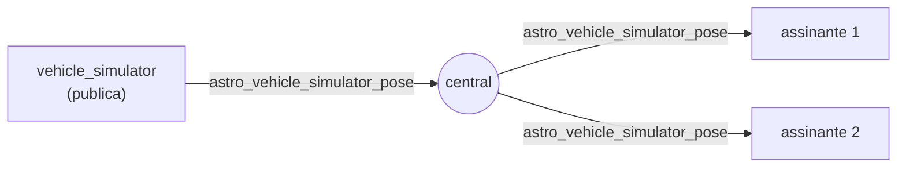

# 2. Definindo e publicando uma mensagem

No capítulo anterior o `vehicle_simulator` se conectou à `central`, mas não tinha nada a dizer. Agora vamos dar a ele uma mensagem: a **pose do veículo** (posição, orientação e velocidade). Ao fim deste capítulo o módulo publicará essa mensagem uma vez por segundo.

Os valores serão fixos por enquanto. O veículo só começa a se mover em um capítulo posterior.

O capítulo tem dois movimentos:

1. **Primeiro escrevemos tudo direto no `main`** (seções 2.2 a 2.6), para entender cada chamada de IPC sem nenhum intermediário.
2. **Depois organizamos o código no padrão do ASTRO** (seção 2.7): as funções de definir e publicar a mensagem vão para um arquivo de **interface**, que é como os módulos do projeto expõem suas mensagens. É nesse formato que o código fica ao fim do capítulo.

## 2.1 Mensagem, publicador e assinante

No IPC, uma **mensagem** é um pacote de dados com um **nome** e um **formato**. Quem produz o dado **publica** (*publish*) a mensagem na `central`. Quem quer o dado **assina** (*subscribe*) a mensagem pelo nome. A `central` entrega cada publicação a todos os assinantes.



O publicador não sabe quem está assinando, e pode haver zero, um ou vários assinantes. Neste capítulo só vamos publicar. O assinante vem no próximo.

Para publicar, o módulo precisa de três coisas, que veremos nesta ordem:

1. **Descrever a mensagem**: a struct em C e o nome e o formato que a `central` vai conhecer.
2. **Defini-la na `central`**: avisar a `central` que essa mensagem existe.
3. **Publicá-la**: preencher uma struct e enviar.

## 2.2 Descrevendo a mensagem

Crie o arquivo `vehicle_simulator_messages.h`, na pasta do módulo:

```cpp
#ifndef ASTRO_VEHICLE_SIMULATOR_MESSAGES_H
#define ASTRO_VEHICLE_SIMULATOR_MESSAGES_H

#ifdef __cplusplus
extern "C"
{
#endif

typedef struct
{
	double x;		/**< Posicao x no referencial global (m) */
	double y;		/**< Posicao y no referencial global (m) */
	double theta;		/**< Orientacao do veiculo (rad) */
	double v;		/**< Velocidade linear (m/s) */
	double timestamp;	/**< Obrigatorio: instante de criacao da mensagem */
	char *host;		/**< Obrigatorio: host de origem da mensagem */
} astro_vehicle_simulator_pose_message;

#define ASTRO_VEHICLE_SIMULATOR_POSE_MESSAGE_NAME	"astro_vehicle_simulator_pose"
#define ASTRO_VEHICLE_SIMULATOR_POSE_MESSAGE_FMT	"{double,double,double,double,double,string}"

#ifdef __cplusplus
}
#endif

#endif
```

O arquivo tem três partes:

| Parte | Para que serve |
|---|---|
| **A struct** `astro_vehicle_simulator_pose_message` | Os dados da mensagem, em C. É o que você preenche ao publicar e lê ao receber |
| **`..._MESSAGE_NAME`** | O **nome** da mensagem na `central`. É por ele que os assinantes a encontram |
| **`..._MESSAGE_FMT`** | O **formato** da mensagem: a descrição, em texto, dos campos da struct |

### O formato precisa espelhar a struct

A `central` não enxerga a struct em C, então precisa do formato para saber como transportar os bytes. Por isso o formato lista **os mesmos campos, na mesma ordem**:

| Campo da struct | Tipo em C | No formato |
|---|---|---|
| `x` | `double` | `double` |
| `y` | `double` | `double` |
| `theta` | `double` | `double` |
| `v` | `double` | `double` |
| `timestamp` | `double` | `double` |
| `host` | `char *` | `string` |

Outros tipos que você vai encontrar: `int` é `int`, e `char *` é sempre `string`. O formato todo vai entre chaves.

> [!WARNING]
> **Struct e formato têm que ficar sincronizados.** Se você acrescentar um campo na struct e esquecer o formato (ou trocar a ordem), o programa compila normalmente, mas os dados chegam trocados ou corrompidos. O compilador não consegue avisar, porque o formato é só um texto.

### Os campos `timestamp` e `host`

**Toda mensagem do ASTRO tem `double timestamp` e `char *host`**, sempre no fim da struct. O `timestamp` registra quando a mensagem foi criada, e o `host` guarda o computador de origem. Quem recebe usa esses campos para saber a idade do dado e de onde ele veio. Você não os inventa: há funções do ASTRO que os fornecem (`astro_get_time()` e `astro_get_host()`), como veremos ao publicar.

### Por que o `extern "C"`

O módulo é em C++, mas a biblioteca de IPC é em C. O `extern "C"` garante que os nomes das macros e da struct sejam entendidos igualmente pelas duas linguagens. Mantenha-o em todo arquivo `_messages.h`.

### Unidades e referencial nos comentários

Repare que cada campo tem a **unidade** e o **referencial** no comentário (m, rad, m/s, referencial global). Dois módulos podem interpretar `v` de formas diferentes (m/s ou km/h?) e o compilador não sabe. Documente isso sempre na struct.

## 2.3 Definindo a mensagem na central

A `central` só entrega mensagens que ela conhece. Por isso, **antes de publicar**, o módulo precisa **defini-la**. Edite o `vehicle_simulator_main.cpp`: inclua o header e acrescente a função:

```cpp
#include <astro/astro.h>
#include "vehicle_simulator_messages.h"

static void
define_messages(void)
{
	IPC_RETURN_TYPE err;

	err = IPC_defineMsg(ASTRO_VEHICLE_SIMULATOR_POSE_MESSAGE_NAME, IPC_VARIABLE_LENGTH, ASTRO_VEHICLE_SIMULATOR_POSE_MESSAGE_FMT);
	astro_test_ipc_exit(err, "Could not define", ASTRO_VEHICLE_SIMULATOR_POSE_MESSAGE_NAME);
}
```

| Trecho | O que faz |
|---|---|
| `IPC_defineMsg(nome, tamanho, formato)` | Registra a mensagem na `central`, com seu nome e formato |
| `IPC_VARIABLE_LENGTH` | Indica que o tamanho da mensagem pode variar. É o valor usado nas mensagens do ASTRO, pois campos `string` têm tamanho livre. Use-o sempre |
| `IPC_RETURN_TYPE err` | O resultado da chamada: se deu certo ou não |
| `astro_test_ipc_exit(err, texto, nome)` | Verifica o resultado. Se houve erro, imprime o `texto` junto com o nome da mensagem e **encerra o módulo** |

A verificação de erro depois de cada chamada de IPC é um padrão do ASTRO. Falhar na definição de uma mensagem é grave, então o módulo termina.

> [!NOTE]
> Estamos escrevendo `define_messages()` dentro do `main` apenas para o primeiro contato. Na seção 2.7 esta função vai para a **interface** do módulo, que é onde ela fica no ASTRO.

Chame `define_messages()` no `main`, logo depois de conectar e antes de qualquer publicação:

```cpp
	astro_ipc_initialize(argc, argv);
	signal(SIGINT, shutdown_module);

	define_messages();
```

## 2.4 Publicando uma pose

Agora a função que monta uma mensagem e a publica. Acrescente-a ao `vehicle_simulator_main.cpp`:

```cpp
static void
publish_pose(void)
{
	IPC_RETURN_TYPE err;
	astro_vehicle_simulator_pose_message message;

	message.x = 0.0;
	message.y = 0.0;
	message.theta = 0.0;
	message.v = 2.0;
	message.timestamp = astro_get_time();
	message.host = astro_get_host();

	err = IPC_publishData(ASTRO_VEHICLE_SIMULATOR_POSE_MESSAGE_NAME, &message);
	astro_test_ipc_exit(err, "Could not publish", ASTRO_VEHICLE_SIMULATOR_POSE_MESSAGE_NAME);

	printf("vehicle_simulator: publicou x=%.2f y=%.2f theta=%.2f v=%.2f\n", message.x, message.y, message.theta, message.v);
}
```

A função faz três coisas:

1. **Preenche a struct.** Os campos `x`, `y`, `theta` e `v` recebem valores fixos (o veículo está parado na origem, com `v = 2.0`). O `timestamp` e o `host` vêm das funções do ASTRO: `astro_get_time()` devolve o instante atual, e `astro_get_host()` devolve o nome desta máquina.
2. **Publica.** `IPC_publishData(nome, &message)` envia a struct para a `central`, que a distribui aos assinantes.
3. **Verifica o erro**, como na definição.

O `printf` serve para você acompanhar no terminal o que está sendo enviado.

> [!NOTE]
> **Nome da mensagem e struct têm que combinar.** A chamada usa o nome `ASTRO_VEHICLE_SIMULATOR_POSE_MESSAGE_NAME` junto com um ponteiro para `astro_vehicle_simulator_pose_message`. A `central` confia que a struct tem o formato definido. Passar a struct de outra mensagem compila, mas corrompe os dados.

## 2.5 Publicando periodicamente

Falta chamar `publish_pose()` repetidamente. O ASTRO tem um **timer periódico** do IPC, que chama uma função a cada intervalo de tempo. Acrescente ao `main`, depois do `define_messages()`:

```cpp
	astro_ipc_addPeriodicTimer(1.0, (TIMER_HANDLER_TYPE) publish_pose, NULL);
```

| Argumento | Significado |
|---|---|
| `1.0` | Intervalo entre as chamadas, **em segundos** |
| `(TIMER_HANDLER_TYPE) publish_pose` | A função a ser chamada |
| `NULL` | Dado extra opcional para a função (não usamos) |

O timer é disparado pelo `astro_ipc_dispatch()` que já está no fim do `main`: é lá que o módulo "vive" e responde a eventos, sejam mensagens recebidas ou timers.

O `main` completo fica assim:

```cpp
int
main(int argc, char **argv)
{
	astro_ipc_initialize(argc, argv);
	signal(SIGINT, shutdown_module);

	define_messages();

	astro_ipc_addPeriodicTimer(1.0, (TIMER_HANDLER_TYPE) publish_pose, NULL);

	astro_ipc_dispatch();

	return 0;
}
```

A ordem é importante: conectar, definir as mensagens, só então registrar o timer que publica, e por último entrar no `dispatch`.

## 2.6 Compilando e executando

O `Makefile` do capítulo anterior continua o mesmo: o header é incluído localmente e não precisa de nenhuma linha nova.

```bash
cd $ASTRO_HOME/src/vehicle_simulator
make
```

Com a `central` rodando em outro terminal, execute:

```bash
cd $ASTRO_HOME/bin
./vehicle_simulator
```

```text
ASTRO - LUME ROBOTICS SYSTEM Version 0.8.0

vehicle_simulator: publicou x=0.00 y=0.00 theta=0.00 v=2.00
vehicle_simulator: publicou x=0.00 y=0.00 theta=0.00 v=2.00
vehicle_simulator: publicou x=0.00 y=0.00 theta=0.00 v=2.00
```

Uma linha por segundo. Ctrl+C encerra o módulo normalmente.

> [!NOTE]
> O `printf` só mostra que o módulo **enviou**. Ainda não temos como saber se alguém **recebeu**, e não é problema: como vimos, o publicador não depende de haver assinantes. O módulo que vai receber será criado no próximo capítulo.

### O erro mais comum: esquecer de definir a mensagem

Para ver o que acontece, comente a linha `define_messages();` no `main`, recompile e execute com uma `central` recém-iniciada:

```text
ASTRO - LUME ROBOTICS SYSTEM Version 0.8.0

IPC_ERROR : Could not publish : message astro_vehicle_simulator_pose
          : IPC message not defined
This is a fatal error. Exiting.
```

O módulo termina na primeira publicação, porque a `central` não conhece a mensagem. Foi para isso que colocamos o `astro_test_ipc_exit`: o erro aparece com o nome da mensagem e o módulo não segue em frente com um estado inconsistente. Desfaça o comentário antes de continuar.

> [!TIP]
> A `central` lembra as mensagens que já foram definidas enquanto estiver no ar. Se outro módulo já a definiu, a publicação sem `define_messages()` pode "funcionar" por acaso, e o erro só apareceria numa `central` nova. Defina sempre a mensagem no módulo que a publica.

## 2.7 Organizando em uma interface

O módulo já publica, mas o código está do jeito "de estudo": definir e publicar a mensagem acontece dentro do `main`, repetindo o nome, o formato e a verificação de erro. Isso tem um problema: **quem for assinar a mensagem em outro módulo precisaria repetir esses mesmos detalhes** (o nome, o formato e o tamanho da struct), e qualquer erro de digitação gera uma mensagem incompatível sem aviso.

No ASTRO isso se resolve com um arquivo de **interface**: o módulo dono da mensagem oferece, junto com o `_messages.h`, **funções prontas** para definir, publicar e assinar essa mensagem. Os outros módulos só chamam essas funções. É o desenho de módulos como o `task_manager`, com `task_manager_messages.h` e `task_manager_interface.h/.c`.

| Arquivo | Conteúdo |
|---|---|
| `vehicle_simulator_messages.h` | A struct, o nome e o formato (já temos) |
| `vehicle_simulator_interface.h` | As declarações das funções da mensagem |
| `vehicle_simulator_interface.cpp` | A implementação, que vira a biblioteca `libvehicle_simulator_interface.a` |

### As três funções por mensagem

Para cada mensagem, a interface tem três funções, com nomes que seguem um padrão:

| Função | O que faz |
|---|---|
| `astro_vehicle_simulator_pose_define_message()` | Define a mensagem na `central` |
| `astro_vehicle_simulator_publish_pose_message(&message)` | Publica uma mensagem |
| `astro_vehicle_simulator_subscribe_pose_message(...)` | Assina a mensagem (será usada no próximo capítulo) |

O padrão dos nomes é `astro_<modulo>_<ação>_<mensagem>_message`, com a mensagem entre o módulo e a ação no caso do `define`, como no `task_manager` (`astro_task_manager_programming_functionality_define_message`).

### O header da interface

Crie o `vehicle_simulator_interface.h`:

```cpp
#ifndef ASTRO_VEHICLE_SIMULATOR_INTERFACE_H
#define ASTRO_VEHICLE_SIMULATOR_INTERFACE_H

#include <astro/astro.h>
#include <astro/vehicle_simulator_messages.h>

#ifdef __cplusplus
extern "C"
{
#endif

void
astro_vehicle_simulator_pose_define_message(void);

void
astro_vehicle_simulator_subscribe_pose_message(astro_vehicle_simulator_pose_message *message,
		astro_handler_t handler, astro_subscribe_t subscribe_how);

void
astro_vehicle_simulator_publish_pose_message(astro_vehicle_simulator_pose_message *message);

#ifdef __cplusplus
}
#endif

#endif
```

O header inclui o `<astro/vehicle_simulator_messages.h>` com `<astro/...>`: é o caminho em que o header público fica depois do `make`, como veremos no `Makefile`. O `extern "C"` aparece de novo, pelo mesmo motivo de antes.

### A implementação

Crie o `vehicle_simulator_interface.cpp`. Repare que **o conteúdo das duas primeiras funções você já escreveu**: é o que estava no `main`, só mudou de arquivo.

```cpp
#include <astro/astro.h>
#include <astro/vehicle_simulator_interface.h>

void
astro_vehicle_simulator_pose_define_message(void)
{
	IPC_RETURN_TYPE err;

	err = IPC_defineMsg(ASTRO_VEHICLE_SIMULATOR_POSE_MESSAGE_NAME, IPC_VARIABLE_LENGTH, ASTRO_VEHICLE_SIMULATOR_POSE_MESSAGE_FMT);
	astro_test_ipc_exit(err, "Could not define", ASTRO_VEHICLE_SIMULATOR_POSE_MESSAGE_NAME);
}

void
astro_vehicle_simulator_subscribe_pose_message(astro_vehicle_simulator_pose_message *message,
		astro_handler_t handler, astro_subscribe_t subscribe_how)
{
	astro_subscribe_message(ASTRO_VEHICLE_SIMULATOR_POSE_MESSAGE_NAME, ASTRO_VEHICLE_SIMULATOR_POSE_MESSAGE_FMT,
			message, sizeof(astro_vehicle_simulator_pose_message), handler, subscribe_how);
}

void
astro_vehicle_simulator_publish_pose_message(astro_vehicle_simulator_pose_message *message)
{
	IPC_RETURN_TYPE err;

	err = IPC_publishData(ASTRO_VEHICLE_SIMULATOR_POSE_MESSAGE_NAME, message);
	astro_test_ipc_exit(err, "Could not publish", ASTRO_VEHICLE_SIMULATOR_POSE_MESSAGE_NAME);
}
```

A função `subscribe` é nova: ela só **embala a chamada** `astro_subscribe_message`, preenchendo o nome, o formato e o tamanho da struct. Quem assina não precisa saber desses detalhes. No próximo capítulo você a usará.

### O `main` fica mais enxuto

No `vehicle_simulator_main.cpp`, **apague** a função `define_messages()` e a chamada direta a `IPC_publishData`. O arquivo passa a usar a interface:

```cpp
#include <astro/astro.h>
#include <astro/vehicle_simulator_interface.h>

static void
publish_pose(void)
{
	astro_vehicle_simulator_pose_message message;

	message.x = 0.0;
	message.y = 0.0;
	message.theta = 0.0;
	message.v = 2.0;
	message.timestamp = astro_get_time();
	message.host = astro_get_host();

	astro_vehicle_simulator_publish_pose_message(&message);

	printf("vehicle_simulator: publicou x=%.2f y=%.2f theta=%.2f v=%.2f\n", message.x, message.y, message.theta, message.v);
}

static void
shutdown_module(int signo)
{
	if (signo == SIGINT)
	{
		astro_ipc_disconnect();
		printf("vehicle_simulator: desconectado.\n");
		exit(0);
	}
}

int
main(int argc, char **argv)
{
	astro_ipc_initialize(argc, argv);
	signal(SIGINT, shutdown_module);

	astro_vehicle_simulator_pose_define_message();

	astro_ipc_addPeriodicTimer(1.0, (TIMER_HANDLER_TYPE) publish_pose, NULL);

	astro_ipc_dispatch();

	return 0;
}
```

O que mudou no `main`:

* O include passa a ser `<astro/vehicle_simulator_interface.h>`, que já traz o `_messages.h`.
* `publish_pose()` só **preenche a struct** e chama `astro_vehicle_simulator_publish_pose_message`. A verificação de erro ficou dentro da interface.
* O `main` chama `astro_vehicle_simulator_pose_define_message()` no lugar do `define_messages()` antigo.

### O `Makefile`

Agora o módulo produz uma **biblioteca** além do executável, e publica os headers e a biblioteca para outros módulos usarem. Atualize o `Makefile`:

```makefile
include ../Makefile.conf

MODULE_NAME = VEHICLE SIMULATOR
MODULE_COMMENT = Modulo de exemplo: simula um veiculo e publica sua pose

LFLAGS += -lvehicle_simulator_interface -lglobal -lipc -lpthread

SOURCES = vehicle_simulator_main.cpp vehicle_simulator_interface.cpp

PUBLIC_INCLUDES = vehicle_simulator_messages.h vehicle_simulator_interface.h
PUBLIC_LIBRARIES = libvehicle_simulator_interface.a
PUBLIC_BINARIES = vehicle_simulator

TARGETS = libvehicle_simulator_interface.a vehicle_simulator

libvehicle_simulator_interface.a: vehicle_simulator_interface.o

vehicle_simulator: vehicle_simulator_main.o

include ../Makefile.rules
```

O que foi acrescentado:

| Linha | Significado |
|---|---|
| `-lvehicle_simulator_interface` em `LFLAGS` | O executável faz link com a própria biblioteca de interface. Deve vir **antes** de `-lglobal -lipc` (mesma regra de ordem do capítulo 1) |
| `SOURCES` com `vehicle_simulator_interface.cpp` | O novo arquivo faz parte do módulo |
| `PUBLIC_INCLUDES` | Os dois headers são **copiados** para `$ASTRO_HOME/include/astro/`, por isso `#include <astro/vehicle_simulator_interface.h>` funciona em qualquer módulo |
| `PUBLIC_LIBRARIES` | A biblioteca é copiada para `$ASTRO_HOME/lib/`, onde qualquer módulo pode fazer link com ela |
| `libvehicle_simulator_interface.a: ...o` | Constrói a biblioteca a partir do arquivo objeto da interface |

### Compilando e executando

```bash
cd $ASTRO_HOME/src/vehicle_simulator
make
```

Confira que os arquivos foram publicados:

```bash
ls $ASTRO_HOME/include/astro/vehicle_simulator_*
ls $ASTRO_HOME/lib/libvehicle_simulator_interface.a
```

(FOTO AQUI DE: o `make` do `vehicle_simulator` com a compilação do `vehicle_simulator_interface.cpp` e a criação da biblioteca, seguido do `ls` dos arquivos públicos.)

Execute com a `central` no ar:

```bash
cd $ASTRO_HOME/bin
./vehicle_simulator
```

```text
ASTRO - LUME ROBOTICS SYSTEM Version 0.8.0

vehicle_simulator: publicou x=0.00 y=0.00 theta=0.00 v=2.00
vehicle_simulator: publicou x=0.00 y=0.00 theta=0.00 v=2.00
vehicle_simulator: publicou x=0.00 y=0.00 theta=0.00 v=2.00
```

A saída é **idêntica** à de antes: reorganizamos o código sem mudar o comportamento. Isso é um **refatoramento**, e o ganho aparece no próximo capítulo.

> [!WARNING]
> **Os headers são copiados, não ligados.** O que fica em `include/astro/` é uma **cópia** do arquivo da pasta do módulo. Se você alterar a struct ou o formato em `vehicle_simulator_messages.h`, rode `make` no `vehicle_simulator` **de novo** para atualizar a cópia, e recompile também os módulos que usam a mensagem. Caso contrário, quem assina e quem publica passam a ter structs diferentes e os dados chegam corrompidos, sem nenhum aviso.

## 2.8 Checkpoint

Neste ponto você tem:

- [x] `vehicle_simulator_messages.h` com a struct, o nome e o formato da mensagem de pose;
- [x] `vehicle_simulator_interface.h/.cpp` com as três funções da mensagem (`define`, `publish` e `subscribe`), no padrão dos módulos do ASTRO;
- [x] um `Makefile` que publica os headers e a biblioteca `libvehicle_simulator_interface.a` para outros módulos;
- [x] um `main` que só usa a interface: define a mensagem uma vez, e publica a pose a cada segundo com um timer periódico;
- [x] a noção de que **struct e formato devem espelhar um ao outro**, e de que toda chamada de IPC tem seu resultado verificado (agora dentro da interface).

**Próximo capítulo:** vamos criar um segundo módulo, o `vehicle_simulator_monitor`, que **assina** essa mensagem usando `astro_vehicle_simulator_subscribe_pose_message` e a imprime na tela.
