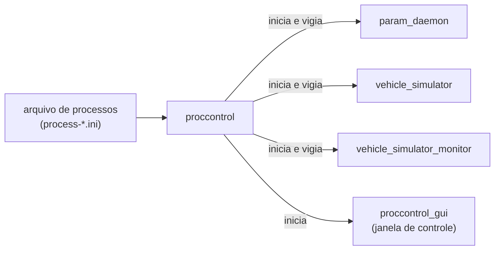

# 6. Integrando os módulos ao ASTRO

Até aqui, para rodar o exemplo você abriu um terminal para a `central`, outro para o `param_daemon`, outro para o `vehicle_simulator` e outro para o `vehicle_simulator_monitor`. Em um robô real são dezenas de módulos, e ninguém sobe cada um à mão.

No ASTRO, os módulos sobem **juntos**, descritos em um arquivo de texto, por um programa chamado **`proccontrol`**. Neste capítulo vamos integrar nossos módulos a esse mecanismo:

1. descrever os módulos em um **arquivo de processos**;
2. subir tudo com o `proccontrol` e acompanhar o **estado e a saída** dos módulos, pela janela de controle (a GUI);
3. **parar** tudo corretamente;
4. fazer o `proccontrol` **vigiar** o simulador, com o **heartbeat**;
5. incluir os módulos no **build completo** do ASTRO.

## 6.1 O `proccontrol` e o arquivo de processos

O `proccontrol` lê um **arquivo de processos**, inicia cada módulo listado nele, **acompanha** se estão vivos e, se necessário, os reinicia.



Entre os módulos que ele inicia está o **`proccontrol_gui`**, a janela que mostra o estado de cada módulo (seção 6.3).

A única coisa que o `proccontrol` **não** inicia é a `central`: ele mesmo precisa dela para funcionar, então ela é sempre iniciada à parte, antes.

## 6.2 O arquivo de processos

Cada linha do arquivo descreve um módulo, com cinco colunas separadas por espaços:

| Coluna | Significado |
|---|---|
| **nome do módulo** | O nome pelo qual o `proccontrol` conhece o módulo. É também o nome que o módulo deve usar no heartbeat (seção 6.6) |
| **grupo** | Um rótulo para agrupar módulos (por exemplo `support`, `planner`). Serve para parar ou iniciar um grupo inteiro |
| **requested_state** | `1`: o módulo deve estar rodando (o `proccontrol` o inicia e, se ele morrer, o reinicia). `0`: não é iniciado |
| **watch_heartbeats** | `1`: o `proccontrol` vigia se o módulo está "vivo" (seção 6.6). `0`: não vigia |
| **comando** | A linha de comando, **como seria digitada na pasta `bin/`** |

Crie o arquivo `process-vehicle_simulator.ini` na pasta do módulo:

```text
# nome                       grupo       requested  watch   comando
 param_daemon                support     1          0       ./param_daemon ../src/vehicle_simulator/vehicle_simulator.ini
 proccontrol_gui             support     1          0       ./proccontrol_gui
 vehicle_simulator           simulator   1          0       ./vehicle_simulator
 vehicle_simulator_monitor   monitor     1          0       ./vehicle_simulator_monitor
```

As linhas começadas por `#` são comentários. Duas linhas merecem atenção:

* O `param_daemon` também é um módulo da lista, com o `.ini` do capítulo 5 como argumento: ele passa a subir junto com os outros.
* O **`proccontrol_gui`** é a **janela de controle** do `proccontrol`. Ela entra na lista como qualquer outro módulo, e é por ela que você acompanha o estado de cada módulo (seção 6.3).

> [!NOTE]
> Os arquivos de processos dos robôs reais ficam em `bin/` e se chamam `process-*.ini`. Vamos deixar o do exemplo na pasta do módulo, como fizemos com o `vehicle_simulator.ini`, para não misturar o exemplo com os arquivos do sistema.

### Outros recursos dos arquivos de processos

Os arquivos de processos do projeto usam ainda alguns recursos que o nosso exemplo não precisa, mas que você vai encontrar:

| Recurso | Exemplo | Para que serve |
|---|---|---|
| `requested_state` `0` | `... monitor  0  0  ./vehicle_simulator_monitor` | O módulo fica **listado, mas parado**: não sobe sozinho, e pode ser iniciado depois pela GUI |
| Variáveis `SET` | `SET PARAM_INI=../src/vehicle_simulator/vehicle_simulator.ini` e depois `./param_daemon ${PARAM_INI}` | Define um valor uma vez e o reutiliza nas linhas de comando, sem repetir caminhos longos |
| Redirecionamento | `./simulator_ackerman > sim.txt` | Envia a saída do módulo para um arquivo |

## 6.3 Subindo tudo com o `proccontrol`

Agora você precisa de só **dois terminais**. No primeiro, a `central`:

```bash
cd $ASTRO_HOME/bin
./central
```

No segundo, o `proccontrol` com o arquivo de processos:

```bash
cd $ASTRO_HOME/bin
./proccontrol ../src/vehicle_simulator/process-vehicle_simulator.ini
```

```text
0: param_daemon support 1 0 ./param_daemon ../src/vehicle_simulator/vehicle_simulator.ini
1: vehicle_simulator simulator 1 0 ./vehicle_simulator
2: vehicle_simulator_monitor monitor 1 0 ./vehicle_simulator_monitor
ASTRO - LUME ROBOTICS SYSTEM Version 0.8.0

PROCCONTROL (119520): Spawned ./param_daemon ../src/vehicle_simulator/vehicle_simulator.ini (119525)
PROCCONTROL (119520): Spawned ./vehicle_simulator (119526)
PROCCONTROL (119520): Spawned ./vehicle_simulator_monitor (119527)
```

Ele leu o arquivo, mostrou as três linhas numeradas e **iniciou** os três módulos (`Spawned`, com o PID de cada um).

Com o `proccontrol_gui` na lista, há também uma linha `Spawned` para ele, e **uma janela se abre**: a janela de controle do `proccontrol`.

(FOTO AQUI DE: os dois terminais, com a `central` no ar e o `proccontrol` mostrando as linhas `Spawned`, e ao lado a janela do `proccontrol_gui` com os três módulos.)

(PREENCHER: o que a janela mostra para cada módulo (nome, grupo, estado, PID) e como se reconhece um módulo "vivo" e um parado.)

> [!NOTE]
> Como o `proccontrol` inicia o `param_daemon` ao mesmo tempo que os módulos que dependem dele, pode aparecer **uma** linha `IPC_ERROR : Message timed out : message astro_param_query_version` logo na partida: um módulo perguntou antes de o `param_daemon` estar pronto. Nos testes, os módulos subiram normalmente mesmo assim. Se ela se repetir sem parar, o problema é outro (veja o capítulo 5, "`param_daemon` fora do ar").

## 6.4 Vendo o estado e a saída dos módulos

O terminal do `proccontrol` mostra **só** os `Spawned`. Nenhuma linha do tipo `vehicle_simulator: publicou ...`, nem do monitor. Isso é proposital: o `proccontrol` **captura** a saída de cada módulo (a saída padrão e a de erro) para dentro dele, em vez de deixá-la ir para o terminal. Com dezenas de módulos, o terminal ficaria ilegível.

### Pela janela de controle (a GUI)

O jeito normal de acompanhar o sistema é a janela do **`proccontrol_gui`**. Nela você vê **o estado de cada módulo da lista**, se está rodando ou parado, e **a saída de cada um**.

(FOTO AQUI DE: a janela do `proccontrol_gui` com o `vehicle_simulator` e o `vehicle_simulator_monitor` rodando, e a saída de um deles à mostra.)

(PREENCHER: como abrir a saída de um módulo na janela, e o que mais ela permite: iniciar ou parar um módulo ou um grupo inteiro, e ligar ou desligar a exibição da saída.)

## 6.5 Parando tudo

Com tudo rodando, como parar? No terminal do `proccontrol`, aperte **Ctrl+C**. Ele encerra **todos** os módulos que iniciou e termina. Por baixo, o `proccontrol` chama o script **`astrokillall.sh`** (que fica em `bin/`), e esse script faz o trabalho:

```text
Shutting down the whole 119745 process group and associated Docker processes:
[1/6] Freezing proccontrol (SIGSTOP)
[2/6] Sending signal -15 to process group -119745
[3/6] Sending signal -15 to Docker processes
[4/6] Grace period
[5/6] Sending SIGKILL to process group -119745
[6/6] Sending SIGKILL to Docker processes
```

Os passos mostram a ideia: **congela** o `proccontrol` (para ele não reiniciar os módulos que estão morrendo), manda o sinal de término ao **grupo de processos inteiro**, espera 2 segundos e, o que ainda estiver vivo, **mata à força**.


Na captura, depois do `^C`, o shell avisa `Stopped` e `Killed` para o `proccontrol`: são o passo de congelamento e o `SIGKILL` final do script. Os números entre colchetes (`[2]`, `[3]`) são os números de *job* do shell e variam de um terminal para outro.

> [!WARNING]
> **Se o Ctrl+C parecer não fazer nada**, os módulos morrem e o `proccontrol` os **reinicia**, com PIDs novos. Isso acontece quando a pasta `bin/` **não está no `PATH`**: o `proccontrol` chama o script como `astrokillall.sh`, sem o `./`, e só o encontra se `bin/` estiver no `PATH`. Confira com `echo $PATH`. Enquanto não corrigir, pare tudo pelo próprio script, de dentro de `bin/`, **com o mesmo caminho** usado para subir o `proccontrol`:
>
> ```bash
> cd $ASTRO_HOME/bin
> ./astrokillall.sh ../src/vehicle_simulator/process-vehicle_simulator.ini
> ```
>
> O `proccontrol` **ignora o SIGTERM**: um `kill` comum nele não o encerra. Evite `kill -9` à mão em módulos soltos: o `proccontrol` os reinicia.

A janela do `proccontrol_gui` permite também **parar e iniciar módulos individualmente**, ou um **grupo** inteiro, sem derrubar o resto do sistema. É para isso que serve a coluna do grupo no arquivo de processos.

(PREENCHER: como parar e iniciar um módulo e um grupo pela janela, na prática.)

Depois de parar o `proccontrol`, a `central` continua no ar: encerre-a com Ctrl+C no terminal dela.

## 6.6 O heartbeat: o `proccontrol` vigiando os módulos

Até agora a coluna `watch_heartbeats` ficou em `0`. Com `1`, o `proccontrol` passa a **vigiar** o módulo: espera receber dele, **periodicamente**, uma mensagem de "estou vivo", o **heartbeat**. Se o módulo ficar um tempo sem enviar, o `proccontrol` conclui que ele travou, o **mata** e o **reinicia**. É uma proteção contra módulos travados.

### Ligando a vigilância sem enviar heartbeat

Para ver o efeito, ligue a vigilância no simulador, **sem** ter acrescentado nenhum heartbeat nele. No arquivo de processos, troque o `0` por `1` na linha do `vehicle_simulator`:

```text
 vehicle_simulator           simulator   1          1       ./vehicle_simulator
```

Suba o `proccontrol` de novo. O `proccontrol` registra:

```text
PROCCONTROL (119936): Spawned ./vehicle_simulator (119941)
PROCCONTROL (119936): ./vehicle_simulator (119941) lost heartbeats
PROCCONTROL (119936): Spawned ./vehicle_simulator (119943)
PROCCONTROL (119936): ./vehicle_simulator (119943) lost heartbeats
PROCCONTROL (119936): Spawned ./vehicle_simulator (119948)
PROCCONTROL (119936): ./vehicle_simulator (119948) lost heartbeats
...
```

(FOTO AQUI DE: as linhas `lost heartbeats` e `Spawned` se repetindo.)

(PREENCHER: onde essas linhas aparecem para você: no terminal do `proccontrol`, na janela da GUI, ou nos dois.)

O módulo está **funcionando**, mas como não envia heartbeat, o `proccontrol` o julga travado, o mata e o reinicia, em um laço. Nos testes foram **18 reinícios em 16 segundos**.

(PREENCHER: como esse laço de reinícios aparece na janela da GUI.)

### Enviando o heartbeat

O módulo precisa chamar `astro_publish_heartbeat`, passando o **nome do módulo**, em um timer periódico. Acrescente ao `vehicle_simulator_main.cpp`:

```cpp
static void
publish_heartbeat(void)
{
	astro_publish_heartbeat("vehicle_simulator");
}
```

E no `main`, ao lado do timer da simulação:

```cpp
	astro_ipc_addPeriodicTimer(dt, (TIMER_HANDLER_TYPE) simulation_step, NULL);
	astro_ipc_addPeriodicTimer(0.1, (TIMER_HANDLER_TYPE) publish_heartbeat, NULL);
```

Dois cuidados:

| Cuidado | Motivo |
|---|---|
| O nome deve ser **igual à primeira coluna** do arquivo de processos (`vehicle_simulator`) | É por esse nome que o `proccontrol` reconhece de quem veio o heartbeat |
| O intervalo deve ser **menor que 0,5 s** | O `proccontrol` espera no máximo **0,5 segundo** entre heartbeats. Por isso usamos 0,1 s |

> [!WARNING]
> **O heartbeat precisa ser mais rápido que o tempo limite.** Um intervalo de 1 s ou de 10 s, que parece razoável à primeira vista, faria o `proccontrol` reiniciar o módulo continuamente, como no laço acima.

Compile, e suba o `proccontrol` de novo, ainda com `watch_heartbeats = 1`. Agora:

```text
PROCCONTROL (120007): Spawned ./vehicle_simulator (120012)
PROCCONTROL (120007): Spawned ./vehicle_simulator_monitor (120013)
```

O módulo é iniciado **uma vez** e **nenhum** `lost heartbeats` aparece: o `proccontrol` recebe o heartbeat a tempo e o considera vivo.

Para o monitor, deixe `watch_heartbeats` em `0`: a vigilância é opcional, e vale para módulos que precisam ser reiniciados quando travam. O padrão é o mesmo, com o nome do módulo e um timer.

## 6.7 Incluindo os módulos no build completo

Até agora compilamos cada módulo entrando na sua pasta e rodando `make`. O ASTRO completo é compilado por um `make` na pasta `src/`, que constrói **todos os módulos conhecidos**, em uma ordem que respeita as dependências. Nossos módulos ainda **não são conhecidos** por esse `make`:

```bash
cd $ASTRO_HOME/src
make phase1@vehicle_simulator
```

```text
make: *** No rule to make target 'phase1@vehicle_simulator'.  Stop.
```

O `Makefile` de `src/` tem listas de pacotes, as `PACKAGES_TIER0` a `PACKAGES_TIER5`, **em ordem de dependência**: a primeira (`ipc global`) tem a base de tudo, e as seguintes dependem das anteriores. Para incluir os módulos, acrescente-os a uma dessas listas. Os nossos usam só módulos das primeiras listas, então cabem na **última**:

```makefile
PACKAGES_TIER5 := \
	likelihood_mapper \
	led_stream_driver \
	vehicle_simulator \
	vehicle_simulator_monitor
```

Agora o `make` de `src/` conhece os dois módulos, e o alvo existe: ele entra na pasta do módulo e executa a fase 1 (`make -C vehicle_simulator ASTRO_ROOT_BUILD=1 phase1`), a mesma que você já viu em cada compilação.

> [!NOTE]
> Esta é a **única** alteração do tutorial em um arquivo compartilhado do sistema. Ela é pequena (duas linhas), mas muda o `Makefile` de `src/` para todos. Em um módulo real, essa mudança vai junto com o resto do módulo, no mesmo *pull request*, e vale combinar com a equipe em qual lista ele deve entrar.

## 6.8 Checkpoint

Neste ponto você tem:

- [x] um **arquivo de processos** com o `param_daemon`, o `proccontrol_gui` e os dois módulos, subindo juntos com o `proccontrol`, com só a `central` à parte;
- [x] a noção de que o `proccontrol` **captura a saída** dos módulos, e de que a janela do **`proccontrol_gui`** mostra o estado e a saída de cada um;
- [x] as formas de **parar** tudo: Ctrl+C (com `bin/` no `PATH`) ou o `astrokillall.sh`;
- [x] o **heartbeat**: `watch_heartbeats = 1` na coluna do arquivo de processos e `astro_publish_heartbeat` com o mesmo nome do módulo, em um intervalo menor que 0,5 s;
- [x] os módulos incluídos nas listas de pacotes de `src/Makefile`, e portanto no build completo.

**Próximo capítulo:** boas práticas e erros comuns. Vamos reunir, em um só lugar, os cuidados que apareceram ao longo do manual e os que ainda faltam.
