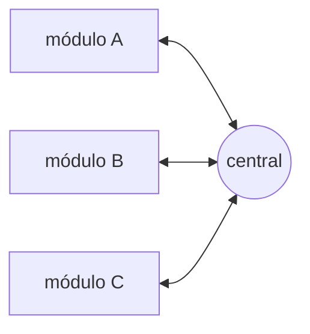

# 1. Seu primeiro módulo: conectando ao IPC

Neste capítulo você vai criar o módulo `vehicle_sim` e fazê-lo se conectar ao ASTRO. Ele ainda não vai enviar nada. O objetivo é entender o mínimo da comunicação por IPC. Nos capítulos seguintes o módulo vai crescendo, e você pode digitar cada trecho conforme ele aparece.

## 1.1 O que é IPC no ASTRO

O ASTRO é formado por vários programas independentes, os **módulos** (localização, planejamento, sensores...). Cada módulo é um executável separado. Eles não chamam funções uns dos outros, e a conversa entre eles passa por um programa no meio, a **`central`**:



A `central` é um servidor. Todo módulo precisa **se conectar** a ela ao iniciar. Se ela não estiver no ar, o módulo não consegue fazer nada.

Neste capítulo vamos apenas criar um módulo e conectá-lo à `central`.

## 1.2 Preparando o ambiente

O `Makefile` do ASTRO precisa saber onde está a raiz do projeto:

```bash
export ASTRO_HOME=/home/lume/astro
```

Sem isso o `make` aborta com `ASTRO_HOME environment variable not set`.

## 1.3 Criando a pasta do módulo

Todo módulo mora em uma pasta dentro de `src/`:

```bash
mkdir $ASTRO_HOME/src/vehicle_sim
cd $ASTRO_HOME/src/vehicle_sim
```

## 1.4 O primeiro `main`

Crie o arquivo `vehicle_sim_main.cpp`. Ele é o ponto de entrada do módulo:

```cpp
#include <astro/astro.h>

int
main(int argc, char **argv)
{
	astro_ipc_initialize(argc, argv);

	printf("vehicle_sim: conectado a central.\n");

	astro_ipc_dispatch();

	return 0;
}
```

Linha a linha:

| Linha | O que faz |
|---|---|
| `#include <astro/astro.h>` | Traz as funções do ASTRO, incluindo as de IPC |
| `astro_ipc_initialize(argc, argv)` | **Conecta o módulo à `central`.** É sempre a primeira coisa do `main`. Se não conseguir conectar, o programa termina com erro |
| `astro_ipc_dispatch()` | **Mantém o módulo vivo, esperando mensagens.** Ela não retorna: o módulo fica aqui parado, e é aqui que, mais adiante, os *handlers* das mensagens recebidas serão chamados |

## 1.5 O `Makefile`

Crie o arquivo `Makefile` na mesma pasta:

```makefile
include ../Makefile.conf

MODULE_NAME = VEHICLE SIM
MODULE_COMMENT = Modulo de exemplo: simula um veiculo e publica sua pose

LFLAGS += -lglobal -lipc -lpthread

SOURCES = vehicle_sim_main.cpp

PUBLIC_BINARIES = vehicle_sim
TARGETS = vehicle_sim

vehicle_sim: vehicle_sim_main.o

include ../Makefile.rules
```

| Linha | Significado |
|---|---|
| `include ../Makefile.conf` e `../Makefile.rules` | Regras de build comuns a todos os módulos. Ficam no começo e no fim |
| `MODULE_NAME`, `MODULE_COMMENT` | Nome e descrição mostrados no build |
| `LFLAGS` | Bibliotecas usadas: `libglobal` e `libipc` (o IPC) e `libpthread` |
| `SOURCES` | Os arquivos `.cpp` do módulo |
| `PUBLIC_BINARIES` | O executável será copiado para `$ASTRO_HOME/bin/` |
| `TARGETS` | O que o `make` constrói |
| `vehicle_sim: vehicle_sim_main.o` | Liga o executável ao seu arquivo objeto |

> [!WARNING]
> **A ordem das bibliotecas importa.** `-lglobal` precisa vir **antes** de `-lipc`. Na ordem inversa o link falha com `undefined reference to IPC_perror`.
> **`-lpthread` é obrigatório**, porque a `libipc` usa *threads*.

## 1.6 Compilando

```bash
cd $ASTRO_HOME/src/vehicle_sim
make
```

Se tudo estiver certo, a última linha será:

```text
[SUCCESS] Module VEHICLE SIM built with hash: ...
```

O executável `vehicle_sim` foi copiado para `$ASTRO_HOME/bin/`.


## 1.7 Executando

### Sem a `central`: o erro mais comum

Vá para a pasta `bin/` e rode o módulo **sem** a `central` no ar:

```bash
cd $ASTRO_HOME/bin
./vehicle_sim
```

```text
ASTRO - LUME ROBOTICS SYSTEM Version 0.8.0

Could not connect to central.

Did you remember to start central?
Did you remember to set your CENTRALHOST variable? It is currently not set.
```

O módulo termina, porque não há onde se conectar. É a confirmação de que `astro_ipc_initialize` faz o que dissemos.

### Com a `central`

Em **outro terminal**, inicie a `central` e deixe-a rodando:

```bash
cd $ASTRO_HOME/bin
./central
```

```text
central running...
```

No terminal do módulo:

```bash
./vehicle_sim
```

```text
ASTRO - LUME ROBOTICS SYSTEM Version 0.8.0

vehicle_sim: conectado a central.
```


O módulo fica parado em `astro_ipc_dispatch()`, esperando mensagens (que ainda não existem). Aperte **Ctrl+C** para encerrá-lo: o programa simplesmente morre, sem dizer nada. Isso funciona, mas é um encerramento "seco". Na próxima seção vamos melhorá-lo.

> [!TIP]
> Se a `central` acusar `unable to bind TCP/IP socket for listening` ao iniciar, a porta ainda está presa por uma execução anterior que acabou de ser encerrada. Espere alguns segundos e tente de novo.

## 1.8 Encerrando com educação

Na execução anterior, o Ctrl+C derrubou o módulo de uma vez: ele não teve chance de fazer nada antes de sair. Isso é um problema à medida que o módulo ganha responsabilidades, como fechar arquivos, liberar recursos ou parar um equipamento. Todo módulo do ASTRO trata o Ctrl+C para ter um **ponto de saída controlado**, onde ele:

1. se desconecta da `central` de forma explícita;
2. executa qualquer limpeza necessária (por enquanto, só uma mensagem);
3. termina.

Acrescente uma função e registre-a no `main`:

```cpp
#include <astro/astro.h>

static void
shutdown_module(int signo)
{
	if (signo == SIGINT)
	{
		astro_ipc_disconnect();
		printf("vehicle_sim: desconectado.\n");
		exit(0);
	}
}

int
main(int argc, char **argv)
{
	astro_ipc_initialize(argc, argv);
	signal(SIGINT, shutdown_module);

	printf("vehicle_sim: conectado a central.\n");

	astro_ipc_dispatch();

	return 0;
}
```

O que mudou:

* `signal(SIGINT, shutdown_module)` pede ao sistema operacional que chame `shutdown_module` quando o Ctrl+C for pressionado (sinal `SIGINT`).
* `astro_ipc_disconnect()` se desconecta da `central` de forma limpa.
* `exit(0)` encerra o programa depois da limpeza.

Compile de novo (`make`), execute e aperte Ctrl+C:

```text
ASTRO - LUME ROBOTICS SYSTEM Version 0.8.0

vehicle_sim: conectado a central.
vehicle_sim: desconectado.
```

Agora a saída mostra o ponto de encerramento controlado. Nos próximos capítulos é nele que entrará a limpeza do que o módulo abrir.

## 1.9 Checkpoint

Neste ponto você tem:

- [x] uma pasta `src/vehicle_sim/` com `Makefile` e `vehicle_sim_main.cpp`;
- [x] um módulo que se conecta à `central` e se desconecta com Ctrl+C;
- [x] a noção de que **todo módulo começa com `astro_ipc_initialize`** e **fica esperando em `astro_ipc_dispatch`**.

**Próximo capítulo:** vamos dar algo para o módulo dizer: definir a mensagem de pose do veículo e publicá-la.
