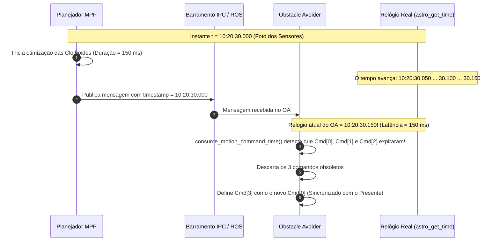
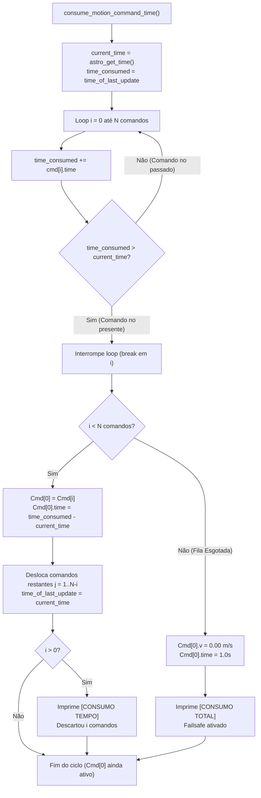

# Sincronização Temporal e Compensação de Latência (`consume_motion_command_time`)

A função [`consume_motion_command_time()`](file:///home/lume/astro/src/obstacle_avoider/obstacle_avoider_main.cpp#L387-L465) é a primeira etapa crítica executada dentro do [`obstacle_avoider_timer_handler()`](file:///home/lume/astro/src/obstacle_avoider/obstacle_avoider_main.cpp#L1300). Ela é responsável por manter a fila de comandos de movimento rigorosamente sincronizada com o relógio do veículo, resolvendo os dois maiores desafios da robótica móvel em malha fechada: **a latência de cálculo do planejador (MPP)** e **o avanço temporal contínuo da fila de comandos durante a condução**.

---

## 1. Por que essa função é indispensável?

Em um veículo autônomo, o planejador de trajetória ([MPP - Model Predictive Planner](file:///home/lume/astro/src/mpp/)) e o controlador de segurança ([Obstacle Avoider](file:///home/lume/astro/src/obstacle_avoider/)) rodam em frequências e processos distintos:

1. **O MPP opera em escala de centenas de milissegundos:**  
   Ele precisa integrar equações de clothoides, calcular envelopes de colisão, resolver otimizações e gerar até 400 comandos à frente. Esse cálculo consome tipicamente entre $100\text{ ms}$ e $350\text{ ms}$.
2. **O relógio do robô não para:**  
   Enquanto o MPP calculava o novo plano, o caminhão continuou se deslocando fisicamente pelo asfalto.
3. **O problema do atraso acumulado:**  
   Se o Obstacle Avoider recebesse o novo plano e simplesmente executasse o primeiro comando (`Cmd[0]`), o veículo estaria executando uma ordem que foi pensada para onde ele estava **no passado**. O resultado seria erro de perseguição de trajetória (*tracking error*), solavancos no volante e desvios de rota.

> [!IMPORTANT]
> **Missão da Função:**  
> `consume_motion_command_time()` garante que o comando na posição zero da fila (`Cmd[0]`) corresponda **exatamente ao instante presente no relógio do veículo**, descartando fatias obsoletas do passado e fatiando o comando ativo no tempo.

---

## 2. Anatomia dos Comandos de Movimento

Cada elemento do vetor `motion_commands_vector[i]` é da estrutura `astro_robot_and_trailers_motion_command_t`:

```cpp
typedef struct
{
    double v;       // Velocidade linear longitudinal desejada (m/s)
    double phi;     // Ângulo de esterçamento do rodado dianteiro (radianos)
    double time;    // Duração deste degrau de comando (dt em segundos!)
} astro_robot_and_trailers_motion_command_t;
```

> [!NOTE]
> O campo `.time` **NÃO é uma data absoluta (timestamp)**. Ele é um **intervalo de tempo ($\Delta t$)**, como $0.05\text{ s}$ ($50\text{ ms}$) ou $0.02\text{ s}$ ($20\text{ ms}$).  
> Um vetor com 400 comandos de $0.05\text{ s}$ projeta um horizonte de predição de:
> $$T_{\text{horizonte}} = 400 \times 0{,}05\text{ s} = 20{,}0\text{ segundos no futuro}$$

---

## 3. Linha do Tempo e Compensação de Latência

A relação temporal entre a emissão do plano pelo MPP e o consumo pelo Obstacle Avoider é ilustrada abaixo:



---

## 4. O Algoritmo Passo a Passo

O código de [`consume_motion_command_time()`](file:///home/lume/astro/src/obstacle_avoider/obstacle_avoider_main.cpp#L387-L465) executa as seguintes etapas:

```cpp
static void
consume_motion_command_time(int motion_command_vetor, FILE *out_act)
{
    int i, j;
    double current_time, time_consumed;

    if (use_timestamp_from_audit)
        current_time = timestamp_of_motion_commands_vector[motion_command_vetor];
    else
        current_time = astro_get_time();

    time_consumed = astro_robot_ackerman_motion_command_time_of_last_update;
```

### Etapa 1: A Varredura de Término dos Comandos
O acumulador `time_consumed` inicia no carimbo de referência `time_of_last_update` (momento do último consumo ou da geração do plano). A cada iteração:
$$t_{\text{fim}}(i) = t_{\text{ref}} + \sum_{k=0}^{i} \Delta t_k$$

```cpp
    for (i = 0; i < num_motion_commands_in_vector[motion_command_vetor]; i++)
    {
        time_consumed += motion_commands_vector[motion_command_vetor][i].time;

        if (time_consumed > current_time)
        {
            break;
        }
    }
```

* **`time_consumed <= current_time`**: O término do comando $i$ já ficou no passado. O comando já foi cumprido pelas rodas e deve ser descartado.
* **`time_consumed > current_time`**: O término do comando $i$ está além do relógio atual. **Este é o comando ativo no instante presente!** O loop é interrompido com o índice `i`.

---

### Etapa 2: Reindexação e Descarte da Fila
Se $i < \text{total de comandos}$, os comandos de $0$ a $i-1$ são descartados, e o comando $i$ passa a ocupar o índice `0`:

```cpp
    if (i < num_motion_commands_in_vector[motion_command_vetor])
    {
        // 1. Move o comando vigente para a posição zero
        motion_commands_vector[motion_command_vetor][0] = motion_commands_vector[motion_command_vetor][i];

        // 2. Ajusta a duração restante do comando que acabou de virar Cmd[0]
        motion_commands_vector[motion_command_vetor][0].time = time_consumed - current_time;

        // 3. Desloca todos os comandos futuros para a esquerda
        for (j = 1; (j + i) < num_motion_commands_in_vector[motion_command_vetor]; j++)
        {
            motion_commands_vector[motion_command_vetor][j] = motion_commands_vector[motion_command_vetor][j + i];
        }

        num_motion_commands_in_vector[motion_command_vetor] = j;
        astro_robot_ackerman_motion_command_time_of_last_update = current_time;
```

#### O Ajuste de Tempo Residual:
Se o comando $i$ tinha duração de $0{,}050\text{ s}$ e terminaria em $10:20:30.150$, mas o instante atual é $10:20:30.120$, restam apenas:
$$\Delta t_{\text{restante}} = t_{\text{fim}} - t_{\text{atual}} = 30{,}150 - 30{,}120 = 0{,}030\text{ s}$$
O código grava exatamente $0{,}030\text{ s}$ no `Cmd[0].time`, garantindo precisão milimétrica.

---

### Etapa 3: Tratamento de Esgotamento Total (*Failsafe*)
Se o tempo decorrido for maior do que a soma de **todos** os comandos do plano (por exemplo, se o MPP travar ou a rede falhar e o robô consumir todo o horizonte de tempo):

```cpp
    else
    {
        num_motion_commands_in_vector[motion_command_vetor] = 1;
        motion_commands_vector[motion_command_vetor][0].v = 0.0;
        motion_commands_vector[motion_command_vetor][0].time = 1.0;

        if (!printed_total_consumed && out_act)
        {
            printed_total_consumed = true;
            fprintf(out_act, "  \033[1;31m[CONSUMO TOTAL]\033[0m O tempo consumiu todos os comandos! Fila esgotada -> Forcando Cmd[0] v = 0.00 m/s\n\n");
            fflush(out_act);
        }
    }
```
O sistema protege o veículo forçando a velocidade imediatamente a $0{,}00\text{ m/s}$, impedindo que o caminhão prossiga sem planejamento válido.

---

## 5. Exemplo Numérico Detalhado

Considere um plano emitido pelo MPP com comandos de $\Delta t = 50\text{ ms}$ ($0{,}05\text{ s}$):

| Índice | Comando Original | Duração ($\Delta t$) | Início Teórico | Fim Teórico ($t_{\text{fim}}$) | Status em $t_{\text{atual}} = 10:20:30.120$ |
| :---: | :---: | :---: | :---: | :---: | :---: |
| `Cmd[0]` | $v = 1.67\text{ m/s}$ | $0.05\text{ s}$ | $10:20:30.000$ | $10:20:30.050$ | **Passado** (Descartado) |
| `Cmd[1]` | $v = 1.67\text{ m/s}$ | $0.05\text{ s}$ | $10:20:30.050$ | $10:20:30.100$ | **Passado** (Descartado) |
| `Cmd[2]` | $v = 1.66\text{ m/s}$ | $0.05\text{ s}$ | $10:20:30.100$ | $10:20:30.150$ | **PRESENTE!** Vira o novo `Cmd[0]` com $\Delta t = 0.03\text{ s}$ |
| `Cmd[3]` | $v = 1.65\text{ m/s}$ | $0.05\text{ s}$ | $10:20:30.150$ | $10:20:30.200$ | Futuro (Vira o novo `Cmd[1]`) |

```
Linha do Tempo Real:
30.000s               30.050s               30.100s        30.120s        30.150s
  |------ Cmd[0] ------|------ Cmd[1] ------|------ Cmd[2] ---*---|-- Cmd[3] --|
  [==== Descartado ===][==== Descartado ===][  Consumido  | Resta ]
                                                          ^
                                                      AGORA (current_time)
```

---

## 6. Interpretação dos Logs Reais

Durante a execução real, monitorando `/tmp/potencial_collision.log`, você observará dois padrões distintos de descarte temporal:

### Padrão A: Descarte em Massa (Novo Plano do MPP com Latência)
```text
  [CONSUMO TEMPO] O tempo passou! Descartou 51 comando(s) executado(s) (v_antiga=1.66 m/s). Novo Cmd[0]: v=1.60 m/s (Restam 317 cmds na fila)
```
* **Significado:** O MPP demorou cerca de $250\text{ ms}$ para calcular e entregar este plano.
* **Ação do OA:** Descartou de uma só vez os 51 comandos correspondentes aos $250\text{ ms}$ passados, reposicionando o início do plano exatamente na pose atual do caminhão.

### Padrão B: Descarte Unitário Contínuo (Ciclos Periódicos do Timer)
```text
  [CONSUMO TEMPO] O tempo passou! Descartou 1 comando(s) executado(s) (v_antiga=1.62 m/s). Novo Cmd[0]: v=1.56 m/s (Restam 188 cmds na fila)
```
* **Significado:** O Obstacle Avoider roda seu timer a cada $20\text{ ms}$.
* **Ação do OA:** Conforme o veículo avança e consome os $20\text{ ms}$ a $50\text{ ms}$ de cada degrau de comando, a fila vai sendo fatiada e avançada suavemente comando por comando.

---

## 7. Diagrama de Fluxo Interno da Função



