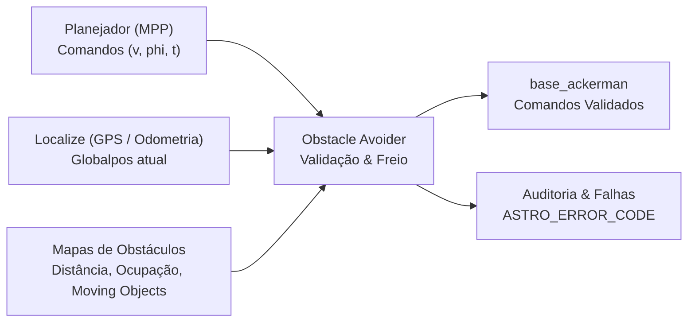
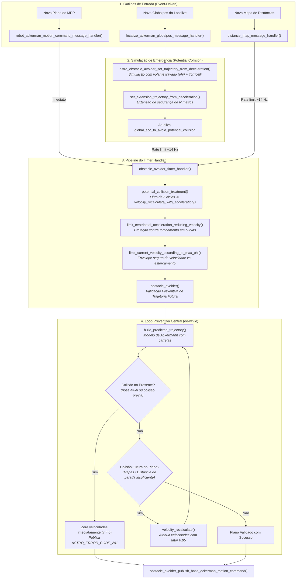

# Obstacle Avoider (OA)

O **`obstacle_avoider`** é o módulo de segurança crítica responsável por garantir que o veículo autônomo (cavalo mecânico e semirreboques) não colida com nenhum obstáculo detectado ao longo de sua trajetória.

> [!IMPORTANT]
> **Escopo Exclusivo de Atuação:**  
> O `obstacle_avoider` **não altera o traçado lateral nem gera esterçamento ($\phi$) para desviar de obstáculos**. O seu papel é estritamente **modular e desacelerar a velocidade ($v$)** do planejamento para garantir a frenagem segura do veículo antes de qualquer colisão. Se a rota estiver bloqueada, ele para o caminhão e aguarda o replanejamento das camadas superiores.

---

## 1. Posicionamento no Pipeline de Navegação

O módulo atua como uma barreira de segurança (*safety shield*) posicionada entre o planejador de trajetória ([MPP / Frenet](file:///home/lume/astro/src/mpp/)) e o controlador de baixo nível ([`base_ackerman`](file:///home/lume/astro/src/base_ackerman/)):



---

## 2. Diagrama Macro Integrado de Fluxo

O sistema opera de forma orientada a eventos. O fluxo de avaliação e intervenção segue o pipeline abaixo:



---

## 3. Mapa de Tratamentos do Módulo

O `obstacle_avoider` organiza suas proteções em diferentes camadas de segurança e dinâmica veicular:

| Tratamento | Função Principal | Objetivo e Comportamento | Documentação Detalhada |
| :--- | :--- | :--- | :--- |
| **Arquitetura e Fluxo Geral** | `obstacle_avoider_timer_handler()` | Coordena os 3 gatilhos, limitadores de frequência, watchdogs de mensagem e publicação para `base_ackerman`. | [`docs/01_arquitetura_e_fluxo_geral.md`](docs/01_arquitetura_e_fluxo_geral.md) |
| **Planejamento Preventivo** | `obstacle_avoider()` | Loop `do-while` que simula os comandos do MPP a partir da pose real. Se detectar obstáculo futuro, reduz progressivamente as velocidades com `velocity_recalculate()` até o plano parar antes do impacto. | [`docs/02_planejamento_preventivo.md`](docs/02_planejamento_preventivo.md) |
| **Planejamento de Emergência (*Potential Collision*)** | `astro_obstacle_avoider_set_trajectory_from_deceleration()` | Responde se o carro colide caso o volante permaneça no $\phi$ atual freando com Torricelli. Se colidir por 5 ciclos, esmaga o plano com `velocity_recalculate_with_acceleration()` até parar. | [`docs/03_planejamento_emergencia.md`](docs/03_planejamento_emergencia.md) |
| **Restrições de Dinâmica Veicular** | `limit_centripetal_acceleration_reducing_velocity()` | Limita a aceleração centrípeta em curvas ($a_c \le 1{,}05 \cdot a_{c,\max}$) e restringe velocidade por ângulo $\phi$ conforme calibração de estabilidade. | [`docs/04_restricoes_dinamica_veiculo.md`](docs/04_restricoes_dinamica_veiculo.md) |
| **Detecção Multi-Mapas** | `astro_collision_detection_compute_maps_collision()` | Camada de colisão geométrica verificando mapas de distância, ocupação, áreas com geometria personalizada e nuvens de pontos de objetos móveis. | [`docs/05_deteccao_colisao_e_mapas.md`](docs/05_deteccao_colisao_e_mapas.md) |
| **Diagnósticos, Erros e Parâmetros** | Mensagens `ASTRO_ERROR_CODE` | Gestão de anotações RDDF de rota, emissão de alarmes de telemetria (códigos 201 a 205) e logs de auditoria. | [`docs/06_diagnosticos_erros_e_parametros.md`](docs/06_diagnosticos_erros_e_parametros.md) |

---

## 4. Parâmetros de Configuração

Os parâmetros podem ser configurados via arquivo `.ini` do robô ou linha de comando:

| Parâmetro / Flag | Tipo | Padrão | Descrição |
| :--- | :---: | :---: | :--- |
| `obstacle_avoider_use_potential_collision` | On/Off | `on` | Ativa a verificação de emergência de colisão potencial (volante travado). |
| `obstacle_avoider_potential_collision_extension_length` | Double | `3.0` | Metros de extensão projetados além da parada na simulação de emergência. Use `0.0` para desativar a extensão. |
| `obstacle_avoider_potential_collision_use_final_goal_implementation` | On/Off | `on` | Atenua a extensão do *potential collision* perto do destino final para permitir manobras de atracamento/doca. |
| `obstacle_avoider_recalculate_velocity_when_braking_distance_exceeds_plan` | On/Off | `on` | Força recálculo de velocidade se o plano do MPP for mais curto que a distância necessária para frear com segurança. |
| `obstacle_avoider_use_hold_velocity_to_reference_phi` | On/Off | `off` | Ativa a intervenção ativa na velocidade quando o ângulo $\phi$ excede o envelope seguro. |
| `obstacle_avoider_v_and_max_phi_reference_points` | String | `NULL` | Tabela spline de pares $(v, \phi_{\max})$ definindo limites de estabilidade lateral. |
| `obstacle_avoider_manual_override_activate` | Int | `0` | Se `1`, força o OA a intervir mesmo quando o veículo estiver em modo manual. |
| `-send_draw_line on` | Flag CLI | `off` | Habilita envio de linhas de debug da trajetória simulada para o `viewer_3D`. |
| `-only_mpp on` | Flag CLI | `off` | Executa o OA estritamente quando receber nova mensagem do MPP (ignora gatilhos de odometria e mapa). |

---

## 5. Códigos de Erro Emitidos

O módulo publica os seguintes erros no barramento do sistema (`ASTRO_ERROR_CODE`):

* **`ASTRO_ERROR_CODE_201`**: Colisão identificada na pose atual enquanto o veículo estava em movimento (estado crítico de colisão real).
* **`ASTRO_ERROR_CODE_203`**: Colisão futura identificada no plano do MPP ou espaço insuficiente para frenagem até o destino.
* **`ASTRO_ERROR_CODE_204`**: Colisão detectada na simulação de emergência (*potential collision* ou extensão).
* **`ASTRO_ERROR_CODE_205`**: Ângulo de esterçamento $\phi$ excedeu o envelope seguro para a velocidade atual.

---

## 6. Testes Unitários

O módulo possui suíte de testes unitários baseada em Google Test (GTest) e Google Mock (GMock):

```bash
# Compilar e executar os testes unitários do obstacle_avoider
cd src/obstacle_avoider
make -f Makefile unit_tests/run_unit_tests
./unit_tests/run_unit_tests
```

