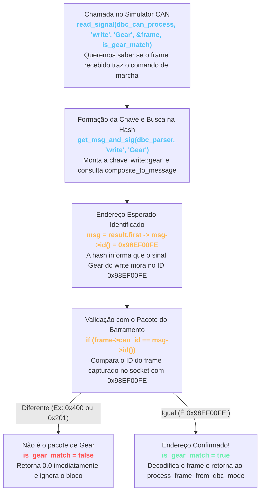
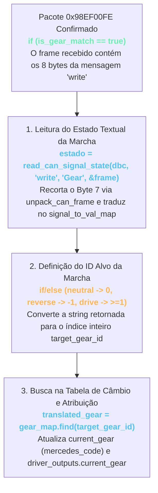

# Processamento do DBC, Tabelas Hash e Comandos `write` (`process_frame_from_dbc_mode`)

A função [`process_frame_from_dbc_mode()`](file:///home/lume/astro/src/simulator_ackerman/simulator_ackerman_can_main.cpp#L2848-L2956) é o núcleo de recepção do simulador quando executado com um arquivo `.dbc` (parâmetro `--dbc_path`). Ela é chamada continuamente pela thread [`update_state_thread()`](file:///home/lume/astro/src/simulator_ackerman/simulator_ackerman_can_main.cpp#L2992-L3007) para cada pacote capturado na rede CAN.

---

## 1. Por que o Simulador lê da mensagem chamada `"write"`?

Conforme detalhado na [Seção 1 da Arquitetura Geral](01_arquitetura_e_fluxo_geral.md#1-o-papel-do-simulator-can-na-pilha-autônoma-divisão-de-responsabilidades), os nomes das mensagens nos arquivos `.dbc` do projeto (como o [`ojAstro_fullDBC.dbc`](file:///home/lume/astro/src/astro_hal/dbc_file_example/ojAstro_fullDBC.dbc)) foram definidos a partir da **perspectiva do controlador de direção (`vehicle_driver`)**:

* **`write`**: Mensagens de comando que o `vehicle_driver` **escreve** na CAN para atuar no veículo (acelerador, freio, volante, marcha).
* **`read`**: Mensagens de sensores/telemetria que o `vehicle_driver` **lê** da CAN (velocidade das rodas, ângulo do volante, RPM, marcha engatada).

> [!IMPORTANT]
> **Perspectiva Invertida no Simulador:**  
> Como o `simulator_ackerman_can` faz o papel do **veículo físico**, ele opera no sentido oposto ao `vehicle_driver`:
> 1. Para **receber os comandos** que o robô enviou, o simulador faz `read_signal()` na mensagem batizada de **`"write"`**.
> 2. Para **devolver a telemetria** simulada, o simulador empacota e transmite a mensagem batizada de **`"read"`**.

---

## 2. O Caminho do Frame: De `update_state_thread()` até `process_frame_from_dbc_mode()`

Como vimos na arquitetura geral, o `simulator_ackerman_can` possui duas vias muito importantes: **escutar** e **enviar** para o barramento CAN.

A via de escuta é realizada dentro de [`update_state_thread()`](file:///home/lume/astro/src/simulator_ackerman/simulator_ackerman_can_main.cpp#L2992-L3007), onde `recv_frame()` escuta o barramento e armazena o frame capturado, e [`update_state_from_can()`](file:///home/lume/astro/src/simulator_ackerman/simulator_ackerman_can_main.cpp#L2960-L2966) é responsável por passar adiante esse frame para tratamento pelo `simulator_can` (o nosso veículo virtual):

```cpp
void *
update_state_thread(void *arg __attribute__ ((unused)))
{
    struct can_frame frame;

    while (1)
    {
        if (can_sockfd != -1)
        {
            recv_frame(can_sockfd, &frame);
            update_state_from_can(frame);
        }
    }

    return (NULL);
}
```

Por sua vez, `update_state_from_can(frame)` identifica se estamos trabalhando com a comunicação via **DBC** (`dbc_can_process.valid_parser == true`) ou com o modo legado/JAUS. Sendo via DBC, ela processa esse frame chamando [`process_frame_from_dbc_mode(frame)`](file:///home/lume/astro/src/simulator_ackerman/simulator_ackerman_can_main.cpp#L2848-L2956):

```cpp
void
update_state_from_can(struct can_frame frame)
{
    if (dbc_can_process.valid_parser == true)
    {
        process_frame_from_dbc_mode(frame);
        return;
    }
    // Caso contrário, segue para o tratamento legado...
}
```

### Como `process_frame_from_dbc_mode()` inicia a avaliação do frame?

Logo na primeira linha útil de `process_frame_from_dbc_mode()`, há uma tentativa de verificar se o comando de marcha (`"Gear"`) veio naquele frame:

```cpp
bool is_gear_match = false;
astro_hal_can_interactions::read_signal(dbc_can_process, "write", "Gear", &frame, is_gear_match);
```

Nessa chamada passamos:
1. **`dbc_can_process`**: A estrutura (`astro_hal_can_interactions_t`) que na inicialização carregou o arquivo `.dbc`;
2. **`"write"`**: O tipo/grupo de mensagem no DBC que queremos verificar;
3. **`"Gear"`**: O sinal específico que estamos procurando;
4. **`&frame`**: O frame que acabou de ser capturado da rede CAN.

---

## 3. Destrinchando o Arquivo DBC e a Criação da Hash de Endereços (`composite_to_message`)

Para entender como o `dbc_can_process` descobre se o `&frame` contém o sinal `"Gear"`, vamos olhar diretamente para o trecho de comandos `WRITE` configurado no arquivo [`ojAstro_fullDBC.dbc`](file:///home/lume/astro/src/astro_hal/dbc_file_example/ojAstro_fullDBC.dbc#L8-L31):

```dbc
#################### WRITE #########################

# aceleração e freio (throttle and brake)
BO_ 0x98EF00FE write: 8 DRIVER
 SG_ ThrottleEffort : 16|16@1+ (0.1,0) [0|100] "" DRIVER
 SG_ BrakesEffort : 0|16@1+ (0.1,0) [0|100] "" DRIVER
 SG_ SignalsByte : 48|8@1+ (1,0) [0|100] "" DRIVER
 SG_ SteeringEffort : 32|16@1- (0.1,0) [-100|100] "" DRIVER

BO_ 0x98EF00FE write: 8 DRIVER
 SG_ Gear : 56|8@1+ (1,0) [0|255] "" DRIVER
VAL_ 0x98EF00FE Gear 16 "drive" 32 "reverse" 8 "neutral" ;

# signals 
BO_ 0x400 write: 2 DRIVER
 SG_ Headlights : 0|5@1+ (1,0) [0|1] "" DRIVER
 SG_ TurnSignal : 5|3@1+ (1,0) [0|1] "" DRIVER
 SG_ Horn : 8|3@1+ (1,0) [0|1] "" DRIVER
 SG_ Retarder : 11|3@1+ (1,0) [0|1] "" DRIVER

# engine_state and vehicle_panel 
BO_ 0x500 write: 1 DRIVER
 SG_ Engine : 0|8@1+ (1,0) [0|1] "" DRIVER
```

### 3.1. O que significam as tags `BO_`, `SG_` e `VAL_`?

O arquivo `.dbc` utiliza três palavras-chave principais para estruturar os pacotes da rede CAN:

| Tag DBC | Nome / Conceito | Estrutura Sintática | O que define no trecho acima? |
| :--- | :--- | :--- | :--- |
| **`BO_`** | **Message** *(Bloco/Cabeçalho da Mensagem CAN)* | `BO_ <CAN_ID> <NomeMsg>: <TamanhoBytes> <Transmissor>` | Define o **endereço CAN** (ex: `0x98EF00FE`, `0x400`, `0x500`), batiza o grupo como `write` e define quantos bytes (DLC) o pacote possui (`8`, `2` ou `1` byte). |
| **`SG_`** | **Signal** *(Sinal empacotado dentro da mensagem)* | `SG_ <NomeSinal> : <BitInicio>\|<Tamanho>@<Ordem><Sinal> (<Fator>,<Offset>) [<Min>\|<Max>] "<Unidade>" <Receptor>` | Define **quais sinais viajam dentro daquele endereço `BO_`** logo acima dele e em quais bits/bytes cada informação fica gravada. |
| **`VAL_`** | **Value Table** *(Dicionário de estados discretos)* | `VAL_ <CAN_ID> <NomeSinal> <Num1> "<Texto1>" <Num2> "<Texto2>" ;` | Traduz números inteiros brutos de um sinal em palavras legíveis (ex: no endereço `0x98EF00FE`, para o sinal `Gear`: `16` = `"drive"`, `32` = `"reverse"`, `8` = `"neutral"`). |

---

### 3.2. Organização dos Sinais por Endereço CAN no Bloco `WRITE`

Esses são todos os comandos de `write` configurados no DBC — ou seja, é o padrão que o **Vehicle Driver (VD)** segue para enviar seus comandos de atuação e como o **Simulator CAN (veículo virtual)** deve lê-los.

Analisando o trecho do DBC acima, observamos que o VD escreve em **3 endereços distintos**, padronizando o envio dos seguintes sinais em cada endereço:

* **Endereço `0x98EF00FE` (`write`, 8 bytes):**
  * `SG_ ThrottleEffort` *(Esforço de aceleração)*
  * `SG_ BrakesEffort` *(Esforço de frenagem)*
  * `SG_ SignalsByte` *(Byte de sinais auxiliares)*
  * `SG_ SteeringEffort` *(Esforço de esterçamento do volante)*
  * `SG_ Gear` *(Comando de marcha)*
* **Endereço `0x400` (`write`, 2 bytes):**
  * `SG_ Headlights` *(Faróis)*
  * `SG_ TurnSignal` *(Setas)*
  * `SG_ Horn` *(Buzina)*
  * `SG_ Retarder` *(Freio motor / Retarder)*
* **Endereço `0x500` (`write`, 1 byte):**
  * `SG_ Engine` *(Estado do motor)*

---

### 3.3. A Criação da Hash de Endereços (`composite_to_message`)

Quando o simulador captura um `frame` na rede CAN, centenas de pacotes de diferentes endereços estão passando pelo cabo. Para filtrar rapidamente **qual é o endereço esperado de um sinal** sem precisar varrer o arquivo DBC toda vez, o HAL cria na inicialização ([`process_dbc_file()`](file:///home/lume/astro/include/astro/astro_hal_can_interactions.hpp#L95-L150)) uma **Hash de Mensagens/Endereços** chamada `composite_to_message`.

Para montar a **Chave (Key)** dessa hash, o HAL junta o nome da mensagem (`BO_`) com o nome do sinal (`SG_`) em letras minúsculas, separados por `"::"`:

$$\text{Chave} = \text{"<nome\_da\_msg>::<nome\_do\_sinal>"}$$

A partir do trecho `WRITE` do DBC acima, a tabela hash `composite_to_message` fica armazenada na memória RAM exatamente assim:

| Chave na Hash (`composite_key`) | Valor Armazenado (`const Libdbc::Message*`) | Endereço (`msg->id()`) | Tamanho (`msg->size()`) |
| :--- | :--- | :--- | :--- |
| `"write::throttleeffort"` | Ponteiro para `Message (0x98EF00FE)` | **`0x98EF00FE`** | `8 bytes` |
| `"write::brakeseffort"` | Ponteiro para `Message (0x98EF00FE)` | **`0x98EF00FE`** | `8 bytes` |
| `"write::signalsbyte"` | Ponteiro para `Message (0x98EF00FE)` | **`0x98EF00FE`** | `8 bytes` |
| `"write::steeringeffort"` | Ponteiro para `Message (0x98EF00FE)` | **`0x98EF00FE`** | `8 bytes` |
| **`"write::gear"`** | Ponteiro para `Message (0x98EF00FE)` | **`0x98EF00FE`** | `8 bytes` |
| `"write::headlights"` | Ponteiro para `Message (0x400)` | **`0x400`** | `2 bytes` |
| `"write::turnsignal"` | Ponteiro para `Message (0x400)` | **`0x400`** | `2 bytes` |
| `"write::horn"` | Ponteiro para `Message (0x400)` | **`0x400`** | `2 bytes` |
| `"write::retarder"` | Ponteiro para `Message (0x400)` | **`0x400`** | `2 bytes` |
| `"write::engine"` | Ponteiro para `Message (0x500)` | **`0x500`** | `1 byte` |

---

### 3.4. Como `get_msg_and_sig()` e `read_signal()` Utilizam essa Hash na Prática

Voltando à nossa chamada lá no simulador:
```cpp
astro_hal_can_interactions::read_signal(dbc_can_process, "write", "Gear", &frame, is_gear_match);
```

Dentro de [`read_signal()`](file:///home/lume/astro/include/astro/astro_hal_can_interactions.hpp#L402-L430), o código invoca [`get_msg_and_sig()`](file:///home/lume/astro/include/astro/astro_hal_can_interactions.hpp#L190-L213) para formar a chave e buscar o endereço na hash:

```cpp
// 1. Dentro de get_msg_and_sig(dbc_parser, "write", "Gear"):
std::string composite_key = to_lowercase(msg_name) + "::" + to_lowercase(sig_name);
// Resultado: composite_key = "write::gear"

auto it_msg = dbc_parser.composite_to_message.find("write::gear");
auto it_sig = dbc_parser.composite_to_signal.find("write::gear");

return std::make_pair(it_msg->second, it_sig->second);
```

Em seguida, `read_signal()` recebe esse resultado em `auto result` e faz o **filtro de endereço**:

```cpp
// 2. Dentro de read_signal():
auto result = get_msg_and_sig(dbc_parser, msg_name, sig_name);
const Libdbc::Message *msg = result.first; // Ponteiro obtido da hash composite_to_message

is_msg_match = false;

// Compara o endereço do frame que chegou na rede com o endereço guardado na Hash!
if (frame->can_id == msg->id()) // Ex: frame->can_id == 0x98EF00FE ?
{
    is_msg_match = true;
    return (decode_signal(result.second, frame->data));
}
```



Sendo o endereço que se deseja (nesse caso `0x98EF00FE`, o endereço onde está a marcha), `is_gear_match` recebe `true`, acontece a decodificação do frame através de `return (decode_signal(result.second, frame->data));` e o fluxo retorna ao `process_frame_from_dbc_mode()`.

---

## 4. A Segunda Hash (`composite_to_signal`) e a Avaliação da Marcha (`if (is_gear_match)`)

De volta ao `process_frame_from_dbc_mode()`, como `is_gear_match` agora é `true`, o código entra no bloco condicional para descobrir qual marcha foi solicitada e atualizar o veículo virtual:

```cpp
    if (is_gear_match)
    {
        std::string estado = astro_hal_can_interactions::read_can_signal_state(dbc_can_process, "write", "Gear", &frame);

        // 1. Define o ID alvo baseado no estado (usamos -99 como valor inválido/padrão)
        int target_gear_id = -99;

        if (estado == "neutral")            target_gear_id = 0;
        else if (estado == "reverse")       target_gear_id = -1;
        else if (estado == "drive")         target_gear_id = astro_fmax(1, current_gear_gear_map_id);
        else if (estado == "down")          target_gear_id = astro_fmax(0, current_gear_gear_map_id - 2);
        else if (estado == "down accurate") target_gear_id = astro_fmax(0, current_gear_gear_map_id - 1);
        else if (estado == "up")            target_gear_id = astro_fmin(gear_map.size() - 1, current_gear_gear_map_id + 2);
        else if (estado == "up accurate")   target_gear_id = astro_fmin(gear_map.size() - 1, current_gear_gear_map_id + 1);

        // 2. Executa a lógica de atribuição UMA ÚNICA VEZ
        if (target_gear_id != -99)
        {
            auto translated_gear = gear_map.find(target_gear_id);
            if (translated_gear != gear_map.end()) {
                current_gear = translated_gear->second->mercedes_code;
                current_gear_gear_map_id = target_gear_id;
                driver_outputs.current_gear = current_gear_gear_map_id;
            }
        }
        //printf("Gear: %d %d %d %s\n", current_gear, current_gear_gear_map_id, target_gear_id, estado.c_str());
    }
```

### 4.1. Como os Sinais são Organizados nos 8 Bytes? A Hash `composite_to_signal`

O DBC já nos avisou (pela primeira hash) que o endereço `0x98EF00FE` contém 5 sinais diferentes dividindo os mesmos 8 bytes: aceleração, freio, esterçamento, byte de sinais e marcha. Mas **como o código sabe exatamente quais bits pertencem à marcha ou ao acelerador?**

É aqui que entra a **Segunda Hash (`composite_to_signal`)**, cujo valor é retornado em `result.second` pela função `get_msg_and_sig()`. 

Enquanto a primeira hash guardava o endereço da mensagem (`BO_`), a segunda hash usa **a mesma chave composta** (`"write::throttleeffort"`, `"write::gear"`, etc.), mas guarda como valor um ponteiro para uma [`struct Libdbc::Signal`](file:///home/lume/astro/include/astro/astro_dbc_parser.hpp#L13-L32) que interpreta toda a descrição técnica à direita do sinal no DBC:

```dbc
SG_ ThrottleEffort : 16|16@1+ (0.1,0) [0|100] "" DRIVER
SG_ Gear           : 56|8@1+  (1,0)   [0|255] "" DRIVER
```

Veja como o trecho `"16|16@1+ (0.1,0) [0|100] "" DRIVER"` é fatiado e armazenado dentro da `struct Signal` na memória:

| Campo da `struct Signal` | Valor (`ThrottleEffort`) | Valor (`Gear`) | De onde veio no DBC? | O que significa? |
| :--- | :--- | :--- | :--- | :--- |
| **`name`** | `"ThrottleEffort"` | `"Gear"` | `SG_ <Nome>` | Nome do sinal. |
| **`is_multiplexed`** | `false` | `false` | *(sem `M`)* | Sinal simples (não multiplexado). |
| **`start_bit`** | **`16`** | **`56`** | **`16\|`** / **`56\|`** | Em qual bit dos 64 bits o sinal começa. |
| **`size`** | **`16`** | **`8`** | **`\|16`** / **`\|8`** | Quantos bits de largura o sinal ocupa. |
| **`is_bigendian`** | `false` | `false` | **`@1`** | `@1` = Little-Endian (Intel). `@0` = Big-Endian. |
| **`is_signed`** | `false` | `false` | **`+`** | `+` = Sem sinal (positivo). `-` = Com sinal (negativo/positivo). |
| **`factor`** | **`0.1`** | **`1.0`** | **`(0.1,`** / **`(1,`** | Fator multiplicador para obter o valor físico. |
| **`offset`** | **`0.0`** | **`0.0`** | **`,0)`** | Soma/deslocamento para obter o valor físico. |
| **`min` / `max`** | `0` a `100` | `0` a `255` | **`[0\|100]`** | Faixa de valores mínimo e máximo. |
| **`unit`** | `""` | `""` | **`""`** | Unidade física do sinal. |
| **`receivers`** | `{"DRIVER"}` | `{"DRIVER"}` | **`DRIVER`** | Módulo receptor definido no DBC. |
| **`value_descriptions`** | *(vazio)* | `{16:"drive", 32:"reverse", 8:"neutral"}` | Linha **`VAL_`** | Estados textuais associados aos números do sinal. |

Graças aos campos `start_bit` e `size` guardados nessa hash para cada sinal do endereço `0x98EF00FE`, o HAL sabe exatamente como os 8 bytes (64 bits) do pacote foram organizados pelo `vehicle_driver`:

```text
Endereço 0x98EF00FE — Payload de 8 Bytes (64 bits):
+---------------+---------------+---------------+---------------+---------------+---------------+---------------+---------------+
|    Byte 0     |    Byte 1     |    Byte 2     |    Byte 3     |    Byte 4     |    Byte 5     |    Byte 6     |    Byte 7     |
| (Bits 0 a 7)  | (Bits 8 a 15) | (Bits 16 a 23)| (Bits 24 a 31)| (Bits 32 a 39)| (Bits 40 a 47)| (Bits 48 a 55)| (Bits 56 a 63)|
+---------------+---------------+---------------+---------------+---------------+---------------+---------------+---------------+
|<------- BrakesEffort -------->|<------ ThrottleEffort ------->|<------ SteeringEffort ------->|  SignalsByte  |     Gear      |
|       start_bit: 0 | 16       |      start_bit: 16 | 16       |      start_bit: 32 | 16       |  bit: 48 | 8  |  bit: 56 | 8  |
+-------------------------------+-------------------------------+-------------------------------+---------------+---------------+
```

---

### 4.2. Recapitulação das Hashes, o Diferencial do `VAL_` e o `read_can_signal_state()`

Recapitulando o que vimos até aqui:
* A primeira hash (**`composite_to_message`**) tem como chave `tipo_sinal::sinal` (ex: `"write::gear"`) e seu valor é o **endereço onde esse sinal está**. Quando chega no barramento CAN o endereço `0x98EF00FE`, podemos afirmar que aquele pacote contém informações da marcha. Porém, essa primeira hash só informa isso: qual endereço foi cadastrado (`msg->id()`) e o tamanho total desse pacote (`msg->size()`).
* Quando queremos **ler de fato a informação** dentro desse endereço, vamos para a segunda hash (**`composite_to_signal`**), que informa **como esse endereço foi organizado** (conforme datado pelo `.dbc`).
* Passando a mesma chave `"write::gear"` nessa segunda hash, o valor associado não é mais um endereço, e sim uma **`struct Signal`** que armazena onde está a informação de `"Gear"` dentro dos 8 bytes.

#### O Diferencial da Marcha (`Gear`) e o Campo `VAL_`

Nesse caso, a marcha possui um diferencial importante. No arquivo `.dbc`, apesar de `Gear` estar no mesmo endereço `0x98EF00FE` que `ThrottleEffort`, `BrakesEffort` e `SteeringEffort`, ela foi declarada de forma separada acompanhada da linha **`VAL_`**:

```dbc
BO_ 0x98EF00FE write: 8 DRIVER
 SG_ Gear : 56|8@1+ (1,0) [0|255] "" DRIVER
VAL_ 0x98EF00FE Gear 16 "drive" 32 "reverse" 8 "neutral" ;
```

Isso acontece porque a [`struct Signal`](file:///home/lume/astro/include/astro/astro_dbc_parser.hpp#L13-L32) possui um campo específico para armazenar esses estados `VAL_` em formato de hash:

```cpp
std::unordered_multimap<std::string, uint32_t> value_descriptions_by_name;
```

Esse campo associa cada string de estado (`"drive"`, `"reverse"`, `"neutral"`) ao seu respectivo valor numérico (`16`, `32`, `8`). Na inicialização ([`process_dbc_file()`](file:///home/lume/astro/include/astro/astro_hal_can_interactions.hpp#L138-L148)), o HAL lê esse campo `value_descriptions_by_name` da `struct Signal` e monta o dicionário reverso `signal_to_val_map` (uma **Hash dentro de outra Hash**):

```text
signal_to_val_map (Hash Externa)
 │
 └── Chave: "write::gear"  (it_sig_map->first)
      └── Valor: Mini-Hash Interna (it_sig_map->second)
           ├── [8]  --> "neutral"
           ├── [16] --> "drive"     <-- (it_val->first = 16, it_val->second = "drive")
           └── [32] --> "reverse"
```

#### Como `read_can_signal_state()` extrai o byte e consulta essa Hash

Quando o simulador entra no `if (is_gear_match)` e executa [`read_can_signal_state(dbc_can_process, "write", "Gear", &frame)`](file:///home/lume/astro/include/astro/astro_hal_can_interactions.hpp#L318-L335), o seguinte trecho entra em ação:

```cpp
uint64_t raw_value = unpack_can_frame(sig, frame);

// =========================================================
// A MODIFICAÇÃO ESTÁ AQUI: Garantir que a chave de busca do VAL_ também seja minúscula
// =========================================================
std::string composite_key = to_lowercase(msg_name) + "::" + to_lowercase(sig_name);

auto it_sig_map = dbc_parser.signal_to_val_map.find(composite_key);

if (it_sig_map != dbc_parser.signal_to_val_map.end())
{
    auto it_val = it_sig_map->second.find(raw_value);

    if (it_val != it_sig_map->second.end())
    {
        return (it_val->second); // Retorna "drive", "neutral", etc.
    }
}
```

1. **`uint64_t raw_value = unpack_can_frame(sig, frame);`**:  
   Usa a `struct Signal` (`sig`, onde `start_bit = 56` e `size = 8`) para recortar apenas o **Byte 7** do frame CAN e obter o número puro que veio na rede (ex: `raw_value = 16`).
2. **`dbc_parser.signal_to_val_map.find("write::gear")`**:  
   Procura a chave `"write::gear"` na hash externa (`it_sig_map`). Encontrando, `it_sig_map->second` entrega a mini-hash interna da marcha (`{8: "neutral", 16: "drive", 32: "reverse"}`).
3. **`it_sig_map->second.find(raw_value)`**:  
   Procura o número `16` dentro da mini-hash interna (`it_val`). Encontrando, retorna `it_val->second`, que é a string **`"drive"`**!

---

### 4.3. De Volta ao `process_frame_from_dbc_mode()`: Atualizando a Marcha do Veículo

Agora que `read_can_signal_state()` devolveu a palavra correspondente ao número que veio na CAN (ex: `"drive"`, `"reverse"` ou `"neutral"`), o fluxo continua dentro do `if (is_gear_match)`:

```cpp
        std::string estado = astro_hal_can_interactions::read_can_signal_state(dbc_can_process, "write", "Gear", &frame);

        // 1. Define o ID alvo baseado no estado (usamos -99 como valor inválido/padrão)
        int target_gear_id = -99;

        if (estado == "neutral")            target_gear_id = 0;
        else if (estado == "reverse")       target_gear_id = -1;
        else if (estado == "drive")         target_gear_id = astro_fmax(1, current_gear_gear_map_id);
        else if (estado == "down")          target_gear_id = astro_fmax(0, current_gear_gear_map_id - 2);
        else if (estado == "down accurate") target_gear_id = astro_fmax(0, current_gear_gear_map_id - 1);
        else if (estado == "up")            target_gear_id = astro_fmin(gear_map.size() - 1, current_gear_gear_map_id + 2);
        else if (estado == "up accurate")   target_gear_id = astro_fmin(gear_map.size() - 1, current_gear_gear_map_id + 1);

        // 2. Executa a lógica de atribuição UMA ÚNICA VEZ
        if (target_gear_id != -99)
        {
            auto translated_gear = gear_map.find(target_gear_id);
            if (translated_gear != gear_map.end()) {
                current_gear = translated_gear->second->mercedes_code;
                current_gear_gear_map_id = target_gear_id;
                driver_outputs.current_gear = current_gear_gear_map_id;
            }
        }
```



1. **Passo 1 — Definição de `target_gear_id`:**  
   O simulador numera internamente suas marchas como inteiros (`-1` = Ré, `0` = Neutro, `1` a `12` = 1ª a 12ª marcha):
   * `"neutral"` $\to$ `target_gear_id = 0`
   * `"reverse"` $\to$ `target_gear_id = -1`
   * `"drive"` $\to$ `astro_fmax(1, current_gear_gear_map_id)` (garante que engate pelo menos a 1ª marcha se estava em neutro/ré, ou mantenha a marcha positiva atual).
   * `"up"` / `"down"` / `"up accurate"` / `"down accurate"` $\to$ Sobe ou desce 1 ou 2 marchas a partir da marcha atual (usado quando o arquivo DBC é de um caminhão com câmbio sequencial, como o [`Mart.dbc`](file:///home/lume/astro/src/astro_hal/dbc_file_example/Mart.dbc#L14)).

2. **Passo 2 — Atualização da Transmissão (`gear_map`):**  
   Se `target_gear_id` recebeu uma marcha válida ($\neq -99$), o código busca esse índice na tabela interna [`gear_map`](file:///home/lume/astro/src/simulator_ackerman/simulator_ackerman_can_main.cpp#L188-L205) e atualiza:
   * **`current_gear`**: Recebe o código hexadecimal daquela marcha (`mercedes_code`, ex: `0x38` para Ré, `0x3C` para Neutro, `0x44` para 1ª marcha), usado na equação física de aceleração.
   * **`current_gear_gear_map_id` e `driver_outputs.current_gear`**: Guardam o índice numérico da marcha atual (`-1`, `0`, `1`...), usado posteriormente na odometria para calcular o **RPM** do motor.

### Resumo Simulado com `ojAstro_fullDBC.dbc`:

| Valor no Byte 7 (`data[7]`) | Retorno de `read_can_signal_state` | Valor de `target_gear_id` | `current_gear` (`mercedes_code`) | `driver_outputs.current_gear` |
| :--- | :--- | :--- | :--- | :--- |
| **`8`** | `"neutral"` | `0` | `0x3C` (`NEUTRAL_GEAR`) | `0` (Ponto Morto) |
| **`16`** *(estando em neutro)* | `"drive"` | `1` | `0x44` (`GEAR_1`) | `1` (1ª Marcha) |
| **`32`** | `"reverse"` | `-1` | `0x38` (`REVERSE_GEAR_1`) | `-1` (Marcha Ré) |

---

## 5. Leitura dos Esforços, Cálculo de $(v, \phi)$ e Encerramento da Recepção

Após avaliar a marcha, a segunda metade de [`process_frame_from_dbc_mode()`](file:///home/lume/astro/src/simulator_ackerman/simulator_ackerman_can_main.cpp#L2885-L2956) extrai os esforços físicos do frame e conclui o ciclo de leitura daquele pacote CAN:

```cpp
    static double throttle_effort = 0.0;
    static double brakes_effort = 0.0;
    static double steering_effort = 0.0;

    bool is_throttle_match = false;
    bool is_brakes_match   = false;
    bool is_steering_match = false;
    double temp_val = 0.0;

    // 1. Extração dos 3 sinais de esforço (usando as mesmas hashes do DBC)
    temp_val = astro_hal_can_interactions::read_signal(dbc_can_process, "write", "ThrottleEffort", &frame, is_throttle_match);
    if (is_throttle_match) throttle_effort = temp_val / 100.0;

    temp_val = astro_hal_can_interactions::read_signal(dbc_can_process, "write", "BrakesEffort", &frame, is_brakes_match);
    if (is_brakes_match) brakes_effort = temp_val / 100.0;

    temp_val = astro_hal_can_interactions::read_signal(dbc_can_process, "write", "SteeringEffort", &frame, is_steering_match);
    if (is_steering_match) steering_effort = -temp_val / 100.0;

    // 2. Se o pacote continha algum dos esforços, calcula v e phi e salva no comando alvo
    if (is_throttle_match || is_brakes_match || is_steering_match)
    {
        ...
        v = compute_v_from_throttle_and_brakes_efforts(throttle_effort - g_throttle_gap / 100.0, brakes_effort - g_brake_gap / 100.0, current_gear, delta_t, v, ...);
        phi = compute_phi_from_steering_effort(steering_effort, phi_v, phi, delta_t, ...);
        phi = astro_clamp(-simulator_config->max_phi, phi, simulator_config->max_phi);

        set_target_v_and_target_phi(v, phi);
        previous_timestamp = astro_get_time();
    }
```

### Resumo das 3 Etapas Finais:

1. **Extração dos Esforços (`read_signal`):**  
   Chama o mesmo `read_signal()` para `"ThrottleEffort"`, `"BrakesEffort"` e `"SteeringEffort"`. Como esses sinais não usam estados textuais (`VAL_`), o próprio retorno numérico de `decode_signal()` já traz o percentual (0 a 100%), que é dividido por `100.0` para normalizar na faixa `[0.0, 1.0]`. *(As variáveis são `static` para reter o último esforço válido caso um DBC separe freio, acelerador e volante em endereços CAN diferentes).*
2. **Cálculo Físico de Velocidade ($v$) e Esterçamento ($\phi$):**  
   Se pelo menos um esforço veio no pacote, as funções [`compute_v_from_throttle_and_brakes_efforts()`](file:///home/lume/astro/src/simulator_ackerman/simulator_ackerman_can_main.cpp#L2927) e [`compute_phi_from_steering_effort()`](file:///home/lume/astro/src/simulator_ackerman/simulator_ackerman_can_main.cpp#L2940) simulam a resposta mecânica do caminhão durante o intervalo `delta_t`, gerando a velocidade $v$ e o ângulo das rodas $\phi$.
3. **Armazenamento Estático e Fim da Leitura (`set_target_v_and_target_phi`):**  
   Por fim, [`set_target_v_and_target_phi(v, phi)`](file:///home/lume/astro/src/simulator_ackerman/simulator_ackerman_can_main.cpp#L2472-L2485) grava o resultado na estrutura `static current_motion_command_vector` e aponta `simulator_config->current_motion_command_vector` para ela:
   ```cpp
   void set_target_v_and_target_phi(double v, double phi)
   {
       static astro_robot_and_trailers_motion_command_t current_motion_command_vector = {};
       current_motion_command_vector.v = v;
       current_motion_command_vector.phi = phi;
       current_motion_command_vector.time = 1.0;

       simulator_config->current_motion_command_vector = &current_motion_command_vector;
       ...
   }
   ```
   Graças ao qualificador **`static`**, essa variável permanece viva na memória RAM durante toda a execução do programa (não é destruída ao término da função).

> [!NOTE]
> **Encerramento do Ciclo de Escuta:**  
> Neste ponto, **a leitura do frame CAN termina**. A `update_state_thread()` retorna imediatamente ao topo do seu `while (1)` para bloquear em `recv_frame()` aguardando o próximo pacote no barramento, enquanto a outra thread do simulador (`one_simulation_step`) consome periodicamente os valores de `v` e `phi` atualizados.


