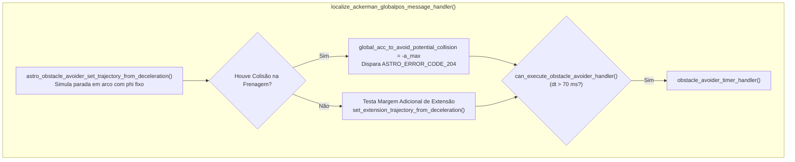

# Desaceleração Preventiva com Ângulo de Esterçamento Fixo (`phi` Fixo)

A função [`astro_obstacle_avoider_set_trajectory_from_deceleration()`](file:///home/lume/astro/src/obstacle_avoider/obstacle_avoider.cpp#L1308-L1401) constitui a **primeira linha de defesa preventiva** do Obstacle Avoider contra colisões catastróficas. 

Antes mesmo que o módulo avalie o plano de trajetória do planejador ou verifique a fila de comandos de movimento, esta função simula continuamente uma pergunta física crucial:
> *"Se o veículo acionar a frenagem máxima neste exato milissegundo, mantendo a direção atual do volante, ele conseguirá parar completamente antes de atingir qualquer obstáculo?"*

Se a resposta for **NÃO** (ou seja, se a trajetória de frenagem cruzar qualquer obstáculo no mapa), o módulo calcula imediatamente a aceleração de emergência necessária (`global_acc_to_avoid_potential_collision`) para mitigar ou evitar o impacto.

---

## 1. Posição no Fluxo de Execução

Ao contrário do consumo temporal da fila (que ocorre dentro do ciclo do timer de decisão), a desaceleração preventiva é disparada no handler de alta frequência da localização:



### Por que executar no Handler do `localize`?
1. **Sensibilidade Imediata:** A odometria e o GPS publicam poses a $50\text{ Hz} \dots 100\text{ Hz}$ ($10\text{ ms} \dots 20\text{ ms}$). Se o caminhão acelerar em direção a um obstáculo repentino, a colisão em potencial é detectada na primeira amostra de posição, sem esperar a janela de $70\text{ ms}$ do rate limiter do timer.
2. **Atualização do Estado de Alerta:** A variável global `global_acc_to_avoid_potential_collision` é mantida sempre atualizada. Quando o `obstacle_avoider_timer_handler()` é liberado para atuar, ele já encontra o diagnóstico de risco pronto para aplicação no debounce.

---

## 2. Fluxo de Funcionamento da `astro_obstacle_avoider_set_trajectory_from_deceleration()`

O objetivo central da [`astro_obstacle_avoider_set_trajectory_from_deceleration()`](file:///home/lume/astro/src/obstacle_avoider/obstacle_avoider.cpp#L1308-L1401) é **tentar parar o veículo mantendo seu ângulo de esterçamento ($\phi$) fixo** e verificar se essa trajetória até a parada completa é segura.

Para fazer isso, a função executa um loop iterativo (`while (fabs(current_velocity) > 0.0)`) que projeta o futuro passo a passo:

### Passo 1: Previsão da Pose Futura ("Passinho" de $0{,}1\text{ s}$)
A partir da pose atual vinda do `localize`, a função utiliza a [`astro_libcarmodel_recalc_pos_ackerman()`](file:///home/lume/astro/src/obstacle_avoider/obstacle_avoider.cpp#L1358) para calcular a coordenada espacial onde o veículo (cabine e carretas) estará daqui a **$0{,}1\text{ s}$** (`full_time_interval = 0.1`, integrado com `delta_t = 0.05` e velocidade de referência `0.5 m/s` apenas para gerar o deslocamento geométrico na curva com `odometry_phi` fixo):

```cpp
iterative_pose = astro_libcarmodel_recalc_pos_ackerman(
    &iterative_pose, vel_sign * 0.5, odometry_phi, 
    full_time_interval, &distance_traveled, delta_t, 
    &astro_robot_ackerman_config, &astro_semi_trailer_config
);
```
> *Nota:* O objetivo dessa chamada não é testar a dinâmica de aceleração, mas simplesmente descobrir **o caminho geométrico (próximo ponto no espaço)** que o caminhão percorre ao avançar um "passinho" mantendo o volante travado em `odometry_phi`.

---

### Passo 2: Redução da Velocidade via Equação de Torricelli
Encontrado esse novo ponto no espaço, mede-se a distância real percorrida nesse passinho ($\Delta s$, dada por `DIST2D(iterative_pose, prev_pose)`) e utiliza-se a **Equação de Torricelli** ([`compute_final_velocity_using_torricelli()`](file:///home/lume/astro/src/obstacle_avoider/obstacle_avoider.cpp#L969)) para identificar qual será a velocidade real do veículo após andar esse deslocamento aplicando a **frenagem máxima**:

$$v^2 = v_0^2 + 2 \cdot a \cdot \Delta s$$

Onde:
* **$\Delta s$:** Distância percorrida entre a pose anterior e a nova pose calculada.
* **$a$:** Valor negativo da desaceleração máxima (`-maximum_deceleration_forward`, vindo dos parâmetros).
* **$v_0$:** Velocidade real do veículo no início daquele passo.

```cpp
current_velocity = vel_sign * compute_final_velocity_using_torricelli(
    current_velocity, 
    -astro_robot_ackerman_config.maximum_deceleration_forward, 
    DIST2D(iterative_pose, prev_pose)
);
```

---

### Passo 3: Verificação de Colisão e Critério de Parada do Loop
Obtida a posição futura exata e sua respectiva velocidade reduzida, chama-se [`check_collision_in_trajectory()`](file:///home/lume/astro/src/obstacle_avoider/obstacle_avoider.cpp#L1012) para verificar se há colisão naquele ponto contra:
1. O **mapa de distâncias / mapas especiais** (`obstacle_distance_map` / `maps_obstacle_avoider`).
2. O **mapa de ocupação** (`occupancy_map`).
3. Algum **objeto móvel** (`moving_objects`).

```cpp
while (fabs(current_velocity) > 0.0)
{
    // 1. Projeta a pose 0.1s à frente mantendo phi fixo
    // 2. Reduz a velocidade pelo deslocamento usando Torricelli com frenagem máxima
    // 3. Verifica se a nova pose colide nos mapas:
    returned_acc = check_collision_in_trajectory(
        iterative_pose, astro_robot_ackerman_config, occupancy_map, 
        astro_robot_ackerman_config.obstacle_avoider_obstacles_safe_distance, 
        vel_sign, total_distance_traveled, timestamp
    );

    if ((fabs(returned_acc) > EPSILON_OB) || (total_distance_traveled >= 50.0))
    {
        break;
    }
    ...
}
```

* **Se houver colisão:** A função `check_collision_in_trajectory()` devolve imediatamente a desaceleração máxima de frenagem (`-maximum_deceleration_forward` em marcha à frente, ou `maximum_deceleration_reverse` em ré). A previsão é **finalizada na hora (`break`)** — sem precisar continuar calculando até a velocidade zerar — e esse valor de frenagem máxima é retornado para a variável de controle `global_acc_to_avoid_potential_collision` no `localize_ackerman_globalpos_message_handler()`.
* **Se não houver colisão:** O fluxo continua repetindo o processo passo a passo enquanto a velocidade não chegar a zero (`fabs(current_velocity) > 0.0`) ou até atingir o limite de segurança de $50\text{ m}$ projetados (`total_distance_traveled >= 50.0`). Caso pare totalmente sem bater em nada, retorna `0.0` (trajetória de parada livre).

---

## 3. Diagrama de Sequência e Fluxo Interno

```mermaid
sequenceDiagram
    autonumber
    participant LOC as localize_ackerman
    participant OA_MAIN as Handler do Localize (Main)
    participant FUNC as set_trajectory_from_deceleration
    participant TORR as Torricelli & CarModel
    participant COL as check_collision_in_trajectory

    LOC->>OA_MAIN: Publica Pose, v_odometria e phi
    OA_MAIN->>FUNC: Inicia simulação preventiva
    
    loop Enquanto v &gt; 0.0 m/s (Até Parar)
        FUNC->>TORR: Avança pose em arco (phi fixo) e reduz v via Torricelli
        TORR-->>FUNC: Nova pose e velocidade decrescente
        FUNC->>COL: Checa polígonos da cabine + carretas contra o mapa
        alt Colisão Detectada!
            COL-->>FUNC: Colidiu! Retorna acc = -a_max
            FUNC->>OA_MAIN: Retorna acc negativa (Dispara ASTRO_ERROR_CODE_204)
        else Livre
            COL-->>FUNC: Desobstruído
        end
    end
    
    Note over FUNC,OA_MAIN: Se atingiu v = 0.0 sem colidir: PARADA SEGURA GARANTIDA!
    FUNC-->>OA_MAIN: Retorna acc = 0.00 m/s^2 (Sem perigo imediato)
```
