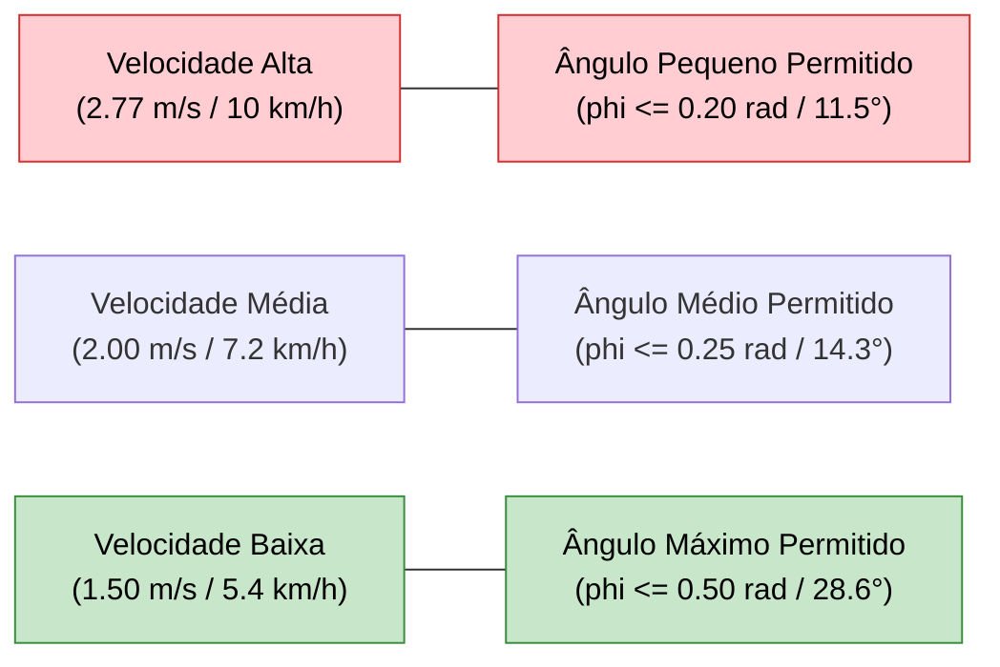
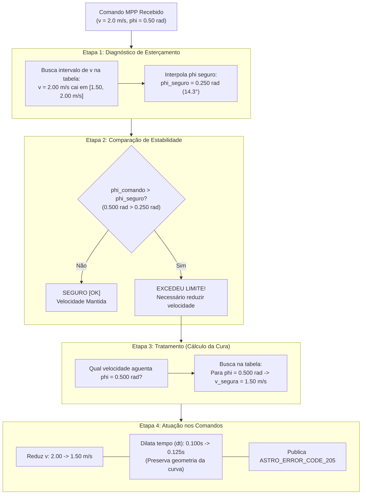

# Guia Didático: Limitação de Velocidade por Esterçamento ($\phi$)

Este documento explica de forma prática e passo a passo como o **Obstacle Avoider (OA)** protege o veículo contra instabilidade dinâmica e tombamento (*rollover*) ao contornar curvas, utilizando a tabela de calibração do parâmetro `obstacle_avoider_v_and_max_phi_reference_points`.

---

## 1. O Problema Físico e a Regra de Ouro

Ao entrar em uma curva, a aceleração lateral exercida sobre a cabine e os reboques cresce com o quadrado da velocidade e com a curvatura ($a_c \approx \frac{v^2}{R} = v^2 \cdot \frac{|\tan(\phi)|}{L}$).

> [!IMPORTANT]
> **A Regra de Ouro do Obstacle Avoider:**  
> O `obstacle_avoider` **NUNCA altera o ângulo de esterçamento ($\phi$)** de um comando planejado pelo MPP.  
> Se o OA alterasse $\phi$, as rodas dianteiras abririam ou fechariam o traçado, fazendo o caminhão **sair da pista autorizada ou colidir com proteções laterais**.  
> Portanto, o OA **respeita rigorosamente a geometria da curva** e atua **exclusivamente no acelerador e no freio**, reduzindo a velocidade linear ($v$) para um teto onde o esterçamento exigido seja 100% seguro.

---

## 2. A Tabela de Calibração ($v \times \phi$)

A tabela de calibração é carregada do arquivo `.ini` (ou linha de comando) através do parâmetro `obstacle_avoider_v_and_max_phi_reference_points`.

A função de leitura [`get_v_and_max_phi_reference_points()`](file:///home/lume/astro/src/obstacle_avoider/obstacle_avoider.cpp#L744) é flexível e aceita **dois formatos** para especificar o ângulo $\phi$:

1. **Porcentagem com `%`:** O valor é calculado como uma porcentagem do esterçamento máximo da cabine (`astro_robot_ackerman_config->max_phi`):
   $$\phi = \frac{\text{porcentagem}}{100} \cdot \phi_{\text{max\_veículo}}$$
   *Exemplo:* se o `max_phi` do caminhão for $0{,}500\text{ rad}$ ($28{,}6^\circ$), então `100%` $\to 0{,}500\text{ rad}$ e `50%` $\to 0{,}250\text{ rad}$.
2. **Valor Direto em Radianos (sem `%`):** O valor numérico é interpretado diretamente em radianos.
   *Exemplo:* `0.20` $\to 0{,}200\text{ rad}$ ($11{,}5^\circ$).

### Formato de Entrada no `.ini` / Linha de Comando:
```ini
# Formato 1: Usando porcentagens relativas ao max_phi do veículo (ex: no seu teste)
obstacle_avoider_v_and_max_phi_reference_points  3 1.5 100% 2.0 50% 2.77 0.20

# Formato 2: Usando valores absolutos diretos em radianos
obstacle_avoider_v_and_max_phi_reference_points  3 1.5 0.50 2.0 0.25 2.77 0.20
```

> [!NOTE]
> **Internamente na memória e nos logs:**  
> Independentemente de ter sido informado como `100%` ou `0.50`, a função converte e armazena o valor **sempre em radianos** dentro da struct `v_phi_reference_point_t`.  
> Por isso, nos cálculos matemáticos, nas mensagens de erro (`ASTRO_ERROR_CODE_205`) e nos prints do terminal, o valor exibido já aparece como **radianos** e **graus** (ex: `0.500 rad (28.6°)`).

* **Quantidade de pontos no exemplo:** `3`
* **Pontos de envelope resultantes:**
  * **Nível 0:** Até $1{,}50\text{ m/s}$ ($5{,}4\text{ km/h}$) $\to \phi_{\max} = 100\% = 0{,}500\text{ rad}$ ($28{,}6^\circ$) *(Manobra em curva fechada)*
  * **Nível 1:** Até $2{,}00\text{ m/s}$ ($7{,}2\text{ km/h}$) $\to \phi_{\max} = 50\% = 0{,}250\text{ rad}$ ($14{,}3^\circ$) *(Curva intermediária)*
  * **Nível 2:** Até $2{,}77\text{ m/s}$ ($10{,}0\text{ km/h}$) $\to \phi_{\max} = 0{,}200\text{ rad}$ ($11{,}5^\circ$) *(Velocidade de cruzeiro em reta)*



A relação é **inversamente proporcional**: quanto mais rápido o caminhão anda, menor é o ângulo com que ele pode curvar com segurança.

---

## 3. O Fluxo de Decisão em 4 Etapas

Para cada comando de movimento vindo do MPP, o OA executa quatro passos bem definidos:



---

## 4. Análise Didática dos Casos Reais de Teste

Abaixo analisamos exatamente os logs capturados durante a execução com o binário de teste [`src/obstacle_avoider/obstacle_avoider_test.cpp`](file:///home/lume/astro/src/obstacle_avoider/obstacle_avoider_test.cpp).

---

### Caso 1: Plano Inseguro ($v = 2{,}00\text{ m/s}$ e $\phi = 0{,}500\text{ rad}$)

O planejador envia uma intenção de andar a $7{,}2\text{ km/h}$ esterçando o volante a quase $29^\circ$.

```text
========================================================================================
[OA PHI LIMIT] Avaliando Plano com 50 comandos contra tabela de referencia (3 niveis)
========================================================================================

--- Detalhes do Comando [0/50] | v_original: 2.00 m/s | phi_original: 0.500 rad (28.6°) ---

  [Etapa 1] Procurando intervalo de velocidade para v = 2.00 m/s (7.2 km/h):
    - Avaliando intervalo de v: [1.50 m/s, 2.00 m/s] -> [ENCONTRADO]
      -> phi maximo para essa velocidade eh de: 0.250 rad (14.3°)

  [Etapa 2] Comparando phi atual com limite seguro:
    -> EXCEDEU LIMITE! (phi 0.500 rad > phi_seguro de 0.250 rad). Necessario limitar velocidade!

  [Etapa 3] Calculando velocidade maxima permitida para conseguir fazer a curva de phi = 0.500 rad (28.6°):
    -> phi_Atual (0.500 rad) >= phi_max configurado (0.500 rad).
    -> Retornando v_minima segura da referencia: 1.50 m/s (5.4 km/h)

  [Etapa 4] Atuacao do Obstacle Avoider:
    -> Velocidade do plano: 2.00 -> 1.50 m/s (7.2 -> 5.4 km/h)
    -> Tempo do comando compensado: 0.100 s -> 0.125 s

>>> [OA Phi Limit] 50/50 comandos limitados por exceder phi de referencia <<<

ASTRO_ERROR_CODE_205 - Ângulo de articulação (phi) excedeu o limite seguro para a velocidade atual. 
Velocidade linear do veículo limitada para garantir a estabilidade do robô e dos reboques.
```

#### O que o log nos ensina:
1. **Etapa 1:** A $2{,}00\text{ m/s}$, o ângulo limite é de $0{,}250\text{ rad}$ ($14{,}3^\circ$).
2. **Etapa 2:** O comando pede $0{,}500\text{ rad}$. Como $0{,}500 > 0{,}250$, o limite de estabilidade foi violado.
3. **Etapa 3:** Como o caminhão **não pode mudar o traçado da curva**, o OA calcula qual a velocidade que suporta essa curva fechada de $0{,}500\text{ rad}$. A resposta é $1{,}50\text{ m/s}$.
4. **Etapa 4:** O OA freia o caminhão para $1{,}50\text{ m/s}$ e dilata o tempo do comando de $0{,}100\text{ s}$ para $0{,}125\text{ s}$ ($dt_{\text{novo}} = dt_{\text{velho}} \cdot \left[2 - \frac{v_{\text{novo}}}{v_{\text{velho}}}\right]$). Com isso, o comprimento percorrido permanece $\Delta S = v \cdot \Delta t \approx 0{,}187\text{ m}$, contornando a curva exatamente no traçado pretendido.
5. **Telemetria:** O sistema emite o alarme **`ASTRO_ERROR_CODE_205`** notificando os módulos de monitoramento e auditoria.

---

### Caso 2: Plano no Limite Seguro ($v = 1{,}50\text{ m/s}$ e $\phi = 0{,}500\text{ rad}$)

No ciclo seguinte, o plano em execução já opera na velocidade reduzida:

```text
========================================================================================
[OA PHI LIMIT] Avaliando Plano com 46 comandos contra tabela de referencia (3 niveis)
========================================================================================

--- Detalhes do Comando [0/46] | v_original: 1.50 m/s | phi_original: 0.500 rad (28.6°) ---

  [Etapa 1] Procurando intervalo de velocidade para v = 1.50 m/s (5.4 km/h):
    - Avaliando intervalo de v: [1.50 m/s, 2.00 m/s] -> [ENCONTRADO]
      -> phi maximo para essa velocidade eh de: 0.500 rad (28.6°)

  [Etapa 2] Comparando phi atual com limite seguro:
    -> SEGURO [OK] (phi 0.500 rad <= max_phi 0.500 rad). Velocidade original mantida.
```

#### O que o log nos ensina:
* Para $v = 1{,}50\text{ m/s}$, a tabela permite até $\phi = 0{,}500\text{ rad}$.
* Como $\phi_{\text{atual}} \le \phi_{\max}$, a condição é declarada como **`SEGURO [OK]`**.
* A velocidade é mantida e nenhum alarme é disparado.

---

### Caso 3: Manobra em Baixa Velocidade ($v = 0{,}81\text{ m/s}$ e $\phi = 0{,}500\text{ rad}$)

O caminhão está quase parado ou manobrando abaixo do menor piso de velocidade configurado ($0{,}81 < 1{,}50\text{ m/s}$):

```text
========================================================================================
[OA PHI LIMIT] Avaliando Plano com 47 comandos contra tabela de referencia (3 niveis)
========================================================================================

--- Detalhes do Comando [0/47] | v_original: 0.81 m/s | phi_original: 0.500 rad (28.6°) ---

  [Etapa 1] Procurando intervalo de velocidade para v = 0.81 m/s (2.9 km/h):
    - Avaliando intervalo de v: [1.50 m/s, 2.00 m/s] -> (fora)
    - Avaliando intervalo de v: [2.00 m/s, 2.77 m/s] -> (fora)
    -> v_current (0.81 m/s) < v_min configurado (1.50 m/s). Retorna phi_maximo: 0.500 rad (28.6°)

  [Etapa 2] Comparando phi atual com limite seguro:
    -> SEGURO [OK] (phi 0.000 rad <= max_phi 0.500 rad). Velocidade original mantida.
```

#### O que o log nos ensina:
* O algoritmo varre todos os intervalos de velocidade e percebe que a velocidade está abaixo do mínimo da tabela.
* **Comportamento seguro:** Em velocidades muito baixas, não há risco de capotamento por aceleração centrípeta. Portanto, o OA libera o **esterçamento máximo** ($0{,}500\text{ rad} = 28{,}6^\circ$) para permitir manobras fechadas de pátio ou ré.

---

## 5. Como Executar e Reproduzir o Teste

Para rodar esse teste em ambiente de desenvolvimento local com o IPC ativo:

### Terminal 1: Iniciar o Obstacle Avoider com a tabela ativa
```bash
cd ~/astro/bin
./obstacle_avoider \
  -obstacle_avoider_use_hold_velocity_to_reference_phi on \
  -obstacle_avoider_v_and_max_phi_reference_points "3 1.5 0.5 2.0 0.25 2.77 0.20"
```

### Terminal 2: Injetar a trajetória de teste
```bash
cd ~/astro/bin
./obstacle_avoider_test
```

No Terminal 1, você verá o fluxo em 4 etapas detalhando a intervenção no primeiro comando que viola o limite e mantendo o resumo consolidado dos 50 comandos atenuados.

