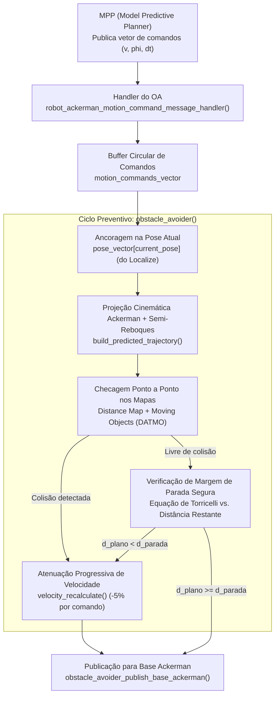

# 02 - Planejamento Preventivo e Validação de Trajetória (`obstacle_avoider`)

O módulo **Obstacle Avoider (OA)** atua como uma camada crítica de supervisão e segurança ativa entre o planejador de trajetória de alto nível (**MPP - Model Predictive Planner**) e a camada de controle e atuação do veículo (**Base Ackerman**).

Enquanto o mecanismo de emergência (*Potential Collision*) realiza simulações hipotéticas com esterçamento fixo para contingências extremas, a função [`obstacle_avoider()`](file:///home/lume/astro/src/obstacle_avoider/obstacle_avoider.cpp#L1510) é responsável pelo **Planejamento Preventivo**: ela projeta no espaço cartesiano global a trajetória real planejada pelo MPP, valida ponto a ponto a ausência de colisões contra o mapa de distâncias e objetos móveis, monitora a margem física de parada do veículo pela equação de Torricelli e remodela ativamente as velocidades do plano quando necessário.

---

## 1. Visão Geral e Papel no Pipeline

O MPP calcula trajetórias otimizadas e envia periodicamente vetores de comandos de movimento compostos apenas por grandezas de controle local:
- Velocidade linear ($v$) em $\text{m/s}$.
- Ângulo de esterçamento das rodas dianteiras ($\phi$) em radianos.
- Tempo de execução de cada comando ($dt$) em segundos.

> [!IMPORTANT]
> **O MPP não envia as coordenadas cartesianas globais $(X, Y, \theta)$ do plano**.  
> O plano do MPP é relativo ao tempo de execução. Cabe ao [`obstacle_avoider()`](file:///home/lume/astro/src/obstacle_avoider/obstacle_avoider.cpp#L1510) ancorar esses comandos na pose estimada atual do veículo (fornecida pelo `localize`) e integrar o modelo cinemático para frente, obtendo a posição exata de cada parte do veículo (cabine e semi-reboques) em cada instante futuro.



---

## 2. Projeção Cinemática da Trajetória (`build_predicted_trajectory`)

Antes de verificar se o veículo irá colidir, o OA precisa conhecer a envoltória geométrica completa ocupada pelo caminhão ao longo de todo o plano. Essa conversão é realizada pela função [`build_predicted_trajectory()`](file:///home/lume/astro/src/obstacle_avoider/obstacle_avoider.cpp#L1471):

```cpp
static int
build_predicted_trajectory(astro_robot_and_trailers_motion_command_t *motion_commands_vector, 
                           int *num_motion_commands,
                           astro_robot_and_trailers_traj_point_t initial_pose, 
                           astro_robot_ackerman_config_t *astro_robot_ackerman_config, 
                           astro_semi_trailers_config_t *astro_semi_trailer_config)
```

### Funcionamento Matemático da Integração:
1. **Pose Inicial ($P_0$):** O ponto de partida é a pose estimada do veículo no instante atual:
   $$\mathbf{P}_0 = \begin{bmatrix} X_{\text{odom}} & Y_{\text{odom}} & \theta_{\text{cabine}} & \theta_{\text{trailer}}[0 \dots N] \end{bmatrix}^T$$
2. **Integração Passo a Passo:** Para cada comando $i \in [0, N-1]$ contendo $(v_i, \phi_i, dt_i)$:
   A função [`astro_libcarmodel_recalc_pos_ackerman()`](file:///home/lume/astro/sharedlib/libcarmodel/ackerman_model.c) calcula o deslocamento infinitesimal considerando:
   - A distância entre eixos da cabine ($L$).
   - O comprimento dos engates e a cinemática de arraste angular de cada semi-reboque acoplado.
   $$\mathbf{P}_{i+1} = f_{\text{Ackerman}}(\mathbf{P}_i, v_i, \phi_i, dt_i)$$
3. **Preenchimento Global:** Os campos globais `x`, `y`, `theta` e `trailer_theta[z]` do vetor `motion_commands_vector[i]` e da matriz `trajectory_vector_of_points` são atualizados com as coordenadas calculadas.

> [!NOTE]
> Essa projeção permite ao sistema saber onde **cada círculo de colisão (marker)** da cabine e de cada semi-reboque estará no mundo $1\text{ s}$, $2\text{ s}$ ou $5\text{ s}$ no futuro.

---

## 3. Checagem de Colisão no Plano Projetado

Com todos os pontos cartesianos do plano previstos, o algoritmo varre ponto a ponto a trajetória futura contra duas fontes independentes de percepção:

```cpp
for (int i = 0; i < *num_motion_commands; i++)
{
    astro_collision_detection_collision_result result = 
        astro_collision_detection_compute_maps_collision(maps_obstacle_avoider, trajectory_vector_of_points[i]);

    if (result.has_collision)
    {
        velocity_recalculate(motion_commands_vector, *num_motion_commands);
        hit_obstacle = 1;
        set_new_motion_command_needs_to_be_published(1);
        ...
        EXEC_COOLDOWN(astro_global_publish_astro_error_message_custom_string(ASTRO_ERROR_CODE_203, custom_string), 0.5);
        break;
    }
}
```

1. **Obstacle Distance Map (Grade Estática):**  
   Verifica a distância euclidiana mínima dos markers do caminhão até as células de obstáculo estático registradas no mapa de grade (`distance_map`). Se a distância for menor que a distância segura (`obstacle_avoider_obstacles_safe_distance`), acusa colisão.
2. **Moving Objects (DATMO - Objetos Dinâmicos):**  
   Verifica a nuvem de pontos de pedestres, veículos e outros alvos rastreados via LiDAR e sensores secundários (radares ARS-408 e câmeras neurais).

Se for detectada uma colisão no ponto $i$ da trajetória:
- O loop de varredura é imediatamente interrompido (`break`).
- A rotina de atenuação [`velocity_recalculate()`](file:///home/lume/astro/src/obstacle_avoider/obstacle_avoider.cpp#L1435) é acionada sobre os comandos do plano.
- É emitido o erro **`ASTRO_ERROR_CODE_203`** (com texto indicando se a colisão foi em *Occupancy Map* ou *Moving Objects*).

---

## 4. Garantia Física de Parada e Ausência do MPP (Torricelli)

Um dos pilares de segurança mais elegantes do `obstacle_avoider` é a **garantia física de parada**, que protege o veículo mesmo na ausência de obstáculos estáticos caso o planejador do MPP pare de enviar planos.

### 4.1. Dedução da Distância de Parada Necessária ($d_{\text{parada}}$)
Pela equação de Torricelli para desaceleração linear máxima constante $a_{\text{max}}$:
$$v_f^2 = v_0^2 - 2 \cdot a_{\max} \cdot \Delta S$$

Para a condição de repouso ($v_f = 0$):
$$\Delta S_{\text{parada}} = \frac{v_0^2}{2 \cdot a_{\max}}$$

No código:
```cpp
double distance_necessary_to_stop = pow(current_odometry_velocity, 2) / 
                                   (2.0 * astro_robot_ackerman_config->maximum_deceleration_forward);
```
Onde $a_{\max}$ (`maximum_deceleration_forward`) é um parâmetro de configuração do robô lido diretamente do arquivo `.ini` do veículo.

### 4.2. Distância Restante no Plano Atual ($D_{\text{plano}}$)
O OA calcula o comprimento geométrico 2D restante acumulado ao longo da sequência de pontos autorizados pelo MPP:
$$D_{\text{plano}} = \sum_{i=0}^{N-2} \sqrt{(X_{i+1} - X_i)^2 + (Y_{i+1} - Y_i)^2}$$

```cpp
distance_remaining_in_current_plan += DIST2D(trajectory_vector_of_points[i], trajectory_vector_of_points[i + 1]);
```

### 4.3. O Ponto Crítico e o Tratamento da Morte do MPP
Em regime nominal, o MPP publica novos planos a cada $\approx 100\text{ ms}$ com horizonte de $\approx 18\text{ m}$ a $25\text{ m}$, mantendo $D_{\text{plano}} \gg \Delta S_{\text{parada}}$.

Porém, se o processo do MPP falhar, travar ou for morto no `proccontrol`:
1. **Nenhum plano novo chega**: O OA retém o último plano no buffer.
2. **Consumo contínuo do plano**: O timer handler do OA (a cada $\approx 25\text{ ms}$) executa [`consume_motion_command_time()`](file:///home/lume/astro/src/obstacle_avoider/obstacle_avoider_main.cpp#L421), descartando do início do buffer os comandos que já foram executados no tempo.
3. **Encolhimento do buffer**: O número de comandos e a distância restante do plano encolhem progressivamente:
   $$140 \to 116 \to 98 \to 60 \to 25\text{ comandos}$$
4. **Disparo da Frenagem Forçada**: No instante em que a distância física de frenagem supera o comprimento restante do plano:
   $$D_{\text{plano}} < \Delta S_{\text{parada}}$$
   O bloco de segurança em [`obstacle_avoider.cpp`](file:///home/lume/astro/src/obstacle_avoider/obstacle_avoider.cpp#L1706-L1724) atua imediatamente:

```cpp
if (recalculate_velocity_when_braking_distance_exceeds_plan == 1)
{
    if (distance_remaining_in_current_plan < distance_necessary_to_stop)
    {
        velocity_recalculate(motion_commands_vector, *num_motion_commands);
        hit_obstacle = 1;

        if (get_new_motion_command_needs_to_be_published() == 0)
        {
            set_new_motion_command_needs_to_be_published(1);
        }

        static char custom_string[1000] = "";
        sprintf(custom_string, "Stop dist %.2fm > plano %.2fm; vel %.2fm/s; dec: %.2fm/s^2", 
                distance_necessary_to_stop, distance_remaining_in_current_plan,
                current_odometry_velocity, astro_robot_ackerman_config->maximum_deceleration_forward);
        EXEC_COOLDOWN(astro_global_publish_astro_error_message_custom_string(ASTRO_ERROR_CODE_203, custom_string), 0.5);
        ASTRO_ERROR_METADATA("ASTRO_ERROR_CODE_203", "Espaço restante no plano atual é insuficiente para a frenagem segura do veículo até a posição do goal. Executado recálculo de velocidade e comando de desaceleração");
    }
}
```

> [!WARNING]
> **Garantia de Não Ultrapassagem:**  
> Sem esse mecanismo de segurança, o caminhão continuaria andando em velocidade nominal e "cairia de um penhasco" ou invadiria áreas não autorizadas ao final do último comando. Com o Torricelli preventivo, o OA garante que a desaceleração comece com folga milimétrica suficiente para que a velocidade seja exatamente **$0\text{ km/h}$** antes do fim da trajetória conhecida.

---

## 5. Algoritmo de Atenuação de Velocidade (`velocity_recalculate`)

Quando o OA decide que o plano precisa ser freado (seja por detecção de obstáculo ou por esgotamento de margem de frenagem), a função [`velocity_recalculate()`](file:///home/lume/astro/src/obstacle_avoider/obstacle_avoider.cpp#L1435) é executada:

```cpp
void
velocity_recalculate(astro_robot_and_trailers_motion_command_t *motion_commands_vector, int num_motion_commands)
{
	int i;
	double reduction_factor = 0.95;

	for (i = 0; i < num_motion_commands; i++)
	{
		if (i != 0)
		{
			reduction_factor *= 0.95;
		}

		motion_commands_vector[i].v *= reduction_factor;
		motion_commands_vector[i].time *= 1.0 / reduction_factor;

		if (fabs(motion_commands_vector[i].v) < 0.05)
		{
			motion_commands_vector[i].time = 1.0;
			motion_commands_vector[i].v = 0.0;
			break;
		}
	}

	for (; i < num_motion_commands; i++)
	{
		motion_commands_vector[i].time = 1.0;
		motion_commands_vector[i].v = 0.0;
	}
}
```

### Propriedades do Algoritmo:

1. **Decaimento Exponencial de 5% por Comando:**  
   Para cada comando $i$, a velocidade é multiplicada pelo fator:
   $$f_i = (0{,}95)^{i+1}$$
   - $v_0 = v_0^{\text{orig}} \cdot 0{,}95$
   - $v_1 = v_1^{\text{orig}} \cdot (0{,}95)^2$
   - $v_2 = v_2^{\text{orig}} \cdot (0{,}95)^3$
   Isso produz uma rampa de desaceleração suave e contínua, sem degraus bruscos que possam induzir efeito canivete (*jackknifing*) na cabine e nos semi-reboques.

2. **Invariância Geométrica da Trajetória ($\Delta S = \text{constante}$):**  
   Ao mesmo tempo em que a velocidade é multiplicada por $f$, a duração $dt$ é multiplicada por $\frac{1}{f}$:
   $$\Delta S_i = v_i \cdot dt_i = \left(v_{\text{orig}} \cdot f\right) \cdot \left(dt_{\text{orig}} \cdot \frac{1}{f}\right) = v_{\text{orig}} \cdot dt_{\text{orig}}$$
   **A distância física percorrida por cada segmento permanece rigorosamente idêntica**. O caminhão executará exatamente o mesmo traçado de pista planejado pelo MPP, apenas trafegando mais devagar.

3. **Corte e Parada Completa ($0\text{ m/s}$):**  
   Quando $v < 0{,}05\text{ m/s}$ ($5\text{ cm/s}$ ou $0{,}18\text{ km/h}$), o comando atual e **todos os comandos subsequentes até o fim do buffer** são forçados a $v = 0{,}0\text{ m/s}$ e $dt = 1{,}0\text{ s}$.

---

## 6. Loop de Convergência Iterativa (`do ... while(hit_obstacle)`)

O processo de validação em [`obstacle_avoider()`](file:///home/lume/astro/src/obstacle_avoider/obstacle_avoider.cpp#L1510) é encapsulado por um loop de convergência:

```cpp
int iter = 0;
do
{
    hit_obstacle = 0;
    *num_motion_commands = build_predicted_trajectory(...);
    ...
    // Checagem de colisões e Torricelli
    ...
    iter++;
} while (hit_obstacle && (fabs(motion_commands_vector[0].v) > 0.001) && (iter < 500));
```

### Mecânica de Convergência:
1. Se uma colisão for detectada no ponto $k$, o `velocity_recalculate()` reduz as velocidades do plano em 5% composto.
2. Na próxima iteração do loop, o `build_predicted_trajectory()` recalcula as poses projetadas com as novas velocidades.
3. Esse ciclo se repete até que:
   - A redução de velocidade encurte os alcances temporais e o plano deixe de colidir com o obstáculo (`hit_obstacle == 0`); OU
   - A velocidade caia para zero ($v_0 \le 0{,}001\text{ m/s}$), significando uma parada total de emergência antes do obstáculo.
4. Ao sair do loop com plano modificado, a flag `set_new_motion_command_needs_to_be_published(1)` é ativada para garantir que a mensagem de controle seja transmitida de imediato à base ackerman.

---

## 7. Evidências Experimentais e Logs de Telemetria

Os arquivos `/tmp/oa_braking_distance.log` e `/tmp/oa_predicted_plan.log` permitem auditar a atuação do módulo em tempo real.

### 7.1. Log de Consumo e Frenagem (`/tmp/oa_braking_distance.log`)
Abaixo, o registro real do teste de perda do MPP (processo `./mpp` finalizado):

```text
>>> NOVO PLANO DO MPP ENVIADO!!! 140 comandos <<<
[OA Frenagem - 140 comandos] Vel: 2.77 m/s (10.0 km/h) | Parada Nec.: 3.82 m | Restante Plano: 19.20 m | Margem: +15.38 m -> [OK - SEGURO]
[OA Frenagem - 118 comandos] Vel: 2.77 m/s (10.0 km/h) | Parada Nec.: 3.82 m | Restante Plano: 17.24 m | Margem: +13.41 m -> [OK - SEGURO]
[OA Frenagem -  87 comandos] Vel: 2.77 m/s (10.0 km/h) | Parada Nec.: 3.82 m | Restante Plano: 13.82 m | Margem:  +9.99 m -> [OK - SEGURO]
[OA Frenagem -  48 comandos] Vel: 2.77 m/s (10.0 km/h) | Parada Nec.: 3.82 m | Restante Plano:  7.85 m | Margem:  +4.03 m -> [OK - SEGURO]
[OA Frenagem -  27 comandos] Vel: 2.78 m/s (10.0 km/h) | Parada Nec.: 3.85 m | Restante Plano:  4.28 m | Margem:  +0.43 m -> [OK - SEGURO]
[OA Frenagem -  22 comandos] Vel: 2.75 m/s ( 9.9 km/h) | Parada Nec.: 3.78 m | Restante Plano:  3.68 m | Margem:  -0.10 m -> [INSUFICIENTE - FRENAGEM FORÇADA]
[OA Frenagem -  21 comandos] Vel: 2.53 m/s ( 9.1 km/h) | Parada Nec.: 3.20 m | Restante Plano:  1.91 m | Margem:  -1.29 m -> [INSUFICIENTE - FRENAGEM FORÇADA]
[OA Frenagem -  21 comandos] Vel: 1.84 m/s ( 6.6 km/h) | Parada Nec.: 1.69 m | Restante Plano:  0.78 m | Margem:  -0.91 m -> [INSUFICIENTE - FRENAGEM FORÇADA]
[OA Frenagem -  21 comandos] Vel: 0.89 m/s ( 3.2 km/h) | Parada Nec.: 0.40 m | Restante Plano:  0.02 m | Margem:  -0.38 m -> [INSUFICIENTE - FRENAGEM FORÇADA]
[OA Frenagem -  21 comandos] Vel: 0.26 m/s ( 0.9 km/h) | Parada Nec.: 0.03 m | Restante Plano:  0.04 m | Margem:  +0.00 m -> [OK - SEGURO]
[OA Frenagem -  21 comandos] Vel: -0.00 m/s (-0.0 km/h) | Parada Nec.: 0.00 m | Restante Plano:  0.08 m | Margem:  +0.08 m -> [OK - SEGURO]
```

### 7.2. Log do Momento da Detecção no SO (`/tmp/oa_predicted_plan.log`)
No instante em que a checagem nativa no `/proc` identifica a finalização do `./mpp`:

```text
===================================================================================
[SO: MPP MORREU! Processo ./mpp finalizado no Linux]
Capturando plano inicial restante no momento da morte (87 comandos) | Vel: 2.77 m/s (10.0 km/h)
Pose Inicial: (X=7486503.53, Y=-315921.41, theta=-172.3 deg)
  Cmd[00]: Global(X=7486503.48, Y=-315921.41, theta=-172.3 deg) | v=2.77 m/s | phi=0.000 rad | dt=0.03s
  Cmd[01]: Global(X=7486503.40, Y=-315921.42, theta=-172.3 deg) | v=2.77 m/s | phi=0.000 rad | dt=0.03s
  ...
  Cmd[86]: Global(X=7486490.12, Y=-315923.05, theta=-172.0 deg) | v=2.77 m/s | phi=0.001 rad | dt=0.03s
===================================================================================
```

---

## 8. Resumo das Regras de Negócio e Tratativas

| Condição Operacional | Ação do `obstacle_avoider()` | Código de Erro / Alerta |
| :--- | :--- | :--- |
| **Plano livre e $D_{\text{plano}} \ge \Delta S_{\text{parada}}$** | Repassa os comandos de velocidade e esterçamento intactos para a base ackerman. | *Nenhum erro (Operação Nominal)* |
| **Colisão prevista no caminho** | Executa `velocity_recalculate()`, reduzindo as velocidades em 5% por comando até cessar o risco ou zerar. | **`ASTRO_ERROR_CODE_203`** (Severidade 4) |
| **Ausência/Queda do MPP ($D_{\text{plano}} < \Delta S_{\text{parada}}$)** | Intercepta o buffer restante e força a frenagem programada via `velocity_recalculate()` antes de esgotar o trajeto. | **`ASTRO_ERROR_CODE_203`** (Severidade 4) |
| **Colisão física do veículo em movimento** | Detecta intersecção da pose atual do caminhão com obstáculo enquanto $v > 0{,}001\text{ m/s}$. | **`ASTRO_ERROR_CODE_201`** (Severidade 0 - Erro Fatal) |
| **Timeout de comunicação do sensor/comando** | Esgotamento do tempo limite configurado (`command_timeout`). | Comanda parada de emergência via `publish_base_ackerman_motion_command_message_to_stop_robot()`. |

