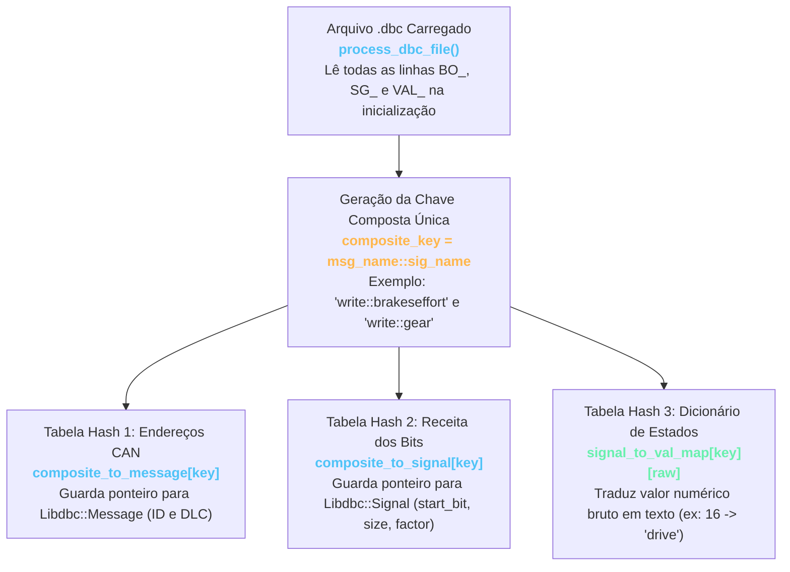
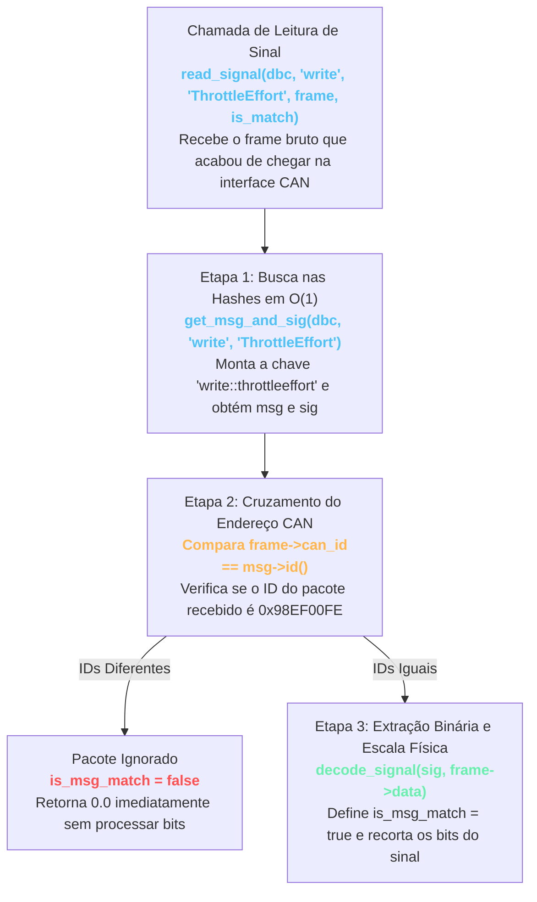

# Processamento do DBC, Tabelas Hash e Comandos `write` (`process_frame_from_dbc_mode`)

A função [`process_frame_from_dbc_mode()`](file:///home/lume/astro/src/simulator_ackerman/simulator_ackerman_can_main.cpp#L2848-L2956) é o núcleo de recepção do simulador quando executado com um arquivo `.dbc` (parâmetro `--dbc_path`). Ela é chamada continuamente pela thread [`update_state_thread()`](file:///home/lume/astro/src/simulator_ackerman/simulator_ackerman_can_main.cpp#L2992-L3007) para cada pacote capturado na rede CAN.

---

## 1. Por que o Simulador lê da mensagem chamada `"write"`?

Nos arquivos `.dbc` do projeto (como o [`ojAstro_fullDBC.dbc`](file:///home/lume/astro/src/astro_hal/dbc_file_example/ojAstro_fullDBC.dbc)), os nomes das mensagens foram definidos a partir da **perspectiva do controlador de direção (`vehicle_driver`)**:

* **`write`**: Mensagens de comando que o `vehicle_driver` **escreve** na CAN para atuar no veículo (acelerador, freio, volante, marcha).
* **`read`**: Mensagens de sensores/telemetria que o `vehicle_driver` **lê** da CAN (velocidade das rodas, ângulo do volante, RPM, marcha engatada).

> [!IMPORTANT]
> **Perspectiva Invertida no Simulador:**  
> Como o `simulator_ackerman_can` faz o papel do **veículo físico**, ele opera no sentido oposto ao `vehicle_driver`:
> 1. Para **receber os comandos** que o robô enviou, o simulador faz `read_signal()` na mensagem batizada de **`"write"`**.
> 2. Para **devolver a telemetria** simulada, o simulador empacota e transmite a mensagem batizada de **`"read"`**.

---

## 2. Anatomia do Pacote de Controle (`0x98EF00FE write`)

No arquivo [`ojAstro_fullDBC.dbc`](file:///home/lume/astro/src/astro_hal/dbc_file_example/ojAstro_fullDBC.dbc#L10-L20), o pacote de controle principal possui **CAN ID `0x98EF00FE`** e tamanho de **8 bytes (64 bits)**:

```dbc
BO_ 0x98EF00FE write: 8 DRIVER
 SG_ThrottleEffort : 16|16@1+ (0.1,0) [0|100] "" DRIVER
 SG_ BrakesEffort : 0|16@1+ (0.1,0) [0|100] "" DRIVER
 SG_ SignalsByte : 48|8@1+ (1,0) [0|100] "" DRIVER
 SG_ SteeringEffort : 32|16@1- (0.1,0) [-100|100] "" DRIVER

BO_ 0x98EF00FE write: 8 DRIVER
 SG_ Gear : 56|8@1+ (1,0) [0|255] "" DRIVER
VAL_ 0x98EF00FE Gear 16 "drive" 32 "reverse" 8 "neutral" ;
```

### Disposição dos 8 Bytes no Barramento:
Quando um frame com ID `0x98EF00FE` chega na rede, todos os 5 sinais dividem o mesmo vetor `frame.data[8]`:

```text
Payload de 8 Bytes (64 bits):
+---------------+---------------+---------------+---------------+---------------+---------------+---------------+---------------+
|    Byte 0     |    Byte 1     |    Byte 2     |    Byte 3     |    Byte 4     |    Byte 5     |    Byte 6     |    Byte 7     |
| (Bits 0 a 7)  | (Bits 8 a 15) | (Bits 16 a 23)| (Bits 24 a 31)| (Bits 32 a 39)| (Bits 40 a 47)| (Bits 48 a 55)| (Bits 56 a 63)|
+---------------+---------------+---------------+---------------+---------------+---------------+---------------+---------------+
|<------- BrakesEffort -------->|<------ ThrottleEffort ------->|<------ SteeringEffort ------->|  SignalsByte  |     Gear      |
|           (16 bits)           |           (16 bits)           |           (16 bits)           |   (8 bits)    |   (8 bits)    |
+-------------------------------+-------------------------------+-------------------------------+---------------+---------------+
```

* **Bytes 0 e 1 (`0|16@1+`)**: `BrakesEffort` — Esforço de frenagem (0 a 100%, sem sinal).
* **Bytes 2 e 3 (`16|16@1+`)**: `ThrottleEffort` — Esforço de aceleração (0 a 100%, sem sinal).
* **Bytes 4 e 5 (`32|16@1-`)**: `SteeringEffort` — Esforço de esterçamento do volante (-100 a +100%, **com sinal**).
* **Byte 6 (`48|8@1+`)**: `SignalsByte` — Flags de sinalização rápida (setas, faróis, buzina, retarder).
* **Byte 7 (`56|8@1+`)**: `Gear` — Comando de troca de marcha (`8` = neutral, `16` = drive, `32` = reverse).

---

## 3. Como o HAL Armazena o DBC em Tabelas Hash

Durante a inicialização, a função [`process_dbc_file()`](file:///home/lume/astro/include/astro/astro_hal_can_interactions.hpp#L95-L150) carrega o arquivo `.dbc` na estrutura [`astro_hal_can_interactions_t`](file:///home/lume/astro/include/astro/astro_hal_can_interactions.hpp#L47-L62). Para permitir buscas instantâneas em $O(1)$ e evitar colisões entre sinais de mesmo nome (como `Gear` no `write` e `Gear` no `read`), o HAL cria uma **Chave Composta** em letras minúsculas:

$$\text{composite\_key} = \text{to\_lowercase}(\text{msg\_name}) + \text{"::"} + \text{to\_lowercase}(\text{sig\_name})$$



### 3.1. Hash de Mensagens (`composite_to_message`)
Associa cada sinal ao pacote CAN (endereço ID e tamanho DLC) onde ele reside:

| Chave (`std::string`) | Valor (`const Libdbc::Message*`) | Dados Internos da Mensagem |
| :--- | :--- | :--- |
| `"write::brakeseffort"` | `&Message_0x98EF00FE` | `id() = 0x98EF00FE`, `size() = 8` |
| `"write::throttleeffort"` | `&Message_0x98EF00FE` | `id() = 0x98EF00FE`, `size() = 8` |
| `"write::steeringeffort"` | `&Message_0x98EF00FE` | `id() = 0x98EF00FE`, `size() = 8` |
| `"write::gear"` | `&Message_0x98EF00FE` | `id() = 0x98EF00FE`, `size() = 8` |
| `"read::gear"` | `&Message_0x8000022D` | `id() = 0x8000022D`, `size() = 8` |
| `"read::rpm"` | `&Message_0x8000022D` | `id() = 0x8000022D`, `size() = 8` |

### 3.2. Hash de Sinais (`composite_to_signal`) e a `struct Signal`
A mesma chave composta aponta para uma instância de [`Libdbc::Signal`](file:///home/lume/astro/include/astro/astro_dbc_parser.hpp#L13-L32), que armazena cada parâmetro da linha `SG_` do DBC.

Tomando como exemplo a linha:
```dbc
SG_ BrakesEffort : 0|16@1+ (0.1,0) [0|100] "" DRIVER
```

O objeto apontado por `composite_to_signal["write::brakeseffort"]` guarda na memória:

| Campo da `struct Signal` | Valor Armazenado | Trecho do DBC | Significado Físico |
| :--- | :--- | :--- | :--- |
| **`name`** | `"BrakesEffort"` | `SG_ BrakesEffort` | Nome identificador do sinal. |
| **`is_multiplexed`** | `false` | *(sem `M`)* | Sinal padrão (não multiplexado). |
| **`start_bit`** | `0` | `0\|16` | Posição do bit inicial no payload de 64 bits. |
| **`size`** | `16` | `0\|16` | Quantidade de bits ocupados (16 bits = 2 bytes). |
| **`is_bigendian`** | `false` | `@1` | `@1` = Little-Endian (Intel). `@0` = Big-Endian (Motorola). |
| **`is_signed`** | `false` | `+` | `+` = Sem sinal (`unsigned`). `-` = Com sinal (`signed`). |
| **`factor`** | `0.1` | `(0.1,0)` | Fator multiplicador de conversão física. |
| **`offset`** | `0.0` | `(0.1,0)` | Deslocamento linear da conversão física. |
| **`min` / `max`** | `0.0` / `100.0` | `[0\|100]` | Limites mínimo e máximo do sinal físico. |
| **`unit`** | `""` | `""` | Unidade de medida (ex: `"%"`, `"rpm"`). |
| **`receivers`** | `{"DRIVER"}` | `DRIVER` | Nó destinatário registrado no DBC. |
| **`value_descriptions`** | *(vazio)* | *(sem `VAL_`)* | Lista de estados textuais (preenchida quando há `VAL_`). |

### 3.3. Hashes de Estados Discretos (`signal_to_val_map` e `state_to_val_map`)
Para sinais que possuem linhas `VAL_` (como o `Gear`), o HAL preenche dois mapas bidirecionais:

```cpp
// Leitura (Número Bruto -> Texto em minúsculas):
signal_to_val_map["write::gear"][8]  = "neutral";
signal_to_val_map["write::gear"][16] = "drive";
signal_to_val_map["write::gear"][32] = "reverse";

// Escrita (Texto em minúsculas -> Número Bruto):
state_to_val_map["write::gear"]["neutral"] = 8;
state_to_val_map["write::gear"]["drive"]   = 16;
state_to_val_map["write::gear"]["reverse"] = 32;
```

---

## 4. Como `read_signal()` Cruza o Frame com o DBC

Quando um frame chega na CAN, [`read_signal()`](file:///home/lume/astro/include/astro/astro_hal_can_interactions.hpp#L402-L430) executa o cruzamento entre o pacote bruto e as hashes do DBC em 3 etapas:



### O Recorte de Bits em `decode_signal()`:
Dentro de [`decode_signal()`](file:///home/lume/astro/include/astro/astro_hal_can_interactions.hpp#L348-L399), os 8 bytes do frame são copiados para um inteiro de 64 bits (`payload`) e fatiados com deslocamento de bits (*Shift & Mask*):

```cpp
uint64_t payload = 0;
__builtin_memcpy(&payload, data, sizeof(uint64_t));

// 1. Empurra os bits até o start_bit ficar na posição zero
uint64_t shifted = (payload >> sig->start_bit);

// 2. Cria máscara do tamanho exato do sinal (ex: 16 bits -> 0xFFFF)
uint64_t mask = (sig->size >= 64) ? ~0ULL : ((1ULL << sig->size) - 1);
uint64_t raw = (shifted & mask);

// 3. Converte para o valor físico real aplicando factor e offset
return ((double) raw * sig->factor + sig->offset);
```

---

## 5. Máquina de Estados da Marcha (`Gear`)

A primeira verificação dentro de [`process_frame_from_dbc_mode()`](file:///home/lume/astro/src/simulator_ackerman/simulator_ackerman_can_main.cpp#L2850-L2883) atualiza a marcha do caminhão simulado:

```cpp
bool is_gear_match = false;
astro_hal_can_interactions::read_signal(dbc_can_process, "write", "Gear", &frame, is_gear_match);
if (is_gear_match)
{
    std::string estado = astro_hal_can_interactions::read_can_signal_state(dbc_can_process, "write", "Gear", &frame);

    int target_gear_id = -99;

    if (estado == "neutral")            target_gear_id = 0;
    else if (estado == "reverse")       target_gear_id = -1;
    else if (estado == "drive")         target_gear_id = astro_fmax(1, current_gear_gear_map_id);
    else if (estado == "down")          target_gear_id = astro_fmax(0, current_gear_gear_map_id - 2);
    else if (estado == "down accurate") target_gear_id = astro_fmax(0, current_gear_gear_map_id - 1);
    else if (estado == "up")            target_gear_id = astro_fmin(gear_map.size() - 1, current_gear_gear_map_id + 2);
    else if (estado == "up accurate")   target_gear_id = astro_fmin(gear_map.size() - 1, current_gear_gear_map_id + 1);

    if (target_gear_id != -99)
    {
        auto translated_gear = gear_map.find(target_gear_id);
        if (translated_gear != gear_map.end()) {
            current_gear = translated_gear->second->mercedes_code;
            current_gear_gear_map_id = target_gear_id;
            driver_outputs.current_gear = current_gear_gear_map_id;
        }
    }
}
```

### Simulação de Casos Práticos com `ojAstro_fullDBC.dbc`:

| Cenário | Pacote Recebido na CAN | Decodificação (`signal_to_val_map`) | Decisão (`target_gear_id`) | Efeito na Transmissão (`gear_map`) |
| :--- | :--- | :--- | :--- | :--- |
| **A. Engatar Ré** | `can_id = 0x98EF00FE`<br/>`data[7] = 32` | `is_gear_match = true`<br/>`estado = "reverse"` | `target_gear_id = -1` | `current_gear = 0x38` (`REVERSE_GEAR_1`)<br/>`driver_outputs.current_gear = -1` |
| **B. Engatar Drive** *(saindo do Neutro)* | `can_id = 0x98EF00FE`<br/>`data[7] = 16` | `is_gear_match = true`<br/>`estado = "drive"` | `astro_fmax(1, 0)` $\to$ `1` | `current_gear = 0x44` (`GEAR_1`)<br/>`driver_outputs.current_gear = 1` |
| **C. Engatar Neutro** | `can_id = 0x98EF00FE`<br/>`data[7] = 8` | `is_gear_match = true`<br/>`estado = "neutral"` | `target_gear_id = 0` | `current_gear = 0x3C` (`NEUTRAL_GEAR`)<br/>`driver_outputs.current_gear = 0` |
| **D. Outro Pacote** *(ex: Velocidade)* | `can_id = 0x201` | `is_gear_match = false` | Ignorado | Mantém a marcha atual inalterada. |

> [!NOTE]
> **Compatibilidade Multi-Veículo:**  
> Os estados `"up"`, `"down"`, `"up accurate"` e `"down accurate"` atendem veículos com câmbio sequencial automatizado de 12 marchas (como em [`Mart.dbc`](file:///home/lume/astro/src/astro_hal/dbc_file_example/Mart.dbc#L14)), permitindo que o mesmo código C++ opere tanto câmbios automáticos simples (`drive`/`reverse`/`neutral`) quanto caixas sequenciais.

---

## 6. Cálculo da Física e Persistência com `static`

Na segunda metade de [`process_frame_from_dbc_mode()`](file:///home/lume/astro/src/simulator_ackerman/simulator_ackerman_can_main.cpp#L2885-L2956), o simulador extrai os 3 esforços (`ThrottleEffort`, `BrakesEffort`, `SteeringEffort`), calcula a nova velocidade $v$ e ângulo $\phi$, e chama [`set_target_v_and_target_phi(v, phi)`](file:///home/lume/astro/src/simulator_ackerman/simulator_ackerman_can_main.cpp#L2472-L2485):

```cpp
void set_target_v_and_target_phi(double v, double phi)
{
    static astro_robot_and_trailers_motion_command_t current_motion_command_vector = {};

    current_motion_command_vector.v = v;
    current_motion_command_vector.phi = phi;
    current_motion_command_vector.time = 1.0;

    simulator_config->current_motion_command_vector = &current_motion_command_vector;
    simulator_config->nun_motion_commands = 1;
    simulator_config->current_motion_command_vector_index = 0;
    simulator_config->time_of_last_command = astro_get_time();
}
```

### Por que `current_motion_command_vector` não é destruída ao sair da função?

1. **Qualificador `static`:**  
   Diferente de variáveis locais comuns (que são alocadas na *Stack* e destruídas no `}` final da função), uma variável local declarada com **`static`** é alocada no **segmento de dados permanentes do programa (BSS / Data Segment)**.
2. **Tempo de vida global:**  
   Ela é criada quando o processo inicia e permanece no mesmo endereço físico de memória até o programa encerrar. A cada novo frame CAN, a função apenas sobrescreve os campos `.v` e `.phi` nesse endereço fixo.
3. **Consumo pela Thread de Simulação:**  
   No ciclo periódico de 20 ms, a função [`astro_simulator_ackerman_recalc_pos()`](file:///home/lume/astro/src/simulator_ackerman/simulator_ackerman_simulation.c#L265-L269) lê o ponteiro `simulator_config->current_motion_command_vector`, copia os alvos para `target_v` e `target_phi` e movimenta o veículo no mapa.
