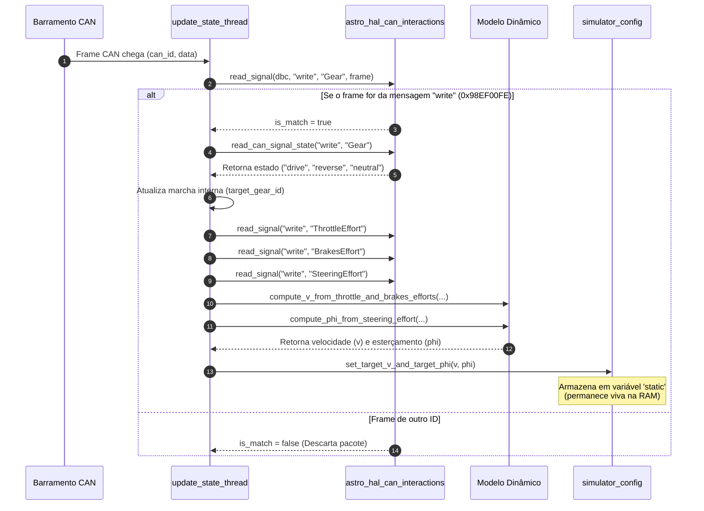
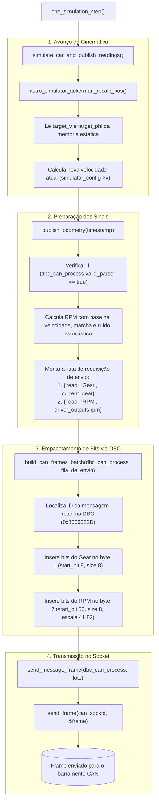

# Fluxo de Comunicação e Simulação: Simulator Ackerman CAN

Este documento detalha o funcionamento interno do simulador CAN ([`simulator_ackerman_can_main.cpp`](simulator_ackerman_can_main.cpp)), abordando a **divisão concorrente entre Escuta e Envio** e os fluxos completos de **leitura de comandos** e **escrita de telemetria na rede CAN** via DBC.

---

## 1. Arquitetura Geral: Divisão entre Escuta e Envio

O simulador emula uma ECU automotiva real utilizando **duas frentes concorrentes desacopladas**:

1. **Thread de Escuta (Event-driven):** Fica bloqueada aguardando frames chegarem do barramento CAN. Assim que um pacote chega, interpreta os comandos do veículo autônomo e atualiza os alvos físicos.
2. **Thread de Simulação e Envio (Time-driven):** Roda em um ciclo fixo de clock (ex: 50Hz / 20ms). Calcula o deslocamento do veículo no mundo virtual e transmite a telemetria do carro de volta para o barramento CAN.

```mermaid
flowchart TD
    subgraph RedecCAN["Barramento Físico / Virtual CAN"]
        CAN_BUS[(Barramento CAN)]
    end

    subgraph Thread1["1. Thread de Escuta (update_state_thread)"]
        A["recv_frame()"] <-- "Escuta Frames" --- CAN_BUS
        A --> B["update_state_from_can()"]
        B --> C["process_frame_from_dbc_mode()"]
        C --> D["Lê Gear e Esforços (Throttle, Brakes, Steering)"]
        D --> E["Calcula dinâmica (v, phi)"]
        E --> F["set_target_v_and_target_phi()<br/>(Guarda na struct static)"]
    end

    subgraph SharedMem["Memória Compartilhada do Simulador"]
        F --> G["simulator_config->current_motion_command_vector"]
    end

    subgraph Thread2["2. Thread de Simulação e Envio (one_simulation_step)"]
        H["Timer Periódico (real_time: 20ms)"] --> I["simulate_car_and_publish_readings()"]
        G -.-> J["astro_simulator_ackerman_recalc_pos()<br/>(Atualiza odometria com base no target)"]
        I --> J
        J --> K["publish_odometry()"]
        K --> L["Calcula RPM e Marcha atual"]
        L --> M["build_can_frames_batch(Gear, RPM)"]
        M --> N["send_message_frame()"]
    end

    N -- "Transmite Telemetria" ---> CAN_BUS
```

---

## 2. Fluxo da Escuta (Leitura de Comandos da CAN)

A escuta roda continuamente na função [`update_state_thread()`](simulator_ackerman_can_main.cpp):



### Por que a memória não é perdida ao final da leitura?
Em [`set_target_v_and_target_phi()`](simulator_ackerman_can_main.cpp):
```cpp
void set_target_v_and_target_phi(double v, double phi)
{
    static astro_robot_and_trailers_motion_command_t current_motion_command_vector = {};

    current_motion_command_vector.v = v;
    current_motion_command_vector.phi = phi;
    current_motion_command_vector.time = 1.0;

    simulator_config->current_motion_command_vector = &current_motion_command_vector;
    ...
}
```
A variável possui o qualificador **`static`**. Ela não reside na pilha temporária de funções (Stack), mas sim na seção de dados permanentes do processo. O endereço `&current_motion_command_vector` permanece válido por todo o ciclo de vida do simulador.

---

## 3. Fluxo de Escrita (Envio de Telemetria de Volta para a CAN)

O envio é cíclico e controlado pelo loop de eventos IPC em [`one_simulation_step()`](simulator_ackerman_can_main.cpp), disparado pela frequência da simulação:



### Detalhes do Empacotamento em Lote (`build_can_frames_batch`)
No trecho de escrita em [`publish_odometry()`](simulator_ackerman_can_main.cpp):
```cpp
std::vector<astro_hal_can_interactions::SignalWriteRequest> fila_de_envio = {
    {"read", "Gear", current_gear},
    {"read", "RPM", driver_outputs.rpm}
};

auto frames_prontos = astro_hal_can_interactions::build_can_frames_batch(dbc_can_process, fila_de_envio);

for (auto& lote : frames_prontos) 
{
    astro_hal_can_interactions::send_message_frame(
        dbc_can_process,
        lote.anchor_msg_name,
        lote.anchor_sig_name,
        &lote.frame
    );
}
```

* **Agrupamento inteligente:** O HAL verifica a qual mensagem do DBC cada sinal pertence. Como tanto `Gear` quanto `RPM` pertencem à mensagem `read` (ID `0x8000022D`), o HAL empacota ambos no **mesmo frame de 8 bytes**.
* **Transmissão final:** `send_message_frame()` identifica o socket da interface registrada e transmite o frame montado diretamente para a rede CAN.
