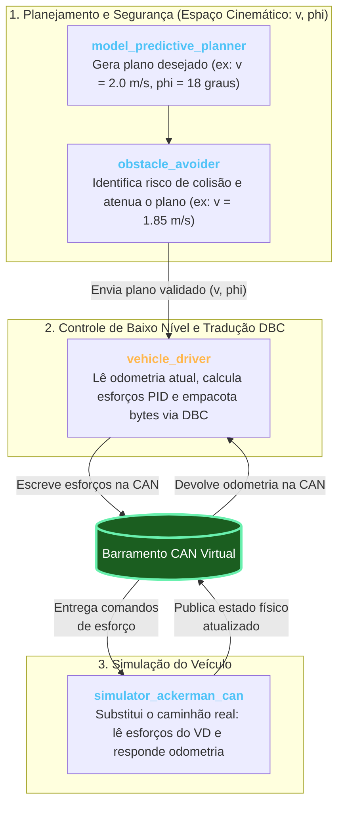
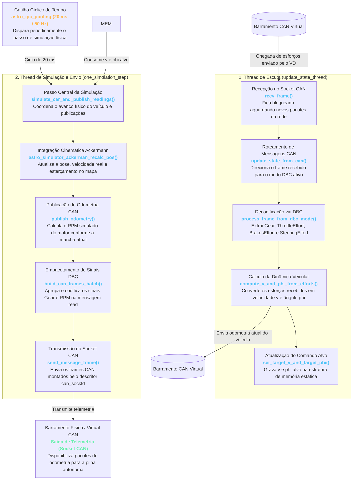

# Arquitetura e Fluxo Geral do Simulator Ackerman CAN

## 1. O Papel do Simulator CAN na Pilha Autônoma (Divisão de Responsabilidades)

Para compreender onde o `simulator_ackerman_can` atua, é fundamental localizar as responsabilidades de cada módulo desde o planejamento de trajetória até o barramento CAN:



1. **Planejamento e Segurança ([`MPP`](file:///home/lume/astro/src/mpp/) $\to$ [`Obstacle Avoider`](file:///home/lume/astro/src/obstacle_avoider/)):**  
   Os módulos de alto nível operam em variáveis cinemáticas $(v, \phi)$. Por exemplo, o **MPP** envia um plano desejado de $v = 2{,}0\text{ m/s}$ e $\phi = 18^\circ$; o **OA** identifica uma potencial colisão à frente e altera o plano para $v = 1{,}85\text{ m/s}$ (desacelerando), enviando esse comando para o controle de baixo nível.
2. **Tradução em Esforços e Comunicação CAN ([`Vehicle Driver - VD`](file:///home/lume/astro/src/vehicle_driver/)):**  
   O **VD** é o módulo que se comunica diretamente com o barramento CAN. Quando recebe o plano desejado do OA, ele simultaneamente lê do barramento CAN os valores de odometria atuais do veículo e calcula os **esforços de atuação** (pedal de acelerador, freio, torque de volante e marcha) necessários para atingir aquele plano. Para transmitir esses comandos na rede CAN, o VD consulta o arquivo `.dbc` para saber exatamente como empacotar cada informação nos 8 bytes do frame (ex: primeiros 2 bytes para o freio, próximos 2 bytes para aceleração, etc.).
3. **O Papel do [`Simulator Ackerman CAN`](file:///home/lume/astro/src/simulator_ackerman/simulator_ackerman_can_main.cpp):**  
   Em ambiente de simulação, **não temos o caminhão físico nem o barramento real do veículo**. É aqui que entra o `simulator_ackerman_can`: ele assume o papel de **"simular o comportamento físico do veículo"** na outra ponta do barramento CAN virtual (`vcan0`). Ele faz exatamente o que o caminhão real faria:
   * **Lê da CAN** os comandos de esforço e marcha que vieram do `vehicle_driver` (usando o `.dbc` para desempacotar os bytes);
   * **Simula a física** resultante (inércia, aceleração, esterçamento e rotação do motor);
   * **Envia de volta para a CAN** as suas informações de odometria atualizadas para que o `vehicle_driver` possa lê-las no próximo ciclo.

---

## 2. Inicialização e as Duas Frentes do Módulo

No [`main()`](file:///home/lume/astro/src/simulator_ackerman/simulator_ackerman_can_main.cpp#L3010-L3077) do `simulator_ackerman_can`, o módulo inicializa a interface CAN, faz o parse do arquivo de definições de rede (DBC), cria uma thread dedicada para escuta de mensagens do barramento e inicia o loop de simulação física do veículo:

```cpp
// Em simulator_ackerman_can_main.cpp:
can_sockfd = init_can(argv[1]);
read_parameters(argc, argv, &simulator_conf);

if (dbc_path != NULL)
{
    astro_hal_can_interactions::process_dbc_file(dbc_can_process, dbc_path, argv[1]);
    astro_hal_can_interactions::register_socket_to_interface(dbc_can_process, argv[1], can_sockfd);
}

// Cria a thread concorrente de escuta da CAN
pthread_create(&can_thread, NULL, update_state_thread, NULL);

// Inicia o loop periódico de simulação e envio de telemetria
astro_ipc_pooling(one_simulation_step, shutdown_module);
```


```cpp
void *
update_state_thread(void *arg __attribute__ ((unused)))
{
	struct can_frame frame;

	while (1)
	{
		if (can_sockfd != -1)
		{
			recv_frame(can_sockfd, &frame);
			update_state_from_can(frame);
		}
	}

	return (NULL);
}
```

Diferente de módulos puramente orientados a eventos de IPC, o simulador opera desacoplado em **duas frentes concorrentes**: a **escuta contínua de comandos** e a **simulação periódica com envio de telemetria**.

| Frente | Ponto de Entrada | Modelo de Execução | Papel no Módulo |
| :--- | :--- | :--- | :--- |
| **Escuta da CAN ** | [`update_state_thread()`](file:///home/lume/astro/src/simulator_ackerman/simulator_ackerman_can_main.cpp#L2992-L3007) | **Orientado a Eventos (`while(1)`)** | Aguarda pacotes/frames da CAN. Quando esses pacotes chegam (enviado pelo VD organizados de acordo com o "write" do .dbc), extrai aceleração, freio, esterçamento e marcha, computando a dinâmica veicular. |
| **Envia na CAN ** | [`one_simulation_step()`](file:///home/lume/astro/src/simulator_ackerman/simulator_ackerman_can_main.cpp#L1782-L1793) | **Orientado a Tempo (Timer Periódico)** | Disparado ciclicamente na frequência da simulação (ex: a cada 20 ms / 50 Hz). Atualiza a odometria do carro virtual e transmite frames de volta para a rede CAN (mensagem `"read"` no DBC: RPM e marcha). |

---

## 3. Diagrama Macro Integrado de Fluxo

O diagrama abaixo ilustra o fluxo completo desde a chegada de comandos pela CAN até a atualização física e o posterior envio periódico de telemetria:



---

## 4. Detalhamento dos Componentes Principais

### A. Inicialização e Parsing do DBC
No início do programa, a função [`astro_hal_can_interactions::process_dbc_file()`](file:///home/lume/astro/include/astro/astro_hal_can_interactions.hpp#L95-L150) lê o arquivo DBC passado por `--dbc_path` e constrói as tabelas hash na memória RAM:
* **`composite_to_message`**: Mapeia chaves compostas (ex: `"write::gear"`) para o ID CAN correspondente (`0x98EF00FE`).
* **`composite_to_signal`**: Mapeia chaves compostas para as propriedades físicas de decodificação (`start_bit`, `size`, `factor`, `offset`).
* **`signal_to_val_map`**: Tabela de estados discretos (`VAL_`), traduzindo códigos brutos em strings legíveis (`"neutral"`, `"drive"`, `"reverse"`).

### B. Recepção e Decodificação de Comandos
A thread [`update_state_thread()`](file:///home/lume/astro/src/simulator_ackerman/simulator_ackerman_can_main.cpp#L2992-L3007) processa cada frame que chega:
1. Compara o ID do frame com o ID da mensagem de atuadores registrada como `"write"` no DBC.
2. Extrai o estado textual da marcha via [`read_can_signal_state()`](file:///home/lume/astro/include/astro/astro_hal_can_interactions.hpp#L295-L341) e atualiza o estado interno da transmissão (`target_gear_id` e `gear_map`).
3. Extrai os esforços percentuais de aceleração, freio e esterçamento.
4. Calcula a nova velocidade desejada ($v$) e ângulo desejado ($\phi$).
5. Chama [`set_target_v_and_target_phi()`](file:///home/lume/astro/src/simulator_ackerman/simulator_ackerman_can_main.cpp#L2472-L2485), gravando os dados em uma variável declarada com **`static`**, garantindo que o comando persista válido na memória RAM para o consumo da outra thread.

### C. Simulação Cinemática e Transmissão Cíclica
No loop [`one_simulation_step()`](file:///home/lume/astro/src/simulator_ackerman/simulator_ackerman_can_main.cpp#L1782-L1793):
1. [`astro_simulator_ackerman_recalc_pos()`](file:///home/lume/astro/src/simulator_ackerman/simulator_ackerman.cpp) lê os comandos alvo da memória estática e integra o modelo cinemático Ackermann para atualizar a velocidade real `v` e o ângulo real `phi`.
2. [`publish_odometry()`](file:///home/lume/astro/src/simulator_ackerman/simulator_ackerman_can_main.cpp#L683-L795) calcula a rotação do motor (`RPM`) em função da velocidade atual e da relação de marcha.
3. As informações de telemetria são agrupadas no vetor de envio com a mensagem `"read"` do DBC.
4. O HAL executa [`build_can_frames_batch()`](file:///home/lume/astro/include/astro/astro_hal_can_interactions.hpp#L579-L627), inserindo os sinais de telemetria dentro do payload de 8 bytes e enviando para o socket com [`send_message_frame()`](file:///home/lume/astro/include/astro/astro_hal_can_interactions.hpp#L510-L548).

---

## 5. Estruturas de Memória Compartilhadas

Para permitir a comunicação entre a thread de escuta e a thread de simulação sem corrupção de dados:

* **`simulator_config`**: Ponteiro global para a configuração e estado dinâmico do simulador (`astro_simulator_ackerman_config_t`).
* **`current_motion_command_vector` (estático)**: Estrutura local com tempo de vida global (`static`), cujo ponteiro é atribuído a `simulator_config->current_motion_command_vector`.
* **`driver_outputs`**: Armazena o estado atual das saídas do motorista simulado (ex: `driver_outputs.current_gear` e `driver_outputs.rpm`).

---

## 6. Índice de Documentação Específica

Para o detalhamento aprofundado de cada funcionalidade:

1. **[`01_arquitetura_e_fluxo_geral.md`](01_arquitetura_e_fluxo_geral.md)**: Visão macro da arquitetura bi-thread, inicialização e fluxo integrado.
2. **[`02_processamento_dbc_e_comandos_write.md`](02_processamento_dbc_e_comandos_write.md)**: Detalhamento das tabelas Hash do DBC, fatiamento do pacote `write` (`0x98EF00FE`), cruzamento em `read_signal()`, máquina de estados da marcha (`Gear`) e persistência com `static`.
3. **[`03_escrita_e_envio_odometria_can.md`](03_escrita_e_envio_odometria_can.md)**: Detalhamento da via de envio, cálculo do RPM físico do motor, empacotamento em lote de sinais via DBC (`build_can_frames_batch`) e transmissão periódica no barramento CAN via SocketCAN.
