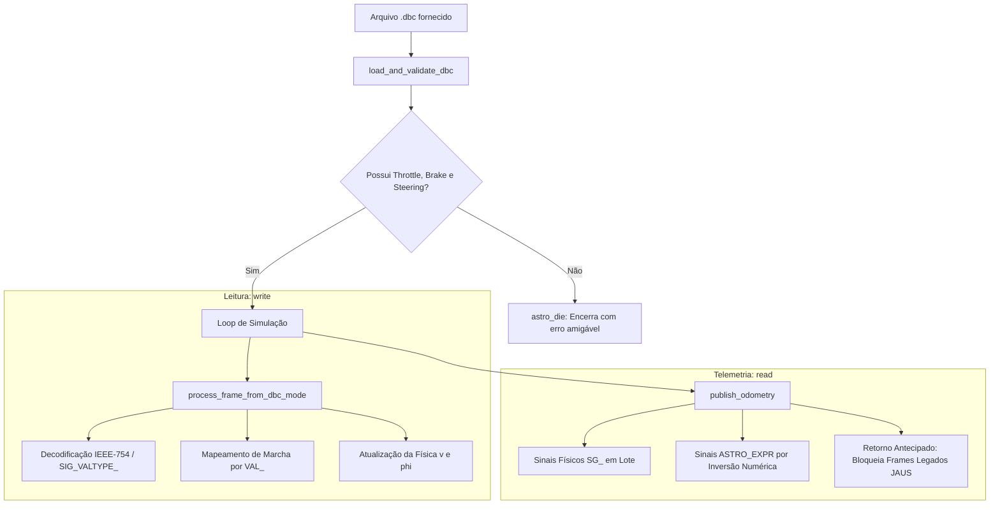

# 05 — Resumo Executivo: Simulador CAN 100% Data-Driven via DBC

Este documento resume de forma sucinta as alterações implementadas em [`simulator_ackerman_can_main.cpp`](file:///home/lume/astro/src/simulator_ackerman/simulator_ackerman_can_main.cpp) para eliminar qualquer código hardcoded (por veículo ou por nome de arquivo) e tornar o simulador totalmente genérico e guiado pelo arquivo `.dbc`.

---

## 1. Visão Geral das Alterações

Ao carregar um `.dbc` (`--dbc <caminho.dbc>`), o simulador opera em modo exclusivo **Data-Driven**:

---

## 2. Pontos-Chave Implementados

### 1. Desvinculação Total do Modo Legado (`switch (vehicle_id)`)
* **Antes**: `publish_odometry` e `send_can_frame_v_lume` executavam em paralelo com checagens de strings manuais (`if (name == "oj403")`, `"ojAstro"`), injetando pacotes redundantes do protocolo legado.
* **Agora**: Se o parser DBC for válido (`valid_parser == true`), as rotinas de velocidade e esterçamento abortam imediatamente (`return`), delegando 100% da telemetria para o empacotamento dinâmico do DBC. O `switch (vehicle_id)` permanece ativo exclusivamente como fallback quando **nenhum** `.dbc` é fornecido.

### 2. Marcha Dinâmica (`read::Gear`) sem Códigos Mificados
* **Antes**: O simulador enviava `0x44` (`68`, 1ª marcha do Actros) fixo na rede, causando erro `110` (`Gear read by DBC and unknown!`) em outros veículos (ex: Atego onde 1ª marcha é `62`).
* **Agora** ([`get_dbc_read_gear_value()`](file:///home/lume/astro/src/simulator_ackerman/simulator_ackerman_can_main.cpp#L365-L401)): Mapeia o estado físico (`driver_outputs.current_gear`) para o rótulo canônico (`"gear_1"`, `"reverse_1"`, `"neutral"`) e consulta dinamicamente a tabela `state_to_val_map["read::gear"]` do `.dbc` carregado.

### 3. Suporte a Ponto Flutuante IEEE-754 (`SIG_VALTYPE_ : 1`)
* **Antes**: Mensagens de esforço como `0x2E` (`SteeringEffort`) do `oj403.dbc` e `Arrow.dbc` tinham seus 32 bits lidos como inteiros, explodindo o esterçamento para valores absurdos (`Steer: -6601130%`).
* **Agora** ([`read_signal()`](file:///home/lume/astro/src/utilities/astrohpp/astro_hal_can_interactions.hpp#L745-L756)): Identifica sinais `SIG_VALTYPE_ : 1` de 32 bits e realiza o desempacotamento binário direto para `float` IEEE-754 via `__builtin_memcpy`.

### 4. Correção do Loop de Realimentação Positiva na Direção (`SteeringAngle`)
* **Antes**: `phi_to_dbc_steering_angle()` continha `-phi` e `atan(L * tan(-phi))`, invertendo o sinal do ângulo e amplificando-o em $4{,}76\times$. Isso causava travamento do volante no batente (`-0.622 rad`) e travava o planejador no erro `ASTRO_ERROR_CODE_302` (`phi_stabilization`).
* **Agora** ([`phi_to_dbc_steering_angle()`](file:///home/lume/astro/src/simulator_ackerman/simulator_ackerman_can_main.cpp#L509-L521)): Retorna diretamente `phi / robot_phi_multiplier`, mantendo o sinal correto e casando com a inversa exata executada pelo `vehicle_driver`.

### 5. Escrita Genérica de Expressões Matemáticas (`ASTRO_EXPR`)
* **Como funciona** ([`dbc_build_derived_frame()`](file:///home/lume/astro/src/simulator_ackerman/simulator_ackerman_can_main.cpp#L451-L486)):
  1. Para expressões como `VelocityEncoder = (* 0.857 (* 0.0017 (mean WheelSpeed1 WheelSpeed2)))` ou `SteeringAngle = (/ SteerRaw 507000.0)`, o simulador aplica uma regra de três avaliando a função em $f(0)$ e $f(1)$.
  2. Calcula o valor bruto dos sinais físicos necessários:
     $$x = \frac{\text{target} - f(0)}{f(1) - f(0)}$$
  3. Preenche os bytes reais do frame e valida com uma prova real antes do envio.
  4. Mantém um cache estático $O(1)$ para garantir alta performance no ciclo de tempo real.

### 6. Tolerância a Sinais Ausentes
* Se um determinado `.dbc` não definir certos sinais opcionais (por exemplo, [`Arrow.dbc`](file:///home/lume/astro/src/astro_hal/dbc_file_example/Arrow.dbc) não possui `RPM` nem `VelocityEncoder`), o simulador detecta com `dbc_has_read_signal()` e **não polui a rede com mensagens desnecessárias**.

---

## 3. Matriz de Compatibilidade Testada

| Arquivo `.dbc` | Velocidade (`Velocity` / `VelocityEncoder`) | Direção (`SteeringAngle`) | Esforços (`write`) | Marcha (`read::Gear`) | Status |
| :--- | :--- | :--- | :--- | :--- | :---: |
| **`ojAstro_fullDBC.dbc`** (Atego) | Sinais Físicos `SG_` em lote | Fallback seguro (expressão multi-byte) | Inteiros com fator | `VAL_` dinâmico (`62 = gear_1`) | ✅ 100% OK |
| **`oj403.dbc`** (Actros) | Derivado `ASTRO_EXPR` (inversão `WheelSpeed1/2`) | Derivado `ASTRO_EXPR` (inversão `SteerRaw`) | `SIG_VALTYPE_ : 1` (Float32) | `VAL_` dinâmico (`68 = gear_1`) | ✅ 100% OK |
| **`Arrow.dbc`** (Arrow) | Sinal Físico `0x8CFF3A57` | Derivado `ASTRO_EXPR` (inversão `SteeringRaw`) | `SIG_VALTYPE_ : 1` (Float32) | `VAL_` dinâmico (`49 = gear_1`) | ✅ 100% OK |

---

## 4. Conclusão

Com essas alterações, **qualquer veículo novo** configurado no Astro necessita apenas de seu respectivo arquivo `.dbc` e dos parâmetros físicos usuais do veículo. O simulador se adapta automaticamente aos IDs, formatos de bytes, tipos de dados e expressões declaradas.
