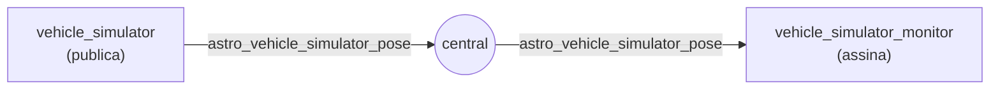
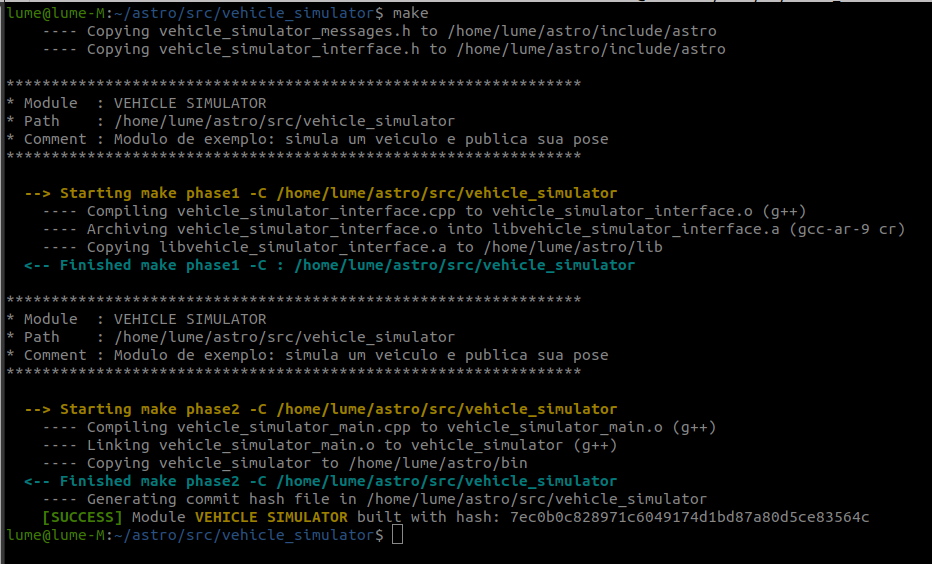
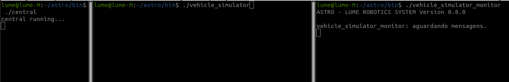
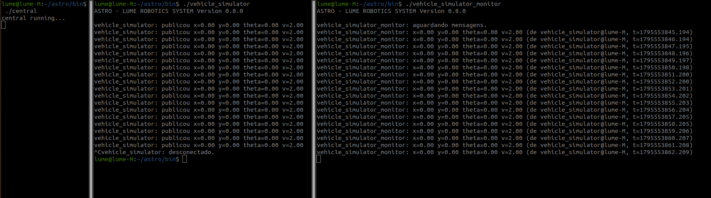

# 3. Assinando a mensagem: o segundo módulo

No capítulo anterior o `vehicle_simulator` passou a publicar a pose do veículo, mas ninguém a recebia. Agora vamos criar um **segundo módulo**, o `vehicle_simulator_monitor`, que **assina** essa mensagem e imprime o que chega.

Esse é o desenho típico do ASTRO: um módulo produz um dado, outro o consome, e nenhum conhece o outro. Só compartilham o nome e o formato da mensagem.



O trabalho deste capítulo tem três etapas:

1. **Preparar a interface para ser usada por outro módulo**: acrescentar a função de assinar e publicá-la.
2. **Criar o módulo monitor**, com um *handler*: a função que o IPC chama a cada mensagem recebida.
3. **Executar os dois** e ver os dados passando de um módulo para o outro.

## 3.1 Como um módulo oferece código a outro

O monitor ficará em uma **pasta diferente** da do `vehicle_simulator`. Isso cria um problema: o código da interface (o header e o `.cpp`) está na pasta do `vehicle_simulator`, e o monitor não enxerga arquivos de outra pasta.

O ASTRO resolve isso do mesmo jeito para todos os módulos: quem **oferece** código o **publica** em dois lugares comuns, e quem **usa** o pega de lá.

| O que se publica | Onde fica | Como o `Makefile` do dono publica | Como quem usa o enxerga |
|---|---|---|---|
| Os **headers** (declarações) | `$ASTRO_HOME/include/astro/` | `PUBLIC_INCLUDES` | `#include <astro/nome.h>` |
| O **código compilado**, em uma **biblioteca** (`.a`) | `$ASTRO_HOME/lib/` | `PUBLIC_LIBRARIES` | `-lnome` no `LFLAGS` |

Você já usa esse mecanismo desde o capítulo 1, sem ter prestado atenção: `#include <astro/astro.h>` pega um header publicado em `include/astro/`, e `-lglobal` e `-lipc` pegam bibliotecas publicadas em `lib/`. O `Makefile` do módulo `global` publica o `astro.h` e a `libglobal.a` usando exatamente essas mesmas variáveis. Agora o `vehicle_simulator` vai fazer o mesmo com a sua interface.

## 3.2 Acrescentando a função de assinar à interface

Na interface, só tínhamos `define` e `publish`. Falta a função que **assina** a mensagem, usada por quem quer receber. Acrescente ao `vehicle_simulator_interface.h`, antes do `#ifdef __cplusplus` que fecha o `extern "C"`:

```cpp
void
astro_vehicle_simulator_subscribe_pose_message(astro_vehicle_simulator_pose_message *message,
		astro_handler_t handler, astro_subscribe_t subscribe_how);

void
astro_vehicle_simulator_unsubscribe_pose_message(astro_handler_t handler);
```

E a implementação, ao final do `vehicle_simulator_interface.cpp`:

```cpp
void
astro_vehicle_simulator_subscribe_pose_message(astro_vehicle_simulator_pose_message *message,
		astro_handler_t handler, astro_subscribe_t subscribe_how)
{
	astro_subscribe_message(ASTRO_VEHICLE_SIMULATOR_POSE_MESSAGE_NAME, ASTRO_VEHICLE_SIMULATOR_POSE_MESSAGE_FMT,
			message, sizeof(astro_vehicle_simulator_pose_message), handler, subscribe_how);
}

void
astro_vehicle_simulator_unsubscribe_pose_message(astro_handler_t handler)
{
	astro_unsubscribe_message(ASTRO_VEHICLE_SIMULATOR_POSE_MESSAGE_NAME, handler);
}
```

As duas funções apenas **embalam** as chamadas do IPC (`astro_subscribe_message` e `astro_unsubscribe_message`), preenchendo o nome, o formato e o tamanho da struct. Quem assina só informa o *handler* e a política de entrega. Os argumentos serão explicados na seção 3.4, quando a função for usada. A `unsubscribe` faz o contrário: remove o *handler* da assinatura.

## 3.3 Publicando a interface

Agora vamos fazer o `vehicle_simulator` publicar a interface nos dois lugares comuns.

### Os `include`

Dentro do próprio módulo, os `include` da interface usavam aspas porque os arquivos estavam na mesma pasta. Como os headers passarão a ser acessados pelo caminho comum, troque-os pela forma padrão do ASTRO:

| Arquivo | Antes | Depois |
|---|---|---|
| `vehicle_simulator_interface.h` | `#include "vehicle_simulator_messages.h"` | `#include <astro/vehicle_simulator_messages.h>` |
| `vehicle_simulator_interface.cpp` | `#include "vehicle_simulator_interface.h"` | `#include <astro/vehicle_simulator_interface.h>` |
| `vehicle_simulator_main.cpp` | `#include "vehicle_simulator_interface.h"` | `#include <astro/vehicle_simulator_interface.h>` |

### O `Makefile`

O `Makefile` do `vehicle_simulator` evolui em três passos. O ponto de partida é o do capítulo 2:

```makefile
include ../Makefile.conf

MODULE_NAME = VEHICLE SIMULATOR
MODULE_COMMENT = Modulo de exemplo: simula um veiculo e publica sua pose

LFLAGS += -lglobal -lipc -lpthread

SOURCES = vehicle_simulator_main.cpp vehicle_simulator_interface.cpp

PUBLIC_BINARIES = vehicle_simulator
TARGETS = vehicle_simulator

vehicle_simulator: vehicle_simulator_main.o vehicle_simulator_interface.o

include ../Makefile.rules
```

#### Passo 1: publicar os headers

Para o monitor conseguir **compilar**, os headers precisam estar no caminho comum. Acrescente:

```makefile
PUBLIC_INCLUDES = vehicle_simulator_messages.h vehicle_simulator_interface.h
```

O `make` passa a **copiar** esses dois arquivos para `$ASTRO_HOME/include/astro/`. Com isso, o `#include <astro/vehicle_simulator_interface.h>` do monitor funciona.

Mas falta metade do caminho. Para o **link**, o monitor precisa do código da interface, e ele está no `vehicle_simulator_interface.o`, que fica na pasta do `vehicle_simulator`, fora do alcance do monitor. Só com os headers publicados, o monitor compila e não consegue ser montado.

#### Passo 2: empacotar a interface em uma biblioteca

A solução é empacotar esse objeto em uma **biblioteca** e publicá-la, também em um lugar comum. São três linhas:

```makefile
libvehicle_simulator_interface.a: vehicle_simulator_interface.o

TARGETS = libvehicle_simulator_interface.a vehicle_simulator

PUBLIC_LIBRARIES = libvehicle_simulator_interface.a
```

Cada uma tem um papel diferente:

| Linha | O que faz |
|---|---|
| `libvehicle_simulator_interface.a: vehicle_simulator_interface.o` | **Como** se faz a biblioteca: empacotando o `vehicle_simulator_interface.o`. Só ele entra na biblioteca: o `vehicle_simulator_main.o` fica de fora porque tem a função `main`, que é do executável |
| `TARGETS = libvehicle_simulator_interface.a ...` | **O que** o `make` deve construir. Sem a biblioteca na lista, a regra acima existiria, mas ninguém a executaria |
| `PUBLIC_LIBRARIES = libvehicle_simulator_interface.a` | **Copia** a biblioteca já construída para `$ASTRO_HOME/lib/`, onde os outros módulos a encontram |

Repare que o `vehicle_simulator_interface.cpp` **continua no `SOURCES`**: é por estar lá que ele é compilado em `vehicle_simulator_interface.o`, que é o que a biblioteca empacota.

#### Passo 3: o executável passa a usar a biblioteca

Agora a interface do `vehicle_simulator` está disponível como biblioteca, para qualquer módulo, inclusive para ele mesmo. O próprio executável não precisa mais listar o `interface.o` no seu alvo: basta pedir a biblioteca no `LFLAGS`.

```makefile
LFLAGS += -lvehicle_simulator_interface -lglobal -lipc -lpthread

vehicle_simulator: vehicle_simulator_main.o
```

O executável é montado só com o `main.o`, e o código da interface vem da biblioteca, pelo `-lvehicle_simulator_interface`. É o mesmo caminho que o monitor vai seguir. O `vehicle_simulator` é o primeiro usuário da sua própria interface.

#### O `Makefile` completo

```makefile
include ../Makefile.conf

MODULE_NAME = VEHICLE SIMULATOR
MODULE_COMMENT = Modulo de exemplo: simula um veiculo e publica sua pose

LFLAGS += -lvehicle_simulator_interface -lglobal -lipc -lpthread

SOURCES = vehicle_simulator_main.cpp vehicle_simulator_interface.cpp

PUBLIC_INCLUDES = vehicle_simulator_messages.h vehicle_simulator_interface.h
PUBLIC_LIBRARIES = libvehicle_simulator_interface.a
PUBLIC_BINARIES = vehicle_simulator

TARGETS = libvehicle_simulator_interface.a vehicle_simulator

libvehicle_simulator_interface.a: vehicle_simulator_interface.o

vehicle_simulator: vehicle_simulator_main.o

include ../Makefile.rules
```

#### Resumo das variáveis

| Variável ou regra | Papel |
|---|---|
| `SOURCES` | Os `.cpp` a **compilar** |
| `libX.a: ...o` e `executável: ...o` | **Como** montar cada alvo, a partir de quais objetos |
| `TARGETS` | **O que construir**: as bibliotecas e os executáveis |
| `PUBLIC_INCLUDES`, `PUBLIC_LIBRARIES`, `PUBLIC_BINARIES` | O que **copiar** para `include/astro/`, `lib/` e `bin/` depois de construído |
| `LFLAGS` com `-lX` | Pede ao link o código da biblioteca `libX.a` |

As variáveis `PUBLIC_*` só **copiam** o que já foi construído. Quem garante que foi construído é o `TARGETS`.

### Compilando: as duas fases do `make`

```bash
cd $ASTRO_HOME/src/vehicle_simulator
make
```



A saída mostra o `make` em **duas fases**, e elas seguem o que o `Makefile` declara:

| Fase | O que acontece na saída | De onde vem |
|---|---|---|
| Antes da fase 1 | `Copying ...messages.h` e `Copying ...interface.h` para `include/astro` | `PUBLIC_INCLUDES` |
| **Fase 1: bibliotecas** | `Compiling ...interface.cpp`, `Archiving ...interface.o into libvehicle_simulator_interface.a`, `Copying libvehicle_simulator_interface.a to .../lib` | Os alvos que são bibliotecas (`TARGETS`) e `PUBLIC_LIBRARIES` |
| **Fase 2: executáveis** | `Compiling ...main.cpp`, `Linking ...main.o to vehicle_simulator`, `Copying vehicle_simulator to .../bin` | Os alvos que são executáveis (`TARGETS`) e `PUBLIC_BINARIES` |

O ASTRO reconhece uma biblioteca pelo nome (termina em `.a` ou começa com `lib`) e a constrói na **fase 1**, antes de qualquer executável. Por isso, no build completo do ASTRO, quando o monitor é montado na fase 2, a `libvehicle_simulator_interface.a` já está em `lib/`.

Os arquivos publicados estão agora nos lugares comuns:

```bash
ls $ASTRO_HOME/include/astro/vehicle_simulator_*
ls $ASTRO_HOME/lib/libvehicle_simulator_interface.a
```

```text
/home/lume/astro/include/astro/vehicle_simulator_interface.h
/home/lume/astro/include/astro/vehicle_simulator_messages.h
/home/lume/astro/lib/libvehicle_simulator_interface.a
```

> [!WARNING]
> **Os headers são copiados, não ligados.** O que fica em `include/astro/` é uma **cópia** do arquivo da pasta do módulo. Se você alterar a struct ou o formato em `vehicle_simulator_messages.h`, rode `make` no `vehicle_simulator` **de novo** para atualizar a cópia, e recompile também os módulos que usam a mensagem. Caso contrário, quem assina e quem publica passam a ter structs diferentes e os dados chegam corrompidos, sem nenhum aviso.

## 3.4 Criando o módulo monitor

Crie a pasta do módulo ao lado do `vehicle_simulator`:

```bash
mkdir $ASTRO_HOME/src/vehicle_simulator_monitor
cd $ASTRO_HOME/src/vehicle_simulator_monitor
```

Crie o `vehicle_simulator_monitor_main.cpp`. A estrutura é a que você já conhece do capítulo 1 (conectar, tratar o Ctrl+C, entrar no `dispatch`). A novidade é o trecho que **assina** a mensagem e o *handler*:

```cpp
#include <astro/astro.h>
#include <astro/vehicle_simulator_interface.h>

static void
pose_message_handler(astro_vehicle_simulator_pose_message *message)
{
	printf("vehicle_simulator_monitor: x=%.2f y=%.2f theta=%.2f v=%.2f (de %s, t=%.3f)\n",
			message->x, message->y, message->theta, message->v, message->host, message->timestamp);
}

static void
shutdown_module(int signo)
{
	if (signo == SIGINT)
	{
		astro_ipc_disconnect();
		printf("vehicle_simulator_monitor: desconectado.\n");
		exit(0);
	}
}

int
main(int argc, char **argv)
{
	astro_ipc_initialize(argc, argv);
	signal(SIGINT, shutdown_module);

	astro_vehicle_simulator_subscribe_pose_message(NULL, (astro_handler_t) pose_message_handler, ASTRO_SUBSCRIBE_LATEST);

	printf("vehicle_simulator_monitor: aguardando mensagens.\n");

	astro_ipc_dispatch();

	return 0;
}
```

Repare que o monitor **não escreve o nome nem o formato da mensagem em lugar nenhum**: tudo está dentro da função da interface.

### O *handler*

```cpp
static void
pose_message_handler(astro_vehicle_simulator_pose_message *message)
{
	printf(...);
}
```

O **handler** é uma função sua, que **você não chama**. Quem a chama é o IPC, **uma vez para cada mensagem que chega**. O argumento `message` é um ponteiro para a struct já preenchida com os dados recebidos. Aqui o handler só imprime os campos.

### A assinatura

```cpp
astro_vehicle_simulator_subscribe_pose_message(NULL, (astro_handler_t) pose_message_handler, ASTRO_SUBSCRIBE_LATEST);
```

| Argumento | Significado |
|---|---|
| `NULL` | Onde guardar a mensagem recebida. Com `NULL`, **o próprio IPC aloca a memória**. É o jeito mais simples e o que usamos |
| `(astro_handler_t) pose_message_handler` | O handler a ser chamado a cada mensagem. O *cast* para `astro_handler_t` é necessário porque o IPC espera uma função que recebe um `void *` |
| `ASTRO_SUBSCRIBE_LATEST` | A política de entrega, explicada a seguir |

### `ASTRO_SUBSCRIBE_LATEST` ou `ASTRO_SUBSCRIBE_ALL`

Imagine que mensagens chegam mais rápido do que o handler consegue processar. O IPC precisa decidir o que fazer com as que ficam esperando:

| Política | Comportamento |
|---|---|
| `ASTRO_SUBSCRIBE_LATEST` | Mantém **só a mais recente** na fila. Se o handler está ocupado, as mensagens antigas são descartadas |
| `ASTRO_SUBSCRIBE_ALL` | Mantém uma **fila longa** (até 1000 mensagens), sem descartar nenhuma |

Para um dado de estado, como uma pose, o que importa é o **valor mais recente**, então usamos `LATEST`. `ALL` é para quando perder uma mensagem causa um problema (um comando que não pode ser perdido, por exemplo).

### Tempo de vida dos dados no handler

> [!WARNING]
> **O que o handler recebe só vale durante a chamada do handler.** O IPC reaproveita a mesma memória a cada nova mensagem: quando a próxima chega, a anterior é liberada. Os campos numéricos você pode ler à vontade dentro do handler, mas o ponteiro `message->host` (uma `string`) **deixa de ser válido** depois dele. Se precisar guardar um valor para usar depois, **copie-o** (um `double` com `x = message->x;`, uma string com `strdup` ou `strcpy`). Guardar o ponteiro da string leva a erros difíceis de achar.

## 3.5 O `Makefile` do monitor

Crie o `Makefile` na pasta do monitor:

```makefile
include ../Makefile.conf

MODULE_NAME = VEHICLE SIMULATOR MONITOR
MODULE_COMMENT = Modulo de exemplo: assina a pose publicada pelo vehicle_simulator

LFLAGS += -lvehicle_simulator_interface -lglobal -lipc -lpthread

SOURCES = vehicle_simulator_monitor_main.cpp

PUBLIC_BINARIES = vehicle_simulator_monitor
TARGETS = vehicle_simulator_monitor

vehicle_simulator_monitor: vehicle_simulator_monitor_main.o

include ../Makefile.rules
```

É o `Makefile` do capítulo 1 com **uma biblioteca a mais** no `LFLAGS`: a `-lvehicle_simulator_interface`, a mesma lista de bibliotecas que o `vehicle_simulator` usa, por isso ele pode chamar as funções da interface. O header vem de `include/astro/`, publicado na seção 3.3. O monitor **não tem** `PUBLIC_INCLUDES` nem `PUBLIC_LIBRARIES`, porque ele não oferece nada a ninguém: só consome.

Compile:

```bash
cd $ASTRO_HOME/src/vehicle_simulator_monitor
make
```

### Se esquecer a seção 3.3

Se você compilar o monitor sem ter publicado a interface, o erro é este:

```text
vehicle_simulator_monitor_main.cpp:2:10: fatal error: astro/vehicle_simulator_interface.h: No such file or directory
```

A solução é voltar à seção 3.3: rodar o `make` no `vehicle_simulator` com o `PUBLIC_INCLUDES` configurado.

## 3.6 Executando os dois módulos

Você vai precisar de **três terminais**:

| Terminal | Comando |
|---|---|
| 1 | `cd $ASTRO_HOME/bin && ./central` |
| 2 | `cd $ASTRO_HOME/bin && ./vehicle_simulator_monitor` |
| 3 | `cd $ASTRO_HOME/bin && ./vehicle_simulator` |

Inicie nesta ordem. No terminal 2, o monitor fica esperando:

```text
ASTRO - LUME ROBOTICS SYSTEM Version 0.8.0

vehicle_simulator_monitor: aguardando mensagens.
```



Ao iniciar o `vehicle_simulator` no terminal 3, ele começa a publicar:

```text
ASTRO - LUME ROBOTICS SYSTEM Version 0.8.0

vehicle_simulator: publicou x=0.00 y=0.00 theta=0.00 v=2.00
vehicle_simulator: publicou x=0.00 y=0.00 theta=0.00 v=2.00
vehicle_simulator: publicou x=0.00 y=0.00 theta=0.00 v=2.00
```

E no terminal 2, o monitor mostra o que recebeu, um por segundo:

```text
vehicle_simulator_monitor: x=0.00 y=0.00 theta=0.00 v=2.00 (de vehicle_simulator@lume-M, t=1795546640.379)
vehicle_simulator_monitor: x=0.00 y=0.00 theta=0.00 v=2.00 (de vehicle_simulator@lume-M, t=1795546641.380)
vehicle_simulator_monitor: x=0.00 y=0.00 theta=0.00 v=2.00 (de vehicle_simulator@lume-M, t=1795546642.380)
```



Pela primeira vez a mensagem foi de um módulo a outro. Repare no que aparece na linha do monitor:

* `x`, `y`, `theta` e `v` são os valores publicados, que chegaram sem alteração.
* `host` mostra o **módulo e a máquina de origem** (`vehicle_simulator@lume-M`), preenchido dentro da função de publicação, lá no publicador.
* `t` é o `timestamp`, também preenchido pelo publicador, em segundos.

### Experimentos

Vale testar o comportamento do desacoplamento:

1. **Pare o `vehicle_simulator`** (Ctrl+C). O monitor não reclama: continua em `aguardando mensagens`, porque assinar não depende de o publicador estar vivo.
2. **Inicie-o de novo.** As mensagens voltam a chegar no monitor, sem precisar reiniciá-lo.
3. **Abra um segundo monitor** em outro terminal. Os dois recebem **as mesmas mensagens**: a `central` entrega a cada assinante.
4. **Inverta a ordem**: inicie o publicador antes do monitor. Funciona também: a mensagem só passa a chegar depois que o monitor se inscreve.

> [!NOTE]
> **Por que o monitor pode iniciar antes do publicador.** A função `astro_subscribe_message` também **define a mensagem** na `central`, "por precaução", como diz o comentário do próprio código. Então, mesmo que o publicador ainda não tenha rodado, a `central` já conhece a mensagem quando o monitor se inscreve. Isso **não** dispensa a definição no publicador: o módulo que publica deve sempre definir o que publica.

## 3.7 Checkpoint

Neste ponto você tem:

- [x] a ideia de que um módulo **oferece** código a outros publicando **headers** (`PUBLIC_INCLUDES`) e **bibliotecas** (`PUBLIC_LIBRARIES`), o mesmo mecanismo do `-lglobal` e do `-lipc`;
- [x] a interface do `vehicle_simulator` com `define`, `publish`, `subscribe` e `unsubscribe`, publicada em `include/astro/` e `lib/`;
- [x] um segundo módulo, o `vehicle_simulator_monitor`, que assina a mensagem **sem conhecer seu nome nem seu formato**;
- [x] um **handler** que o IPC chama a cada mensagem recebida;
- [x] a diferença entre `ASTRO_SUBSCRIBE_LATEST` e `ASTRO_SUBSCRIBE_ALL`;
- [x] o cuidado de que os dados do handler só valem durante a chamada;
- [x] os dois módulos conversando por meio da `central`.

**Próximo capítulo:** o veículo ainda está parado na origem. Vamos fazê-lo se mover: a pose passará a ser calculada a cada ciclo a partir da velocidade, e o monitor vai ganhar um alerta de velocidade com um parâmetro lido do `.ini`.
